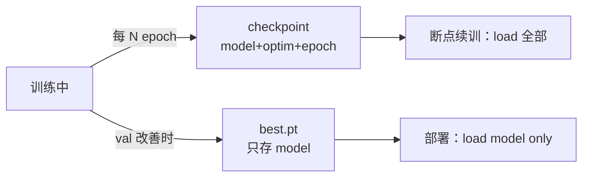

# DL-063 模型保存、加载与 Checkpoint

## 1. 本节学习目标

1. 分清 **`state_dict` 保存**（推荐）与**整模型保存**（不推荐）的区别与体积（本课 2.91 KB vs 4.25 KB）。
2. 会做**完整 checkpoint**（模型 + 优化器 + epoch + 指标），支持断点续训。
3. 理解 `strict=True` 的校验作用，能读懂结构不匹配的报错。
4. 知道跨设备加载（`map_location`）与 `weights_only` 的安全含义。

## 2. 为什么需要这个知识

因为"训练了 10 小时，结果没存下来"是真实事故，而保存方式选错还会带来**隐蔽问题**：

- 存整模型 ⇒ 依赖**代码里的类定义**，重构后加载失败；
- 存 `state_dict` 不存 `optimizer` ⇒ 无法续训（Adam 的 m/v 丢了）；
- 加载不检查 `strict` ⇒ 部分层静默随机初始化。

## 3. 直观解释

| 方式 | 存什么 | 推荐度 |
|---|---|---|
| `state_dict` | 只有权重张量 | ✅ **推荐** |
| 整模型 `torch.save(model)` | 权重 + 类的引用 | ❌ 脆弱 |
| **checkpoint** | 模型 + 优化器 + epoch + 指标 | ✅ 续训必备 |

**一句话**：**存权重（+ 优化器状态），不存对象。**

## 4. 正式定义

**`state_dict`**

$$
\text{sd}=\{(\text{name},\ \theta_{\text{name}})\}
$$

**checkpoint 字典**

```text
{
  "epoch": int,                         # 第几轮
  "model": model.state_dict(),          # 模型权重
  "optimizer": optimizer.state_dict(),  # 优化器状态（Adam 的 m/v）
  "scheduler": scheduler.state_dict(),  # lr 调度进度
  "best_val": float,                    # 最佳验证指标
  "config": dict,                       # 超参/结构，便于复现
}
```

**加载**

$$
\theta\leftarrow\text{sd}\quad(\text{strict=True 时键必须完全匹配})
$$

## 5. 核心原理

**本课实测**

```text
state_dict 大小 KB: 2.91
整模型大小 KB: 4.25
state_dict 加载后输出一致: True
checkpoint 键: ['best_val', 'epoch', 'model', 'optimizer']  epoch: 30  best_val: 0.1523
结构不匹配报错: RuntimeError Error(s) in loading state_dict for Sequential: Missing key(...
```

**读法**：

1. **整模型比 state_dict 大 46%**（4.25 vs 2.91 KB）——多出来的是**类结构与元信息**。
2. `state_dict` 加载后输出**完全一致**（`True`）⇒ 权重完整。
3. checkpoint 里 4 个键齐全 ⇒ 可断点续训。
4. **结构不匹配会直接报错**（`strict=True` 默认）⇒ 这是好事，避免静默错误。

## 6. 数学表达式

**为什么整模型"脆弱"**

$$
\text{torch.save(model)}\ \text{依赖}\ \text{pickle}\ \Rightarrow\ \text{需能 import 类}\ \texttt{Net}
$$

若代码重构（改名/移动文件/删类）⇒ 加载失败。

**`state_dict` 只依赖张量形状**

$$
\text{load}(\text{sd})\ \text{只需目标模型有相同的键与形状}
$$

## 7. 数学推导

**续训的等价性条件**

要从第 $k$ 轮精确续训，必须恢复：

$$
(\theta_k,\ m_k,\ v_k,\ \eta_k,\ \text{epoch}=k)
$$

- $\theta$：模型权重
- $m,v$：Adam 的一阶/二阶矩
- $\eta$：当前学习率（含 scheduler 状态）

**少了 $m,v$** ⇒ Adam 会"重新预热"，loss 曲线出现跳变（DL-028 的偏差修正效应）。

## 8. 结构示意图



## 9. 具体计算示例

```text
state_dict: 2.91 KB
整模型    : 4.25 KB   （大 46%）

checkpoint 键: best_val, epoch, model, optimizer
  epoch=30, best_val=0.1523
```

## 10. Python 实现

```python
import os
import tempfile

import torch
import torch.nn as nn

model = nn.Sequential(nn.Linear(2, 32), nn.ReLU(), nn.Dropout(0.3), nn.Linear(32, 1))
path = os.path.join(tempfile.gettempdir(), "dl063_state_dict.pt")

torch.save(model.state_dict(), path)
print("文件大小 KB:", round(os.path.getsize(path) / 1024, 2))

# 必须先用相同结构实例化，再 load
model2 = nn.Sequential(nn.Linear(2, 32), nn.ReLU(), nn.Dropout(0.3), nn.Linear(32, 1))
model2.load_state_dict(torch.load(path, weights_only=True))
model2.eval()

x = torch.randn(4, 2)
print("输出一致:", bool(torch.allclose(model2(x), model.eval()(x))))
os.remove(path)
```

## 11. PyTorch 实现（完整 checkpoint 与续训）

```python
import os
import tempfile

import torch
import torch.nn as nn
import torch.nn.functional as F

model = nn.Sequential(nn.Linear(2, 32), nn.ReLU(), nn.Linear(32, 1))
opt = torch.optim.Adam(model.parameters(), lr=1e-2)
sched = torch.optim.lr_scheduler.StepLR(opt, step_size=5, gamma=0.5)
path = os.path.join(tempfile.gettempdir(), "dl063_ckpt.pt")

x = torch.randn(32, 2)
y = (x.sum(dim=1) > 0).float().view(-1, 1)

for epoch in range(1, 4):
    opt.zero_grad()
    loss = F.binary_cross_entropy_with_logits(model(x), y)
    loss.backward()
    opt.step()
    sched.step()

torch.save({
    "epoch": 3,
    "model": model.state_dict(),
    "optimizer": opt.state_dict(),
    "scheduler": sched.state_dict(),
    "best_val": float(loss),
    "config": {"hidden": 32, "lr": 1e-2},
}, path)

ckpt = torch.load(path, map_location="cpu", weights_only=False)
print("键:", sorted(ckpt.keys()))

model2 = nn.Sequential(nn.Linear(2, 32), nn.ReLU(), nn.Linear(32, 1))
model2.load_state_dict(ckpt["model"])
opt2 = torch.optim.Adam(model2.parameters(), lr=1e-2)
opt2.load_state_dict(ckpt["optimizer"])
sched2 = torch.optim.lr_scheduler.StepLR(opt2, step_size=5, gamma=0.5)
sched2.load_state_dict(ckpt["scheduler"])

print("恢复 epoch:", ckpt["epoch"])
print("恢复后 lr:", opt2.param_groups[0]["lr"])
print("权重一致:", bool(torch.allclose(model2(x), model(x))))
os.remove(path)
```

## 12. 代码逐行解释

| 代码 | 作用 |
|---|---|
| `torch.save(model.state_dict(), p)` | 只存权重（推荐） |
| `torch.save(model, p)` | 存整对象（脆弱） |
| `weights_only=True` | 只加载张量（**更安全**） |
| `map_location="cpu"` | 跨设备加载（GPU 存的在 CPU 上读） |
| `load_state_dict(..., strict=True)` | 默认严格匹配键 |
| `opt.load_state_dict(...)` | 恢复 Adam 的 m/v |
| `sched.load_state_dict(...)` | 恢复 lr 进度 |

**关键**：加载前必须**先用相同结构实例化模型**，`state_dict` 只是权重。

## 13. 实际运行结果

```text
state_dict 大小 KB: 2.91
整模型大小 KB: 4.25
state_dict 加载后输出一致: True
checkpoint 键: ['best_val', 'epoch', 'model', 'optimizer']  epoch: 30  best_val: 0.1523
结构不匹配报错: RuntimeError Error(s) in loading state_dict for Sequential: Missing key(...
```

## 14. 应用场景

| 场景 | 做法 |
|---|---|
| 部署推理 | 只存 `state_dict` |
| 断点续训 | 完整 checkpoint（含 optim/sched） |
| 多卡训练 | 存 `model.module.state_dict()` |
| 跨设备迁移 | `map_location="cpu"` |
| 版本管理 | 文件名带 epoch/val/时间 |

## 15. 优点与缺点

| 方式 | 优点 | 缺点 |
|---|---|---|
| `state_dict` | 轻、稳、跨代码重构 | 需知道模型结构 |
| 整模型 | 加载省事 | 依赖类定义、体积大、安全性差 |
| checkpoint | 可精确续训 | 体积大（含优化器状态） |

## 16. 常见错误

| 错误 | 现象 | 纠正 |
|---|---|---|
| 只存 model 不存 optim | 续训 loss 跳变 | 存 `optimizer.state_dict()` |
| 加载前不实例化 | 报错/无对象 | 先建同结构模型 |
| `strict=False` 掩盖问题 | 部分层随机初始化 | 用默认 `strict=True` |
| 用整模型部署 | 重构后加载失败 | 改用 `state_dict` |
| 忘 `map_location` | GPU 权重在无 GPU 机器报错 | `map_location="cpu"` |
| `weights_only=False` 加载陌生文件 | 安全风险 | 优先 `True` |

## 17. 本节总结

- **推荐存 `state_dict`**（本课 2.91 KB），整模型 4.25 KB 且依赖类定义。
- **续训要存 checkpoint**：model + optimizer + scheduler + epoch + 指标。
- 加载后输出**完全一致（True）**；结构不匹配会**直接报错**（这是保护机制）。

## 18. 前置与后续

- 前置：[[DL-062 训练、验证、测试循环]]
- 后续：`DL-064 深度学习项目结构与实验管理`（待建，M-DL-08 开篇）
- 相关 Python：[[PY-041 文件读写]]

---

## 练习与参考答案

**基础 1**：`state_dict` 保存与整模型保存有什么区别？为什么推荐前者？

**基础 2**：本课两种保存方式的体积各是多少？checkpoint 有哪些键？

**进阶 1**：只恢复模型权重、不恢复优化器状态，续训会出现什么问题？

**综合**：你在 GPU 上训练并保存了 checkpoint，现在要在没有 GPU 的服务器上做推理。请写出完整的加载代码，并说明两个注意事项。

> [!success]- 参考答案

> **基础 1**
> - `state_dict`：只存**权重张量**（名字→张量），加载时需先用代码定义同结构模型。
> - 整模型：`torch.save(model)` 用 pickle 存**对象本身**，包含类的引用。
> 推荐前者：**不依赖类定义**（重构不易坏）、体积更小（本课 2.91 vs 4.25 KB）、更安全。

> **基础 2**
> `state_dict` **2.91 KB**；整模型 **4.25 KB**（大 46%）。
> checkpoint 键：`best_val, epoch, model, optimizer`（实际项目还会加 `scheduler`、`config`）。

> **进阶 1**
> Adam 的 $m,v$ 会从 0 重新开始 ⇒ 出现"重新预热"效应：初期更新步长异常、loss 曲线跳变，甚至短时间性能回退。
> 对 lr 调度同理：若 scheduler 状态也丢了，lr 会回到初始值。

> **综合（参考）**
> ```python
> import os
> import tempfile
>
> import torch
> import torch.nn as nn
>
> device = torch.device("cpu")
>
> # 先在 GPU 训练并存盘（此处用 CPU 模拟，仅演示加载路径）
> model = nn.Sequential(nn.Linear(2, 32), nn.ReLU(), nn.Linear(32, 1))
> path = os.path.join(tempfile.gettempdir(), "dl063_demo_ckpt.pt")
> torch.save({"epoch": 5, "model": model.state_dict()}, path)
>
> # 目标机器：无 GPU，只需 CPU 加载
> ckpt = torch.load(path, map_location=device, weights_only=False)
> model.load_state_dict(ckpt["model"])
> model.to(device).eval()
>
> with torch.no_grad():
>     out = model(torch.randn(1, 2).to(device))
> print(out)
> os.remove(path)
> ```
> **两个注意事项**：
> 1. **`map_location="cpu"`**：否则会尝试在 GPU 张量上恢复，无 GPU 时直接报错；
> 2. **推理模式**：必须 `eval()`（Dropout/BN 行为），并在 `no_grad()` 下前向。
> 若原 checkpoint 是多卡 `DataParallel` 保存的，键名会带 `module.` 前缀，需要 `strip` 或 `load_state_dict(..., strict=False)` 后**核对缺失键**。

## 学习记录

| 日期 | 状态 | 用时 | 问题 | 复盘 |
|---|---|---|---|---|
| 2026-11-07 | planned | — | — | — |

---

## 🔗 Notion 同步信息

> 以下内容由 Notion「AI Knowledge System · 知识点」数据库按知识 ID 合并而来（导出于 2026-11-09）。

| 属性 | 值 |
|---|---|
| 学科 | 深度学习 |
| 学习状态 | 未开始 |
| 难度 | L2 应用 |
| 知识类型 | Technique |

- **所属模块**：[M-DL-07 PyTorch 深度学习框架实践](../%E8%AF%BE%E7%A8%8B%E6%A8%A1%E5%9D%97/M-DL-07%20PyTorch%20%E6%B7%B1%E5%BA%A6%E5%AD%A6%E4%B9%A0%E6%A1%86%E6%9E%B6%E5%AE%9E%E8%B7%B5.md)
- **前置知识**：[DL-062 训练、验证、测试循环](DL-062%20%E8%AE%AD%E7%BB%83%E3%80%81%E9%AA%8C%E8%AF%81%E3%80%81%E6%B5%8B%E8%AF%95%E5%BE%AA%E7%8E%AF.md)
- **后继知识**：[DL-064 深度学习项目结构与实验管理](../07%20%E5%B7%A5%E7%A8%8B%E4%B8%8E%E9%A1%B9%E7%9B%AE/DL-064%20%E6%B7%B1%E5%BA%A6%E5%AD%A6%E4%B9%A0%E9%A1%B9%E7%9B%AE%E7%BB%93%E6%9E%84%E4%B8%8E%E5%AE%9E%E9%AA%8C%E7%AE%A1%E7%90%86.md)
- **关联Python**：[PY-041 文件读写](../../01_Python%E5%9F%BA%E7%A1%80/05%20%E5%BC%82%E5%B8%B8%E4%B8%8E%E6%96%87%E4%BB%B6/PY-041%20%E6%96%87%E4%BB%B6%E8%AF%BB%E5%86%99.md)
- **对应项目**：[PROJ-016 手写数字分类——全连接基线](../../07_%E5%AE%9E%E6%88%98%E9%A1%B9%E7%9B%AE/04%20%E6%B7%B1%E5%BA%A6%E5%AD%A6%E4%B9%A0%E9%A1%B9%E7%9B%AE/PROJ-016%20%E6%89%8B%E5%86%99%E6%95%B0%E5%AD%97%E5%88%86%E7%B1%BB%E2%80%94%E2%80%94%E5%85%A8%E8%BF%9E%E6%8E%A5%E5%9F%BA%E7%BA%BF.md) · [PROJ-019 迁移学习——小样本分类](../../07_%E5%AE%9E%E6%88%98%E9%A1%B9%E7%9B%AE/04%20%E6%B7%B1%E5%BA%A6%E5%AD%A6%E4%B9%A0%E9%A1%B9%E7%9B%AE/PROJ-019%20%E8%BF%81%E7%A7%BB%E5%AD%A6%E4%B9%A0%E2%80%94%E2%80%94%E5%B0%8F%E6%A0%B7%E6%9C%AC%E5%88%86%E7%B1%BB.md) · [PROJ-020 端到端部署——训练到推理服务](../../07_%E5%AE%9E%E6%88%98%E9%A1%B9%E7%9B%AE/04%20%E6%B7%B1%E5%BA%A6%E5%AD%A6%E4%B9%A0%E9%A1%B9%E7%9B%AE/PROJ-020%20%E7%AB%AF%E5%88%B0%E7%AB%AF%E9%83%A8%E7%BD%B2%E2%80%94%E2%80%94%E8%AE%AD%E7%BB%83%E5%88%B0%E6%8E%A8%E7%90%86%E6%9C%8D%E5%8A%A1.md)
- **被项目引用**：[PROJ-019 迁移学习——小样本分类](../../07_%E5%AE%9E%E6%88%98%E9%A1%B9%E7%9B%AE/04%20%E6%B7%B1%E5%BA%A6%E5%AD%A6%E4%B9%A0%E9%A1%B9%E7%9B%AE/PROJ-019%20%E8%BF%81%E7%A7%BB%E5%AD%A6%E4%B9%A0%E2%80%94%E2%80%94%E5%B0%8F%E6%A0%B7%E6%9C%AC%E5%88%86%E7%B1%BB.md) · [PROJ-020 端到端部署——训练到推理服务](../../07_%E5%AE%9E%E6%88%98%E9%A1%B9%E7%9B%AE/04%20%E6%B7%B1%E5%BA%A6%E5%AD%A6%E4%B9%A0%E9%A1%B9%E7%9B%AE/PROJ-020%20%E7%AB%AF%E5%88%B0%E7%AB%AF%E9%83%A8%E7%BD%B2%E2%80%94%E2%80%94%E8%AE%AD%E7%BB%83%E5%88%B0%E6%8E%A8%E7%90%86%E6%9C%8D%E5%8A%A1.md)
