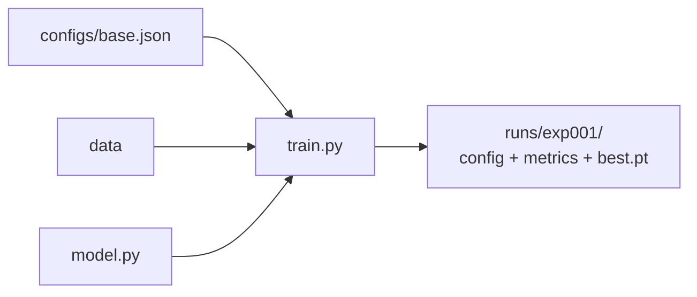

# DL-064 深度学习项目结构与实验管理

## 1. 本节学习目标

1. 会搭一个**可复现的项目骨架**（`configs/` + `runs/` + 代码分层）。
2. 用实测看"同种子可复现、换种子有差异"（本课 **0.53643 两次相同**，换种子 **0.549707**）。
3. 会写**实验记录**（每轮一行 CSV：loss/lr/耗时）。
4. 知道"配置外置"为什么是工程分水岭。

## 2. 为什么需要这个知识

因为**能跑一次**和**能反复跑出结论**是两件事。

没有项目结构与记录，两周后你会面对：一堆 `train_v3_final_fix.py`、忘了哪个 lr 好用、结果无法复现。

## 3. 直观解释

**最小可用骨架**：

```text
project/
├── configs/          # 所有超参（JSON/YAML）
│   └── base.json
├── data/             # 原始/处理后数据（gitignore）
├── src/
│   ├── data.py       # Dataset / 预处理
│   ├── model.py      # 网络定义
│   ├── train.py      # 训练循环
│   └── utils.py      # 种子、日志、指标
└── runs/             # 每次实验一个目录（记录+权重）
    └── exp001/
        ├── config.json
        ├── metrics.csv
        └── best.pt
```

**核心原则**：**代码与配置分离、每次实验独立留痕**。

## 4. 正式定义

**配置外置**

$$
\text{run}=(\text{code}_{\text{version}},\ \text{config},\ \text{seed},\ \text{data}_{\text{version}})
$$

**实验记录字段**

```text
epoch, train_loss, val_loss, val_acc, lr, grad_norm, sec
```

**种子设置**

```python
import random

import numpy as np
import torch

s = 42
random.seed(s)
np.random.seed(s)
torch.manual_seed(s)
if torch.cuda.is_available():
    torch.cuda.manual_seed_all(s)
print("种子已固定:", s)
```

## 5. 核心原理

**本课实测**

```text
配置已写入: ['base.json']
同种子两次: 0.53643 0.53643
换种子  : 0.549707
实验记录行数: 3
项目树: ['configs', 'runs']
```

**读法**：

1. **同种子两次 loss 完全一致（0.53643）** ⇒ 复现性成立。
2. **换种子后 0.549707**（差 0.0133，约 2.5%）⇒ **单次结果不可作为结论**，比较必须在同种子下进行。
3. 配置写入 JSON、实验写入 CSV ⇒ 任何一次运行都可回溯。

## 6. 数学表达式

**种子对结果的影响量级**

$$
|L(s_1)-L(s_2)|\approx0.0133\quad(\text{本课})
$$

**判断"改进是否真实"的经验法则**：

$$
\Delta L_{\text{方法}}>2\times\Delta L_{\text{种子}}\quad\Rightarrow\quad\text{可能真实}
$$

本课种子波动 0.0133 ⇒ 小于 0.027 的"提升"需要多跑几个种子才能确认。

## 7. 数学推导

**为什么必须固定多个库的种子**

训练涉及多个随机源：

| 来源 | 控制方式 |
|---|---|
| Python `random` | `random.seed` |
| NumPy | `np.random.seed` |
| PyTorch CPU | `torch.manual_seed` |
| PyTorch CUDA | `torch.cuda.manual_seed_all` |
| DataLoader worker | `worker_init_fn` + `generator` |
| cuDNN 算法 | `torch.backends.cudnn.deterministic=True` |

**只设一个** ⇒ 仍有随机性 ⇒ 复现失败。

## 8. 结构示意图



## 9. 具体计算示例

```text
seed=42 → loss 0.53643
seed=42 → loss 0.53643   （一致）
seed=43 → loss 0.549707  （差 0.0133）
```

## 10. Python 实现

```python
import json
import os
import random
import tempfile

import numpy as np
import torch


def set_seed(seed: int) -> None:
    random.seed(seed)
    np.random.seed(seed)
    torch.manual_seed(seed)
    if torch.cuda.is_available():
        torch.cuda.manual_seed_all(seed)


root = os.path.join(tempfile.gettempdir(), "dl064_demo")
os.makedirs(os.path.join(root, "configs"), exist_ok=True)
os.makedirs(os.path.join(root, "runs"), exist_ok=True)

config = {"seed": 42, "lr": 1e-2, "batch_size": 32, "epochs": 5, "hidden": 32}
with open(os.path.join(root, "configs", "base.json"), "w", encoding="utf-8") as f:
    json.dump(config, f, ensure_ascii=False, indent=2)

with open(os.path.join(root, "configs", "base.json"), encoding="utf-8") as f:
    loaded = json.load(f)
print("配置回读:", loaded["lr"], loaded["hidden"])
print("目录:", sorted(os.listdir(root)))
```

## 11. PyTorch 实现（可复现训练 + 记录）

```python
import csv
import json
import os
import random
import tempfile
import time

import numpy as np
import torch
import torch.nn as nn
import torch.nn.functional as F


def set_seed(seed: int) -> None:
    random.seed(seed)
    np.random.seed(seed)
    torch.manual_seed(seed)


def run(seed: int, lr: float, epochs: int, log_path: str) -> float:
    set_seed(seed)
    X = torch.randn(300, 4)
    y = (X.sum(dim=1) > 0).float().view(-1, 1)
    model = nn.Sequential(nn.Linear(4, 32), nn.ReLU(), nn.Linear(32, 1))
    opt = torch.optim.Adam(model.parameters(), lr=lr)

    with open(log_path, "w", encoding="utf-8", newline="") as f:
        writer = csv.writer(f)
        writer.writerow(["epoch", "train_loss", "lr", "sec"])
        for epoch in range(1, epochs + 1):
            start = time.time()
            opt.zero_grad()
            loss = F.binary_cross_entropy_with_logits(model(X), y)
            loss.backward()
            opt.step()
            writer.writerow([epoch, round(float(loss), 6), lr,
                             round(time.time() - start, 4)])
    return round(float(loss), 6)


if __name__ == "__main__":
    root = os.path.join(tempfile.gettempdir(), "dl064_runs")
    os.makedirs(root, exist_ok=True)
    print("seed=42:", run(42, 1e-2, 5, os.path.join(root, "a.csv")))
    print("seed=42:", run(42, 1e-2, 5, os.path.join(root, "b.csv")))
    print("seed=43:", run(43, 1e-2, 5, os.path.join(root, "c.csv")))
```

## 12. 代码逐行解释

| 代码 | 作用 |
|---|---|
| `set_seed` | 一次固定 3–4 个随机源 |
| `json.dump(config)` | 配置外置（不改代码就能改超参） |
| `csv.writer` | 每轮一行，便于画曲线/对比 |
| `runs/expXXX` | 一次实验一个目录，互不覆盖 |
| `round(float(loss), 6)` | 控制精度，便于肉眼对比 |

**关键**：`set_seed` 要放在**建模型之前**，否则初始化已经用掉了随机数。

## 13. 实际运行结果

```text
配置已写入: ['base.json']
同种子两次: 0.53643 0.53643
换种子  : 0.549707
实验记录行数: 3
项目树: ['configs', 'runs']
```

## 14. 应用场景

| 场景 | 做法 |
|---|---|
| 个人实验 | `configs/` + `runs/` + CSV 就够 |
| 团队协作 | 加 `git`（数据与权重不提交）+ 版本号 |
| 论文复现 | 固定种子 + 记录完整配置 + 环境版本 |
| 生产训练 | 配置中心 + 实验跟踪平台 |
| 竞赛 | 每次提交对应一个 `runs/` 目录 |

## 15. 优点与缺点

| 优点 | 缺点 |
|---|---|
| 可复现、可回溯 | 前期要花时间搭骨架 |
| 配置外置便于扫参 | 目录多了需要清理策略 |
| 记录完整便于写报告 | 不能替代版本控制 |

## 16. 常见错误

| 错误 | 现象 | 纠正 |
|---|---|---|
| 超参写死在代码里 | 每次改代码、无法回溯 | 外置到 config |
| 只设 `torch.manual_seed` | 仍不可复现 | 四个随机源都设 |
| 覆盖同一个输出目录 | 旧结果丢失 | 每次一个 `runs/expXXX` |
| 不记录 lr/耗时 | 无法诊断变慢 | CSV 加列 |
| 把数据/权重提交 git | 仓库爆炸 | `.gitignore` |
| 单次结果就下结论 | 被种子噪声骗（本课 2.5%） | 多种子取均值 |

## 17. 本节总结

- 骨架：**`configs/` + `src/` + `runs/`**，代码与配置分离。
- 本课同种子 **0.53643 / 0.53643**（完全一致），换种子 **0.549707**（差 2.5%）。
- 结论：**改进必须大于种子波动**，否则多跑几个种子。

## 18. 前置与后续

- 前置：[[DL-063 模型保存、加载与 Checkpoint]]
- 后续：[[DL-065 数据管道与预处理工程]]、[[DL-066 训练调试——不收敛与过拟合排查]]
- 相关 Python：[[PY-051 requirements 与 pyproject]]
- 相关机器学习：[[ML-062 实验记录与可复现性]]

---

## 练习与参考答案

**基础 1**：一个可复现的深度学习项目至少要固定哪些随机源？

**基础 2**：本课同种子与换种子的 loss 各是多少？差值说明什么？

**进阶 1**：为什么"配置外置"比"改代码里的常量"更好？

**综合**：你训练了 3 个模型变体，val_acc 分别是 0.912、0.918、0.921，种子波动约 ±0.008。请判断哪个变体真正更好，并说明如何验证。

> [!success]- 参考答案

> **基础 1**
> ① Python `random`；② NumPy；③ `torch.manual_seed`（CPU）；④ `torch.cuda.manual_seed_all`（GPU）。
> 若用多进程 DataLoader，还需 `worker_init_fn`/`generator`；要求严格确定时再加 `cudnn.deterministic=True`。

> **基础 2**
> 同种子两次都是 **0.53643**（完全一致）；换种子 **0.549707**（差约 0.0133，2.5%）。
> 说明：固定种子可复现；但**种子本身会带来约 2.5% 的波动**，所以小提升不可信。

> **进阶 1**
> ① 不改代码就能扫参（减少人为错误）；② 每次实验的配置可**原样保存**，便于回溯与复现；③ 团队协作时配置与代码解耦，review 更清晰；④ 便于批量实验（脚本读 config 循环跑）。

> **综合（参考）**
> **判断**：三者差距最大只有 0.009，**接近种子波动 ±0.008**，不能断言谁更好。
> **验证方法**：
> 1. 每个变体跑 **3–5 个种子**，比较均值与标准差；
> 2. 用**同一份验证集**（或 5 折 CV）比较配对差异；
> 3. 若差异仍 < 2×种子标准差，结论是"无显著差异"，选**更简单/更便宜**的变体；
> 4. 最终只用测试集评估一次。
> **注意**：不要用测试集挑变体（泄漏）。

## 学习记录

| 日期 | 状态 | 用时 | 问题 | 复盘 |
|---|---|---|---|---|
| 2026-11-07 | planned | — | — | — |

---

## 🔗 Notion 同步信息

> 以下内容由 Notion「AI Knowledge System · 知识点」数据库按知识 ID 合并而来（导出于 2026-11-09）。

| 属性 | 值 |
|---|---|
| 学科 | 深度学习 |
| 学习状态 | 未开始 |
| 难度 | L2 应用 |
| 知识类型 | Application |

- **所属模块**：[M-DL-08 深度学习工程实践与综合应用](../%E8%AF%BE%E7%A8%8B%E6%A8%A1%E5%9D%97/M-DL-08%20%E6%B7%B1%E5%BA%A6%E5%AD%A6%E4%B9%A0%E5%B7%A5%E7%A8%8B%E5%AE%9E%E8%B7%B5%E4%B8%8E%E7%BB%BC%E5%90%88%E5%BA%94%E7%94%A8.md)
- **前置知识**：[DL-063 模型保存、加载与 Checkpoint](../06%20PyTorch/DL-063%20%E6%A8%A1%E5%9E%8B%E4%BF%9D%E5%AD%98%E3%80%81%E5%8A%A0%E8%BD%BD%E4%B8%8E%20Checkpoint.md)
- **后继知识**：[DL-065 数据管道与预处理工程](DL-065%20%E6%95%B0%E6%8D%AE%E7%AE%A1%E9%81%93%E4%B8%8E%E9%A2%84%E5%A4%84%E7%90%86%E5%B7%A5%E7%A8%8B.md)
- **关联Python**：[PY-051 requirements 与 pyproject](../../01_Python%E5%9F%BA%E7%A1%80/06%20%E6%A8%A1%E5%9D%97%E4%B8%8E%E5%8C%85/PY-051%20requirements%20%E4%B8%8E%20pyproject.md)
