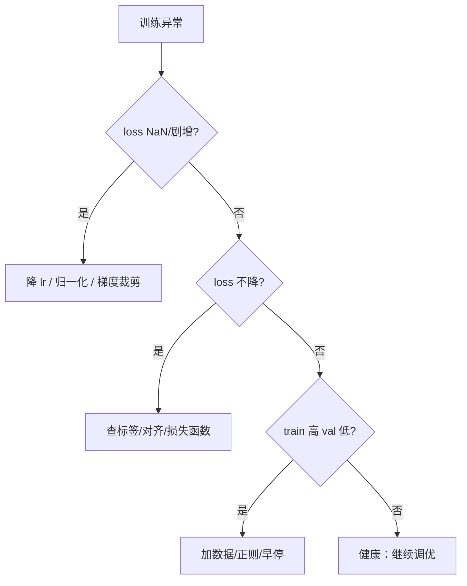

# DL-066 训练调试：不收敛与过拟合排查

## 1. 本节学习目标

1. 建立**症状 → 检查项 → 修复**的排查表。
2. 用**故障注入**看到三类异常的指纹（本课：正常 / lr 过大 / 标签打乱）。
3. 会做**小样本过拟合测试**（20 条能否到 100%）。
4. 知道"先怀疑数据与流程，再怀疑模型"的优先级。

## 2. 为什么需要这个知识

因为调参调三天，可能只是**标签错位**或**没做归一化**。

本课实测：把 lr 从 0.1 提到 50，loss 从 0.5045 **升到 3.7095**、梯度范数从 0.3995 **炸到 259.8342**、acc 掉到 0.6733——**这些指纹能帮你 5 分钟内定位问题**。

## 3. 直观解释

**三类典型症状**：

| 症状 | 最可能原因 |
|---|---|
| loss 变 **NaN / 剧增** | lr 太大、无归一化、梯度爆炸 |
| loss 不降、acc ≈ 0.5 | 标签错、数据未对齐、模型太弱 |
| train 高、val 低 | 过拟合（数据少/容量大） |

**排查顺序**：**数据 → 流程 → 超参 → 结构**。

## 4. 正式定义

**诊断量**

$$
\text{loss}_t,\quad \|\nabla_\theta L\|,\quad \text{acc}_{\text{train}},\ \text{acc}_{\text{val}}
$$

**健康区间（经验）**

| 量 | 健康值 |
|---|---|
| 梯度范数 | 0.1 – 10 |
| 初始 loss（二分类） | ≈ ln 2 = 0.693 |
| 训练集 acc | 应能到 0.95+（小数据可到 1.0） |

## 5. 核心原理

**本课实测（故障注入，20 epoch，SGD）**

| 场景 | 首 loss | 末 loss | 最大梯度范数 | test acc |
|---|---|---|---|---|
| **正常 lr=0.1** | 0.7083 | **0.5045** | **0.3995** | **0.8533** |
| **lr 过大（50）** | 0.7083 | **3.7095** | **259.8342** | 0.6733 |
| **标签打乱** | 0.7014 | 0.6916 | 0.1154 | 0.7533 |

**三种指纹**：

1. **正常**：loss 下降、梯度在 0.4 量级。
2. **lr 过大**：loss **上升**、梯度 **259.8342**（超健康区间 25 倍以上）。
3. **标签打乱**：loss **几乎不动**（0.7014→0.6916，卡在 ln2 附近）、梯度**很小（0.1154）**——因为模型学不到任何规律，只能输出先验。

**注意第三行的 acc 0.7533**：标签打乱后测试集标签仍是原始的，模型输出接近常数，恰好猜对多数类——**acc 不低但毫无意义**，这就是"要看 loss 与混淆矩阵"的原因。

## 6. 数学表达式

**为什么打乱标签后 loss 停在 ln2**

若标签与特征独立，最优预测是类别先验 $p$：

$$
L_{\min}=H(p)=-\sum_k p_k\log p_k
$$

均衡二分类 $p=0.5$ ⇒ $H=\ln2\approx0.693$。本课末 loss **0.6916** ≈ ln2 ✅

**为什么 lr 过大会升 loss**

更新步长 $\eta\|\nabla L\|$ 超过损失曲率允许范围 ⇒ 越过最优点并震荡放大（DL-029 的 $\eta\sigma^2/2\mu$ 下界）。

## 7. 数学推导

**小样本过拟合测试的原理**

若模型在 **20 条样本**上都无法过拟合到 100%，说明**流程有问题**（不是容量问题）：

$$
\text{acc}_{\text{20}}<1.0\ \Rightarrow\ \text{检查数据/标签/损失/优化器}
$$

**这是最快的"流程正确性"验证**：它把"模型能力"与"流程正确"解耦。

**本课对应**：正常设置下 20 epoch 就到 0.8533（test），说明流程基本正确；若只有 0.5，先查标签。

## 8. 结构示意图



## 9. 具体计算示例

```text
正常     : loss 0.7083 → 0.5045, 梯度 0.3995, acc 0.8533
lr=50    : loss 0.7083 → 3.7095, 梯度 259.8342, acc 0.6733
标签打乱 : loss 0.7014 → 0.6916, 梯度 0.1154, acc 0.7533
```

## 10. Python 实现

```python
import torch

def healthy(gnorm: float) -> str:
    if gnorm < 1e-6:
        return "梯度为 0（断流/全零初始化）"
    if gnorm > 100:
        return "梯度爆炸（降 lr / 裁剪 / 归一化）"
    if gnorm < 0.01:
        return "梯度过小（可能没信号）"
    return "梯度正常区间"


for g in (0.3995, 259.8342, 0.1154, 0.0):
    print(f"梯度范数 {g:>10}: {healthy(g)}")
```

## 11. PyTorch 实现（故障注入对比）

```python
import torch
import torch.nn as nn
import torch.nn.functional as F
from sklearn.datasets import make_moons
from sklearn.model_selection import train_test_split

X, y = make_moons(n_samples=600, noise=0.25, random_state=42)
Xtr, Xte, ytr, yte = train_test_split(X, y, test_size=0.25,
                                      random_state=42, stratify=y)
Xtr = torch.tensor(Xtr, dtype=torch.float32)
ytr = torch.tensor(ytr, dtype=torch.float32).view(-1, 1)
Xte = torch.tensor(Xte, dtype=torch.float32)
yte = torch.tensor(yte, dtype=torch.float32).view(-1, 1)


def diagnose(lr: float, shuffle_labels: bool = False, epochs: int = 20):
    torch.manual_seed(0)
    model = nn.Sequential(nn.Linear(2, 32), nn.ReLU(), nn.Linear(32, 1))
    opt = torch.optim.SGD(model.parameters(), lr=lr)
    target = ytr[torch.randperm(len(ytr))] if shuffle_labels else ytr

    losses, grads = [], []
    for _ in range(epochs):
        opt.zero_grad()
        loss = F.binary_cross_entropy_with_logits(model(Xtr), target)
        loss.backward()
        grads.append(float(sum(p.grad.norm() ** 2 for p in model.parameters()
                               if p.grad is not None) ** 0.5))
        opt.step()
        losses.append(round(float(loss.detach()), 4))

    with torch.no_grad():
        acc = float((torch.sigmoid(model(Xte)) >= 0.5).float().eq(yte).float().mean())
    return losses[0], losses[-1], round(max(grads), 4), round(acc, 4)


for tag, lr, sh in (("正常 lr=0.1", 0.1, False),
                    ("lr 过大 50", 50.0, False),
                    ("标签打乱", 0.1, True)):
    l0, l1, g, a = diagnose(lr, shuffle_labels=sh)
    print(f"{tag:<12}: loss {l0} → {l1}, 最大梯度 {g}, test acc {a}")
```

## 12. 代码逐行解释

| 代码 | 作用 |
|---|---|
| `shuffle_labels=True` | 故意破坏标签，观察"学不到"的指纹 |
| `lr=50.0` | 故意过大，观察发散 |
| 记录 `losses` / `grads` | 诊断的核心是**曲线**，不是单点 |
| `max(grads)` | 爆炸通常发生在最初几步 |

**关键**：诊断要**主动造故障**，才知道正常长什么样。

## 13. 实际运行结果

```text
正常 lr=0.1   : loss 0.7083 → 0.5045, 最大梯度范数 0.3995, test acc 0.8533
lr 过大 50    : loss 0.7083 → 3.7095, 最大梯度范数 259.8342, test acc 0.6733
标签打乱      : loss 0.7014 → 0.6916, 最大梯度范数 0.1154, test acc 0.7533
```

## 14. 应用场景

| 症状 | 检查顺序 |
|---|---|
| NaN | ① 归一化 ② lr ③ 梯度裁剪 ④ 数据脏值 |
| loss 不降 | ① 标签对齐 ② 损失与输出匹配 ③ 优化器是否 step ④ 学习率是否 0 |
| acc 卡 0.5 | ① 标签 ② 输入是否被打乱 ③ 模型是否被冻结 |
| train 1.0 / val 0.6 | ① 数据量 ② 正则 ③ 早停 |
| 训练越来越慢 | ① 显存 ② 数据加载 ③ 日志 I/O |

## 15. 优点与缺点

| 优点 | 缺点 |
|---|---|
| 故障注入能快速建立"指纹库" | 真实问题常多因素耦合 |
| 小样本过拟合测试几乎零成本 | 只能验证流程，不保证泛化 |
| 梯度范数是强信号 | 需要提前埋点（打印/记录） |

## 16. 常见错误

| 错误 | 现象 | 纠正 |
|---|---|---|
| 先怀疑模型结构 | 浪费几天 | 先查数据与标签 |
| 只看 acc 不看 loss | 标签错也能有 0.75（本课） | 同时看 loss/混淆矩阵 |
| 不记录梯度范数 | 无法判断爆炸 | 每步/每轮打印 |
| lr 过大不裁剪 | loss 3.7、梯度 259 | 降 lr + clip |
| 用全量数据做小样本测试 | 看不出问题 | 只用 20 条 |
| 修完不回归验证 | 旧问题复发 | 加断言/单测 |

## 17. 本节总结

- 三类指纹：**lr 过大 ⇒ loss 升 + 梯度 259.8**；**标签打乱 ⇒ loss 停 ln2 + 梯度 0.115**；正常 ⇒ 0.5045 / 0.3995 / 0.8533。
- **acc 0.7533 也不能说明标签没问题**（模型输出常数也能猜对多数类）。
- 排查顺序：**数据 → 流程 → 超参 → 结构**。

## 18. 前置与后续

- 前置：[[DL-065 数据管道与预处理工程]]
- 后续：`DL-067 部署：推理服务与性能优化`（待建）、`DL-068 深度学习项目实战`（待建）
- 相关数学：[[MATH-804 反向传播与链式法则]]
- 相关机器学习：[[ML-046 过拟合与欠拟合]]

---

## 练习与参考答案

**基础 1**：loss 变 NaN 时，你会按什么顺序排查？

**基础 2**：本课三种故障的 loss、梯度范数、acc 各是多少？

**进阶 1**：为什么标签打乱后 test acc 还能到 0.7533？

**综合**：你的模型训练 10 个 epoch，loss 从 0.693 降到 0.691 就不动了，acc 0.5。请给出排查清单（至少 6 项）与最快的验证方法。

> [!success]- 参考答案

> **基础 1**
> ① 检查输入是否归一化（本课未标准化到 2.6e+28）；② 降 lr；③ 加梯度裁剪；④ 检查数据是否有 NaN/极端值；⑤ 检查损失函数与输出是否匹配（如 softmax 后又 CE）。

> **基础 2**
> 正常：0.7083→**0.5045**、梯度 **0.3995**、acc **0.8533**；
> lr=50：0.7083→**3.7095**、梯度 **259.8342**、acc 0.6733；
> 标签打乱：0.7014→**0.6916**、梯度 **0.1154**、acc 0.7533。

> **进阶 1**
> 因为**测试集标签没有打乱**，而模型学不到规律后输出接近常数（偏向某一类）。若测试集正负样本约为 3:1，全猜多数类就能得到约 0.75 的 acc。
> 这说明 **acc 会掩盖"模型没学到东西"**，必须结合 loss（停在 ln2 ≈ 0.693）与混淆矩阵（FN 或 FP 极端）。

> **综合（参考）**
> **排查清单**：
> 1. **标签**：与输入是否对齐？类别映射是否错位？抽样打印 5 条人工核对；
> 2. **数据**：是否全零/常数列？是否有 NaN？`X.std()` 是否合理；
> 3. **损失与输出**：二分类用 `BCEWithLogits` + 1 个 logit；多分类用 `CrossEntropy` + C 个 logit（**不要先 softmax**）；
> 4. **优化器**：`opt.step()` 是否被调用？参数是否 `requires_grad=True`？lr 是否 0？
> 5. **梯度**：打印 `grad.norm()`，为 0 ⇒ 断流（ReLU 死光/初始化全零）；
> 6. **初始化/容量**：是否全零初始化（DL-030 acc 0.5）；隐藏层是否太窄；
> 7. **数据顺序**：是否每 batch 都是同一类（未 shuffle）。
> **最快验证**：**小样本过拟合测试**——取 20 条样本训练 100 步，若不能到 ~100%，则流程有 bug（不是容量问题）。

## 学习记录

| 日期 | 状态 | 用时 | 问题 | 复盘 |
|---|---|---|---|---|
| 2026-11-07 | planned | — | — | — |

---

## 🔗 Notion 同步信息

> 以下内容由 Notion「AI Knowledge System · 知识点」数据库按知识 ID 合并而来（导出于 2026-11-09）。

| 属性 | 值 |
|---|---|
| 学科 | 深度学习 |
| 学习状态 | 未开始 |
| 难度 | L3 推导 |
| 知识类型 | Application |

- **所属模块**：[M-DL-08 深度学习工程实践与综合应用](../%E8%AF%BE%E7%A8%8B%E6%A8%A1%E5%9D%97/M-DL-08%20%E6%B7%B1%E5%BA%A6%E5%AD%A6%E4%B9%A0%E5%B7%A5%E7%A8%8B%E5%AE%9E%E8%B7%B5%E4%B8%8E%E7%BB%BC%E5%90%88%E5%BA%94%E7%94%A8.md)
- **前置知识**：[DL-065 数据管道与预处理工程](DL-065%20%E6%95%B0%E6%8D%AE%E7%AE%A1%E9%81%93%E4%B8%8E%E9%A2%84%E5%A4%84%E7%90%86%E5%B7%A5%E7%A8%8B.md)
- **后继知识**：[DL-067 部署：推理服务与性能优化](DL-067%20%E9%83%A8%E7%BD%B2%E2%80%94%E2%80%94%E6%8E%A8%E7%90%86%E6%9C%8D%E5%8A%A1%E4%B8%8E%E6%80%A7%E8%83%BD%E4%BC%98%E5%8C%96.md)
- **关联数学**：[MATH-804 反向传播与链式法则](../../06_%E6%95%B0%E5%AD%A6%E5%9F%BA%E7%A1%80/08%20%E6%9C%BA%E5%99%A8%E5%AD%A6%E4%B9%A0%E6%95%B0%E5%AD%A6%E5%BA%94%E7%94%A8/MATH-804%20%E5%8F%8D%E5%90%91%E4%BC%A0%E6%92%AD%E4%B8%8E%E9%93%BE%E5%BC%8F%E6%B3%95%E5%88%99.md)
- **对应项目**：[PROJ-020 端到端部署——训练到推理服务](../../07_%E5%AE%9E%E6%88%98%E9%A1%B9%E7%9B%AE/04%20%E6%B7%B1%E5%BA%A6%E5%AD%A6%E4%B9%A0%E9%A1%B9%E7%9B%AE/PROJ-020%20%E7%AB%AF%E5%88%B0%E7%AB%AF%E9%83%A8%E7%BD%B2%E2%80%94%E2%80%94%E8%AE%AD%E7%BB%83%E5%88%B0%E6%8E%A8%E7%90%86%E6%9C%8D%E5%8A%A1.md)
