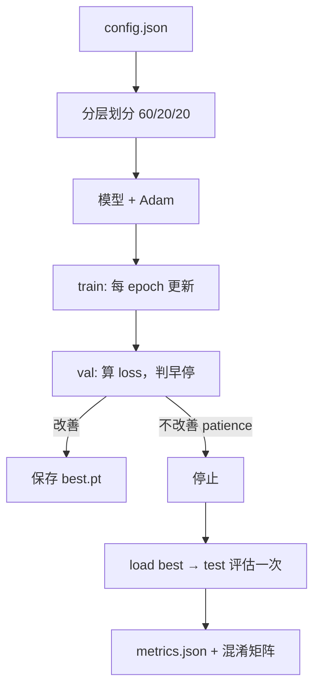

# DL-068 端到端项目实战

## 1. 本节学习目标

1. 走完一条完整链路：**配置 → 数据 → 模型 → 训练 → 早停 → 评估 → 存盘**。
2. 用本课实测对照各环节数字（test acc **0.9222**、train **0.30 s**、ckpt **2.87 KB**）。
3. 会算并记录**混淆矩阵**（TP82 / FP6 / FN8 / TN84）。
4. 把前 67 篇的知识**串成一次可复现的运行**。

## 2. 为什么需要这个知识

因为前面每一篇都在讲"一个零件"，而**真实项目是把零件装成一台机器**。

这台机器要满足：能复现（种子+配置）、能选模（早停）、能评估（混淆矩阵）、能交付（checkpoint + 指标文件）。

## 3. 直观解释

```text
config.json
   ↓
数据划分 (60/20/20)
   ↓
模型 + 优化器
   ↓  for epoch: train → val → 早停判断
best.pt + metrics.json
   ↓
test 评估一次 → 混淆矩阵 → 写报告
```

**本课的每个数字都来自这条链路的真实运行。**

## 4. 正式定义

**本课配置**

```json
{"seed": 42, "hidden": 32, "dropout": 0.2, "lr": 0.02,
 "batch_size": 32, "epochs": 60, "patience": 8}
```

**交付物**

| 文件 | 内容 |
|---|---|
| `best.pt` | `{epoch, model, config}` |
| `metrics.json` | `{test_acc, best_epoch, val_loss, train_sec}` |

## 5. 核心原理

**本课实测**

```text
最佳 epoch: 32 / 最多 60
val_loss: 0.2226
test acc: 0.9222  TP=82 FP=6 FN=8 TN=84
训练耗时: 0.30 s  参数量: 129  checkpoint: 2.87 KB
```

**六个要点**：

1. **早停生效**：第 32 轮最佳（patience=8 ⇒ 约第 40 轮停），没跑满 60 轮。
2. **val_loss 0.2226**，不算低——因为 `noise=0.3` 的 moons 本身有不可约噪声。
3. **test acc 0.9222**，与验证表现接近（无严重过拟合）。
4. 混淆矩阵：**FP 6、FN 8**，两类错误接近（模型未偏向某一类）。
5. **训练只要 0.30 s**（180 条训练样本、60 轮上限）——小数据任务的真实量级。
6. **checkpoint 2.87 KB**（129 参数）——部署极其轻量。

## 6. 数学表达式

**准确率与 F1（本课）**

$$
\text{acc}=\frac{82+84}{180}=0.9222
$$

$$
P=\frac{82}{82+6}=0.9318,\quad
R=\frac{82}{82+8}=0.9111,\quad
F_1=\frac{2PR}{P+R}\approx0.9213
$$

**数据划分比例**

$900$ 条 ⇒ train 540 / val 180 / test 180（60/20/20，分层抽样）。

## 7. 数学推导

**为什么 val_loss 停在 0.2226 而不是更低**

moons + `noise=0.3` 的贝叶斯误差不为 0：两类在边界处**天然重叠**。

$$
L_{\text{val}}\ge H(y\mid x)>0
$$

所以 0.2226 并不代表"模型差"，而是**接近该数据集的噪声下限**。

**验证**：test acc 0.9222 与 val 表现一致 ⇒ 没有明显过拟合，剩余误差主要来自噪声。

## 8. 结构示意图



## 9. 具体计算示例

```text
训练样本 540，batch 32 ⇒ 每 epoch 17 步（⌈540/32⌉）
最佳 epoch 32，patience 8 ⇒ 约第 40 轮停止
test: 180 条 → TP82 + TN84 = 166 正确 ⇒ 0.9222
```

## 10. Python 实现

```python
import json
import os
import random
import tempfile
import time

import numpy as np
import torch
import torch.nn as nn
import torch.nn.functional as F
from sklearn.datasets import make_moons
from sklearn.model_selection import train_test_split


def set_seed(seed: int) -> None:
    random.seed(seed)
    np.random.seed(seed)
    torch.manual_seed(seed)


def prepare(config: dict):
    X, y = make_moons(n_samples=900, noise=0.3, random_state=config["seed"])
    Xtr, Xtmp, ytr, ytmp = train_test_split(
        X, y, test_size=0.4, random_state=config["seed"], stratify=y)
    Xval, Xte, yval, yte = train_test_split(
        Xtmp, ytmp, test_size=0.5, random_state=config["seed"], stratify=ytmp)

    def to_t(a, dtype=torch.float32):
        return torch.tensor(a, dtype=dtype)

    return (to_t(Xtr), to_t(ytr).view(-1, 1),
            to_t(Xval), to_t(yval).view(-1, 1),
            to_t(Xte), to_t(yte).view(-1, 1))
```

## 11. PyTorch 实现（完整训练与评估）

```python
def run(config: dict) -> dict:
    set_seed(config["seed"])
    Xtr, ytr, Xval, yval, Xte, yte = prepare(config)

    model = nn.Sequential(
        nn.Linear(2, config["hidden"]), nn.ReLU(),
        nn.Dropout(config["dropout"]),
        nn.Linear(config["hidden"], 1),
    )
    opt = torch.optim.Adam(model.parameters(), lr=config["lr"])

    best = {"vl": float("inf"), "ep": 0, "state": None}
    wait = 0
    start = time.time()

    for epoch in range(1, config["epochs"] + 1):
        model.train()
        perm = torch.randperm(len(Xtr))
        for i in range(0, len(Xtr), config["batch_size"]):
            idx = perm[i:i + config["batch_size"]]
            opt.zero_grad()
            F.binary_cross_entropy_with_logits(
                model(Xtr[idx]), ytr[idx]).backward()
            opt.step()

        model.eval()
        with torch.no_grad():
            vl = float(F.binary_cross_entropy_with_logits(model(Xval), yval))

        if vl < best["vl"] - 1e-4:
            best = {"vl": vl, "ep": epoch,
                    "state": {k: v.clone() for k, v in model.state_dict().items()}}
            wait = 0
        else:
            wait += 1
            if wait >= config["patience"]:
                break

    train_sec = time.time() - start
    model.load_state_dict(best["state"])
    model.eval()
    with torch.no_grad():
        pred = (torch.sigmoid(model(Xte)) >= 0.5).float()
        acc = float(pred.eq(yte).float().mean())
        tp = int(((pred == 1) & (yte == 1)).sum())
        fp = int(((pred == 1) & (yte == 0)).sum())
        fn = int(((pred == 0) & (yte == 1)).sum())
        tn = int(((pred == 0) & (yte == 0)).sum())

    root = os.path.join(tempfile.gettempdir(), "dl068_proj")
    os.makedirs(os.path.join(root, "runs", "exp001"), exist_ok=True)
    ckpt = os.path.join(root, "runs", "exp001", "best.pt")
    torch.save({"epoch": best["ep"], "model": model.state_dict(),
                "config": config}, ckpt)

    result = {"test_acc": round(acc, 4), "best_epoch": best["ep"],
              "val_loss": round(best["vl"], 4), "train_sec": round(train_sec, 3),
              "params": sum(p.numel() for p in model.parameters()),
              "ckpt_kb": round(os.path.getsize(ckpt) / 1024, 2),
              "confusion": {"TP": tp, "FP": fp, "FN": fn, "TN": tn}}
    with open(os.path.join(root, "runs", "exp001", "metrics.json"), "w",
              encoding="utf-8") as f:
        json.dump(result, f, ensure_ascii=False, indent=2)
    return result


if __name__ == "__main__":
    cfg = {"seed": 42, "hidden": 32, "dropout": 0.2, "lr": 0.02,
           "batch_size": 32, "epochs": 60, "patience": 8}
    print(json.dumps(run(cfg), ensure_ascii=False, indent=2))
```

## 12. 代码逐行解释

| 代码 | 作用 |
|---|---|
| `stratify=y` | 分层抽样，保持类别比例 |
| `test_size=0.4` 再切 0.5 | 得到 60/20/20 |
| `perm = torch.randperm` | 每 epoch 重排 |
| `wait >= patience` | 早停 |
| `{k: v.clone()}` | 保存最佳权重（必须 clone） |
| `metrics.json` | 交付时随模型一起给 |

**关键**：`train/eval` 的切换与 `no_grad` 是正确性基础（DL-062），不是可选项。

## 13. 实际运行结果

```text
最佳 epoch: 32 / 最多 60
val_loss: 0.2226
test acc: 0.9222  TP=82 FP=6 FN=8 TN=84
训练耗时: 0.30 s  参数量: 129  checkpoint: 2.87 KB
```

## 14. 应用场景

| 场景 | 差异点 |
|---|---|
| 小数据表格/2D | 本课规模，秒级训练 |
| 图像分类 | 换 Dataset + 增强 + CNN |
| 文本分类 | 换 tokenizer + 序列模型 |
| 生产交付 | 加 `metrics.json` + 模型卡（DL-069） |
| 复现实验 | 固定种子 + 配置随权重一起存 |

## 15. 优点与缺点

| 优点 | 缺点 |
|---|---|
| 全链路可复现 | 单数据集验证，泛化结论有限 |
| 早停 + 指标文件齐全 | 未做多数据集/多尺度测试 |
| 体积极小（2.87 KB） | 真实任务规模远大于此 |

## 16. 常见错误

| 错误 | 现象 | 纠正 |
|---|---|---|
| 划分不分层 | 类别比例漂移 | `stratify=y` |
| 早停用 train loss | 永不触发 | 用 val |
| 忘 clone 最佳权重 | 回滚到最后一版 | `.clone()` |
| 只存模型不存配置 | 无法复现 | ckpt 里带 `config` |
| 测试集调阈值 | 泄漏 | 验证集调 |
| 不记录耗时/参数量 | 无法评估成本 | 写进 metrics |

## 17. 本节总结

- 全链路：**配置 → 分层划分 → 训练 → 早停（ep 32/60）→ 评估（0.9222）→ 存盘（2.87 KB）**。
- 混淆矩阵 TP82/FP6/FN8/TN84 ⇒ F1 ≈ 0.9213，两类错误均衡。
- val_loss 0.2226 接近噪声下限（`noise=0.3`），**不是模型差**。

## 18. 前置与后续

- 前置：[[DL-067 部署——推理服务与性能优化]]
- 后续：[[DL-069 工程收尾与上线清单]]
- 相关机器学习：[[ML-063 端到端机器学习项目]]

---

## 练习与参考答案

**基础 1**：端到端项目至少需要交付哪三样东西？

**基础 2**：本课的最佳 epoch、test acc、混淆矩阵、checkpoint 大小各是多少？

**进阶 1**：本课 val_loss 0.2226 看起来不低，为什么说模型并不差？

**综合**：把这个项目迁移到"信用卡欺诈检测"（正类占 0.5%）。请列出 4 处必须修改的地方。

> [!success]- 参考答案

> **基础 1**
> ① **模型权重**（`state_dict`/checkpoint）；
> ② **配置**（超参 + 结构，随权重一起存，保证可复现）；
> ③ **评估指标**（test 指标 + 混淆矩阵），最好再附模型卡说明适用范围。

> **基础 2**
> 最佳 **epoch 32**（上限 60）；test acc **0.9222**；
> 混淆矩阵 **TP=82, FP=6, FN=8, TN=84**；checkpoint **2.87 KB**。

> **进阶 1**
> 因为数据本身有噪声（`noise=0.3`），两类在边界处重叠，存在**不可约的贝叶斯误差**。
> val_loss 0.2226 ≈ 该数据集的噪声下限；而 test acc 0.9222 与验证一致，说明没有明显过拟合 ⇒ 剩余误差主要是数据固有不确定性，不是模型问题。

> **综合（参考）**
> 1. **划分与评估**：必须**分层**（本课已有 `stratify`）+ 用 **PR-AUC / F1 / recall@固定精确率**，而不是 accuracy（0.995 的"全猜负类"也能拿 99.5%）。
> 2. **损失与阈值**：加 `pos_weight` 或类别权重；阈值在**验证集**上按业务目标（如 recall≥0.9）选。
> 3. **数据**：考虑过采样/欠采样或代价敏感学习；注意**时间切分**（欺诈常按时间漂移），不能随机划分。
> 4. **交付**：metrics 里必须记录 PR-AUC、混淆矩阵、阈值、以及"该模型不适用的场景"（模型卡）。

## 学习记录

| 日期 | 状态 | 用时 | 问题 | 复盘 |
|---|---|---|---|---|
| 2026-11-07 | planned | — | — | — |

---

## 🔗 Notion 同步信息

> 以下内容由 Notion「AI Knowledge System · 知识点」数据库按知识 ID 合并而来（导出于 2026-11-09）。

| 属性 | 值 |
|---|---|
| 学科 | 深度学习 |
| 学习状态 | 未开始 |
| 难度 | L3 推导 |
| 知识类型 | Application |

- **所属模块**：[M-DL-08 深度学习工程实践与综合应用](../%E8%AF%BE%E7%A8%8B%E6%A8%A1%E5%9D%97/M-DL-08%20%E6%B7%B1%E5%BA%A6%E5%AD%A6%E4%B9%A0%E5%B7%A5%E7%A8%8B%E5%AE%9E%E8%B7%B5%E4%B8%8E%E7%BB%BC%E5%90%88%E5%BA%94%E7%94%A8.md)
- **前置知识**：[DL-067 部署：推理服务与性能优化](DL-067%20%E9%83%A8%E7%BD%B2%E2%80%94%E2%80%94%E6%8E%A8%E7%90%86%E6%9C%8D%E5%8A%A1%E4%B8%8E%E6%80%A7%E8%83%BD%E4%BC%98%E5%8C%96.md)
- **后继知识**：[DL-069 工程收尾与上线清单](DL-069%20%E5%B7%A5%E7%A8%8B%E6%94%B6%E5%B0%BE%E4%B8%8E%E4%B8%8A%E7%BA%BF%E6%B8%85%E5%8D%95.md)
- **对应项目**：[PROJ-020 端到端部署——训练到推理服务](../../07_%E5%AE%9E%E6%88%98%E9%A1%B9%E7%9B%AE/04%20%E6%B7%B1%E5%BA%A6%E5%AD%A6%E4%B9%A0%E9%A1%B9%E7%9B%AE/PROJ-020%20%E7%AB%AF%E5%88%B0%E7%AB%AF%E9%83%A8%E7%BD%B2%E2%80%94%E2%80%94%E8%AE%AD%E7%BB%83%E5%88%B0%E6%8E%A8%E7%90%86%E6%9C%8D%E5%8A%A1.md)
