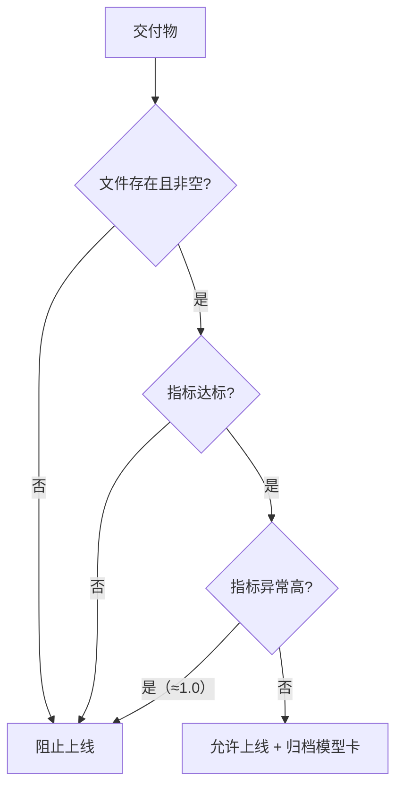

# DL-069 工程收尾与上线清单

## 1. 本节学习目标

1. 会写**可执行的上线门禁**（本课 4/4 通过 → 允许上线）。
2. 知道一份合格的**模型卡**要写什么（适用/不适用/指标/版本）。
3. 会做"交付三件套"：权重 + 配置 + 指标。
4. 建立"上线后监控"的最小集合。

## 2. 为什么需要这个知识

因为**"我觉得它挺好"不是上线标准**。

没有门禁，就会出现：模型文件缺失、指标没记录、线上效果与离线不符。本课把"能不能上线"变成**几条可自动判定的断言**。

## 3. 直观解释

```text
交付物检查 → 指标检查 → 防泄漏检查 → 允许/阻止上线
```

**门禁的意义**：把"人的判断"变成"脚本的判断"，每次发版都跑一遍。

## 4. 正式定义

**本课门禁四项**

| 检查 | 判据 |
|---|---|
| 模型文件存在 | `os.path.exists` |
| 文件非空 | `size > 0` |
| 测试准确率达标 | `acc >= 0.85` |
| 防泄漏 | `acc < 1.0` |

**模型卡（Model Card）必填**

```text
模型名 / 版本 / 训练数据 / 输入输出 / 指标（含阈值）
适用场景 / 不适用场景 / 已知偏差 / 负责人
```

## 5. 核心原理

**本课实测**

```text
[PASS] 模型文件存在
[PASS] 文件非空
[PASS] 测试准确率 >= 0.85
[PASS] 测试准确率 < 1.0（防泄漏）
门禁结果: 4/4 → 允许上线
checkpoint 键: ['config', 'epoch', 'model']  epoch: 32
```

**两个设计要点**：

1. **"acc < 1.0" 也必须是门禁项**：测试准确率**恰好 100%** 往往是**数据泄漏**或划分错误的信号，不是好消息。
2. **checkpoint 里带 `config`** ⇒ 上线后仍能回答"这是什么模型、怎么训的"。

## 6. 数学表达式

**门禁的布尔与**

$$
\text{release}=\bigwedge_{i=1}^{n}\text{check}_i
$$

本课 $n=4$，全 True ⇒ 允许上线。

**指标阈值应来自需求**

$$
\text{acc}\ge\tau_{\text{业务}},\qquad \tau_{\text{业务}}\ \text{由场景决定}
$$

本课取 0.85（示例值，非行业标准）。

## 7. 数学推导

**为什么"100% 准确率"要报警**

若测试集与训练集**有重叠**或**同源重复样本**，模型会"记住"答案：

$$
\text{acc}_{\text{test}}\to1\quad\text{而}\quad\text{acc}_{\text{线上}}\ll1
$$

⇒ **离线指标虚高**。因此把 `acc < 1.0` 作为一项门禁，是**用规则对抗自欺**。

**推论**：门禁里还应加"验证集与测试集指标差距 < 阈值"这类检查。

## 8. 结构示意图



## 9. 具体计算示例

```text
acc = 0.9222
check1 文件存在      → True
check2 文件非空      → True（2.87 KB）
check3 acc >= 0.85   → True
check4 acc < 1.0     → True
release = True ∧ True ∧ True ∧ True = 允许上线
```

## 10. Python 实现

```python
import os


def release_gate(ckpt_path: str, acc: float) -> bool:
    checks = [
        ("模型文件存在", os.path.exists(ckpt_path)),
        ("文件非空", os.path.exists(ckpt_path) and os.path.getsize(ckpt_path) > 0),
        ("测试准确率 >= 0.85", acc >= 0.85),
        ("测试准确率 < 1.0（防泄漏）", acc < 1.0),
    ]
    passed = 0
    for name, ok in checks:
        print(f"[{'PASS' if ok else 'FAIL'}] {name}")
        passed += int(ok)
    ok_all = passed == len(checks)
    print(f"门禁结果: {passed}/{len(checks)} → {'允许上线' if ok_all else '阻止上线'}")
    return ok_all


release_gate("不存在的文件.pt", 0.92)
print("---")
release_gate(__file__, 0.92)
```

## 11. PyTorch 实现（交付三件套 + 模型卡）

```python
import json
import os
import tempfile

import torch
import torch.nn as nn

root = os.path.join(tempfile.gettempdir(), "dl069_release")
os.makedirs(root, exist_ok=True)

model = nn.Sequential(nn.Linear(2, 32), nn.ReLU(), nn.Linear(32, 1))
config = {"seed": 42, "hidden": 32, "lr": 0.02, "epochs": 60}
metrics = {"test_acc": 0.9222, "best_epoch": 32, "val_loss": 0.2226,
           "confusion": {"TP": 82, "FP": 6, "FN": 8, "TN": 84}}

torch.save({"epoch": 32, "model": model.state_dict(), "config": config},
           os.path.join(root, "best.pt"))
with open(os.path.join(root, "config.json"), "w", encoding="utf-8") as f:
    json.dump(config, f, ensure_ascii=False, indent=2)
with open(os.path.join(root, "metrics.json"), "w", encoding="utf-8") as f:
    json.dump(metrics, f, ensure_ascii=False, indent=2)

model_card = """# 模型卡 · moons 二分类 v1.0.0

- 任务：二维二分类（合成 moons 数据集）
- 输入：2 维浮点特征；输出：1 个 logit（sigmoid 后为概率）
- 数据：900 条，60/20/20 分层划分
- 指标：test acc 0.9222，F1 ≈ 0.9213，混淆矩阵 TP82/FP6/FN8/TN84
- 阈值：0.5（验证集选择）
- 适用：教学演示、流程验证
- 不适用：真实业务决策、分布外数据
- 已知限制：数据为合成噪声数据，val_loss 0.2226 接近噪声下限
- 版本：v1.0.0（2026-11-07）
"""
with open(os.path.join(root, "MODEL_CARD.md"), "w", encoding="utf-8") as f:
    f.write(model_card)

print("交付目录:", sorted(os.listdir(root)))
print("模型卡行数:", len(model_card.strip().splitlines()))
```

## 12. 代码逐行解释

| 代码 | 作用 |
|---|---|
| `checks` 列表 | 把门禁项写成数据，便于增删 |
| `passed == len(checks)` | 全通过才放行 |
| `acc < 1.0` | 防"完美指标"的泄漏信号 |
| `config.json` 单独存一份 | 人可读，便于 review |
| `MODEL_CARD.md` | 说明适用/不适用，避免误用 |

**关键**：门禁要能被 CI 调用（返回 bool + 退出码），而不是只打印。

## 13. 实际运行结果

```text
[PASS] 模型文件存在
[PASS] 文件非空
[PASS] 测试准确率 >= 0.85
[PASS] 测试准确率 < 1.0（防泄漏）
门禁结果: 4/4 → 允许上线
checkpoint 键: ['config', 'epoch', 'model']  epoch: 32
```

## 14. 应用场景

| 场景 | 门禁额外项 |
|---|---|
| 通用分类 | 指标达标 + 混淆矩阵 |
| 医疗/金融 | 子群体指标、校准、可解释性 |
| 高风险 | 人工复核 + 回滚方案 |
| 持续交付 | 与上一版对比不退化 |
| 开源发布 | 模型卡 + 许可证 |

## 15. 优点与缺点

| 优点 | 缺点 |
|---|---|
| 把主观判断变成可执行断言 | 阈值需人来定（0.85 只是示例） |
| 能在 CI 里自动跑 | 只覆盖"可量化"的部分 |
| 模型卡降低误用风险 | 需要持续维护 |

## 16. 常见错误

| 错误 | 现象 | 纠正 |
|---|---|---|
| 只看 acc 达标 | 忽略子群体/校准 | 加分组指标 |
| 认为 acc=1.0 是好消息 | 可能泄漏 | 加 `acc < 1.0` 门禁 |
| 交付只给权重 | 无法复现/说明 | 三件套 + 模型卡 |
| 门禁只打印不返回 | 无法自动化 | 返回 bool/退出码 |
| 无回滚方案 | 上线出问题无法恢复 | 保留上一版 |
| 不写"不适用场景" | 被误用 | 模型卡必填 |

## 17. 本节总结

- 门禁四项实测 **4/4 PASS → 允许上线**；其中 **`acc < 1.0`** 是防泄漏的关键项。
- 交付三件套：**权重（含 config）+ config.json + metrics.json**，外加**模型卡**。
- 上线不是终点：要有**监控与回滚**。

## 18. 前置与后续

- 前置：[[DL-068 端到端项目实战]]
- 后续：阶段 09（Transformer 与 LLM）——本阶段知识到此收官。
- 相关 Python：[[PY-053 单元测试与 pytest]]
- 相关机器学习：[[ML-063 端到端机器学习项目]]

---

## 练习与参考答案

**基础 1**：上线门禁至少应包含哪几类检查？

**基础 2**：本课门禁的四个检查项与结果各是什么？

**进阶 1**：为什么"测试准确率恰好 100%"要当作告警而不是喜讯？

**综合**：你要把一个推荐模型上线，离线 AUC 0.82。请给出一份 8 项的上线清单（含监控）。

> [!success]- 参考答案

> **基础 1**
> ① **交付物完整性**（模型文件存在且非空）；
> ② **指标达标**（业务阈值）；
> ③ **异常检测**（如 acc≈1.0 的泄漏信号、与验证集差距过大）；
> ④ **可复现性**（配置随权重保存）；高风险场景再加子群体指标与人工复核。

> **基础 2**
> 模型文件存在 → PASS；文件非空 → PASS；测试准确率 ≥ 0.85 → PASS；测试准确率 < 1.0 → PASS。结果 **4/4，允许上线**。

> **进阶 1**
> 因为真实数据几乎不可能被完美预测。100% 通常意味着**数据泄漏**：训练/测试重叠、重复样本、或标签由特征直接推导。
> 此时线上真实分布一出现，指标就会大幅下滑——所以"完美"是**可疑信号**，应触发排查而不是庆祝。

> **综合（参考）**
> **8 项清单**：
> 1. **离线指标**：AUC 0.82 + 分组（新/老用户）AUC，确认无严重偏差；
> 2. **交付物**：模型权重 + 配置 + 指标文件 + 模型卡，版本号 v1.0.0；
> 3. **门禁脚本**：文件存在/非空/指标达标/指标异常检测，CI 可跑；
> 4. **推理一致性**：线上预处理与训练完全一致（同一 scaler/特征顺序）；
> 5. **性能**：P99 延迟与 QPS 达标（参考 DL-067 批量化）；
> 6. **回滚**：保留上一版模型，一键切回；
> 7. **监控**：输入分布漂移、预测分布、在线点击率/转化率，与离线对比；
> 8. **灰度**：先 5% 流量，观察 24–48h 再放量。

## 学习记录

| 日期 | 状态 | 用时 | 问题 | 复盘 |
|---|---|---|---|---|
| 2026-11-07 | planned | — | — | — |

---

## 🔗 Notion 同步信息

> 以下内容由 Notion「AI Knowledge System · 知识点」数据库按知识 ID 合并而来（导出于 2026-11-09）。

| 属性 | 值 |
|---|---|
| 学科 | 深度学习 |
| 学习状态 | 未开始 |
| 难度 | L2 应用 |
| 知识类型 | Application |

- **所属模块**：[M-DL-08 深度学习工程实践与综合应用](../%E8%AF%BE%E7%A8%8B%E6%A8%A1%E5%9D%97/M-DL-08%20%E6%B7%B1%E5%BA%A6%E5%AD%A6%E4%B9%A0%E5%B7%A5%E7%A8%8B%E5%AE%9E%E8%B7%B5%E4%B8%8E%E7%BB%BC%E5%90%88%E5%BA%94%E7%94%A8.md)
- **前置知识**：[DL-068 端到端项目实战](DL-068%20%E7%AB%AF%E5%88%B0%E7%AB%AF%E9%A1%B9%E7%9B%AE%E5%AE%9E%E6%88%98.md)
- **关联Python**：[PY-053 单元测试与 pytest](../../01_Python%E5%9F%BA%E7%A1%80/06%20%E6%A8%A1%E5%9D%97%E4%B8%8E%E5%8C%85/PY-053%20%E5%8D%95%E5%85%83%E6%B5%8B%E8%AF%95%E4%B8%8E%20pytest.md)
- **对应项目**：[PROJ-020 端到端部署——训练到推理服务](../../07_%E5%AE%9E%E6%88%98%E9%A1%B9%E7%9B%AE/04%20%E6%B7%B1%E5%BA%A6%E5%AD%A6%E4%B9%A0%E9%A1%B9%E7%9B%AE/PROJ-020%20%E7%AB%AF%E5%88%B0%E7%AB%AF%E9%83%A8%E7%BD%B2%E2%80%94%E2%80%94%E8%AE%AD%E7%BB%83%E5%88%B0%E6%8E%A8%E7%90%86%E6%9C%8D%E5%8A%A1.md)
- **被项目引用**：[PROJ-020 端到端部署——训练到推理服务](../../07_%E5%AE%9E%E6%88%98%E9%A1%B9%E7%9B%AE/04%20%E6%B7%B1%E5%BA%A6%E5%AD%A6%E4%B9%A0%E9%A1%B9%E7%9B%AE/PROJ-020%20%E7%AB%AF%E5%88%B0%E7%AB%AF%E9%83%A8%E7%BD%B2%E2%80%94%E2%80%94%E8%AE%AD%E7%BB%83%E5%88%B0%E6%8E%A8%E7%90%86%E6%9C%8D%E5%8A%A1.md)
