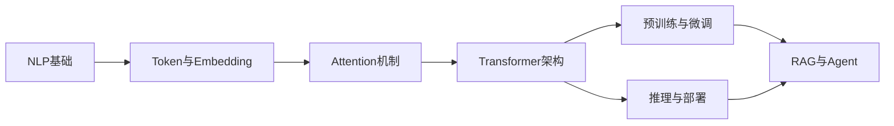

# 💬 大语言模型 · 模块索引

> 主色：#1B3A6B（深蓝）· #8B5CF6（紫）
> 上位导航：[[00_知识首页/00 总索引\|总索引]] · 顺序见 [[00_知识首页/01 学习路线总览\|学习路线]]
> 定位：**把 Transformer 从"能训练"推到"能干活"**。这一层的关键词是：规模化、对齐、检索、工具调用。

---

## 一、八个目录（对应 10 个课程模块 M-LLM-01~10）

| # | 模块 | 目录 | 能力目标 |
|---|---|---|---|
| 1 | NLP 基础 | `01 NLP基础/` | 分词、词表、序列任务、评价指标（困惑度/BLEU/ROUGE 的局限） |
| 2 | Token 与 Embedding | `02 Token与Embedding/` | BPE/WordPiece、词向量、语义空间、为什么 token 数决定成本 |
| 3 | Attention 机制 | `03 Attention机制/` | QKV、缩放点积、多头、掩码、复杂度 O(n²) 的来源 |
| 4 | Transformer 架构 | `04 Transformer架构/` | 编码器/解码器、残差+LayerNorm、位置编码、GPT/BERT 分支 |
| 5 | 预训练与微调 | `05 预训练与微调/` | 预训练目标、SFT、LoRA/QLoRA、灾难性遗忘 |
| 6 | 推理与部署 | `06 推理与部署/` | KV Cache、量化、批处理、显存估算、延迟与吞吐权衡 |
| 7 | RAG 与 Agent | `07 RAG与Agent/` | 切分与检索、重排、提示编排、工具调用、记忆与规划 |
| 8 | 应用工程 | `08 应用工程/` | 提示工程、结构化输出、评估、幻觉与安全、成本与可观测性、上线清单 |

> **模块与目录不是一对一**：M-LLM-06（训练与对齐）与 M-LLM-07（微调与 PEFT）共用 `05 预训练与微调/`；M-LLM-08（RAG 与 Agent）→ `07 RAG与Agent/`；M-LLM-09（推理与部署）→ `06 推理与部署/`；M-LLM-10（应用工程）→ `08 应用工程/`。

## 二、学习顺序

> **Attention 是整个学科的重心**。学不透 Attention，后面全是背概念。

## 三、三个必须建立的数量感

1. **显存估算**：参数量 × 精度字节 × 系数（权重 + 梯度 + 优化器状态 + 激活）。
2. **计算量**：Attention 是 O(n²)，序列翻倍，注意力部分计算量变四倍。
3. **成本**：token 数 × 单价；上下文越长，每次调用越贵——这直接决定 RAG 的切分策略。

## 四、知识点登记（当前 110 条）

| 知识 ID | 名称 | 难度 | 状态 | 笔记 |
|---|---|---|---|---|
| `LLM-001` | 什么是语言模型 | M-LLM-01 | L1 | planned | [[LLM-001 什么是语言模型]] |
| `LLM-002` | 统计语言模型与 N-gram | M-LLM-01 | L3 | planned | [[LLM-002 统计语言模型与 N-gram]] |
| `LLM-003` | 神经语言模型：RNN 与 Seq2Seq | M-LLM-01 | L3 | planned | [[LLM-003 神经语言模型——RNN 与 Seq2Seq]] |
| `LLM-004` | Attention 的历史背景与 Transformer 的提出 | M-LLM-01 | L2 | planned | [[LLM-004 Attention 的历史背景与 Transformer 的提出]] |
| `LLM-005` | 什么是大语言模型 | M-LLM-01 | L2 | planned | [[LLM-005 什么是大语言模型]] |
| `LLM-006` | 预训练语言模型与 Foundation Model | M-LLM-01 | L2 | planned | [[LLM-006 预训练语言模型与 Foundation Model]] |
| `LLM-007` | 参数规模与模型能力 | M-LLM-01 | L3 | planned | [[LLM-007 参数规模与模型能力]] |
| `LLM-008` | LLM 的完整生命周期 | M-LLM-01 | L2 | planned | [[LLM-008 LLM 的完整生命周期]] |
| `LLM-009` | 现代大模型生态 | M-LLM-01 | L1 | planned | [[LLM-009 现代大模型生态]] |
| `LLM-010` | 学习地图与实验环境 | M-LLM-01 | L1 | planned | [[LLM-010 学习地图与实验环境]] |
| `LLM-011` | Attention 的基本思想 | M-LLM-02 | L1 | planned | [[LLM-011 Attention 的基本思想]] |
| `LLM-012` | Query、Key、Value 与 QKV 的来源 | M-LLM-02 | L3 | planned | [[LLM-012 Query、Key、Value 与 QKV 的来源]] |
| `LLM-013` | 点积注意力与 Scaled Dot-Product Attention | M-LLM-02 | L3 | planned | [[LLM-013 点积注意力与 Scaled Dot-Product Attention]] |
| `LLM-014` | Softmax 在 Attention 中的作用 | M-LLM-02 | L2 | planned | [[LLM-014 Softmax 在 Attention 中的作用]] |
| `LLM-015` | Self-Attention | M-LLM-02 | L3 | planned | [[LLM-015 Self-Attention]] |
| `LLM-016` | Cross-Attention | M-LLM-02 | L2 | planned | [[LLM-016 Cross-Attention]] |
| `LLM-017` | Multi-Head Attention | M-LLM-02 | L3 | planned | [[LLM-017 Multi-Head Attention]] |
| `LLM-018` | 掩码：Causal、Padding 与 Attention Mask | M-LLM-02 | L2 | planned | [[LLM-018 掩码——Causal、Padding 与 Attention Mask]] |
| `LLM-019` | Attention 的张量维度与实现细节 | M-LLM-02 | L3 | planned | [[LLM-019 Attention 的张量维度与实现细节]] |
| `LLM-020` | Attention 的计算复杂度与局限 | M-LLM-02 | L3 | planned | [[LLM-020 Attention 的计算复杂度与局限]] |
| `LLM-021` | Transformer 总体架构 | M-LLM-03 | L2 | planned | [[LLM-021 Transformer 总体架构]] |
| `LLM-022` | Encoder 与 Encoder Block | M-LLM-03 | L3 | planned | [[LLM-022 Encoder 与 Encoder Block]] |
| `LLM-023` | Decoder 与 Decoder Block | M-LLM-03 | L3 | planned | [[LLM-023 Decoder 与 Decoder Block]] |
| `LLM-024` | 位置编码 | M-LLM-03 | L3 | planned | [[LLM-024 位置编码]] |
| `LLM-025` | 残差、LayerNorm 与 Pre-LN/Post-LN | M-LLM-03 | L3 | planned | [[LLM-025 残差、LayerNorm 与 Pre-LN、Post-LN]] |
| `LLM-026` | Multi-Head 的变体：MQA 与 GQA | M-LLM-03 | L3 | planned | [[LLM-026 Multi-Head 的变体——MQA 与 GQA]] |
| `LLM-027` | Encoder-Only、Decoder-Only 与 Encoder-Decoder | M-LLM-03 | L2 | planned | [[LLM-027 Encoder-Only、Decoder-Only 与 Encoder-Decoder]] |
| `LLM-028` | RoPE 与长上下文外推 | M-LLM-03 | L3 | planned | [[LLM-028 RoPE 与长上下文外推]] |
| `LLM-029` | FFN、激活函数与 SwiGLU | M-LLM-03 | L3 | planned | [[LLM-029 FFN、激活函数与 SwiGLU]] |
| `LLM-030` | Transformer 参数量与计算量估算 | M-LLM-03 | L3 | planned | [[LLM-030 Transformer 参数量与计算量估算]] |
| `LLM-031` | Tokenizer 基础与子词切分 | M-LLM-04 | L2 | planned | [[LLM-031 Tokenizer 基础与子词切分]] |
| `LLM-032` | BPE 算法 | M-LLM-04 | L3 | planned | [[LLM-032 BPE 算法]] |
| `LLM-033` | WordPiece 与 SentencePiece | M-LLM-04 | L3 | planned | [[LLM-033 WordPiece 与 SentencePiece]] |
| `LLM-034` | 特殊 Token 与 Attention Mask | M-LLM-04 | L2 | planned | [[LLM-034 特殊 Token 与 Attention Mask]] |
| `LLM-035` | Token 数量、上下文窗口与成本 | M-LLM-04 | L2 | planned | [[LLM-035 Token 数量、上下文窗口与成本]] |
| `LLM-036` | Embedding 与向量表示 | M-LLM-04 | L2 | planned | [[LLM-036 Embedding 与向量表示]] |
| `LLM-037` | 语义空间与相似度 | M-LLM-04 | L2 | planned | [[LLM-037 语义空间与相似度]] |
| `LLM-038` | 从静态词向量到上下文向量 | M-LLM-04 | L2 | planned | [[LLM-038 从静态词向量到上下文向量]] |
| `LLM-039` | Embedding 与模型参数 | M-LLM-04 | L2 | planned | [[LLM-039 Embedding 与模型参数]] |
| `LLM-040` | Token 嵌入与位置嵌入的区别 | M-LLM-04 | L2 | planned | [[LLM-040 Token 嵌入与位置嵌入的区别]] |
| `LLM-041` | 多语言 Tokenizer 的取舍 | M-LLM-04 | L2 | planned | [[LLM-041 多语言 Tokenizer 的取舍]] |
| `LLM-043` | GPT 系列的演进 | M-LLM-05 | L2 | planned | [[LLM-043 GPT 系列的演进]] |
| `LLM-044` | T5 与 Span Corruption | M-LLM-05 | L2 | planned | [[LLM-044 T5 与 Span Corruption]] |
| `LLM-045` | 预训练目标对比：MLM、CLM 与 Span Corruption | M-LLM-05 | L3 | planned | [[LLM-045 预训练目标对比：MLM、CLM 与 Span Corruption]] |
| `LLM-046` | 双向上下文与单向生成 | M-LLM-05 | L3 | planned | [[LLM-046 双向上下文与单向生成]] |
| `LLM-047` | 上下文窗口与位置外推 | M-LLM-05 | L2 | planned | [[LLM-047 上下文窗口与位置外推]] |
| `LLM-048` | 微调范式：全参与参数高效 | M-LLM-05 | L2 | planned | [[LLM-048 微调范式：全参与参数高效]] |
| `LLM-049` | 零样本、少样本与上下文学习 | M-LLM-05 | L2 | planned | [[LLM-049 零样本、少样本与上下文学习]] |
| `LLM-050` | 提示的结构与格式敏感性 | M-LLM-05 | L2 | planned | [[LLM-050 提示的结构与格式敏感性]] |
| `LLM-051` | 模型规模与能力的关系 | M-LLM-05 | L3 | planned | [[LLM-051 模型规模与能力的关系]] |
| `LLM-052` | 现代 Decoder-only 架构的差异 | M-LLM-05 | L2 | planned | [[LLM-052 现代 Decoder-only 架构的差异]] |
| `LLM-088` | 自回归推理的基本流程 | M-LLM-09 | L2 | planned | [[LLM-088 自回归推理的基本流程]] |
| `LLM-089` | Prefill 与 Decode 两阶段 | M-LLM-09 | L3 | planned | [[LLM-089 Prefill 与 Decode 两阶段]] |
| `LLM-090` | KV Cache 的原理与显存 | M-LLM-09 | L3 | planned | [[LLM-090 KV Cache 的原理与显存]] |
| `LLM-091` | 批处理与连续批处理 | M-LLM-09 | L3 | planned | [[LLM-091 批处理与连续批处理]] |
| `LLM-076` | RAG 的基本架构 | M-LLM-08 | L2 | planned | [[LLM-076 RAG 的基本架构]] |
| `LLM-077` | 文档切块策略 | M-LLM-08 | L2 | planned | [[LLM-077 文档切块策略]] |
| `LLM-078` | 向量化与嵌入模型 | M-LLM-08 | L2 | planned | [[LLM-078 向量化与嵌入模型]] |
| `LLM-079` | 向量检索与相似度索引 | M-LLM-08 | L3 | planned | [[LLM-079 向量检索与相似度索引]] |
| `LLM-100` | 提示工程的基本原则 | M-LLM-10 | L2 | planned | [[LLM-100 提示工程的基本原则]] |
| `LLM-101` | 结构化输出与约束解码 | M-LLM-10 | L3 | planned | [[LLM-101 结构化输出与约束解码]] |
| `LLM-102` | 上下文工程与长文本处理 | M-LLM-10 | L2 | planned | [[LLM-102 上下文工程与长文本处理]] |
| `LLM-103` | 评估体系：离线与在线 | M-LLM-10 | L3 | planned | [[LLM-103 评估体系：离线与在线]] |
| `LLM-104` | 幻觉的成因与缓解 | M-LLM-10 | L3 | planned | [[LLM-104 幻觉的成因与缓解]] |
| `LLM-105` | 安全、越狱与内容过滤 | M-LLM-10 | L2 | planned | [[LLM-105 安全、越狱与内容过滤]] |
| `LLM-106` | 成本、延迟与质量的三角权衡 | M-LLM-10 | L3 | planned | [[LLM-106 成本、延迟与质量的三角权衡]] |
| `LLM-107` | 缓存、重试与降级策略 | M-LLM-10 | L2 | planned | [[LLM-107 缓存、重试与降级策略]] |
| `LLM-108` | 可观测性与日志追踪 | M-LLM-10 | L2 | planned | [[LLM-108 可观测性与日志追踪]] |
| `LLM-109` | 从原型到生产的工程清单 | M-LLM-10 | L2 | planned | [[LLM-109 从原型到生产的工程清单]] |
| `LLM-110` | 大模型应用的边界与未来 | M-LLM-10 | L1 | planned | [[LLM-110 大模型应用的边界与未来]] |
| `LLM-042` | BERT 的预训练任务 | M-LLM-05 | L2 | planned | [[LLM-042 BERT 的预训练任务]] |
| `LLM-053` | 预训练数据与语料工程 | M-LLM-06 | L2 | planned | [[LLM-053 预训练数据与语料工程]] |
| `LLM-054` | 预训练的目标与损失 | M-LLM-06 | L3 | planned | [[LLM-054 预训练的目标与损失]] |
| `LLM-055` | 训练超参数与学习率调度 | M-LLM-06 | L2 | planned | [[LLM-055 训练超参数与学习率调度]] |
| `LLM-056` | 分布式训练与数据并行 | M-LLM-06 | L3 | planned | [[LLM-056 分布式训练与数据并行]] |
| `LLM-057` | 混合精度与显存优化 | M-LLM-06 | L3 | planned | [[LLM-057 混合精度与显存优化]] |
| `LLM-058` | 训练稳定性与损失尖峰 | M-LLM-06 | L3 | planned | [[LLM-058 训练稳定性与损失尖峰]] |
| `LLM-059` | Scaling Laws | M-LLM-06 | L3 | planned | [[LLM-059 Scaling Laws]] |
| `LLM-060` | 指令微调（SFT） | M-LLM-06 | L2 | planned | [[LLM-060 指令微调（SFT）]] |
| `LLM-061` | 人类偏好对齐与 RLHF | M-LLM-06 | L3 | planned | [[LLM-061 人类偏好对齐与 RLHF]] |
| `LLM-062` | DPO 与偏好优化 | M-LLM-06 | L3 | planned | [[LLM-062 DPO 与偏好优化]] |
| `LLM-063` | 对齐的代价与风险 | M-LLM-06 | L2 | planned | [[LLM-063 对齐的代价与风险]] |
| `LLM-064` | 从预训练到对齐的完整流程 | M-LLM-06 | L2 | planned | [[LLM-064 从预训练到对齐的完整流程]] |
| `LLM-065` | LoRA 与参数高效微调 | M-LLM-07 | L3 | planned | [[LLM-065 LoRA 与参数高效微调]] |
| `LLM-066` | QLoRA 与量化微调 | M-LLM-07 | L3 | planned | [[LLM-066 QLoRA 与量化微调]] |
| `LLM-067` | Adapter、Prefix 与 Prompt Tuning | M-LLM-07 | L2 | planned | [[LLM-067 Adapter、Prefix 与 Prompt Tuning]] |
| `LLM-068` | 微调数据构造与质量 | M-LLM-07 | L2 | planned | [[LLM-068 微调数据构造与质量]] |
| `LLM-069` | 微调的超参数与训练技巧 | M-LLM-07 | L2 | planned | [[LLM-069 微调的超参数与训练技巧]] |
| `LLM-070` | 过拟合、灾难性遗忘与缓解 | M-LLM-07 | L3 | planned | [[LLM-070 过拟合、灾难性遗忘与缓解]] |
| `LLM-071` | 微调效果评估 | M-LLM-07 | L2 | planned | [[LLM-071 微调效果评估]] |
| `LLM-072` | 从微调到推理部署的衔接 | M-LLM-07 | L2 | planned | [[LLM-072 从微调到推理部署的衔接]] |
| `LLM-073` | 多任务微调与指令混合 | M-LLM-07 | L2 | planned | [[LLM-073 多任务微调与指令混合]] |
| `LLM-074` | 领域适配：从通用到专业 | M-LLM-07 | L2 | planned | [[LLM-074 领域适配：从通用到专业]] |
| `LLM-075` | PEFT 的取舍与选型 | M-LLM-07 | L2 | planned | [[LLM-075 PEFT 的取舍与选型]] |
| `LLM-092` | 采样策略：温度、Top-K、Top-P | M-LLM-09 | L2 | planned | [[LLM-092 采样策略：温度、Top-K、Top-P]] |
| `LLM-093` | 束搜索与确定性解码 | M-LLM-09 | L3 | planned | [[LLM-093 束搜索与确定性解码]] |
| `LLM-094` | 量化：INT8、INT4 与 GPTQ | M-LLM-09 | L3 | planned | [[LLM-094 量化：INT8、INT4 与 GPTQ]] |
| `LLM-095` | 推理显存估算与可行性判断 | M-LLM-09 | L2 | planned | [[LLM-095 推理显存估算与可行性判断]] |
| `LLM-096` | 推理延迟与吞吐的权衡 | M-LLM-09 | L3 | planned | [[LLM-096 推理延迟与吞吐的权衡]] |
| `LLM-097` | 推理引擎与服务化 | M-LLM-09 | L2 | planned | [[LLM-097 推理引擎与服务化]] |
| `LLM-098` | 本地部署实践 | M-LLM-09 | L2 | planned | [[LLM-098 本地部署实践]] |
| `LLM-099` | 推理成本与优化清单 | M-LLM-09 | L2 | planned | [[LLM-099 推理成本与优化清单]] |
| `LLM-080` | 混合检索：BM25 与向量 | M-LLM-08 | L3 | planned | [[LLM-080 混合检索：BM25 与向量]] |
| `LLM-081` | Rerank 与检索结果精排 | M-LLM-08 | L2 | planned | [[LLM-081 Rerank 与检索结果精排]] |
| `LLM-082` | 提示词组装与上下文预算 | M-LLM-08 | L2 | planned | [[LLM-082 提示词组装与上下文预算]] |
| `LLM-083` | RAG 的评估 | M-LLM-08 | L3 | planned | [[LLM-083 RAG 的评估]] |
| `LLM-084` | RAG 的失败模式与修复 | M-LLM-08 | L3 | planned | [[LLM-084 RAG 的失败模式与修复]] |
| `LLM-085` | Agent 的基本循环 | M-LLM-08 | L2 | planned | [[LLM-085 Agent 的基本循环]] |
| `LLM-086` | 工具调用与函数调用 | M-LLM-08 | L3 | planned | [[LLM-086 工具调用与函数调用]] |
| `LLM-087` | Agent 的规划、记忆与多步执行 | M-LLM-08 | L3 | planned | [[LLM-087 Agent 的规划、记忆与多步执行]] |

领号入口：[[08_知识索引/08 ID注册表\|ID 注册表]]（下一可用 `LLM-111`）

## 五、关联数学

| 数学分支 | 入口 | 用在哪 |
|---|---|---|
| 线性代数 | [[06_数学基础/02 线性代数/00 分支索引\|线性代数]] | QKV 投影全是矩阵乘法（`MATH-216`）；向量相似度 |
| 概率论 | [[06_数学基础/03 概率论/00 分支索引\|概率论]] | softmax、采样（temperature/top-p）、交叉熵 |
| 最优化方法 | [[06_数学基础/07 最优化方法/00 分支索引\|最优化方法]] | 大规模训练、梯度累积、学习率 warmup |
| 高等数学 | [[06_数学基础/01 高等数学/00 分支索引\|高等数学]] | 导数与链式法则（反向传播）、LayerNorm 的梯度 |

**RAG 的核心数学**：向量内积/余弦相似度 = 线性代数；重排的打分 = 概率与排序。

## 六、出口标准

- [ ] 能手写 scaled dot-product attention（10 行以内）
- [ ] 能估算一个 7B 模型在 fp16 下的推理显存与 LoRA 训练显存
- [ ] 能从零搭一个最小 RAG（切分 → 检索 → 拼 prompt → 引用溯源）
- [ ] 能说清 SFT 与 RAG 各自解决什么问题、何时该用哪个

## 七、下一步

- 落地：[[07_实战项目/00 项目总览\|项目总览]]（大模型类项目在 `05 大模型项目/`）
- 查索引：[[08_知识索引/05 大语言模型知识索引\|大语言模型知识索引]]
- 关联机制：[[08_知识索引/06 知识关联索引\|知识关联索引]]
