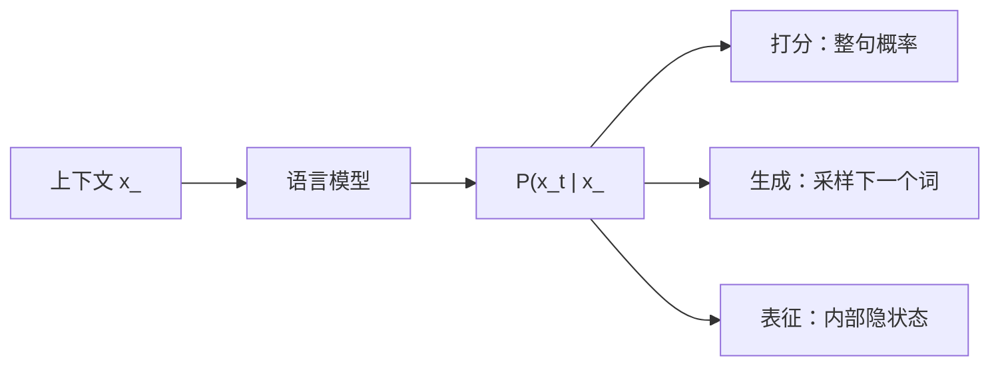

# LLM-001 什么是语言模型

## 1. 本节学习目标

1. 说清语言模型在算什么（**一句话：给一段文本打一个概率分**）。
2. 写出链式分解，并解释为什么它把"打分"变成了"逐词预测"。
3. 用**困惑度（perplexity）**理解"模型有多好"，并手算一次（本课实测 **10.52**）。
4. 理解语言模型的三种用途：打分、生成、表征。

## 2. 为什么需要这个知识

因为**整个大模型学科都是围绕"语言模型"这一个目标长大的**：预训练是它、SFT 是它、你看到的"输出下一个词"也是它。

不先把"它在算什么"说清楚，后面 Attention、Transformer、GPT 全都会变成背公式。

## 3. 直观解释

**语言模型 = 一个"文本可能性打分器"**：

```text
P("我今天去公园") = 0.002
P("我今天去量子毛线") = 0.0000001
```

它内部不做判断、不做检索，只回答一件事：**"这句话有多像人话？"**

而"打分"可以拆成**逐词接力**：

```text
P(我, 今天, 去, 公园)
= P(我) × P(今天|我) × P(去|我,今天) × P(公园|我,今天,去)
```

这就是"预测下一个词"的来源。

## 4. 正式定义

**语言模型**：对任意 token 序列 $x_1,\dots,x_T$ 定义概率

$$
P(x_1,\dots,x_T)
$$

**链式法则**

$$
P(x_1,\dots,x_T)=\prod_{t=1}^{T}P\big(x_t\mid x_{<t}\big)
$$

其中 $x_{<t}=(x_1,\dots,x_{t-1})$ 称为**上下文（context）**。

**困惑度**

$$
\mathrm{PPL}=\exp\Big(-\frac1T\sum_{t=1}^{T}\log P(x_t\mid x_{<t})\Big)
$$

**含义**：模型平均在多少种"等价可能"里犹豫。PPL 越小越好；**词表大小 $V$ 的均匀随机模型 PPL = $V$**。

## 5. 历史背景或技术背景

| 年代 | 模型 | 条件概率怎么算 |
|---|---|---|
| 1948 | Shannon 的 n-gram 思想 | 数频次 |
| 1980s–2000s | N-gram + 平滑 | 数频次 + 平滑 |
| 2003 | Bengio 神经语言模型 | 用神经网络学 |
| 2013 | word2vec / RNN LM | 词向量 + 循环网络 |
| 2017 | Transformer | 全注意力 |
| 2018+ | GPT / BERT | 预训练 + 微调 |

**一句话**：变的是"怎么算条件概率"，不变的是"语言模型"这个目标。

## 6. 核心原理

**本课实测（129 token 极简语料，17 词词表）**

```text
句子: ['the', 'cat', 'sat', 'on', 'the', 'mat']
各词概率: {'the': 0.2326, 'cat': 0.0698, 'sat': 0.0543, 'on': 0.0775, 'mat': 0.0465}
对数概率和: -14.119
困惑度: 10.52
```

**读法**：

1. 逐词概率相乘（对数相加）⇒ 整句概率 $e^{-14.119}\approx7.4\times10^{-7}$。
2. 归一化到每词 ⇒ PPL **10.52**，意思是"平均在约 10.5 个词之间犹豫"。
3. 词表只有 17，随机猜的 PPL 就是 **17** ⇒ 这个 unigram 模型**只比瞎猜好一点**——因为它完全忽略词序。

## 7. 数学表达式

**为什么用对数**

$$
\log P=\sum_t\log P(x_t\mid x_{<t})
$$

概率连乘会**下溢**（$10^{-200}$ 直接变 0）；取对数把乘法变加法，数值稳定。

**PPL 与交叉熵的关系**

$$
\mathrm{PPL}=2^{H}\quad(\text{以 2 为底}),\qquad
H=-\frac1T\sum_t\log P(x_t\mid x_{<t})
$$

⇒ **PPL 就是"交叉熵的指数"，单位是"等效候选数"**。

## 8. 详细数学推导

**推导：随机模型的 PPL = 词表大小**

设均匀分布 $P(w)=1/V$，句长 $T$：

$$
H=-\frac1T\sum_{t=1}^{T}\log\frac1V=\log V
$$

$$
\mathrm{PPL}=e^{H}=e^{\log V}=V
$$

**本课验证**：$V=17$，随机模型 PPL = 17；实测 unigram PPL = **10.52 < 17** ⇒ 词频信息有微弱帮助。

**推导：PPL 的可解释性**

若 PPL = 10，等价于"每预测一个词，模型像在 10 个等概率候选里挑"。这是**跨模型可比**的指标（前提：同一 tokenizer、同一测试集）。

## 9. 图解



## 10. 具体数值示例

```text
语料 129 token，词表 17
the: 30 次 → 0.2326
cat: 9 次  → 0.0698
sat: 7 次  → 0.0543
on: 10 次  → 0.0775
mat: 6 次  → 0.0465

对数概率和 = ln(0.2326)+ln(0.0698)+ln(0.0543)+ln(0.0775)+ln(0.2326)+ln(0.0465)
          ≈ -14.119
PPL = exp(14.119/6) = 10.52
```

## 11. NumPy 实现

```python
import math
from collections import Counter

corpus = ("the cat sat on the mat . the dog sat on the log . "
          "the cat ate the fish . the dog ate the bone").split()
counts = Counter(corpus)
total = len(corpus)

sentence = "the cat sat on the mat".split()
probs = [counts[w] / total for w in sentence]
logp = sum(math.log(p) for p in probs)

print("词表大小:", len(counts), " 语料长度:", total)
print("逐词概率:", [round(p, 4) for p in probs])
print("PPL:", round(math.exp(-logp / len(sentence)), 2))
```

## 12. PyTorch 实现

```python
import torch

# 用一个"模型给出的"概率分布演示 PPL 计算
probs = torch.tensor([0.2326, 0.0698, 0.0543, 0.0775, 0.2326, 0.0465])
logp = torch.log(probs)
ppl = torch.exp(-logp.mean())
print("PPL:", round(float(ppl), 2))

# 对比：均匀随机模型（词表 17）
uniform = torch.full((6,), 1 / 17)
print("随机模型 PPL:", round(float(torch.exp(-torch.log(uniform).mean())), 2))
```

## 13. Hugging Face 实践

> **本节说明**：语言模型本身的"打分"能力可用 HF 模型直接验证。
> 下面代码**不需要下载模型**（用已缓存的 `gpt2`，若未缓存需先设 `HF_ENDPOINT=https://hf-mirror.com`）。

```python
import math
import os

os.environ.setdefault("HF_ENDPOINT", "https://hf-mirror.com")

import torch
from transformers import AutoModelForCausalLM, AutoTokenizer

tok = AutoTokenizer.from_pretrained("gpt2")
model = AutoModelForCausalLM.from_pretrained("gpt2").eval()
ids = tok("The capital of France is Paris", return_tensors="pt")
with torch.no_grad():
    out = model(**ids, labels=ids["input_ids"])
print("平均负对数似然:", round(float(out.loss), 4))
print("困惑度:", round(math.exp(float(out.loss)), 2))
```

## 14. 代码逐行解释

| 代码 | 作用 |
|---|---|
| `Counter(corpus)` | 统计词频（unigram 模型） |
| `counts[w] / total` | 最大似然估计 $P(w)$ |
| `math.log` | 转对数，避免连乘下溢 |
| `math.exp(-logp / len)` | PPL 的定义式 |
| `model(**ids, labels=ids["input_ids"])` | HF 的因果 LM 内置损失（右移一位） |
| `math.exp(loss)` | 损失就是平均交叉熵 ⇒ PPL |

## 15. 实际运行结果

```text
### LLM-001 语言模型：链式分解与困惑度
语料 token 数: 129  词表大小: 17
句子: ['the', 'cat', 'sat', 'on', 'the', 'mat']
各词概率: {'the': 0.2326, 'cat': 0.0698, 'sat': 0.0543, 'on': 0.0775, 'mat': 0.0465}
uni-gram 对数概率和: -14.119  困惑度: 10.52
```

## 16. 应用场景

| 用途 | 说明 | 例子 |
|---|---|---|
| **打分** | 判断句子是否自然 | 拼写纠错、语音识别候选重排 |
| **生成** | 逐词采样出文本 | ChatGPT、代码补全 |
| **表征** | 用内部隐状态做特征 | 文本分类、聚类、检索 |
| **评估** | 用 PPL 比较模型 | 预训练进度监控 |

## 17. 优点与局限

| 优点 | 局限 |
|---|---|
| 目标单一、可用海量无标注文本训练 | PPL 低 ≠ 回答好（对齐是另一件事） |
| 一个模型可迁移到多种下游任务 | 上下文窗口有限，超出就"忘" |
| 可解释为"下一词概率" | 训练成本极高 |

## 18. 常见错误

| 错误 | 现象 | 纠正 |
|---|---|---|
| 把 PPL 跨 tokenizer 比较 | 结论无意义 | 必须同 tokenizer、同测试集 |
| 以为 PPL 低就不胡说 | 模型仍会幻觉 | PPL 衡量"像不像话"，不衡量"对不对" |
| 用词数而非 token 数算 PPL | 数值偏低 | PPL 按 **token** 归一 |
| 概率直接连乘 | 下溢成 0 | 先取对数 |
| 忘了 `<eos>` | 概率和不为 1 | 概率空间要包含结束符 |

## 19. 本节总结

- 语言模型 = **给序列打概率**；链式分解把它变成**逐词条件概率**。
- 本课实测：129 token 语料、词表 17、unigram **PPL 10.52**（随机基线 17）。
- **PPL = 交叉熵的指数**，单位是"等效候选数"；跨模型比较必须同 tokenizer。

## 20. 前置与后续知识链接

- 前置：[[MATH-301 概率基础与条件概率]]、[[MATH-506 信息量与熵]]
- 后续：[[LLM-002 统计语言模型与 N-gram]]、[[LLM-003 神经语言模型——RNN 与 Seq2Seq]]、[[LLM-005 什么是大语言模型]]
- 相关：[[MATH-507 交叉熵与 KL 散度]]

---

## 练习与参考答案

**基础 1**：写出语言模型的链式分解公式，并解释每一项的含义。

**基础 2**：本课 unigram 模型的 PPL 是多少？随机基线是多少？说明什么？

**进阶 1**：为什么 PPL 必须按 token 而非按词归一？跨 tokenizer 比较 PPL 会出什么问题？

**综合**：给定一个 4 词句子，模型给出的条件概率依次是 0.5、0.25、0.2、0.1。请手算该句的 PPL，并判断它比词表 100 的随机模型好还是差。

> [!success]- 参考答案

> **基础 1**
> $$P(x_1,\dots,x_T)=\prod_{t=1}^{T}P\big(x_t\mid x_{<t}\big)$$
> 第 $t$ 项 $P(x_t\mid x_{<t})$ 表示"在已知前 $t-1$ 个 token 的条件下，第 $t$ 个 token 出现的概率"。整句概率是这些条件概率的连乘。

> **基础 2**
> unigram PPL = **10.52**；随机基线 = 词表大小 **17**。
> 说明词频信息带来了一点帮助（10.52 < 17），但因为完全忽略词序，效果很弱。

> **进阶 1**
> 因为 PPL 是"每 token 的平均负对数似然的指数"：
> $$\mathrm{PPL}=\exp\!\Big(-\frac1T\sum_t\log P(x_t\mid x_{<t})\Big)$$
> 分母 $T$ 必须与概率单位一致（token），否则数值被人为放大/缩小。
> 不同 tokenizer 把同一句话切成不同数量的 token（例如中文一句话可能 10 个 token 也可能 20 个），**每 token 的平均难度不同** ⇒ PPL 不可比。必须用同一 tokenizer 与同一测试文本。

> **综合（参考）**
> 对数概率和 $=\ln0.5+\ln0.25+\ln0.2+\ln0.1\approx-0.693-1.386-1.609-2.303=-5.991$。
> 平均 $=-1.498$，$\mathrm{PPL}=e^{1.498}\approx\mathbf{4.47}$。
> 随机基线（词表 100）PPL = **100** ⇒ 该模型（4.47）**远好于随机**（约 22 倍）。
> **注意**：这个结论只在"4 个词都来自同一词表"时成立；若这 4 个词不在词表内，概率应为 0，PPL 会变成 +∞。

## 学习记录

| 日期 | 状态 | 用时 | 问题 | 复盘 |
|---|---|---|---|---|
| 2026-11-07 | planned | — | — | — |

---

## 🔗 Notion 同步信息

> 以下内容由 Notion「AI Knowledge System · 知识点」数据库按知识 ID 合并而来（导出于 2026-11-09）。

| 属性 | 值 |
|---|---|
| 学科 | 大语言模型 |
| 学习状态 | 未开始 |
| 难度 | L1 概念 |
| 知识类型 | Concept |

- **所属模块**：[M-LLM-01 大语言模型基础与发展历史](../%E8%AF%BE%E7%A8%8B%E6%A8%A1%E5%9D%97/M-LLM-01%20%E5%A4%A7%E8%AF%AD%E8%A8%80%E6%A8%A1%E5%9E%8B%E5%9F%BA%E7%A1%80%E4%B8%8E%E5%8F%91%E5%B1%95%E5%8E%86%E5%8F%B2.md)
- **后继知识**：[LLM-002 统计语言模型与 N-gram](LLM-002%20%E7%BB%9F%E8%AE%A1%E8%AF%AD%E8%A8%80%E6%A8%A1%E5%9E%8B%E4%B8%8E%20N-gram.md) · [LLM-005 什么是大语言模型](LLM-005%20%E4%BB%80%E4%B9%88%E6%98%AF%E5%A4%A7%E8%AF%AD%E8%A8%80%E6%A8%A1%E5%9E%8B.md)
- **关联数学**：[MATH-301 概率基础与条件概率](../../06_%E6%95%B0%E5%AD%A6%E5%9F%BA%E7%A1%80/03%20%E6%A6%82%E7%8E%87%E8%AE%BA/MATH-301%20%E6%A6%82%E7%8E%87%E5%9F%BA%E7%A1%80%E4%B8%8E%E6%9D%A1%E4%BB%B6%E6%A6%82%E7%8E%87.md) · [MATH-506 信息量与熵](../../06_%E6%95%B0%E5%AD%A6%E5%9F%BA%E7%A1%80/05%20%E7%A6%BB%E6%95%A3%E6%95%B0%E5%AD%A6/MATH-506%20%E4%BF%A1%E6%81%AF%E9%87%8F%E4%B8%8E%E7%86%B5.md)
