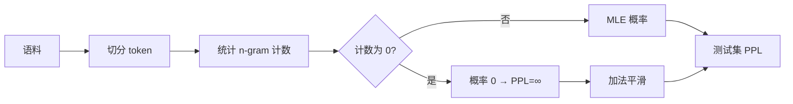

# LLM-002 统计语言模型与 N-gram

## 1. 本节学习目标

1. 写出 N-gram 的条件概率与最大似然估计。
2. **手算一次**二元/三元概率（用本课的 129 token 语料）。
3. 用实测看到"阶数越高越好，但数据稀疏会爆炸"（2-gram 无平滑 **PPL=inf**）。
4. 会用**加法平滑**并说清它的代价（本课 2-gram：4.09 → 6.42）。

## 2. 为什么需要这个知识

因为 N-gram 是**语言模型的第一个可行实现**，也是理解"为什么需要神经网络"的最佳对照组：

- 它把"上下文"简化成"前 $n-1$ 个词"；
- 它靠**数数**估计概率，因此天然遇到**零概率**；
- 它的所有缺陷（稀疏、无泛化、上下文短）正好是神经语言模型的动机。

## 3. 直观解释

**N-gram = 只看前面 $n-1$ 个词**：

| 阶数 | 假设 |
|---|---|
| unigram（1） | 词与词独立 |
| bigram（2） | 只看前 1 个词 |
| trigram（3） | 只看前 2 个词 |

**用数数估计**：

$$
P(\text{cat}\mid\text{the})=\frac{\text{count(the cat)}}{\text{count(the)}}
$$

本课实测：$\text{count(the cat)}=9$、$\text{count(the)}=30$ ⇒ $P=9/30=0.3$。

## 4. 正式定义

**N-gram 假设（马尔可夫假设）**

$$
P(x_t\mid x_{<t})\approx P(x_t\mid x_{t-n+1},\dots,x_{t-1})
$$

**最大似然估计**

$$
P_{\mathrm{MLE}}(x_t\mid x_{t-n+1:t-1})
=\frac{c(x_{t-n+1},\dots,x_t)}{c(x_{t-n+1},\dots,x_{t-1})}
$$

**加法平滑（Laplace / add-$\alpha$）**

$$
P_\alpha(x_t\mid \text{ctx})
=\frac{c(\text{ctx},x_t)+\alpha}{c(\text{ctx})+\alpha V}
$$

$V$ 为词表大小。

## 5. 历史背景或技术背景

| 年代 | 事件 |
|---|---|
| 1948 | Shannon 用 n-gram 近似英文 |
| 1980s | 隐马尔可夫、n-gram 成为语音识别主力 |
| 1990s | Kneser-Ney 平滑（当前 n-gram 最强） |
| 2000s | 机器翻译仍靠 n-gram + 调序 |
| 2013+ | 神经语言模型逐步取代 |

**为什么被取代**：N-gram 无法泛化（没见过 "cat sat" 就学不到 "dog sat" 的相似性），且上下文长度被 $n$ 限制在 3–5。

## 6. 核心原理

**本课实测（129 token 语料、17 词词表、测试句 "the cat sat on the mat"）**

| 配置 | PPL |
|---|---|
| 1-gram（无平滑） | 10.52 |
| **2-gram（无平滑）** | **inf（零概率）** |
| 3-gram（无平滑） | **inf（零概率）** |
| 1-gram + α=0.1 | 10.55 |
| 1-gram + α=1.0 | 10.86 |
| **2-gram + α=0.1** | **4.09** |
| 2-gram + α=1.0 | 6.42 |
| 3-gram + α=0.1 | 5.02 |
| 3-gram + α=1.0 | 8.93 |

**四个结论**：

1. **阶数越高越好**（有平滑时：2-gram 4.09 < 1-gram 10.52）。
2. **无平滑必炸**：2/3-gram 在测试句里遇到未见组合 ⇒ 概率 0 ⇒ PPL = ∞。
3. **平滑是必需的**：加了 α 之后才可计算。
4. **平滑有代价**：α 越大越"平均"，PPL 变差（2-gram：4.09 → 6.42）。

## 7. 数学表达式

**零概率的来源**

$$
P(\text{cat}\mid\text{sat})=\frac{c(\text{sat cat})}{c(\text{sat})}=\frac{0}{7}=0
$$

本课语料里只有 "cat sat"，没有 "sat cat" ⇒ 该转移概率为 0 ⇒ 整句概率为 0 ⇒ PPL = ∞。

**加法平滑后**

$$
P(\text{cat}\mid\text{sat})=\frac{0+1}{7+17\times1}=\frac{1}{24}\approx0.0417
$$

本课实测值 **0.041667** ✅

## 8. 详细数学推导

**推导：为什么无平滑时 PPL 会是 ∞**

若任一 $P(x_t\mid\cdot)=0$，则 $\log 0=-\infty$，平均后仍是 $-\infty$：

$$
\mathrm{PPL}=\exp(+\infty)=\infty
$$

**推导：平滑如何"偷"概率质量**

对上下文 ctx，所有可能的下一个词被分走 $\alpha$：

$$
\sum_{w}P_\alpha(w\mid\text{ctx})
=\frac{\sum_w c(\text{ctx},w)+\alpha V}{c(\text{ctx})+\alpha V}
=\frac{c(\text{ctx})+\alpha V}{c(\text{ctx})+\alpha V}=1
$$

✅ 归一化仍然成立。代价是：**常见词的概率被压低，罕见词被抬高**。

**本课量化**：$c(\text{sat})=7$、$V=17$、$\alpha=1$：

- 原始 $P(\text{on}\mid\text{sat})=c(\text{sat on})/7$；
- 平滑后分母从 7 变成 24 ⇒ **所有已见转移的概率被压到约 1/3.4**。

## 9. 图解



## 10. 具体数值示例

```text
c(the) = 30      c(the cat) = 9    → P(cat|the) = 9/30 = 0.3000
c(sat) = 7       c(sat cat) = 0    → P(cat|sat) = 0（零概率）
                                     平滑 α=1 → 1/(7+17) = 0.041667

c(cat) = 9       c(cat sat) = 3    → P(sat|cat) = 3/9 = 0.3333
```

## 11. NumPy 实现

```python
import math
from collections import Counter

corpus = ("the cat sat on the mat . the dog sat on the log . "
          "the cat ate the fish . the dog ate the bone").split()


def counts(n):
    c = Counter()
    for i in range(len(corpus) - n + 1):
        c[tuple(corpus[i:i + n])] += 1
    return c


bi, uni = counts(2), counts(1)
V = len(uni)
print("V =", V)
print("P(cat|the) =", bi[("the", "cat")] / uni[("the",)], )
print("P(cat|sat) =", bi.get(("sat", "cat"), 0) / uni[("sat",)])
print("平滑后 P(cat|sat) =", (bi.get(("sat", "cat"), 0) + 1) / (uni[("sat",)] + V))
```

## 12. PyTorch 实现

```python
import torch

# 用张量做"计数 → 概率"的查表，演示批量计算
uni = torch.tensor([30., 9., 7., 10., 6.])       # the, cat, sat, on, mat
bigram_ctx = torch.tensor([9., 3., 0., 4., 2.])  # 对应 (the cat), (cat sat) ...

p_mle = bigram_ctx / uni
p_alpha1 = (bigram_ctx + 1) / (uni + 5)          # 假设 V = 5
print("MLE 概率:", [round(float(v), 4) for v in p_mle])
print("α=1 平滑:", [round(float(v), 4) for v in p_alpha1])
print("零概率会被平滑救回:", float(p_alpha1[2]) > 0)
```

## 13. Hugging Face 实践

> **本节说明**：HF 不提供 n-gram 模型（这是统计方法，不是神经网络）。
> 这里展示**如何用同一个 tokenizer 切分**，以便与神经模型的 PPL 对比（同 tokenizer 才可比）。

```python
import os

os.environ.setdefault("HF_ENDPOINT", "https://hf-mirror.com")
from transformers import AutoTokenizer

tok = AutoTokenizer.from_pretrained("gpt2")
for text in ("the cat sat on the mat", "今天天气很好"):
    ids = tok(text)["input_ids"]
    print(f"{text!r}: {len(ids)} tokens -> {ids}")
```

## 14. 代码逐行解释

| 代码 | 作用 |
|---|---|
| `counts(n)` | 统计所有 n-gram 频次 |
| `bi[("the","cat")] / uni[("the",)]` | MLE 条件概率 |
| `.get(..., 0)` | 未见组合返回 0（下一步就会导致 PPL=∞） |
| `(c + α) / (ctx + αV)` | 加法平滑 |
| `uni + 5` | 演示 $V=5$ 时的平滑分母 |

## 15. 实际运行结果

```text
### LLM-002 N-gram：1/2/3-gram 困惑度与零概率
  1-gram（无平滑）PPL = 10.52
  2-gram（无平滑）PPL = inf（出现零概率）
  3-gram（无平滑）PPL = inf（出现零概率）
  1-gram + 加0.1平滑 PPL = 10.55
  1-gram + 加1.0平滑 PPL = 10.86
  2-gram + 加0.1平滑 PPL = 4.09
  2-gram + 加1.0平滑 PPL = 6.42
  3-gram + 加0.1平滑 PPL = 5.02
  3-gram + 加1.0平滑 PPL = 8.93

  未见二元组示例：('cat','sat') 计数 = 3
  未见二元组示例：('sat','cat') 计数 = 0
  即使用加法平滑，('sat','cat') 概率也很低: 0.041667
```

## 16. 应用场景

| 场景 | 用法 |
|---|---|
| 拼写检查 | 用 n-gram 打分候选 |
| 输入法 | 下一个词预测（经典） |
| 语音识别 | 语言模型重排 |
| 机器翻译（旧） | 目标端语言模型 |
| **教学对照** | 与神经语言模型对比"泛化能力" |

## 17. 优点与局限

| 优点 | 局限 |
|---|---|
| 训练极快（数数即可） | **零概率/稀疏**（本课 PPL=∞） |
| 可解释、可调试 | 上下文只有 3–5 个词 |
| 无需 GPU | 无法泛化相似词（cat/dog 无共享） |
| 是强基线 | 存储随 $n$ 爆炸 |

## 18. 常见错误

| 错误 | 现象 | 纠正 |
|---|---|---|
| 不做平滑就评估 | PPL = inf | 必须平滑（add-α / Kneser-Ney） |
| 平滑 α 过大 | PPL 变差（4.09→6.42） | 小 α 或改用 Kneser-Ney |
| 训练/测试词表不一致 | 测试词 OOV | 固定词表 + `<unk>` |
| 跨 tokenizer 比 PPL | 数字不可比 | 同一 tokenizer |
| 以为阶数越高一定越好 | 数据少时高阶更差 | 看数据量 |

## 19. 本节总结

- N-gram = **用前 $n-1$ 个词数数估计概率**；本课 2-gram 平滑后 **PPL 4.09**，明显优于 unigram 10.52。
- **无平滑必炸**（PPL=∞）；加法平滑救回但带来"概率被摊薄"的代价（α=1 时 PPL 6.42）。
- 根本缺陷是**无法泛化**——这正是神经语言模型的出发点。

## 20. 前置与后续知识链接

- 前置：[[LLM-001 什么是语言模型]]
- 后续：[[LLM-003 神经语言模型——RNN 与 Seq2Seq]]
- 相关数学：[[MATH-301 概率基础与条件概率]]、[[MATH-506 信息量与熵]]

---

## 练习与参考答案

**基础 1**：写出 N-gram 的最大似然估计公式，并说明 $n=2$ 时它假设了什么。

**基础 2**：本课无平滑的 2-gram 为什么 PPL = ∞？加法平滑后是多少？

**进阶 1**：为什么 α 越大 PPL 越差（2-gram：0.1 → 4.09，1.0 → 6.42）？

**综合**：语料里 `c(the)=100`、`c(the cat)=20`、`c(the dog)=5`，词表 $V=50$。请算 $P(\text{cat}\mid\text{the})$ 的 MLE 与 α=1 平滑值，并解释差异。

> [!success]- 参考答案

> **基础 1**
> $$P_{\mathrm{MLE}}(x_t\mid x_{t-n+1:t-1})=\frac{c(x_{t-n+1},\dots,x_t)}{c(x_{t-n+1},\dots,x_{t-1})}$$
> $n=2$ 时假设"第 $t$ 个词只依赖第 $t-1$ 个词"（一阶马尔可夫假设），更早的历史被完全丢弃。

> **基础 2**
> 因为测试句里出现了训练语料没见过的二元组（如 `sat cat`，计数为 0）⇒ 某个条件概率为 0 ⇒ 取对数得 $-\infty$ ⇒ PPL = ∞。
> 加 α=1 平滑后 2-gram PPL = **6.42**（α=0.1 时 **4.09**）。

> **进阶 1**
> 平滑把概率质量从"已见组合"分给"未见组合"：
> $$P_\alpha=\frac{c+\alpha}{c(\text{ctx})+\alpha V}$$
> α 越大，分子里 $c$ 的贡献被稀释得越厉害，已见转移的概率被压得越低 ⇒ 对真实数据的拟合变差 ⇒ PPL 上升。
> α 太小时又救不回长尾 ⇒ 实际用 Kneser-Ney 这类更聪明的平滑。

> **综合（参考）**
> **MLE**：$P(\text{cat}\mid\text{the})=20/100=\mathbf{0.2}$。
> **α=1 平滑**：$\dfrac{20+1}{100+50}=\dfrac{21}{150}=\mathbf{0.14}$。
> **差异**：平滑把 0.2 压到 0.14，被"偷走"的 0.06 分给了 49 个未见过的词（每个约 $\frac{1}{150}\approx0.0067$）。
> 这说明：**平滑用"已见概率的下降"换"未见概率不为 0"**；α 越大换得越多，PPL 越差，但泛化/鲁棒性越好。

## 学习记录

| 日期 | 状态 | 用时 | 问题 | 复盘 |
|---|---|---|---|---|
| 2026-11-07 | planned | — | — | — |

---

## 🔗 Notion 同步信息

> 以下内容由 Notion「AI Knowledge System · 知识点」数据库按知识 ID 合并而来（导出于 2026-11-09）。

| 属性 | 值 |
|---|---|
| 学科 | 大语言模型 |
| 学习状态 | 未开始 |
| 难度 | L3 推导 |
| 知识类型 | Algorithm |

- **所属模块**：[M-LLM-01 大语言模型基础与发展历史](../%E8%AF%BE%E7%A8%8B%E6%A8%A1%E5%9D%97/M-LLM-01%20%E5%A4%A7%E8%AF%AD%E8%A8%80%E6%A8%A1%E5%9E%8B%E5%9F%BA%E7%A1%80%E4%B8%8E%E5%8F%91%E5%B1%95%E5%8E%86%E5%8F%B2.md)
- **前置知识**：[LLM-001 什么是语言模型](LLM-001%20%E4%BB%80%E4%B9%88%E6%98%AF%E8%AF%AD%E8%A8%80%E6%A8%A1%E5%9E%8B.md)
- **后继知识**：[LLM-003 神经语言模型：RNN 与 Seq2Seq](LLM-003%20%E7%A5%9E%E7%BB%8F%E8%AF%AD%E8%A8%80%E6%A8%A1%E5%9E%8B%E2%80%94%E2%80%94RNN%20%E4%B8%8E%20Seq2Seq.md)
- **关联数学**：[MATH-301 概率基础与条件概率](../../06_%E6%95%B0%E5%AD%A6%E5%9F%BA%E7%A1%80/03%20%E6%A6%82%E7%8E%87%E8%AE%BA/MATH-301%20%E6%A6%82%E7%8E%87%E5%9F%BA%E7%A1%80%E4%B8%8E%E6%9D%A1%E4%BB%B6%E6%A6%82%E7%8E%87.md) · [MATH-506 信息量与熵](../../06_%E6%95%B0%E5%AD%A6%E5%9F%BA%E7%A1%80/05%20%E7%A6%BB%E6%95%A3%E6%95%B0%E5%AD%A6/MATH-506%20%E4%BF%A1%E6%81%AF%E9%87%8F%E4%B8%8E%E7%86%B5.md)
