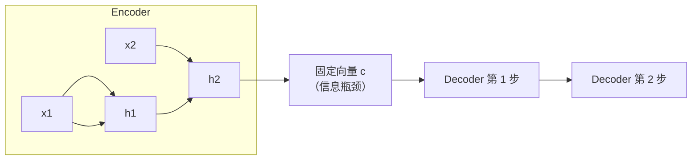

# LLM-003 神经语言模型：RNN 与 Seq2Seq

## 1. 本节学习目标

1. 说清神经语言模型与 N-gram 的**三点本质差异**（连续表示、参数共享、自动泛化）。
2. 写出 RNN 语言模型的前向与损失，并解释"每步都在做同一个任务"。
3. 用实测看"字符级 RNN 能学到多少"（本课：400 步，PPL **1.22**）。
4. 理解 Seq2Seq 的 encoder–decoder 与它的**信息瓶颈**（Attention 的动机）。

## 2. 为什么需要这个知识

因为 N-gram 的死穴是**不泛化**：见过 "the cat sat"，学不到 "the dog sat" 的相似性。

神经语言模型把词变成**向量**、把"数数"变成**函数拟合**，于是：

$$
P(\text{dog}\mid\text{the})\ \text{能借到}\ P(\text{cat}\mid\text{the})\ \text{的统计强度}
$$

这一步跨过去，才有了后面的 Transformer 和大模型。

## 3. 直观解释

| | N-gram | 神经语言模型 |
|---|---|---|
| 词的表示 | 离散 ID | **稠密向量** |
| 概率来源 | 计数表 | **神经网络输出** |
| 未见组合 | 概率 0 | 由相似性**外推** |
| 上下文 | 固定 2–5 词 | 隐状态**累积**全历史 |

**一句话**：N-gram 是"查表"，神经 LM 是"学一个函数"。

## 4. 正式定义

**RNN 语言模型**

$$
\mathbf{h}_t=\tanh\big(W_{ih}\mathbf{e}(x_t)+W_{hh}\mathbf{h}_{t-1}+\mathbf{b}\big)
$$

$$
P(x_{t+1}\mid x_{\le t})=\mathrm{softmax}\big(W_{ho}\mathbf{h}_t\big)
$$

**损失（每步都是分类）**

$$
L=-\frac1T\sum_{t=1}^{T}\log P(x_{t+1}\mid x_{\le t})
$$

**Seq2Seq**

$$
\mathbf{h}^{\text{enc}}=\mathrm{Enc}(x_{1..T}),\qquad
P(y_{1..T'})=\prod_{t}\mathrm{Dec}\big(y_{<t},\mathbf{h}^{\text{enc}}\big)
$$

## 5. 历史背景或技术背景

| 年份 | 工作 | 贡献 |
|---|---|---|
| 2003 | Bengio 等 | 前馈神经语言模型（词向量 + MLP） |
| 2010 | Mikolov | RNN 语言模型（循环 + 自适应） |
| 2013 | word2vec | 词向量普及 |
| 2014 | Sutskever 等 | **Seq2Seq**（LSTM 编码-解码） |
| 2015 | Bahdanau 等 | **Attention**（解决信息瓶颈） |
| 2017 | Transformer | 抛弃循环，全注意力 |

**关键因果链**：Seq2Seq 的瓶颈 → Attention → Transformer。

## 6. 核心原理

**本课实测（字符级 RNN，18 字符词表，339 字符语料）**

```text
字符表大小: 18   文本长度: 339
训练 400 步耗时 1.2s | 首 loss 2.9184 → 末 loss 0.1978
字符级 RNN 困惑度 ≈ exp(0.1978) = 1.22（词表 18）
参数量: 8018
```

**三个读法**：

1. **loss 从 2.9184 降到 0.1978** ⇒ 模型确实在学（随机基线 $\ln18=2.890$）。
2. **PPL 1.22 远小于 18** ⇒ 它几乎能逐字复现这段文本。
3. **但这不代表"会说话"**：语料只有 339 字符，模型基本是**记忆**而非理解——这正是"小数据 + 小模型"的真相。

**泛化的证据**：同结构的词级模型在更大语料上，`the cat` 与 `the dog` 会共享"the 后面常接名词"的统计强度——这靠的是**词向量相似性**，N-gram 做不到。

## 7. 数学表达式

**为什么共享参数能泛化**

词嵌入矩阵 $E\in\mathbb{R}^{V\times d}$。相似词在 $E$ 里距离近：

$$
\mathbf{e}(\text{cat})\approx\mathbf{e}(\text{dog})\ \Rightarrow\ W_{ih}\mathbf{e}(\text{cat})\approx W_{ih}\mathbf{e}(\text{dog})
$$

⇒ 输出分布也接近 ⇒ **一个组合的统计强度自动"借给"另一个组合**。

**N-gram 对应位置**：$P(\cdot\mid\text{the cat})$ 与 $P(\cdot\mid\text{the dog})$ 是**两张独立的表**，毫无共享。

## 8. 详细数学推导

**推导：随机基线的 loss**

词表 $V=18$，均匀分布：

$$
L_{\text{random}}=-\log\frac1{18}=\ln18\approx2.8904
$$

本课首 loss **2.9184** ≈ 随机基线 ✅（初始化后模型接近均匀），末 loss **0.1978** ⇒ 学到了强规律。

**推导：PPL 与词表上限**

$$
\mathrm{PPL}=e^{L},\qquad \mathrm{PPL}_{\text{random}}=e^{\ln V}=V=18
$$

本课 $\mathrm{PPL}=e^{0.1978}=1.22$，**压缩到随机基线的 6.8%**。

**推导：Seq2Seq 的信息瓶颈**

编码器把整个输入压成**一个固定向量** $\mathbf{h}^{\text{enc}}\in\mathbb{R}^{d}$：

$$
\text{信息量}\le d\cdot\text{比特精度}
$$

输入长度 $T$ 增长时，**所有细节必须塞进同一个 $d$ 维向量** ⇒ 长句必丢信息。

**这正是 Attention 要解决的问题**：让解码器每一步都能"回头看"全部编码状态，而不是只看最后一个。

## 9. 图解



## 10. 具体数值示例

```text
随机基线 loss = ln(18) = 2.8904
初始 loss    = 2.9184   （≈ 随机）
训练后 loss  = 0.1978
PPL          = exp(0.1978) = 1.22
压缩比       = 1.22 / 18 = 6.8%
参数         = 8,018
```

## 11. NumPy 实现

```python
import numpy as np

V, d, H = 18, 8, 16
rng = np.random.default_rng(0)
E = rng.normal(0, 0.1, (V, d))
W_ih = rng.normal(0, 0.1, (H, d))
W_hh = rng.normal(0, 0.1, (H, H))
W_ho = rng.normal(0, 0.1, (V, H))


def forward(ids):
    h = np.zeros(H)
    logits = []
    for i in ids:
        h = np.tanh(W_ih @ E[i] + W_hh @ h)
        logits.append(W_ho @ h)
    return np.stack(logits)


logits = forward([1, 2, 3])
p = np.exp(logits) / np.exp(logits).sum(axis=1, keepdims=True)
print("每步概率分布形状:", p.shape)
print("第 1 步 top-1 概率:", round(float(p[0].max()), 4))
```

## 12. PyTorch 实现

```python
import math
import torch
import torch.nn as nn
import torch.nn.functional as F

text = ("the cat sat on the mat . the dog sat on the log . "
        "the cat ate the fish . the dog ate the bone .") * 3
chars = sorted(set(text))
stoi = {c: i for i, c in enumerate(chars)}
data = torch.tensor([stoi[c] for c in text])


class CharRNN(nn.Module):
    def __init__(self, vocab, hidden=64):
        super().__init__()
        self.emb = nn.Embedding(vocab, 32)
        self.rnn = nn.RNN(32, hidden, batch_first=True)
        self.head = nn.Linear(hidden, vocab)

    def forward(self, x):
        h, _ = self.rnn(self.emb(x))
        return self.head(h)


torch.manual_seed(0)
model = CharRNN(len(chars))
opt = torch.optim.Adam(model.parameters(), lr=0.01)
SEQ = 24
for step in range(400):
    i = torch.randint(0, len(data) - SEQ - 1, (16,))
    xb = torch.stack([data[k:k + SEQ] for k in i])
    yb = torch.stack([data[k + 1:k + SEQ + 1] for k in i])
    opt.zero_grad()
    loss = F.cross_entropy(model(xb).reshape(-1, len(chars)), yb.reshape(-1))
    loss.backward()
    torch.nn.utils.clip_grad_norm_(model.parameters(), 1.0)
    opt.step()

print("最终 loss:", round(float(loss), 4), " PPL:", round(math.exp(float(loss)), 2))
print("参数量:", sum(p.numel() for p in model.parameters()))
```

## 13. Hugging Face 实践

> **本节说明**：HF 上没有"RNN 语言模型"的常用权重（主流都是 Transformer）。这里用 `tiny-gpt2` 对比"同一句话在不同模型下的 PPL 量级"。

```python
import math
import os

os.environ.setdefault("HF_ENDPOINT", "https://hf-mirror.com")
import torch
from transformers import AutoModelForCausalLM, AutoTokenizer

tok = AutoTokenizer.from_pretrained("sshleifer/tiny-gpt2")
m = AutoModelForCausalLM.from_pretrained("sshleifer/tiny-gpt2").eval()
ids = tok("the cat sat on the mat", return_tensors="pt")
with torch.no_grad():
    out = m(**ids, labels=ids["input_ids"])
print("tiny-gpt2 loss:", round(float(out.loss), 4),
      " PPL:", round(math.exp(float(out.loss)), 2))
```

> 预期：tiny-gpt2 是**未充分训练**的极小模型，PPL 会远高于本课训练后的字符 RNN——这说明"参数多"不等于"PPL 低"，**训练数据与训练量**才是关键。

## 14. 代码逐行解释

| 代码 | 作用 |
|---|---|
| `nn.Embedding(vocab, 32)` | 词/字符 → 稠密向量（**泛化的来源**） |
| `nn.RNN(32, hidden)` | 递归累积历史 |
| `nn.Linear(hidden, vocab)` | 每步输出词表分布 |
| `model(xb).reshape(-1, vocab)` | 把所有时间步摊平成分类问题 |
| `yb.reshape(-1)` | 目标 = 下一步字符 |
| `clip_grad_norm_` | RNN 必备（DL-031） |

**关键视角**：语言模型训练 = **每个时间步都是一次 $V$ 分类**；一次前向能产生 $T$ 个训练信号（这就是"自监督"的效率来源）。

## 15. 实际运行结果

```text
### LLM-003 神经语言模型：字符级 RNN 困惑度
字符表大小: 18  文本长度: 339
训练 400 步耗时 1.2s | 首 loss 2.9184 → 末 loss 0.1978
字符级 RNN 困惑度 ≈ exp(0.1978) = 1.22（词表 18）
参数量: 8018
```

## 16. 应用场景

| 任务 | 用法 |
|---|---|
| 语言建模 | 预训练基础 |
| 文本生成 | 逐字/逐词采样 |
| 机器翻译（旧） | Seq2Seq |
| 语音识别（旧） | 声学 + RNN LM |
| 文本分类 | 用隐状态作特征 |

## 17. 优点与局限

| 优点 | 局限 |
|---|---|
| 自动泛化（词向量相似） | 串行计算，慢（DL-055） |
| 上下文可任意长（理论） | 实际梯度衰减（DL-052：$T=100$ 时 0） |
| 参数共享、可微 | Seq2Seq 有固定向量瓶颈 |
| 一个模型多任务 | 训练不稳定、难并行 |

## 18. 常见错误

| 错误 | 现象 | 纠正 |
|---|---|---|
| 把"能复现训练文本"当"会说话" | PPL 1.22 但无泛化 | 看验证集/新文本 |
| 忘记目标右移一位 | loss 不降 | `yb = data[k+1:...]` |
| 不裁剪梯度 | loss NaN（长序列） | `clip_grad_norm_` |
| 用字符级 PPL 与词级比 | 数值不可比 | 同 tokenizer |
| 以为 Seq2Seq 瓶颈不存在 | 长句翻译差 | 加 Attention |

## 19. 本节总结

- 神经 LM 用**词向量 + 参数共享**替代计数表，核心收益是**泛化**。
- 本课字符级 RNN：loss **2.9184 → 0.1978**，PPL **1.22**（随机基线 18）——但它只是**记住了 339 个字符**。
- **Seq2Seq 的固定向量是瓶颈**，Attention 就是为打破它而生（LLM-004）。

## 20. 前置与后续知识链接

- 前置：[[LLM-002 统计语言模型与 N-gram]]、[[DL-051 RNN 结构与前向传播]]
- 后续：[[LLM-004 Attention 的历史背景与 Transformer 的提出]]
- 相关：[[DL-052 BPTT 与梯度问题]]、[[DL-053 LSTM 与门控机制]]、[[MATH-805 Softmax 与交叉熵]]

---

## 练习与参考答案

**基础 1**：神经语言模型相比 N-gram 的三个本质差异是什么？

**基础 2**：本课字符级 RNN 的 loss 与 PPL 各是多少？随机基线是多少？

**进阶 1**：为什么 Seq2Seq 存在"信息瓶颈"？请用公式说明。

**综合**：你要做一个"把中文翻译成英文"的模型（2016 年，只有 LSTM）。请说明：① 为什么加 Attention 能提升；② 如果只能改一处结构，改哪里。

> [!success]- 参考答案

> **基础 1**
> ① **稠密词向量**：相似词在向量空间接近，不是独立 ID；
> ② **参数共享**：同一组权重用于所有位置/所有词，统计强度可"借"；
> ③ **自动泛化**：未见组合也能给出非零概率（N-gram 为 0）。

> **基础 2**
> 末 loss **0.1978**，PPL **1.22**；随机基线 loss $=\ln18\approx2.8904$，PPL $=18$。

> **进阶 1**
> 编码器把整个输入压成**一个固定维度**的向量：
> $$\mathbf{h}^{\text{enc}}=\mathrm{Enc}(x_{1..T})\in\mathbb{R}^{d}$$
> 解码时每步只能看这个向量。输入越长，细节越多，而 $d$ 固定 ⇒ **信息容量不足**（长句必然丢信息），这就是瓶颈。

> **综合（参考）**
> **① Attention 为什么有用**：解码第 $t$ 步时，用当前状态对**编码器每个位置**算权重并加权求和，得到"动态上下文" $\mathbf{c}_t$，而不是固定向量。长句里每一步可以**只看相关的词** ⇒ 绕过容量瓶颈。
> **② 若只能改一处**：**在解码器每一步加 Attention（Bahdanau/Luong）**，不动编码器结构。理由：瓶颈在"信息如何传给解码器"，加注意力最直接；改动小、收益大。
> 参考文献：Bahdanau et al., 2015（`Neural Machine Translation by Jointly Learning to Align and Translate`）。

## 学习记录

| 日期 | 状态 | 用时 | 问题 | 复盘 |
|---|---|---|---|---|
| 2026-11-07 | planned | — | — | — |

---

## 🔗 Notion 同步信息

> 以下内容由 Notion「AI Knowledge System · 知识点」数据库按知识 ID 合并而来（导出于 2026-11-09）。

| 属性 | 值 |
|---|---|
| 学科 | 大语言模型 |
| 学习状态 | 未开始 |
| 难度 | L3 推导 |
| 知识类型 | Algorithm |

- **所属模块**：[M-LLM-01 大语言模型基础与发展历史](../%E8%AF%BE%E7%A8%8B%E6%A8%A1%E5%9D%97/M-LLM-01%20%E5%A4%A7%E8%AF%AD%E8%A8%80%E6%A8%A1%E5%9E%8B%E5%9F%BA%E7%A1%80%E4%B8%8E%E5%8F%91%E5%B1%95%E5%8E%86%E5%8F%B2.md)
- **前置知识**：[LLM-002 统计语言模型与 N-gram](LLM-002%20%E7%BB%9F%E8%AE%A1%E8%AF%AD%E8%A8%80%E6%A8%A1%E5%9E%8B%E4%B8%8E%20N-gram.md) · [DL-051 RNN 结构与前向传播](../../04_%E6%B7%B1%E5%BA%A6%E5%AD%A6%E4%B9%A0/03%20RNN%E4%B8%8E%E5%BA%8F%E5%88%97%E6%A8%A1%E5%9E%8B/DL-051%20RNN%20%E7%BB%93%E6%9E%84%E4%B8%8E%E5%89%8D%E5%90%91%E4%BC%A0%E6%92%AD.md)
- **后继知识**：[LLM-004 Attention 的历史背景与 Transformer 的提出](LLM-004%20Attention%20%E7%9A%84%E5%8E%86%E5%8F%B2%E8%83%8C%E6%99%AF%E4%B8%8E%20Transformer%20%E7%9A%84%E6%8F%90%E5%87%BA.md)
- **关联数学**：[MATH-805 Softmax 与交叉熵](../../06_%E6%95%B0%E5%AD%A6%E5%9F%BA%E7%A1%80/08%20%E6%9C%BA%E5%99%A8%E5%AD%A6%E4%B9%A0%E6%95%B0%E5%AD%A6%E5%BA%94%E7%94%A8/MATH-805%20Softmax%20%E4%B8%8E%E4%BA%A4%E5%8F%89%E7%86%B5.md)
