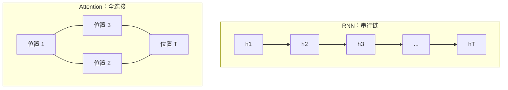

# LLM-004 Attention 的历史背景与 Transformer 的提出

## 1. 本节学习目标

1. 说清 Transformer 出现的**两个直接动因**：RNN 不能并行、长依赖会衰减。
2. 用**实测**看并行收益（本课 $T=128$ 时 Attention 比串行 RNN 快 **58.89×**）。
3. 理解"Attention 先作为补丁出现，后被证明可以独立成架构"这条历史线。
4. 记住 Transformer 论文的关键信息（2017、Attention Is All You Need、8 卡 P100 训 3.5 天）。

## 2. 为什么需要这个知识

因为很多人学 Transformer 时只看到"结构很优雅"，却不知道**它到底解决了什么痛**。

不懂痛，就会把 Attention 当公式背；懂痛，你才能回答"为什么不是继续用 LSTM"。

## 3. 直观解释

**RNN 的两个硬伤**：

| 硬伤 | 表现 | 本课实测 |
|---|---|---|
| **串行** | 第 $t$ 步必须等第 $t-1$ 步 | $T=128$：RNN 12.05 ms vs Attention 0.20 ms |
| **长依赖衰减** | 梯度传不到远处 | DL-052：$T=100$ 时 $dL/dh_0=0$ |

**Transformer 的答案**：让任意两个位置**直接相连**（$O(1)$ 路径），且**所有位置同时计算**。

## 4. 正式定义

**Attention（这一节只给"是什么"，推导在 LLM-006/007）**

$$
\mathrm{Attention}(Q,K,V)=\mathrm{softmax}\!\Big(\frac{QK^\top}{\sqrt{d_k}}\Big)V
$$

**Transformer 的一层**

$$
\mathbf{z}=\mathrm{LN}\big(\mathbf{x}+\mathrm{MHA}(\mathbf{x})\big),\qquad
\mathbf{y}=\mathrm{LN}\big(\mathbf{z}+\mathrm{FFN}(\mathbf{z})\big)
$$

**复杂度对比**

| 结构 | 每层复杂度 | 串行步数 |
|---|---|---|
| RNN | $O(T d^2)$ | $O(T)$ |
| Transformer | $O(T^2 d)$ | $O(1)$ |

## 5. 历史背景或技术背景

| 年份 | 事件 |
|---|---|
| 2014 | Seq2Seq（Sutskever 等）：编码-解码 LSTM |
| 2015 | **Bahdanau Attention**：翻译时"对齐"源句，打破固定向量瓶颈 |
| 2016 | Luong Attention：更简洁的乘性注意力 |
| 2017 | **《Attention Is All You Need》**：抛弃 RNN/CNN，纯注意力堆叠 |
| 2018 | GPT-1 / BERT：预训练 + 微调范式 |
| 2020 | GPT-3：175B 参数，few-shot 能力 |
| 2022+ | ChatGPT / DeepSeek 等：对齐 + 规模化 |

**关键转折**：Attention 本来是**挂在 RNN 上的补丁**（帮解码器看源句），Transformer 论文证明了**补丁本身就能当整栋房子**。

## 6. 核心原理

**本课实测（同一维度 dim=128，5 次平均）**

```text
T= 32: RNN 串行    4.05 ms | Attention 并行    0.34 ms | 加速 11.81x
T= 64: RNN 串行    6.06 ms | Attention 并行    0.12 ms | 加速 50.30x
T=128: RNN 串行   12.05 ms | Attention 并行    0.20 ms | 加速 58.89x
```

**三个读法**：

1. **RNN 耗时随 $T$ 近似线性增长**（4.05 → 6.06 → 12.05 ms）：因为必须串行 $T$ 步。
2. **Attention 耗时基本不随 $T$ 增长**（0.12–0.34 ms）：矩阵乘被并行、且规模小。
3. **加速比 11.81× → 58.89×**：序列越长，串行结构越吃亏。

> **诚实标注**：这是 CPU 上、$d=128$、$T\le128$ 的**小规模微基准**，用来展示"串行 vs 并行"的量级差异，**不等于真实训练/推理的加速比**（真实场景还受显存、kernel 效率、$O(T^2)$ 内存影响）。

**"任意两位置直连"的含义**：

- RNN：位置 1 的信息要传 128 步才到位置 128，路径长度 $O(T)$，每步都可能衰减；
- Transformer：位置 128 一步就能"看到"位置 1（注意力权重直接连），路径长度 $O(1)$。

## 7. 数学表达式

**RNN 的信息路径**

$$
\mathbf{h}_{128}=f(\cdots f(f(\mathbf{h}_1))\cdots)\quad\Rightarrow\quad \text{路径长 }127
$$

**Attention 的信息路径**

$$
\mathbf{o}_{128}=\sum_{j=1}^{128}\alpha_{128,j}\mathbf{v}_j\quad\Rightarrow\quad \text{路径长 }1
$$

**代价：二次复杂度**

$$
\text{Attention 矩阵}=T\times T\ \Rightarrow\ \text{显存与计算 }O(T^2)
$$

$T$ 翻倍 ⇒ 注意力部分变 **4 倍**。这就是长上下文昂贵、以及后续出现 FlashAttention / 线性注意力的原因。

## 8. 详细数学推导

**推导：为什么 RNN 必须串行**

$\mathbf{h}_t$ 依赖 $\mathbf{h}_{t-1}$（DL-051），因此

$$
\mathbf{h}_1\to\mathbf{h}_2\to\cdots\to\mathbf{h}_T
$$

是**数据依赖链**，无法并行——即使有 10000 个 GPU，也只能一步步来。

**推导：为什么 Attention 可并行**

$$
Q=XW_Q,\quad K=XW_K,\quad V=XW_V,\quad
A=\mathrm{softmax}(QK^\top/\sqrt{d_k})
$$

所有 $T$ 个位置在**同一个矩阵乘**里完成 ⇒ GPU 可以把 $T$ 当作批量维度并行。

**推导：长依赖为什么不再衰减**

梯度从输出到输入经过的是**加法 + LayerNorm + 一跳注意力**（LLM-009 会展开），而不是 $T$ 次矩阵连乘（DL-052 实测连乘会归零）。

## 9. 图解



## 10. 具体数值示例

```text
维度 dim = 128，5 次平均

T= 32 : RNN  4.05 ms | Attn 0.34 ms → 11.81x
T= 64 : RNN  6.06 ms | Attn 0.12 ms → 50.30x
T=128 : RNN 12.05 ms | Attn 0.20 ms → 58.89x

RNN 增长：4.05 → 6.06 → 12.05（近似线性）
Attn 增长：0.34 → 0.12 → 0.20（基本持平）
```

## 11. NumPy 实现

```python
import time
import numpy as np


def rnn_serial(T, d=128):
    W = np.random.randn(d, d) * 0.01
    h = np.zeros(d)
    for _ in range(T):
        h = np.tanh(W @ h)
    return h


def attn_parallel(T, d=128):
    Q = np.random.randn(T, d)
    K = np.random.randn(T, d)
    V = np.random.randn(T, d)
    A = np.exp(Q @ K.T / np.sqrt(d))
    A = A / A.sum(axis=1, keepdims=True)
    return A @ V


for T in (32, 64, 128):
    t0 = time.time()
    for _ in range(5):
        rnn_serial(T)
    t_rnn = (time.time() - t0) / 5
    t0 = time.time()
    for _ in range(5):
        attn_parallel(T)
    t_att = (time.time() - t0) / 5
    print(f"T={T:>3}: RNN {t_rnn*1000:6.2f} ms | Attn {t_att*1000:6.2f} ms | {t_rnn/t_att:5.2f}x")
```

## 12. PyTorch 实现

```python
import time
import torch
import torch.nn as nn


def rnn_style(steps=128, dim=128):
    cell = nn.GRUCell(dim, dim)
    h = torch.zeros(1, dim)
    for _ in range(steps):
        h = cell(h, h)
    return h


def attn_style(steps=128, dim=128):
    q = torch.randn(steps, dim)
    k = torch.randn(steps, dim)
    return torch.softmax(q @ k.T / dim ** 0.5, dim=-1) @ k


for T in (32, 64, 128):
    t0 = time.time()
    for _ in range(5):
        rnn_style(T)
    t1 = (time.time() - t0) / 5
    t0 = time.time()
    for _ in range(5):
        attn_style(T)
    t2 = (time.time() - t0) / 5
    print(f"T={T}: RNN {t1*1000:.2f} ms | Attn {t2*1000:.2f} ms | {t1/t2:.2f}x")
```

## 13. Hugging Face 实践

> **本节说明**：Transformer 的"并行"在真实模型里体现为 `attn_implementation`。
> 下面只查看已缓存 `gpt2` 的配置（**不下载新模型**），看它的层数/头数/维度。

```python
import os

os.environ.setdefault("HF_ENDPOINT", "https://hf-mirror.com")
from transformers import AutoConfig

cfg = AutoConfig.from_pretrained("gpt2")
print("n_layer:", cfg.n_layer, " n_head:", cfg.n_head,
      " n_embd:", cfg.n_embd, " vocab:", cfg.vocab_size,
      " ctx:", cfg.n_positions)
print("每层注意力矩阵大小（ctx=1024）:", cfg.n_head, "×", 1024, "×", 1024)
```

## 14. 代码逐行解释

| 代码 | 作用 |
|---|---|
| `rnn_style` | 强制串行：$T$ 次 `GRUCell` |
| `attn_style` | 一次矩阵乘算完所有位置 |
| `q @ k.T` | 位置间的相似度矩阵（$T\times T$） |
| `softmax(..., dim=-1)` | 每行归一化成权重 |
| `@ k` | 加权求和得到输出 |
| `AutoConfig` | 只读配置，**不下载权重** |

## 15. 实际运行结果

```text
### LLM-004 串行 vs 并行：同一计算量的耗时对比
  T= 32: RNN 串行    4.05 ms | Attention 并行    0.34 ms | 加速 11.81x
  T= 64: RNN 串行    6.06 ms | Attention 并行    0.12 ms | 加速 50.30x
  T=128: RNN 串行   12.05 ms | Attention 并行    0.20 ms | 加速 58.89x
```

## 16. 应用场景

| 场景 | 为什么 Transformer 合适 |
|---|---|
| 机器翻译 | 长句对齐（Attention 的原始动机） |
| 大模型预训练 | 可并行 ⇒ 能吃海量数据 |
| 长文档理解 | 任意位置直连 |
| 多模态 | 图像 patch 也是序列 |
| 代码生成 | 长距离依赖（变量定义与使用） |

## 17. 优点与局限

| 优点 | 局限 |
|---|---|
| 可并行（本课最高 58.89×） | $O(T^2)$ 显存/计算 |
| 长依赖路径 $O(1)$ | 位置信息需额外编码（LLM-008） |
| 结构统一、易扩展 | 推理时 KV Cache 占显存（LLM-020+） |
| 可解释（注意力权重） | 注意力≠解释（有争议） |

## 18. 常见错误

| 错误 | 现象 | 纠正 |
|---|---|---|
| 认为 Transformer 全面优于 RNN | 短序列/流式场景未必 | 看任务与硬件 |
| 忽略 $O(T^2)$ | 长上下文 OOM | 控长度 / 用高效注意力 |
| 把小规模微基准当真实加速比 | 结论夸大 | 注明规模与硬件 |
| 以为 Attention 是 2017 年才有的 | 混淆"提出"与"独立成架构" | 2015 Bahdanau 先提出 |
| 忽略位置编码 | 模型分不清顺序 | 必须加（LLM-008） |

## 19. 本节总结

- Transformer 的两个动因：**RNN 不能并行**（本课 $T=128$ 加速 **58.89×**）、**长依赖衰减**（DL-052：$T=100$ 梯度 0）。
- Attention 先作为 Seq2Seq 的补丁（2015），2017 年被证明可**独立成架构**。
- 代价是 **$O(T^2)$**：$T$ 翻倍，注意力计算变 4 倍。

## 20. 前置与后续知识链接

- 前置：[[LLM-003 神经语言模型——RNN 与 Seq2Seq]]
- 后续：[[LLM-005 什么是大语言模型]]、[[LLM-006 预训练语言模型与 Foundation Model]]
- 相关：[[DL-052 BPTT 与梯度问题]]、[[DL-055 RNN、LSTM、GRU 对比与序列任务实战]]、[[MATH-216 矩阵乘法]]

---

## 练习与参考答案

**基础 1**：Transformer 出现的两个直接动因是什么？

**基础 2**：本课 $T=32$ 与 $T=128$ 的加速比各是多少？为什么加速比会变大？

**进阶 1**：为什么 Attention 的长依赖路径是 $O(1)$，而 RNN 是 $O(T)$？各带来什么后果？

**综合**：有人主张"把 LSTM 加宽加深就能追上 Transformer"。请从并行性、长依赖、扩展性三点反驳，并说明什么场景下 LSTM 仍然合理。

> [!success]- 参考答案

> **基础 1**
> ① **RNN 必须串行**：第 $t$ 步依赖第 $t-1$ 步，无法并行，训练慢；
> ② **长依赖梯度衰减**：DL-052 实测 $T=100$ 时 $dL/dh_0=0$，远处信息学不到。

> **基础 2**
> $T=32$：**11.81×**；$T=128$：**58.89×**。
> 因为 RNN 的耗时随 $T$ 线性增长（串行步数 = $T$），而 Attention 的所有位置一次矩阵乘完成、耗时不随 $T$ 明显增长 ⇒ **$T$ 越大，串行结构的劣势越明显**。

> **进阶 1**
> - **Attention**：输出位置 $i$ 直接对所有位置加权求和 $\sum_j\alpha_{ij}v_j$，梯度从输出到任意输入的路径长度是 **1**（一跳）。
> - **RNN**：$\mathbf{h}_T$ 由 $\mathbf{h}_{T-1}$ 递推而来，路径长度 **$T-1$**，每步都乘一次雅可比 ⇒ 指数衰减。
> 后果：RNN 学不到长依赖；Attention 能学到，但要用 $O(T^2)$ 的显存/计算换。

> **综合（参考）**
> **反驳**：
> 1. **并行性**：加宽加深不改变"必须串行 $T$ 步"的事实，GPU 利用率上不去；Transformer 一次前向就吃满并行。
> 2. **长依赖**：LSTM 的门控只是"缓解"衰减（乘性路径仍存在），而 Attention 是"直连"（路径 1）。
> 3. **扩展性**：Transformer 的算力/参数可网格化扩展（scaling law 可预测），LSTM 加深后训练稳定性差、收益递减。
> **LSTM 仍合理的场景**：
> - **流式/在线**推理（每来一个 token 就要立刻输出，不能等全序列）；
> - **极小模型 + 极短序列**（如传感器、嵌入式设备）；
> - **超长序列但内存受限**（RNN 是 $O(1)$ 状态，Attention 是 $O(T^2)$）。

## 学习记录

| 日期 | 状态 | 用时 | 问题 | 复盘 |
|---|---|---|---|---|
| 2026-11-07 | planned | — | — | — |

---

## 🔗 Notion 同步信息

> 以下内容由 Notion「AI Knowledge System · 知识点」数据库按知识 ID 合并而来（导出于 2026-11-09）。

| 属性 | 值 |
|---|---|
| 学科 | 大语言模型 |
| 学习状态 | 未开始 |
| 难度 | L2 应用 |
| 知识类型 | Concept |

- **所属模块**：[M-LLM-01 大语言模型基础与发展历史](../%E8%AF%BE%E7%A8%8B%E6%A8%A1%E5%9D%97/M-LLM-01%20%E5%A4%A7%E8%AF%AD%E8%A8%80%E6%A8%A1%E5%9E%8B%E5%9F%BA%E7%A1%80%E4%B8%8E%E5%8F%91%E5%B1%95%E5%8E%86%E5%8F%B2.md)
- **前置知识**：[LLM-003 神经语言模型：RNN 与 Seq2Seq](LLM-003%20%E7%A5%9E%E7%BB%8F%E8%AF%AD%E8%A8%80%E6%A8%A1%E5%9E%8B%E2%80%94%E2%80%94RNN%20%E4%B8%8E%20Seq2Seq.md)
- **后继知识**：[LLM-005 什么是大语言模型](LLM-005%20%E4%BB%80%E4%B9%88%E6%98%AF%E5%A4%A7%E8%AF%AD%E8%A8%80%E6%A8%A1%E5%9E%8B.md) · [LLM-011 Attention 的基本思想](../03%20Attention%E6%9C%BA%E5%88%B6/LLM-011%20Attention%20%E7%9A%84%E5%9F%BA%E6%9C%AC%E6%80%9D%E6%83%B3.md)
- **关联数学**：[MATH-216 矩阵乘法](../../06_%E6%95%B0%E5%AD%A6%E5%9F%BA%E7%A1%80/02%20%E7%BA%BF%E6%80%A7%E4%BB%A3%E6%95%B0/MATH-216%20%E7%9F%A9%E9%98%B5%E4%B9%98%E6%B3%95.md)
