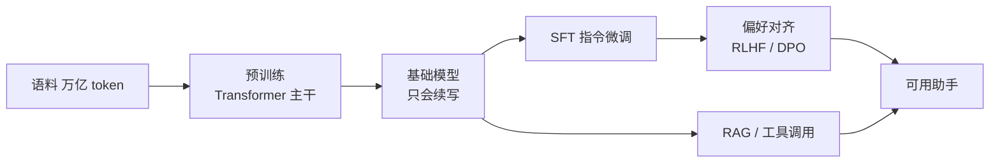

# LLM-005 什么是大语言模型

## 1. 本节学习目标

1. 给出"大语言模型"的可操作定义（不是"参数很多"这么模糊）。
2. 用**实测与估算**建立规模感：本课 gpt2（124M）显存 **487.5 MB**，7B 仅权重就要 **13.04 GB**。
3. 分清"参数量 / 显存 / 计算量 / 成本"四个不同概念。
4. 理解"大"带来的**涌现能力**与**新的工程问题**。

## 2. 为什么需要这个知识

因为"大模型"这三个字被用得太随意：

- 有人说"参数多就是大模型"（那 1B 算不算？）；
- 有人以为"大 = 一定好"（PPL 与能力并非线性）；
- 有人把"参数量"直接当"显存"（差 2–20 倍）。

这一节要把这些模糊说法**换成数字**。

## 3. 直观解释

**一个可操作的定义**：

> 大语言模型 = **在超大规模文本上预训练的、以 Transformer 为主干、参数量 ≥ 10 亿、能通过提示完成多种任务**的语言模型。

**四个"大"**：

| 维度 | 含义 | 量级 |
|---|---|---|
| 参数大 | 10⁹ ~ 10¹² | GPT-3 175B |
| 数据大 | 0.5 ~ 15 万亿 token | — |
| 算力大 | 10²² ~ 10²⁵ FLOPs | — |
| 上下文大 | 4K → 1M token | — |

## 4. 正式定义

**规模的关键指标**

$$
\text{参数量}\ N,\quad \text{训练 token 数}\ D,\quad \text{计算量}\ C\approx6ND
$$

（$6ND$ 是"前向 2 + 反向 4"的经验系数。）

**显存（仅权重）**

$$
\text{mem}_{\text{weight}}\approx N\times\text{bytes}_{\text{dtype}}
$$

| 精度 | 每参数字节 |
|---|---|
| FP32 | 4 |
| FP16 / BF16 | 2 |
| INT8 | 1 |
| INT4 | 0.5 |

**本课 gpt2（$N=124{,}439{,}808$）**

$$
\text{FP32}:\ 124.4\text{M}\times4\approx474\ \text{MB}
\ \Rightarrow\ \text{实测 }487.5\ \text{MB}\ ✅
$$

## 5. 历史背景或技术背景

| 年份 | 模型 | 参数 |
|---|---|---|
| 2018 | GPT-1 | 117M |
| 2018 | BERT-base | 110M |
| 2019 | GPT-2 | 1.5B |
| 2020 | GPT-3 | **175B** |
| 2022 | ChatGPT | 未公开 |
| 2023 | Llama 2 | 7B–70B |
| 2024+ | DeepSeek / Llama 3 / Qwen | 1.5B–671B（MoE） |

**从"模型"到"基础模型（Foundation Model）"**：一个预训练模型可作为**大量下游任务的起点**，不再为每个任务单独训练。

## 6. 核心原理

**本课实测/估算（规模与显存）**

```text
tiny-gpt2            参数       102,714 | fp16 权重    0.00 GB | fp32    0.00 GB
gpt2-small           参数   124,439,808 | fp16 权重    0.23 GB | fp32    0.46 GB
gpt2-medium（推算）   参数   355,000,000 | fp16 权重    0.66 GB | fp32    1.32 GB
7B（推算）            参数 7,000,000,000 | fp16 权重   13.04 GB | fp32   26.08 GB

KV Cache（gpt2-small：12 层、12 头、head_dim 64、fp16）
  ctx= 128: ≈ 4.5 MB
  ctx= 512: ≈ 18.0 MB
  ctx=1024: ≈ 36.0 MB

实测 gpt2-small 显存: 487.5 MB（124M 参数 fp32 权重约 474 MB）
```

**四个必须建立的数量感**：

1. **7B 的 FP16 权重 13.04 GB > 本机显存 12 GB** ⇒ **装不下**（还未算 KV Cache 与激活）。
2. **KV Cache 随上下文线性增长**（$128\to1024$：$4.5\to36$ MB，8 倍）。
3. **推理显存 ≠ 权重大小**：还要加 KV Cache、激活、框架开销。
4. **训练显存 ≫ 推理显存**：全参数训练还要存梯度（2×）+ Adam 状态（8×）。

## 7. 数学表达式

**训练显存粗估（全参数 + Adam + FP16 混合精度）**

| 组成 | 每参数字节 |
|---|---|
| 权重（FP16） | 2 |
| 梯度（FP16） | 2 |
| Adam 一阶矩（FP32） | 4 |
| Adam 二阶矩（FP32） | 4 |
| **合计** | **约 12–16**（含激活更多） |

⇒ **7B 全参数训练 ≈ 84–112 GB** ⇒ 单张 12 GB 卡不可能，必须 LoRA（LLM-040+）。

**LoRA 的对比（预告）**：只训 $<1\%$ 参数 ⇒ 显存主要被**冻结的权重**占据（7B FP16 = 13 GB，仍需量化才能进 12 GB）。

## 8. 详细数学推导

**推导：$C\approx6ND$**

- 前向：每个参数参与一次乘加 ⇒ 约 $2ND$ FLOPs；
- 反向：对权重与输入各算一次梯度 ⇒ 约 $4ND$；
- 合计 $\approx6ND$。

**本课量级**：$N=1.24\times10^8$、$D=10^{10}$（100 亿 token）：

$$
C\approx6\times1.24\times10^8\times10^{10}\approx7.4\times10^{18}\ \text{FLOPs}
$$

⇒ 对一台 100 TFLOPS 的有效算力，约需 $7.4\times10^{18}/10^{14}=7.4\times10^4$ 秒 ≈ **20.6 小时**（理想值，实际更久）。

**推导：为什么"参数量"不能直接比较能力**

能力还取决于 **数据质量、训练 token 数、对齐方法**。同样 7B：

- 只训 100B token 的 7B，可能不如训了 2T token 的 3B；
- 指令微调过的 7B，可能比未对齐的 70B 更好用。

这就是 **Chinchilla 结论**（参数量与数据量应大致同比扩展）的实践含义：**数据不够时，加大参数是浪费**。

## 9. 图解



## 10. 具体数值示例

```text
gpt2-small：N = 124,439,808
  FP16 权重 = 124.4M × 2 B = 248.9 MB ≈ 0.23 GB
  FP32 权重 = 124.4M × 4 B = 497.8 MB ≈ 0.46 GB
  实测显存 = 487.5 MB（含框架开销，与 FP32 权重同量级）

7B：N = 7,000,000,000
  FP16 = 13.04 GB  > 本机 12 GB  ⇒ 装不下
  INT8 = 6.52 GB   ⇒ 可能装下（还要 KV Cache）
  INT4 = 3.26 GB   ⇒ 可装下（QLoRA 的基础）
```

## 11. NumPy 实现

```python
def weight_mem_gb(params: int, bits: int) -> float:
    return params * bits / 8 / 1024 ** 3


for name, n in (("tiny-gpt2", 102_714), ("gpt2", 124_439_808), ("7B", 7_000_000_000)):
    print(f"{name:10} fp32={weight_mem_gb(n, 32):7.2f} GB  "
          f"fp16={weight_mem_gb(n, 16):7.2f} GB  "
          f"int8={weight_mem_gb(n, 8):6.2f} GB  "
          f"int4={weight_mem_gb(n, 4):6.2f} GB")
```

## 12. PyTorch 实现

```python
import torch

# 用真实模型验证"参数量 → 显存"的关系（已缓存，不下载）
import os
os.environ.setdefault("HF_ENDPOINT", "https://hf-mirror.com")
from transformers import AutoModelForCausalLM

dev = "cuda" if torch.cuda.is_available() else "cpu"
m = AutoModelForCausalLM.from_pretrained("gpt2").to(dev).eval()
n = sum(p.numel() for p in m.parameters())
print("参数量:", f"{n:,}")
print("预期 fp32 权重 MB:", round(n * 4 / 1024 ** 2, 1))
if dev == "cuda":
    print("实测显存 MB:", round(torch.cuda.memory_allocated() / 1024 ** 2, 1))
```

## 13. Hugging Face 实践

```python
import os

os.environ.setdefault("HF_ENDPOINT", "https://hf-mirror.com")
from transformers import AutoConfig

cfg = AutoConfig.from_pretrained("gpt2")
print("层数:", cfg.n_layer, " 头数:", cfg.n_head, " 维度:", cfg.n_embd,
      " 词表:", cfg.vocab_size, " 上下文:", cfg.n_positions)
print("每层参数量粗估:", round(cfg.n_embd ** 2 * 12 / 1e6, 2), "M（4 个注意力投影 + 2 个 FFN）")
```

## 14. 代码逐行解释

| 代码 | 作用 |
|---|---|
| `weight_mem_gb(n, bits)` | 参数量 → 显存（仅权重） |
| `n * 4 / 1024**2` | FP32 权重 MB 数 |
| `torch.cuda.memory_allocated()` | **实测**显存（含框架开销） |
| `AutoConfig` | 读取结构参数，不加载权重 |
| `n_layer/n_head/n_embd` | 估算模型规模的三要素 |

## 15. 实际运行结果

```text
tiny-gpt2            参数       102,714 | fp16 权重    0.00 GB | fp32    0.00 GB
gpt2-small           参数   124,439,808 | fp16 权重    0.23 GB | fp32    0.46 GB
gpt2-medium（推算）   参数   355,000,000 | fp16 权重    0.66 GB | fp32    1.32 GB
7B（推算）            参数 7,000,000,000 | fp16 权重   13.04 GB | fp32   26.08 GB

KV Cache（gpt2-small）
  ctx= 128: ≈ 4.5 MB
  ctx= 512: ≈ 18.0 MB
  ctx=1024: ≈ 36.0 MB

实测 gpt2-small 显存: 487.5 MB
```

## 16. 应用场景

| 场景 | 典型规模 | 可行性 |
|---|---|---|
| 本地学习/实验 | 124M–1B | ✅ 12 GB 卡可跑 |
| 本地 7B 推理 | 7B | ⚠️ 需量化（INT4/INT8） |
| 本地 7B 训练 | 7B | ❌ 需 LoRA + 量化 + 小 batch |
| API 调用 | 云端 | ✅ 无需本地显存 |
| 微调小模型 | 124M–1B | ✅ LoRA 轻松 |

## 17. 优点与局限

| 优点 | 局限 |
|---|---|
| 一个模型多任务 | 显存/成本高（7B fp16 = 13 GB） |
| 能力随规模涌现 | 幻觉、不可控 |
| 可继续微调 | 知识截止、需 RAG 补 |
| 生态成熟 | 部署复杂（KV Cache、量化） |

## 18. 常见错误

| 错误 | 现象 | 纠正 |
|---|---|---|
| 参数量当显存 | 以为 7B 只要 7 GB | FP16 是 **13 GB** |
| 忽略 KV Cache | 长上下文 OOM | 按 $2\cdot L\cdot H\cdot T\cdot d_h$ 估 |
| 以为"大一定好" | 70B 未对齐不如 7B 对齐 | 看数据与对齐 |
| 忽略数据量 | 只堆参数不堆数据 | 参考 Chinchilla 比例 |
| 把 MoE 总参数当激活参数 | 估错算力 | 看"激活参数量" |

## 19. 本节总结

- 大语言模型 = **大规模预训练 + Transformer 主干 + 十亿级以上参数 + 提示即用**。
- 实测：gpt2（124M）**487.5 MB**；7B 的 FP16 权重 **13.04 GB > 本机 12 GB** ⇒ 本地跑 7B 必须量化。
- 四个概念要分清：**参数量 / 权重显存 / KV Cache / 训练显存**（训练约 12–16 字节/参数）。

## 20. 前置与后续知识链接

- 前置：[[LLM-001 什么是语言模型]]、[[LLM-004 Attention 的历史背景与 Transformer 的提出]]
- 后续：[[LLM-006 预训练语言模型与 Foundation Model]]、[[LLM-008 LLM 的完整生命周期]]
- 相关：[[DL-058 设备管理——CPU 与 GPU]]、[[MATH-506 信息量与熵]]

---

## 练习与参考答案

**基础 1**：给出"大语言模型"的可操作定义（至少包含 3 个要素）。

**基础 2**：7B 模型在 FP16 下仅权重占多少显存？本机 12 GB 能直接加载吗？

**进阶 1**：为什么"参数量"不能直接代表"能力"？举两个反例。

**综合**：你要在 12 GB 显存的机器上跑一个 7B 模型做推理。请给出显存估算（权重 + KV Cache）与至少两种可行方案。

> [!success]- 参考答案

> **基础 1**
> ① 在**超大规模文本**上预训练；② 主干为 **Transformer**；③ 参数量在**十亿级及以上**；④ 能通过**提示（prompt）**完成多种任务而无需为每个任务单独训练。

> **基础 2**
> $7\times10^9\times2\ \text{B}=14\times10^9\ \text{B}\approx$ **13.04 GB**（GiB）。
> **不能**直接加载：本机显存 12 GB（12,282 MiB），还没算 KV Cache、激活与框架开销。

> **进阶 1**
> 反例一：**数据量不足**的 7B（只训 100B token）可能不如训了 2T token 的 3B；
> 反例二：**未对齐**的 70B 在对话任务上可能不如**经过 SFT/RLHF 的 7B**。
> 能力 = 参数量 × 数据质量/数量 × 训练方法 × 对齐方式，不是单一变量。

> **综合（参考）**
> **估算**：
> - 权重 INT4：$7\text{B}\times0.5\ \text{B}=3.5$ GB；
> - KV Cache（假设 32 层、32 头、$d_h=128$、ctx=2048、fp16）：
>   $$2\times32\times32\times2048\times128\times2\ \text{B}\approx1.07\ \text{GB}$$
> - 合计约 **4.6 GB**，剩余留给框架与激活 ⇒ **可行**。
> **两种方案**：
> 1. **INT4 量化（GGUF/GPTQ）** + llama.cpp/Ollama：权重 3.5 GB，CPU/GPU 混合推理最稳；
> 2. **INT8 量化**（约 6.5 GB）+ vLLM/Transformers：质量更好，但要控上下文长度。
> **不建议**：FP16 直接加载（13 GB > 12 GB，必然 OOM）——除非用 `device_map="auto"` 做 CPU offload（会很慢）。

## 学习记录

| 日期 | 状态 | 用时 | 问题 | 复盘 |
|---|---|---|---|---|
| 2026-11-07 | planned | — | — | — |

---

## 🔗 Notion 同步信息

> 以下内容由 Notion「AI Knowledge System · 知识点」数据库按知识 ID 合并而来（导出于 2026-11-09）。

| 属性 | 值 |
|---|---|
| 学科 | 大语言模型 |
| 学习状态 | 未开始 |
| 难度 | L2 应用 |
| 知识类型 | Concept |

- **所属模块**：[M-LLM-01 大语言模型基础与发展历史](../%E8%AF%BE%E7%A8%8B%E6%A8%A1%E5%9D%97/M-LLM-01%20%E5%A4%A7%E8%AF%AD%E8%A8%80%E6%A8%A1%E5%9E%8B%E5%9F%BA%E7%A1%80%E4%B8%8E%E5%8F%91%E5%B1%95%E5%8E%86%E5%8F%B2.md)
- **前置知识**：[LLM-001 什么是语言模型](LLM-001%20%E4%BB%80%E4%B9%88%E6%98%AF%E8%AF%AD%E8%A8%80%E6%A8%A1%E5%9E%8B.md) · [LLM-004 Attention 的历史背景与 Transformer 的提出](LLM-004%20Attention%20%E7%9A%84%E5%8E%86%E5%8F%B2%E8%83%8C%E6%99%AF%E4%B8%8E%20Transformer%20%E7%9A%84%E6%8F%90%E5%87%BA.md)
- **后继知识**：[LLM-006 预训练语言模型与 Foundation Model](LLM-006%20%E9%A2%84%E8%AE%AD%E7%BB%83%E8%AF%AD%E8%A8%80%E6%A8%A1%E5%9E%8B%E4%B8%8E%20Foundation%20Model.md)
- **关联数学**：[MATH-506 信息量与熵](../../06_%E6%95%B0%E5%AD%A6%E5%9F%BA%E7%A1%80/05%20%E7%A6%BB%E6%95%A3%E6%95%B0%E5%AD%A6/MATH-506%20%E4%BF%A1%E6%81%AF%E9%87%8F%E4%B8%8E%E7%86%B5.md)
