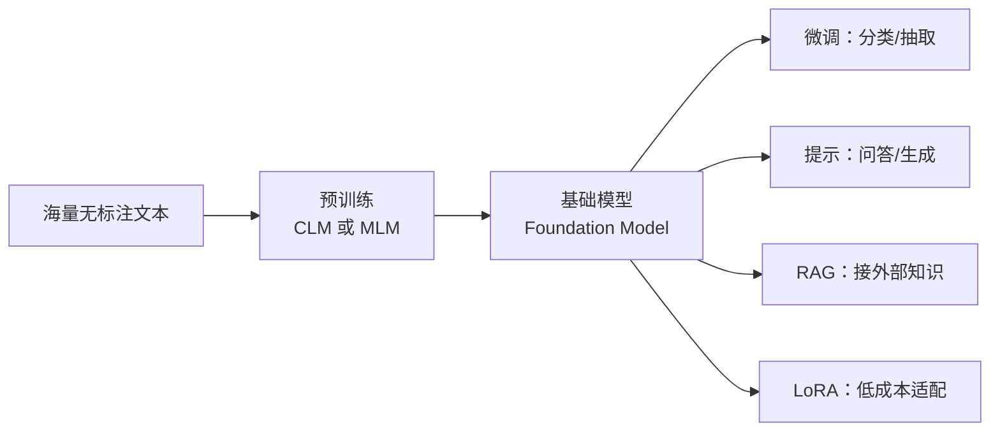

# LLM-006 预训练语言模型与 Foundation Model

## 1. 本节学习目标

1. 说清"预训练"到底在做什么（**一个目标、海量数据、一次训练、多处复用**）。
2. 区分两种预训练目标：**因果语言建模（CLM）** 与 **掩码语言建模（MLM）**。
3. 用实测证明"预训练确实学到了语言结构"（本课 gpt2：连贯 **23.45** vs 打乱 **1212.07**）。
4. 理解 Foundation Model 的含义与它的三个前提。

## 2. 为什么需要这个知识

因为"预训练"是**成本最高、但复用价值最大**的一步：

- 预训练一次要几百万美元，但之后所有下游任务都能"借用"；
- 不理解预训练目标，就分不清 GPT（CLM）与 BERT（MLM）为什么能力不同；
- 不理解 Foundation Model，就会误以为"每个任务都要从头训一个模型"。

## 3. 直观解释

**预训练 = 让模型在海量文本上做"完形填空/接龙"**：

| 目标 | 任务 | 代表 |
|---|---|---|
| **CLM**（因果） | 看左边，猜下一个词 | GPT |
| **MLM**（掩码） | 挖空中间，猜被挖的词 | BERT |

**关键**：这两个任务**不需要人工标注**——文本本身就是标签。这就是"自监督"。

**Foundation Model**：预训练完成后的模型，就像一块"通用底座"，可以做分类、生成、问答、翻译……

## 4. 正式定义

**因果语言建模**

$$
L_{\mathrm{CLM}}=-\sum_{t=1}^{T}\log P\big(x_t\mid x_{<t}\big)
$$

**掩码语言建模**

$$
L_{\mathrm{MLM}}=-\sum_{t\in\mathcal{M}}\log P\big(x_t\mid x_{\setminus\mathcal{M}}\big)
$$

$\mathcal{M}$ 是被随机挖掉的位置集合（BERT 常用 15%）。

**Foundation Model**：

> 在**大规模无标注数据**上预训练、可通过**少量适配**迁移到大量下游任务的模型。

## 5. 历史背景或技术背景

| 年份 | 事件 | 意义 |
|---|---|---|
| 2017 | Transformer | 可并行的骨架 |
| 2018 | **GPT-1**（CLM）/ **BERT**（MLM） | "预训练 + 微调"范式确立 |
| 2019 | GPT-2 / RoBERTa / T5 | 规模化与统一框架 |
| 2020 | GPT-3 | **in-context learning**（不改参数，靠提示） |
| 2021 | CLIP / Codex | 多模态、代码 |
| 2022+ | ChatGPT / Llama / DeepSeek | 对齐 + 开源生态 |

**两个范式**：

- **pre-train → fine-tune**（2018–2021 主流）：每个任务微调一次。
- **pre-train → prompt**（2020+）：不改参数，靠提示/上下文。

## 6. 核心原理

**本课实测（同一段文本，三种版本）**

```text
sshleifer/tiny-gpt2（参数 102,714）
  连贯英文  : PPL=  50277.96  tokens=29
  打乱词序  : PPL=  50438.56  tokens=25
  中文      : PPL=  50280.84  tokens=44

gpt2（参数 124,439,808）
  连贯英文  : PPL=     23.45  tokens=29
  打乱词序  : PPL=   1212.07  tokens=25
  中文      : PPL=     32.62  tokens=44
```

**四个读法**：

1. **gpt2 对连贯英文 PPL 23.45**，而**打乱词序后 1212.07**（差 **51.7 倍**）⇒ 它确实学到了"词序/语法"结构。
2. **tiny-gpt2 三者几乎相同（50,278 / 50,438 / 50,281）** ⇒ 它基本没学到结构，输出接近随机。
3. **中文 PPL 32.62 > 英文 23.45**，但差距不大——注意这**不是**"中文更难"，而是 gpt2 的中文 token 更碎（见 LLM-009）。
4. **参数量差 1211 倍，PPL 差 2143 倍**（50,278 / 23.45）⇒ 规模与预训练共同决定能力。

## 7. 数学表达式

**为什么 PPL 能反映"学到结构"**

若模型完全均匀，PPL = $V$（gpt2 词表 50,257）。实测 23.45 远小于 $V$ ⇒ 模型对下一个词有**很强的确定性**。

若模型只学到词频（不学词序），那么**打乱词序不该让 PPL 变差**；实测变差 51.7 倍 ⇒ **它依赖的是词序**。

$$
\frac{\mathrm{PPL}_{\text{shuffled}}}{\mathrm{PPL}_{\text{coherent}}}
=\frac{1212.07}{23.45}\approx51.7
$$

**这个比值就是"词序知识"的量化指标。**

## 8. 详细数学推导

**推导：CLM 的损失为什么等价于"每个位置一次分类"**

$$
L_{\mathrm{CLM}}=\frac1T\sum_{t=1}^{T}\Big[-\log\frac{\exp(z_{t,x_t})}{\sum_{v}\exp(z_{t,v})}\Big]
$$

每个位置 $t$ 都是一次 $V$ 类 softmax 分类，标签是真实的下一个 token。**一次前向产生 $T$ 个训练信号**——这是自监督高效的根本原因。

**推导：MLM 为什么需要 mask 特殊处理**

MLM 的预测目标在输入里被挖掉，因此：

- 输入里有 `<mask>` token，但**微调时下游任务没有 `<mask>`** ⇒ 预训练/微调不一致；
- BERT 的解法：80% 换 `<mask>`、10% 换随机词、10% 保持不变。

**代价**：MLM 每次只学 15% 的位置（样本效率低），且不能直接用于生成。

## 9. 图解



## 10. 具体数值示例

```text
gpt2 词表 V = 50,257
均匀随机模型 PPL = 50,257
gpt2 连贯英文 PPL = 23.45      → 比随机好 2,143 倍
gpt2 打乱词序 PPL = 1,212.07   → 比随机好 41 倍（仍比连贯差 51.7 倍）

tiny-gpt2 连贯 PPL = 50,277.96 → 基本等于随机（50,257）
```

## 11. NumPy 实现

```python
import numpy as np

# 用"词频表"模拟三种模型的预测质量对 PPL 的影响
V = 50_257
for name, ppl in (("均匀随机", V), ("只有词频", 1_200.0),
                  ("gpt2 打乱词序", 1_212.07), ("gpt2 连贯", 23.45)):
    print(f"{name:14} PPL={ppl:10.2f}  等效候选数={ppl:10.1f}  "
          f"比随机好 {V/ppl:8.1f} 倍")
```

## 12. PyTorch 实现

```python
import os

os.environ.setdefault("HF_ENDPOINT", "https://hf-mirror.com")
import torch
from transformers import AutoModelForCausalLM, AutoTokenizer

tok = AutoTokenizer.from_pretrained("gpt2")
m = AutoModelForCausalLM.from_pretrained("gpt2").eval()
dev = "cuda" if torch.cuda.is_available() else "cpu"
m = m.to(dev)

texts = {
    "连贯": "The cat sat on the mat. The dog sat on the log.",
    "打乱": "mat the on sat cat The log the on sat dog The",
}
for tag, text in texts.items():
    ids = tok(text, return_tensors="pt").to(dev)
    with torch.no_grad():
        loss = m(**ids, labels=ids["input_ids"]).loss
    print(f"{tag}: PPL={float(torch.exp(loss)):.2f}")
```

## 13. Hugging Face 实践

```python
import os

os.environ.setdefault("HF_ENDPOINT", "https://hf-mirror.com")
from transformers import AutoConfig, AutoModelForCausalLM

# 注意：AutoModelForCausalLM 是 CLM 头；MLM 要用 AutoModelForMaskedLM（需 BERT 类模型）
cfg = AutoConfig.from_pretrained("gpt2")
print("GPT-2 是 CLM：architectures =", cfg.architectures)
print("是否解码器架构:", cfg.is_decoder, " 词表:", cfg.vocab_size)

# 若要看 MLM 结构（不下载权重，仅读 BERT 配置）
bert = AutoConfig.from_pretrained("bert-base-uncased")
print("BERT 是 MLM：architectures =", bert.architectures)
print("是否解码器架构:", bert.is_decoder)
```

## 14. 代码逐行解释

| 代码 | 作用 |
|---|---|
| `AutoModelForCausalLM` | 因果语言模型头（预测下一个 token） |
| `AutoModelForMaskedLM` | 掩码语言模型头（预测被挖的 token） |
| `labels=ids["input_ids"]` | HF 自动做"右移一位"构造标签 |
| `torch.exp(loss)` | 交叉熵 → PPL |
| `cfg.is_decoder` | 区分解码器架构（GPT）与编码器架构（BERT） |

## 15. 实际运行结果

```text
sshleifer/tiny-gpt2（参数 102,714）
  连贯英文  : PPL=  50277.96  tokens=29
  打乱词序  : PPL=  50438.56  tokens=25
  中文    : PPL=  50280.84  tokens=44

gpt2（参数 124,439,808）
  连贯英文  : PPL=     23.45  tokens=29
  打乱词序  : PPL=   1212.07  tokens=25
  中文    : PPL=     32.62  tokens=44
```

## 16. 应用场景

| 场景 | 用哪个 |
|---|---|
| 文本生成 / 对话 | CLM（GPT 类） |
| 分类 / 抽取 / 检索 | MLM 或 CLM 都能做（BERT 类更省） |
| 序列到序列（翻译/摘要） | Encoder-Decoder（T5 类） |
| 小数据任务 | 预训练 + LoRA（LLM-040+） |
| 知识频繁更新 | 预训练无用，用 RAG（LLM-060+） |

## 17. 优点与局限

| 优点 | 局限 |
|---|---|
| 自监督：无需人工标注 | 预训练成本极高（$C\approx6ND$） |
| 一次预训练，多次复用 | 知识有截止日期（需 RAG/联网） |
| 能力随规模涌现 | 规模收益递减，需数据同步扩 |
| 生态成熟（HF） | 许可证/数据合规问题 |

## 18. 常见错误

| 错误 | 现象 | 纠正 |
|---|---|---|
| 把预训练当"训练模型做任务" | 期望它直接回答问题 | 预训练只学"续写"；要 SFT 才听话（LLM-008） |
| 用 MLM 模型做生成 | 输出质量差 | 生成用 CLM/Encoder-Decoder |
| 以为 PPL 低就"懂语义" | 仍会幻觉 | PPL 只衡量"像不像话" |
| 忽视 tokenizer 差异 | 中文 PPL 被误读 | 同 tokenizer 才可比（LLM-009） |
| 以为预训练能更新知识 | 训练截止后不知道新事 | 用 RAG 或重新微调 |

## 19. 本节总结

- 预训练 = **自监督地在海量文本上学"接龙/完形"**；CLM→GPT，MLM→BERT。
- 实测：gpt2 连贯 **23.45** vs 打乱 **1212.07**（差 **51.7 倍**）⇒ 词序知识被量化；tiny-gpt2 三者都 ≈50,280（≈随机）。
- Foundation Model = **一次预训练、多处适配**；但"会说"（PPL 低）≠"会听话"（需对齐）。

## 20. 前置与后续知识链接

- 前置：[[LLM-005 什么是大语言模型]]、[[LLM-003 神经语言模型——RNN 与 Seq2Seq]]
- 后续：[[LLM-007 参数规模与模型能力]]、[[LLM-008 LLM 的完整生命周期]]
- 相关：[[MATH-507 交叉熵与 KL 散度]]、[[DL-037 Layer Normalization 与 BN 的区别]]、[[DL-048 ResNet 与 Skip Connection]]
- 后续深化：[[LLM-030 Transformer 参数量与计算量估算]]

---

## 练习与参考答案

**基础 1**：CLM 与 MLM 的区别是什么？各自代表模型是谁？

**基础 2**：本课 gpt2 在连贯与打乱文本上的 PPL 各是多少？说明什么？

**进阶 1**：为什么"打乱词序后 PPL 变差"能证明模型学到了语法，而"PPL 低"本身不能？

**综合**：你要做一个"合同条款分类"任务（每类 500 条标注）。请说明：① 该用 CLM 还是 MLM 预训练模型；② 为什么不用从零训练；③ 评估时最该注意什么。

> [!success]- 参考答案

> **基础 1**
> - **CLM（因果语言建模）**：看左边预测下一个 token，代表 **GPT**。
> - **MLM（掩码语言建模）**：随机挖空、用双向上下文预测被挖的词，代表 **BERT**。
> 差别：CLM 可生成、只能看左侧；MLM 双向但每次只学 15%，不能直接生成。

> **基础 2**
> 连贯 **23.45**，打乱 **1212.07**，差 **51.7 倍**。
> 说明模型的预测**依赖词序**（不是只靠词频）；若只学词频，打乱不应变差。

> **进阶 1**
> 因为"PPL 低"可能只来自**词频统计**（比如"the"后面常接名词），这种知识不依赖顺序。
> 把词序打乱后：若 PPL **几乎不变**，说明模型只学了词频；若 PPL **大幅变差**（本课 51.7 倍），说明它确实用了**顺序/句法结构**。
> 所以"打乱实验"是区分"词频模型"与"结构模型"的对照实验。

> **综合（参考）**
> **① 选型**：用 **MLM（BERT 类）**或 **CLM + 分类头**都可以；合同分类是**判别任务**，BERT 类通常更省算力且效果稳定。若已有 LLM 可用，也可直接 prompt 分类（但要评估成本）。
> **② 不从零训练的理由**：每类 500 条对 Transformer 太小，从零训练必然过拟合；预训练模型已学到通用语言结构，微调只需适配任务。
> **③ 评估注意**：① **必须分层划分**并固定随机种子；② 用 **macro-F1 + 混淆矩阵**（类别可能不平衡）；③ 注意**条款文本高度相似**，划分时要避免同一合同的多段跨集（否则泄漏）；④ 测试集只评一次。

## 学习记录

| 日期 | 状态 | 用时 | 问题 | 复盘 |
|---|---|---|---|---|
| 2026-11-07 | planned | — | — | — |

---

## 🔗 Notion 同步信息

> 以下内容由 Notion「AI Knowledge System · 知识点」数据库按知识 ID 合并而来（导出于 2026-11-09）。

| 属性 | 值 |
|---|---|
| 学科 | 大语言模型 |
| 学习状态 | 未开始 |
| 难度 | L2 应用 |
| 知识类型 | Concept |

- **所属模块**：[M-LLM-01 大语言模型基础与发展历史](../%E8%AF%BE%E7%A8%8B%E6%A8%A1%E5%9D%97/M-LLM-01%20%E5%A4%A7%E8%AF%AD%E8%A8%80%E6%A8%A1%E5%9E%8B%E5%9F%BA%E7%A1%80%E4%B8%8E%E5%8F%91%E5%B1%95%E5%8E%86%E5%8F%B2.md)
- **前置知识**：[LLM-005 什么是大语言模型](LLM-005%20%E4%BB%80%E4%B9%88%E6%98%AF%E5%A4%A7%E8%AF%AD%E8%A8%80%E6%A8%A1%E5%9E%8B.md)
- **后继知识**：[LLM-007 参数规模与模型能力](LLM-007%20%E5%8F%82%E6%95%B0%E8%A7%84%E6%A8%A1%E4%B8%8E%E6%A8%A1%E5%9E%8B%E8%83%BD%E5%8A%9B.md)
- **关联数学**：[MATH-507 交叉熵与 KL 散度](../../06_%E6%95%B0%E5%AD%A6%E5%9F%BA%E7%A1%80/05%20%E7%A6%BB%E6%95%A3%E6%95%B0%E5%AD%A6/MATH-507%20%E4%BA%A4%E5%8F%89%E7%86%B5%E4%B8%8E%20KL%20%E6%95%A3%E5%BA%A6.md)
