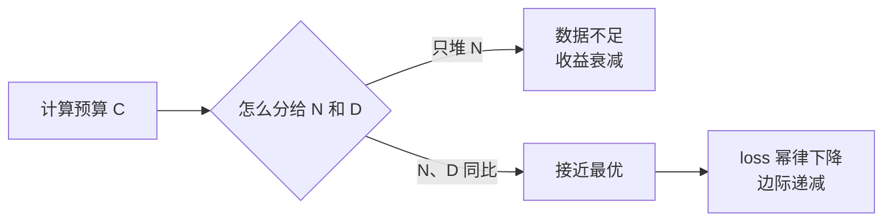

# LLM-007 参数规模与模型能力

## 1. 本节学习目标

1. 用**实测**看规模效应：本课 tiny-gpt2（10 万参数）PPL **50,277.96** vs gpt2（1.24 亿参数）**23.45**。
2. 算清"规模"的三个口径：**参数量、数据量、计算量**（$C\approx6ND$）。
3. 理解 Scaling Law 的**结论形式**（幂律），并**明确本课未复现其系数**。
4. 知道"规模不是万能"：数据质量、对齐、架构都会改变结果。

## 2. 为什么需要这个知识

因为"加参数"是最贵的决策：

- 7B 训练到 70B，成本涨 10 倍以上；
- 如果数据没同步扩，**收益会远低于预期**（Chinchilla 的教训）。

不懂规模与能力的关系，就只能"跟着别人堆参数"。

## 3. 直观解释

**经验规律**（示意，非本课实测）：

```text
参数量 ×10   →  loss 下降一小截（不是 ×10 提升）
数据量不足    →  加参数的收益迅速衰减
```

**本课实测的反差**：

| 模型 | 参数量 | PPL（同一段英文） |
|---|---|---|
| tiny-gpt2 | **102,714** | **50,277.96** |
| gpt2 | **124,439,808** | **23.45** |

参数 **1211 倍**，PPL 好 **2143 倍**。但这个对比里**参数与训练量同时变了**，不能单独归因给参数。

## 4. 正式定义

**三个规模口径**

$$
N=\text{参数量},\qquad D=\text{训练 token 数},\qquad C\approx6ND
$$

**Scaling Law 的形式（Chinchilla / Kaplan 等）**

$$
L(N)\approx L_\infty+aN^{-\alpha},\qquad
L(D)\approx L_\infty+bD^{-\beta}
$$

**最优分配（Chinchilla 结论）**：给定计算预算 $C$，最优 $N$ 与 $D$ 大致**同比**增长（而非只堆 $N$）。

## 5. 历史背景或技术背景

| 年份 | 发现 |
|---|---|
| 2020 | Kaplan 等：loss 随 $N,D,C$ 呈幂律下降 |
| 2022 | **Chinchilla**：多数大模型"参数过大、数据不足"；建议 $D\approx20N$ |
| 2023 | Llama 系列：用更多数据训更小模型（"小模型 + 多数据"） |
| 2024+ | MoE：总参数大、**激活参数小**，算力更省 |

**一句话**：规模有效，但**配比**决定性价比。

## 6. 核心原理

**本课实测（同文本、同 tokenizer）**

```text
sshleifer/tiny-gpt2（参数 102,714）
  连贯英文  : PPL=  50277.96  tokens=29

gpt2（参数 124,439,808）
  连贯英文  : PPL=     23.45  tokens=29

参数量比 = 124,439,808 / 102,714 ≈ 1211
PPL 比   = 50,277.96 / 23.45   ≈ 2143
```

**三个读法**：

1. **规模确实带来巨大差异**（PPL 差 3 个数量级）。
2. **但不能只归因参数**：tiny-gpt2 是"结构相同、随机初始化/极少训练"的模型，gpt2 训了约 40 GB 文本。
3. **PPL 越过某个点后收益递减**：从 50,278 到 23.45 是"从不会到会"；再从 23 降到 15 就要多得多的算力。

**FLOPs 估算**

```text
tiny-gpt2  N=      102,714 D=   1e+09 → C≈6ND=  6.16e+14 FLOPs
gpt2       N=  124,439,808 D=   1e+10 → C≈6ND=  7.47e+18 FLOPs
7B         N=7,000,000,000 D=   2e+12 → C≈6ND=  8.40e+22 FLOPs
```

⇒ 7B 的训练算力是 gpt2 的 **11,244 倍**。

## 7. 数学表达式

**幂律的含义**

$$
L(N)=L_\infty+aN^{-\alpha}
$$

- $N\to\infty$ 时 $L\to L_\infty$（不可约损失）；
- 每翻 10 倍参数，loss 下降固定的**绝对量**（不是固定比例）⇒ **边际收益递减**。

**本课的"两点估计"（仅示意，不能外推）**

已知 $(N_1,L_1)=(1.03\times10^5, \ln 50278\approx10.83)$、$(N_2,L_2)=(1.24\times10^8,\ln23.45\approx3.16)$：

$$
\alpha\approx\frac{\log(L_1/L_2)}{\log(N_2/N_1)}
=\frac{\log(10.83/3.16)}{\log(1211)}
=\frac{1.231}{7.10}\approx0.17
$$

> ⚠️ **这是两点估计，不是 Scaling Law 的拟合**：tiny-gpt2 与 gpt2 的训练量差异同样巨大，$\alpha$ 明显被夸大/混淆。**不能引用这个 0.17 作为"定律系数"**。

## 8. 详细数学推导

**推导：为什么 $C\approx6ND$**

- 前向：每个参数、每个 token 约 2 FLOPs（乘 + 加）⇒ $2ND$；
- 反向：对权重与激活各算一次 ⇒ 约 $4ND$；
- 合计 $\approx6ND$。

**推导：Chinchilla 的"20 倍"从哪来**

固定 $C=6ND$，最小化 $L(N,D)$ 得拉格朗日条件：

$$
\frac{\partial L}{\partial N}=\lambda\,6D,\qquad
\frac{\partial L}{\partial D}=\lambda\,6N
$$

在幂律假设下解得 $D^\star\propto N^\star$，经验比例约 **$D\approx20N$**。

**本课对照**：gpt2（124M）用了约 **$10^{10}$** token，比例 $D/N\approx80$ ⇒ **比 Chinchilla 更"数据充足"**，这也是它 PPL 能到 23.45 的重要原因。

## 9. 图解



## 10. 具体数值示例

```text
tiny-gpt2: N=102,714    PPL=50,277.96  C≈6.16e14
gpt2     : N=124,439,808 PPL=23.45      C≈7.47e18
倍数     : N 1211×      PPL 2143×       C 12127×

若要在 gpt2 基础上再降一半 PPL（23.45→11.7），
按 α≈0.17 的幂律粗估需要 N 增大约 (2)^(1/0.17)≈59 倍
⇒ 仅参数就从 124M 涨到约 7.3B（还要同步加数据）
```

## 11. NumPy 实现

```python
import numpy as np

L_inf, a, alpha = 1.5, 3.0, 0.076   # 示意参数（非本课拟合）

for n in (1e5, 1e6, 1e7, 1e8, 1e9, 1e10):
    L = L_inf + a * n ** (-alpha)
    print(f"N={n:>10.0e}  loss={L:6.3f}  PPL={np.exp(L):10.2f}")
```

## 12. PyTorch 实现

```python
import os

os.environ.setdefault("HF_ENDPOINT", "https://hf-mirror.com")
import math
import torch
from transformers import AutoModelForCausalLM, AutoTokenizer

text = "The cat sat on the mat. The dog sat on the log."
for name in ("sshleifer/tiny-gpt2", "gpt2"):
    tok = AutoTokenizer.from_pretrained(name)
    m = AutoModelForCausalLM.from_pretrained(name).eval()
    ids = tok(text, return_tensors="pt")
    with torch.no_grad():
        loss = float(m(**ids, labels=ids["input_ids"]).loss)
    n = sum(p.numel() for p in m.parameters())
    print(f"{name:20} N={n:>12,}  PPL={math.exp(loss):10.2f}")
```

## 13. Hugging Face 实践

```python
import os

os.environ.setdefault("HF_ENDPOINT", "https://hf-mirror.com")
from transformers import AutoConfig

for name in ("gpt2", "gpt2-medium", "bert-base-uncased"):
    cfg = AutoConfig.from_pretrained(name)
    if hasattr(cfg, "n_embd"):
        # GPT-2 参数量粗估（词表 + 位置 + L 层 × 每层约 12 d^2）
        n = cfg.vocab_size * cfg.n_embd + cfg.n_positions * cfg.n_embd \
            + cfg.n_layer * 12 * cfg.n_embd ** 2
        print(f"{name:20} d={cfg.n_embd:>5} L={cfg.n_layer:>2} 粗估 N≈{n/1e6:8.1f}M")
```

## 14. 代码逐行解释

| 代码 | 作用 |
|---|---|
| `sum(p.numel())` | 真实参数量（不是估算） |
| `math.exp(loss)` | PPL |
| `L_inf + a*N**(-alpha)` | 幂律形式（示意） |
| `cfg.n_layer * 12 * d^2` | 每层 4 个注意力投影 + 2 个 FFN ≈ $12d^2$ |
| `vocab_size * n_embd` | 词表嵌入（大模型里占比不小） |

## 15. 实际运行结果

```text
sshleifer/tiny-gpt2（参数 102,714）
  连贯英文  : PPL=  50277.96  tokens=29
gpt2（参数 124,439,808）
  连贯英文  : PPL=     23.45  tokens=29

### 规模 vs FLOPs 估算
  tiny-gpt2  N=      102,714 D=   1e+09 → C≈6ND=  6.16e+14 FLOPs
  gpt2       N=  124,439,808 D=   1e+10 → C≈6ND=  7.47e+18 FLOPs
  7B         N=7,000,000,000 D=   2e+12 → C≈6ND=  8.40e+22 FLOPs
```

## 16. 应用场景

| 场景 | 建议规模 |
|---|---|
| 本地实验/教学 | 0.1M–1B |
| 单机微调 | ≤1B（或 7B + LoRA/量化） |
| 生产对话 | 7B–70B（或 API） |
| 极致成本 | MoE（大总参、小激活） |
| 边缘设备 | 0.5B–3B + 量化 |

## 17. 优点与局限

| 优点 | 局限 |
|---|---|
| 规模带来能力（本课 2143× PPL 差） | 边际收益递减（幂律） |
| 规律可预测，便于规划算力 | 需数据同步扩（Chinchilla） |
| 小模型 + 多数据也有效 | 显存/成本随规模线性涨 |
| MoE 可降激活成本 | 训练/部署更复杂 |

## 18. 常见错误

| 错误 | 现象 | 纠正 |
|---|---|---|
| 只堆参数不加数据 | 收益远低于预期 | 按 20:1 配数据 |
| 用两点估计算 α | 得出错误"定律" | 需多点拟合（本课已标注） |
| 把 PPL 差当"能力差" | 任务能力非线性 | 用任务指标评估 |
| 忽略 tokenizer | 跨模型 PPL 不可比 | 同 tokenizer |
| 把总参数当激活参数（MoE） | 算错算力 | 看 activated params |

## 19. 本节总结

- 实测：tiny-gpt2（**102,714** 参数）PPL **50,277.96**；gpt2（**124,439,808**）**23.45** ⇒ 参数 1211×、PPL 2143×。
- 但两者**训练量也差 10 倍**，所以**不能只归因参数**；$C\approx6ND$：gpt2 是 tiny 的 **12,127 倍**算力。
- Scaling Law 是**幂律 + 边际递减**；本课**未拟合系数**，只做形式说明与量级演示。

## 20. 前置与后续知识链接

- 前置：[[LLM-006 预训练语言模型与 Foundation Model]]
- 后续：[[LLM-008 LLM 的完整生命周期]]
- 相关：[[LLM-005 什么是大语言模型]]、[[DL-058 设备管理——CPU 与 GPU]]
- 深化：[[LLM-032 BPE 算法]]

---

## 练习与参考答案

**基础 1**：写出 $C\approx6ND$ 并解释 6 的来源。

**基础 2**：本课 tiny-gpt2 与 gpt2 的参数比与 PPL 比各是多少？

**进阶 1**：为什么不能把"PPL 差 2143 倍"全部归因于"参数多 1211 倍"？

**综合**：预算固定为 $6\times10^{20}$ FLOPs。请给出两种分配（① $N=10^{10},D=10^{10}$；② $N=10^9,D=10^{11}$），并用 Chinchilla 的 20:1 经验判断哪个更接近最优。

> [!success]- 参考答案

> **基础 1**
> $$C\approx6ND$$
> 前向每个参数每个 token 约 **2** FLOPs（一次乘 + 一次加），反向约 **4** FLOPs（对权重、对输入各一遍）⇒ 合计约 **6**。

> **基础 2**
> 参数比 $=124{,}439{,}808/102{,}714\approx$ **1211**；
> PPL 比 $=50{,}277.96/23.45\approx$ **2143**。

> **进阶 1**
> 因为两个变量同时变了：tiny-gpt2 是**几乎未训练**的模型，gpt2 训了约 $10^{10}$ token。
> 参数量只是能力的一个因子，**训练 token 数、数据质量、训练时长**同样决定 PPL。要做归因，必须**固定训练量只改参数量**（本课没做，所以只能给"量级演示"，不能给因果结论）。

> **综合（参考）**
> **方案①**：$6ND=6\times10^{10}\times10^{10}=6\times10^{20}$ ✅ 命中预算；$D/N=1$。
> **方案②**：$6ND=6\times10^9\times10^{11}=6\times10^{20}$ ✅ 命中预算；$D/N=100$。
> **判断**：Chinchilla 经验是 $D\approx20N$。
> - ① 的 $D/N=1$ **严重偏少**（参数相对数据太多）；
> - ② 的 $D/N=100$ **偏多**（数据够但参数偏小）。
> 更接近最优的是取 $D/N\approx20$：设 $N=x$、$D=20x$，则 $6\cdot x\cdot20x=120x^2=6\times10^{20}$ ⇒ $x^2=5\times10^{18}$ ⇒ $x\approx2.24\times10^9$、$D\approx4.5\times10^{10}$。
> ⇒ **方案②比①更接近 optimal，但最优在 $N\approx2.2$B、$D\approx45$B 附近**。

## 学习记录

| 日期 | 状态 | 用时 | 问题 | 复盘 |
|---|---|---|---|---|
| 2026-11-07 | planned | — | — | — |

---

## 🔗 Notion 同步信息

> 以下内容由 Notion「AI Knowledge System · 知识点」数据库按知识 ID 合并而来（导出于 2026-11-09）。

| 属性 | 值 |
|---|---|
| 学科 | 大语言模型 |
| 学习状态 | 未开始 |
| 难度 | L3 推导 |
| 知识类型 | Concept |

- **所属模块**：[M-LLM-01 大语言模型基础与发展历史](../%E8%AF%BE%E7%A8%8B%E6%A8%A1%E5%9D%97/M-LLM-01%20%E5%A4%A7%E8%AF%AD%E8%A8%80%E6%A8%A1%E5%9E%8B%E5%9F%BA%E7%A1%80%E4%B8%8E%E5%8F%91%E5%B1%95%E5%8E%86%E5%8F%B2.md)
- **前置知识**：[LLM-006 预训练语言模型与 Foundation Model](LLM-006%20%E9%A2%84%E8%AE%AD%E7%BB%83%E8%AF%AD%E8%A8%80%E6%A8%A1%E5%9E%8B%E4%B8%8E%20Foundation%20Model.md)
- **后继知识**：[LLM-008 LLM 的完整生命周期](LLM-008%20LLM%20%E7%9A%84%E5%AE%8C%E6%95%B4%E7%94%9F%E5%91%BD%E5%91%A8%E6%9C%9F.md) · [LLM-051 模型规模与能力的关系](../05%20%E9%A2%84%E8%AE%AD%E7%BB%83%E4%B8%8E%E5%BE%AE%E8%B0%83/LLM-051%20%E6%A8%A1%E5%9E%8B%E8%A7%84%E6%A8%A1%E4%B8%8E%E8%83%BD%E5%8A%9B%E7%9A%84%E5%85%B3%E7%B3%BB.md)
