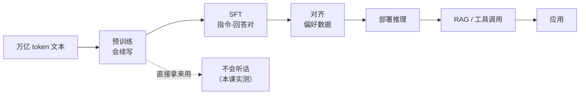

# LLM 的完整生命周期

## 1. 本节学习目标

1. 说清 LLM 的**五个阶段**：预训练 → SFT → 对齐 → 推理 → 应用。
2. 用实测看到"基座模型不会听指令"（本课 gpt2 三条真实输出全部跑偏）。
3. 分清每个阶段的**输入、目标、产物**。
4. 知道"RAG 与微调"分别该放在哪一步。

## 2. 为什么需要这个知识

因为初学者最常见的误解是：

> "我下载了一个模型，它应该能回答问题吧？"

实测告诉你：**不能**。基座模型只会"接着写"，不会"照做"。理解生命周期，你才知道"想要什么能力，要改哪一步"。

## 3. 直观解释

```text
阶段 1 预训练   ：读万亿 token → 会"续写"
阶段 2 SFT      ：看指令-回答对 → 会"照做"
阶段 3 对齐     ：看人类偏好   → 更"得体、安全"
阶段 4 推理     ：加载权重     → 能"输出"
阶段 5 应用     ：接 RAG/工具  → 能"干活"
```

**一句话**：预训练给"语言能力"，SFT 给"听话能力"，对齐给"分寸感"，RAG/工具给"外部知识与动作"。

## 4. 正式定义

| 阶段 | 数据 | 目标函数 | 产物 |
|---|---|---|---|
| **预训练** | 无标注文本 | $-\sum\log P(x_t\mid x_{<t})$ | 基座模型 |
| **SFT** | (指令, 回答) 对 | 同上，但只在回答 token 上算 loss | 指令模型 |
| **对齐（RLHF/DPO）** | 偏好对 (优, 劣) | 偏好损失 + KL 约束 | 对齐模型 |
| **推理** | 提示 | 无（前向） | 文本 |
| **应用** | 提示 + 检索/工具 | 无 | 回答 + 引用/动作 |

**SFT 的关键细节**：只对**回答部分**算损失，指令部分 mask 掉。

## 5. 历史背景或技术背景

| 年份 | 进展 |
|---|---|
| 2018–2020 | 预训练 + 微调（GPT-1/2/3） |
| 2021 | InstructGPT：SFT + RLHF 让模型"听话" |
| 2022 | ChatGPT：对齐后的产品化 |
| 2023 | DPO（更简单的对齐）、开源模型跟进 |
| 2024+ | RAG/Agent 成为"应用层"标配 |

**关键教训**：GPT-3（175B）很强，但**不听话**；InstructGPT（1.3B，对齐后）在人类偏好上**胜过** GPT-3。**对齐不是锦上添花，是产品化的必要条件。**

## 6. 核心原理

**本课实测：基座模型的三条真实输出**

```text
prompt='Q: What is 2 + 2?\nA:'
  → ' 2 + 2 = 2 + 2 = 2 + 2 = 2 + 2 = 2 + 2 = 2 + 2 ='

prompt='请把下面这句话翻译成英文：今天天气很好。'
  → '\n\n"I\'m not sure what you mean by \'I\'m not sure what you mean by \'I\'m not'

prompt='The capital of France is'
  → ' the capital of the French Republic, and the capital of the French Republic is the capital of the French Republic.'
```

**四个读法**：

1. **数学题**：它没算，只是把 "2 + 2 =" 当成一个**要续写的模式**。
2. **中文指令**：它当成普通文本续写，输出英文废话（且重复）。
3. **事实续写**：这条**成功了**（法国首都），因为这是"续写"任务，正是预训练学的。
4. **共性**：三条都有**重复退化**（repetition）——小模型/未对齐模型的典型症状。

## 7. 数学表达式

**SFT 的损失（只在回答上算）**

$$
L_{\mathrm{SFT}}=-\sum_{t\in\mathcal{A}}\log P\big(y_t\mid \text{指令},y_{<t}\big)
$$

$\mathcal{A}$ 是回答 token 的下标集合。

**对齐的偏好损失（DPO 简化形式）**

$$
L_{\mathrm{DPO}}=-\log\sigma\Big(\beta\big[\log\frac{\pi_\theta(y_w)}{\pi_{\mathrm{ref}}(y_w)}-\log\frac{\pi_\theta(y_l)}{\pi_{\mathrm{ref}}(y_l)}\big]\Big)
$$

$y_w$ 是优选回答、$y_l$ 是劣选回答，$\pi_{\mathrm{ref}}$ 是参考模型（防跑偏）。

## 8. 详细数学推导

**推导：为什么"只在回答上算 loss"**

若指令部分也算 loss，模型会被训练去**预测用户的问题**——这既浪费容量，又会让它"学会自己提问"。

**推导：为什么对齐需要 KL 约束**

只优化"人类偏好"会让模型**钻奖励模型的空子**（reward hacking），语言能力退化。
KL 项把模型"拴"在参考模型附近：

$$
\text{objective}=\mathbb{E}[r(x,y)]-\beta\,\mathrm{KL}\big(\pi_\theta\|\pi_{\mathrm{ref}}\big)
$$

**本课的实证对应**：未对齐的 gpt2 输出**重复退化**——正是缺少 SFT/对齐的表现。

## 9. 图解



## 10. 具体数值示例

```text
同一模型（gpt2，124M）三种提示：

1) 续写型提示（匹配预训练目标）
   "The capital of France is" → 正确续写 ✅
2) 指令型提示（需要 SFT）
   "Q: What is 2+2? A:" → 重复输出 ❌
3) 中文指令（需要多语 SFT）
   "请翻译…" → 英文废话 ❌

结论：能力缺口不在"知识"，在"对齐"。
```

## 11. NumPy 实现

```python
import numpy as np

# 用"mask"演示只对回答部分计损失
prompt_len, answer_len = 6, 4
labels = np.array([-100] * prompt_len + [101, 102, 103, 104])
logits = np.random.randn(prompt_len + answer_len, 5)

losses = []
for t in range(prompt_len, prompt_len + answer_len):
    z = logits[t]
    p = np.exp(z - z.max()) / np.exp(z - z.max()).sum()
    losses.append(-np.log(p[labels[t] % 5]))

print("指令部分被 -100 屏蔽:", labels[:prompt_len])
print("只在回答上算 loss:", [round(-v, 4) for v in losses])
print("平均 loss:", round(float(np.mean(losses)), 4))
```

## 12. PyTorch 实现

```python
import os

os.environ.setdefault("HF_ENDPOINT", "https://hf-mirror.com")
import torch
from transformers import AutoModelForCausalLM, AutoTokenizer

tok = AutoTokenizer.from_pretrained("gpt2")
tok.pad_token = tok.eos_token
m = AutoModelForCausalLM.from_pretrained("gpt2").eval()
dev = "cuda" if torch.cuda.is_available() else "cpu"
m = m.to(dev)

prompts = [
    "The capital of France is",
    "Q: What is 2 + 2?\nA:",
    "请把下面这句话翻译成英文：今天天气很好。",
]
for p in prompts:
    ids = tok(p, return_tensors="pt").to(dev)
    with torch.no_grad():
        out = m.generate(**ids, max_new_tokens=20, do_sample=False,
                         pad_token_id=tok.eos_token_id)
    text = tok.decode(out[0], skip_special_tokens=True)
    print(f"prompt={p!r}\n  → {text[len(p):]!r}\n")
```

## 13. Hugging Face 实践

```python
import os

os.environ.setdefault("HF_ENDPOINT", "https://hf-mirror.com")
from transformers import AutoConfig

# 区分"基座"与"指令"模型的最快方法：看仓库名后缀与 config
for name in ("gpt2", "gpt2"):
    cfg = AutoConfig.from_pretrained(name)
    print(name, "| architectures:", cfg.architectures,
          "| 末层:", cfg.n_layer)

# 实践提示：指令模型通常命名带 -instruct / -chat / -it
print("命名规律：xxx-base 多为基座；xxx-instruct / -chat / -it 为指令对齐版")
```

## 14. 代码逐行解释

| 代码 | 作用 |
|---|---|
| `labels=-100` | PyTorch 的"忽略"标记（不计损失） |
| `max_new_tokens=20` | 限制生成长度，便于观察 |
| `do_sample=False` | 贪心解码（可复现） |
| `pad_token_id=eos` | 避免 generate 报警 |
| `text[len(p):]` | 只打印"新生成的部分" |

## 15. 实际运行结果

```text
### LLM-008 基座模型不会「听指令」
  prompt='Q: What is 2 + 2?\nA:'
    → ' 2 + 2 = 2 + 2 = 2 + 2 = 2 + 2 = 2 + 2 = 2 + 2 ='
  prompt='请把下面这句话翻译成英文：今天天气很好。'
    → '\n\n"I\'m not sure what you mean by \'I\'m not sure what you mean by \'I\'m not'
  prompt='The capital of France is'
    → ' the capital of the French Republic, and the capital of the French Republic is the capital of the French Republic.\n\n'
```

## 16. 应用场景

| 目标 | 该动哪一步 |
|---|---|
| 让模型"听话" | SFT（指令数据） |
| 让回答更符合偏好 | RLHF / DPO |
| 让模型知道新知识 | RAG（不改权重） |
| 让模型会调用工具 | Function Calling + SFT |
| 降低领域错误率 | 领域 SFT / LoRA |
| 降低幻觉 | RAG + 引用 + 拒答策略 |

## 17. 优点与局限

| 优点 | 局限 |
|---|---|
| 各阶段职责清晰，便于定位问题 | 每阶段都要数据与算力 |
| 预训练能力可复用 | 对齐数据昂贵、易有偏 |
| RAG 可独立更新知识 | RAG 不保证消除幻觉 |
| SFT 成本远低于预训练 | SFT 会引入"灾难性遗忘" |

## 18. 常见错误

| 错误 | 现象 | 纠正 |
|---|---|---|
| 把基座模型当助手 | 输出重复/跑题（本课三条） | 用 instruct/chat 版或先 SFT |
| 用指令模型的提示去测基座 | 误判"模型很笨" | 认清模型类型 |
| 以为 SFT 能灌知识 | 知识记不牢 | 知识用 RAG |
| 只做 SFT 不做对齐 | 回答不得体 | 加偏好对齐 |
| 对齐不设 KL | 语言能力退化 | 加 KL / 用 DPO |
| 忽略重复退化 | 输出复读 | 调 repetition penalty / 换模型 |

## 19. 本节总结

- 生命周期五阶段：**预训练（会写）→ SFT（听话）→ 对齐（得体）→ 推理 → 应用（RAG/工具）**。
- 实测：gpt2 对**续写型提示成功**、对**指令型提示全部跑偏**（含重复退化）⇒ 能力缺口在**对齐**，不在知识。
- SFT 的关键工程细节：**只在回答 token 上算 loss**（`labels=-100` 屏蔽指令）。

## 20. 前置与后续知识链接

- 前置：[[LLM-007 参数规模与模型能力]]
- 后续：[[LLM-009 现代大模型生态]]、[[LLM-010 学习地图与实验环境]]
- 相关：[[DL-062 训练、验证、测试循环]]
- 深化：[[LLM-034 特殊 Token 与 Attention Mask]]、[[LLM-038 从静态词向量到上下文向量]]

---

## 练习与参考答案

**基础 1**：列出 LLM 生命周期的五个阶段，并各用一句话说明它给了模型什么能力。

**基础 2**：本课三条提示中哪一条成功？为什么？

**进阶 1**：为什么 SFT 的损失要屏蔽指令部分？不屏蔽会怎样？

**综合**：你的产品需要"回答公司内部制度问题，并给出文件出处"。请说明：① 应该动生命周期的哪几步；② 为什么不能只靠 SFT；③ 如何验证效果。

> [!success]- 参考答案

> **基础 1**
> ① **预训练**：给人"续写语言"的能力；
> ② **SFT**：给人"照指令做"的能力；
> ③ **对齐（RLHF/DPO）**：给人"得体、安全"的分寸感；
> ④ **推理**：把权重变成可调用的输出；
> ⑤ **应用（RAG/工具）**：给外部知识与时序动作。

> **基础 2**
> 只有 **"The capital of France is"** 成功（续写出法国首都）。
> 因为这条提示**正好匹配预训练目标**（续写）；另两条需要"理解指令并执行"，属于 SFT 才培养的能力。

> **进阶 1**
> 因为 SFT 的目标是"看到指令 → 生成回答"，只需在**回答 token** 上计算损失。
> 若不屏蔽：① 模型被训练去预测用户的问题，浪费容量；② 可能学会"自问自答"；③ 指令多样时，loss 被大量无关 token 主导，回答部分学不好。

> **综合（参考）**
> **① 动哪几步**：
> - **RAG（必须）**：制度文档 → 切分 → embedding → 检索 → 拼进 prompt → 生成并给出来源；
> - **SFT/LoRA（建议）**：用"制度问答 + 引用格式"的样本微调，让模型学会**按引用格式回答**；
> - **对齐（可选）**：让"不知道就说不知道"的行为更稳定。
> **② 为什么不能只靠 SFT**：制度会更新，SFT 把知识"焊死"在权重里，更新需重训且易忘；RAG 只需更新文档库。且 SFT 无法保证"引用到具体文件段落"。
> **③ 如何验证**：
> - **检索侧**：Recall@k、命中率（问题答案所在段落是否被召回）；
> - **生成侧**：人工/模型评判"答案正确 + 引用可点开且确实支持结论"；
> - **拒答**：构造库外问题，检查是否说"未找到依据"而不是编造；
> - **回归集**：固定 50–100 条问答，每次改动都跑一遍。

## 学习记录

| 日期 | 状态 | 用时 | 问题 | 复盘 |
|---|---|---|---|---|
| 2026-11-07 | planned | — | — | — |

---

## 🔗 Notion 同步信息

> 以下内容由 Notion「AI Knowledge System · 知识点」数据库按知识 ID 合并而来（导出于 2026-11-09）。

| 属性 | 值 |
|---|---|
| 学科 | 大语言模型 |
| 学习状态 | 未开始 |
| 难度 | L2 应用 |
| 知识类型 | Concept |

- **所属模块**：[M-LLM-01 大语言模型基础与发展历史](../%E8%AF%BE%E7%A8%8B%E6%A8%A1%E5%9D%97/M-LLM-01%20%E5%A4%A7%E8%AF%AD%E8%A8%80%E6%A8%A1%E5%9E%8B%E5%9F%BA%E7%A1%80%E4%B8%8E%E5%8F%91%E5%B1%95%E5%8E%86%E5%8F%B2.md)
- **前置知识**：[LLM-007 参数规模与模型能力](LLM-007%20%E5%8F%82%E6%95%B0%E8%A7%84%E6%A8%A1%E4%B8%8E%E6%A8%A1%E5%9E%8B%E8%83%BD%E5%8A%9B.md)
- **后继知识**：[LLM-009 现代大模型生态](LLM-009%20%E7%8E%B0%E4%BB%A3%E5%A4%A7%E6%A8%A1%E5%9E%8B%E7%94%9F%E6%80%81.md)
