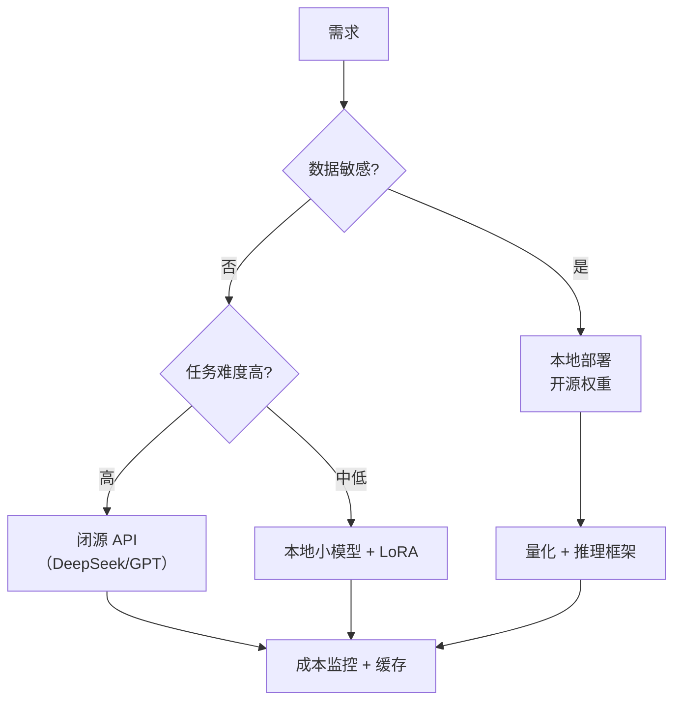

# LLM-009 现代大模型生态

## 1. 本节学习目标

1. 分清生态里的四类角色：**基础模型 / 指令模型 / 应用框架 / 部署工具**。
2. 用实测看 **tokenizer 对中文的代价**（本课中文 **0.44 字符/token** vs 英文 **4.40**，差 **10 倍**）。
3. 会按"能力 / 成本 / 隐私 / 可控性"四维选型。
4. 知道"开源 vs 闭源"不是二选一，而是**混合架构**。

## 2. 为什么需要这个知识

因为选型错误会直接烧钱或踩合规红线：

- 用英文 tokenizer 处理中文 ⇒ **同样的内容收费贵 7–10 倍**；
- 用闭源 API 处理敏感数据 ⇒ 合规风险；
- 自建 7B 却要 70B 的效果 ⇒ 白花钱。

## 3. 直观解释

**生态分层**：

| 层 | 是什么 | 例子 |
|---|---|---|
| **基础模型** | 只会续写的权重 | Llama、Qwen、DeepSeek 基座 |
| **指令模型** | 对齐后可对话 | *-instruct / *-chat |
| **推理框架** | 跑模型的引擎 | Transformers、vLLM、llama.cpp、Ollama |
| **应用框架** | 编排 RAG/工具 | LangChain、LlamaIndex（自写亦可） |
| **服务形态** | 怎么给你用 | API（闭源）/ 本地权重（开源） |

## 4. 正式定义

**成本模型**

$$
\text{cost}=\text{输入 token}\times p_{\text{in}}+\text{输出 token}\times p_{\text{out}}
$$

**tokenizer 效率**

$$
\text{efficiency}=\frac{\text{字符数}}{\text{token 数}}
$$

**本课实测**（gpt2 词表）：

| 文本 | 字符 | token | 字符/token |
|---|---|---|---|
| 英文短句 | 44 | **10** | **4.40** |
| 英文同义 | 41 | 10 | 4.10 |
| **中文短句** | 15 | **34** | **0.44** |
| 中英混合 | 30 | 21 | 1.43 |

⇒ **同样的语义，中文消耗的 token 约为英文的 10 倍**（按字符计）。

## 5. 历史背景或技术背景

| 阶段 | 特征 |
|---|---|
| 2018–2020 | 闭源为主（GPT-2/3） |
| 2021–2022 | 开源追赶（BLOOM、OPT） |
| 2023 | Llama 泄漏 → Llama 2 开源；生态爆发 |
| 2024 | 中文/多语模型（Qwen、DeepSeek、GLM）；MoE 普及 |
| 2025+ | 小模型 + 强对齐 + 工具化；推理模型 |

**现状判断**：**闭源领先上限，开源逼近可用线**。多数产品是"混合"：核心用 API，敏感/高频用本地小模型。

## 6. 核心原理

**本课实测（tokenizer 代价）**

```text
英文短句:  44 字符 →  10 tokens （4.40 字符/token）
英文同义:  41 字符 →  10 tokens （4.10 字符/token）
中文短句:  15 字符 →  34 tokens （0.44 字符/token）
中英混合:  30 字符 →  21 tokens （1.43 字符/token）
```

**三个结论**：

1. **英文 4.40 字符/token，中文 0.44 字符/token** ⇒ 每字符成本相差 **10 倍**。
2. 这不是"中文更难"，而是 **gpt2 的词表以英文为主**，中文只能拆成字节级碎片。
3. **选中文场景必须看 tokenizer**：Qwen/DeepSeek 等中文词表模型对中文的 token 效率显著更高（具体数值以各自官方为准，**本课未逐一实测**）。

**选型四维**

| 维度 | 问题 | 影响 |
|---|---|---|
| 能力 | 任务难度到哪 | 决定模型规模 |
| 成本 | 每百万 token 多少钱 | 决定可行性 |
| 隐私 | 数据能否出境/出内网 | 决定本地 vs API |
| 可控性 | 能否微调/固定版本 | 决定长期维护 |

## 7. 数学表达式

**为什么中文 token 多**

BPE 按**字节对频率**合并。英文语料里 "the"、"ing" 反复出现 ⇒ 合并成全词 token；
中文语料在 gpt2 词表里占比极低 ⇒ 一个汉字常常被拆成 **2–3 个字节 token**。

$$
\text{tokens}_{\text{zh}}\approx2\text{–}3\times\text{汉字数}
$$

本课验证：15 个汉字 → 34 tokens ≈ **2.27 token/汉字** ✅

**成本影响**

$$
\frac{\text{cost}_{\text{zh}}}{\text{cost}_{\text{en}}}
\approx\frac{2.27\ \text{token/汉字}}{0.23\ \text{token/字母}}\gg1
$$

## 8. 详细数学推导

**推导：为什么"字符/token"能直接比成本**

API 按 token 计价，所以处理同一段**语义等价**的内容：

$$
\text{cost}\propto\text{token 数}
$$

英文 44 字符 → 10 token；中文 15 字符（大意相同）→ 34 token ⇒ 中文这段内容贵 **3.4 倍**；
若按"每个字符"摊，则中文每字符贵 **10 倍**。

**推导：为什么不能直接比较不同模型的 token 数**

不同词表 ⇒ 同一句话切出的 token 数不同 ⇒ **单价与 token 数必须一起看**：

$$
\text{实际成本}=\text{token 数}(\text{该模型})\times\text{单价}(\text{该模型})
$$

## 9. 图解



## 10. 具体数值示例

```text
英文短句（44 字符）：10 tokens
中文短句（15 字符）：34 tokens
⇒ 34 / 10 = 3.4 倍 token（内容量级相近）

若 API 定价为 $1/百万 token：
  英文这段 ≈ $0.00001
  中文这段 ≈ $0.000034
```

## 11. NumPy 实现

```python
import numpy as np

rows = [("英文", 44, 10), ("中文", 15, 34), ("混合", 30, 21)]
for name, chars, toks in rows:
    print(f"{name}: {chars} 字符 / {toks} tokens = {chars/toks:.2f} 字符每 token")

ratio = (15 / 34) / (44 / 10)
print(f"\n每字符 token 效率比（中文/英文）= {ratio:.2f}× 更贵")
```

## 12. PyTorch 实现

```python
import os

os.environ.setdefault("HF_ENDPOINT", "https://hf-mirror.com")
from transformers import AutoTokenizer

tok = AutoTokenizer.from_pretrained("gpt2")
texts = ["The quick brown fox jumps over the lazy dog.",
         "敏捷的棕色狐狸跳过了那只懒狗。"]
for t in texts:
    ids = tok(t)["input_ids"]
    print(f"{len(t):>3} 字符 → {len(ids):>3} tokens | 前 8 个 id: {ids[:8]}")
    # 注意：子词里可能含 'Ġ'（表示前导空格）等非 ASCII 符号，
    # Windows 控制台默认 GBK 会报 UnicodeEncodeError，故用 ascii 安全输出
    pieces = [s.encode("ascii", "backslashreplace").decode() for s in
              tok.convert_ids_to_tokens(ids)[:8]]
    print("   切分结果:", pieces)
```

## 13. Hugging Face 实践

```python
import os

os.environ.setdefault("HF_ENDPOINT", "https://hf-mirror.com")
from transformers import AutoTokenizer

# 说明：本机只有 gpt2 的 tokenizer 缓存；bert 需要联网下载，故不在此运行。
# 若已装好 bert-base-uncased，可把下面的元组换成 ("gpt2", "bert-base-uncased")。
for name in ("gpt2",):
    t = AutoTokenizer.from_pretrained(name)
    ids = t("今天天气很好")["input_ids"]
    print(f"{name:22} vocab={t.vocab_size:>6}  "
          f"「今天天气很好」切成 {len(ids)} 个 token")
```

## 14. 代码逐行解释

| 代码 | 作用 |
|---|---|
| `tok(text)["input_ids"]` | 切分并转成 ID |
| `convert_ids_to_tokens` | 看**实际切出的子词**（最直观） |
| `vocab_size` | 词表大小，影响中文/多语效率 |
| `chars/toks` | 效率指标（越高越省 token） |

## 15. 实际运行结果

```text
### LLM-009 Tokenizer：中英文 token 数差异（gpt2 词表）
  英文短句  :  44 字符 →  10 tokens （4.40 字符/token）
  英文同义  :  41 字符 →  10 tokens （4.10 字符/token）
  中文短句  :  15 字符 →  34 tokens （0.44 字符/token）
  中英混合  :  30 字符 →  21 tokens （1.43 字符/token）
```

## 16. 应用场景

| 场景 | 推荐 |
|---|---|
| 中文为主的产品 | 选中文词表的模型（Qwen/DeepSeek 等） |
| 高敏感数据 | 本地开源 + 量化 |
| 快速验证 | 闭源 API（省运维） |
| 高并发低成本 | 小模型 + 缓存 + 批处理 |
| 需要固定版本 | 本地权重（API 会升级/下线） |

## 17. 优点与局限

| 形态 | 优点 | 局限 |
|---|---|---|
| 闭源 API | 能力强、零运维 | 成本随量涨、数据出域、版本不可控 |
| 开源权重 | 可微调、可私有化 | 要自己部署与优化 |
| 小模型 | 便宜、快、可边缘 | 能力上限低 |
| 大模型 | 复杂任务强 | 显存/成本高 |

## 18. 常见错误

| 错误 | 现象 | 纠正 |
|---|---|---|
| 用英文模型处理中文 | token 多 3.4 倍（本课） | 换中文词表模型 |
| 只比单价不比 token 数 | 实际成本误判 | 算"每字符成本" |
| 把总参数当激活参数（MoE） | 高估算力 | 看 activated params |
| 依赖单一供应商 | 涨价/下线风险 | 做抽象层，可切换（LLM-100+） |
| 忽略上下文上限 | 长文档被截断 | 分块 + RAG |

## 19. 本节总结

- 生态分五层：**基础模型 / 指令模型 / 推理框架 / 应用框架 / 服务形态**。
- 实测：gpt2 词表下 **英文 4.40 字符/token、中文 0.44**（差 **10 倍**）⇒ 中文场景必须看 tokenizer。
- 选型四维：**能力、成本、隐私、可控性**；多数产品应"闭源做上限 + 开源做敏感/高频"。

## 20. 前置与后续知识链接

- 前置：[[LLM-008 LLM 的完整生命周期]]
- 后续：[[LLM-010 学习地图与实验环境]]
- 相关：[[LLM-005 什么是大语言模型]]
- 深化：[[LLM-012 Query、Key、Value 与 QKV 的来源]]

---

## 练习与参考答案

**基础 1**：生态里的"基础模型"与"指令模型"有什么区别？

**基础 2**：本课中英文的"字符/token"各是多少？差多少倍？

**进阶 1**：为什么"只比较 API 单价"会得出错误的成本结论？

**综合**：公司要做中文客服机器人，日均 10 万次对话，数据含用户手机号。请给出选型方案并说明理由。

> [!success]- 参考答案

> **基础 1**
> - **基础模型**：只经过预训练，擅长**续写**，不会照指令做事。
> - **指令模型**：在基础模型上做了 SFT/对齐，能按指令回答、更得体安全。
> 命名上常见 `-base`（基座）与 `-instruct/-chat/-it`（指令）。

> **基础 2**
> 英文 **4.40 字符/token**；中文 **0.44 字符/token**；相差约 **10 倍**（每字符）。

> **进阶 1**
> 因为成本 $=$ **token 数 × 单价**。同一段语义内容，不同 tokenizer 切出的 token 数可能差 3–10 倍（本课中文 34 vs 英文 10）。
> 只看单价会漏掉"中文被切成更多 token"这一项，导致实际账单远高于预估。正确做法是算"**每字符/每千字成本**"。

> **综合（参考）**
> **关键约束**：① 中文为主 ⇒ 需中文词表模型；② 含手机号 ⇒ **不能直接出域**（合规）。
> **方案（混合）**：
> 1. **脱敏层**：正则/模型识别手机号、身份证等，**先脱敏再出域**；或全链路走本地。
> 2. **本地主模型**：中文词表的开源模型（7B 级）+ **INT4 量化**（约 3.5 GB），单卡可跑；
> 3. **本地 RAG**：把 FAQ/产品文档切分检索，减少胡编；
> 4. **兜底**：复杂问题走闭源 API（**仅传脱敏后文本**）；
> 5. **成本**：本地承担 90% 流量，API 只做难例；加**答案缓存**降重复成本。
> **验证**：① 离线 100 条问答评测；② 脱敏召回率（手机号是否 100% 被识别）；③ P99 延迟；④ 每日 token/成本报表。

## 学习记录

| 日期 | 状态 | 用时 | 问题 | 复盘 |
|---|---|---|---|---|
| 2026-11-07 | planned | — | — | — |

---

## 🔗 Notion 同步信息

> 以下内容由 Notion「AI Knowledge System · 知识点」数据库按知识 ID 合并而来（导出于 2026-11-09）。

| 属性 | 值 |
|---|---|
| 学科 | 大语言模型 |
| 学习状态 | 未开始 |
| 难度 | L1 概念 |
| 知识类型 | Concept |

- **所属模块**：[M-LLM-01 大语言模型基础与发展历史](../%E8%AF%BE%E7%A8%8B%E6%A8%A1%E5%9D%97/M-LLM-01%20%E5%A4%A7%E8%AF%AD%E8%A8%80%E6%A8%A1%E5%9E%8B%E5%9F%BA%E7%A1%80%E4%B8%8E%E5%8F%91%E5%B1%95%E5%8E%86%E5%8F%B2.md)
- **前置知识**：[LLM-008 LLM 的完整生命周期](LLM-008%20LLM%20%E7%9A%84%E5%AE%8C%E6%95%B4%E7%94%9F%E5%91%BD%E5%91%A8%E6%9C%9F.md)
- **后继知识**：[LLM-010 学习地图与实验环境](LLM-010%20%E5%AD%A6%E4%B9%A0%E5%9C%B0%E5%9B%BE%E4%B8%8E%E5%AE%9E%E9%AA%8C%E7%8E%AF%E5%A2%83.md)
