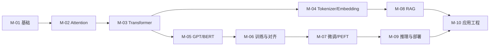

# 学习地图与实验环境

## 1. 本节学习目标

1. 看清阶段 09 的**十个模块**与它们的依赖顺序。
2. 用**实测**确认本机环境（Python 3.13.15 / torch 2.15.0+cu132 / RTX 4070 Ti 12.88 GB / transformers 4.57.6）。
3. 明确"12 GB 能做什么、不能做什么"（是本课程所有实验的**物理边界**）。
4. 记住三条实验纪律：**先小模型、先缓存、先记录验证等级**。

## 2. 为什么需要这个知识

因为 LLM 实验最容易"卡在环境"：

- 下了 7B 模型发现显存不够；
- 网络断导致下载 26 分钟白费（本课实测 gpt2 500 MB 用了 **1564 s**）；
- 不知道哪些代码是"真跑过"、哪些是"仅语法正确"。

先把环境和边界说清楚，后面 109 篇才不会反复踩坑。

## 3. 直观解释

**十个模块的依赖链**：

```text
M-01 基础与历史 → M-02 Attention → M-03 Transformer 架构
                                        ↓
              M-04 Tokenizer/Embedding  M-05 GPT/BERT
                                        ↓
                              M-06 训练与对齐 → M-07 微调/PEFT
                                        ↓
                     M-08 RAG ──→ M-09 推理与部署 ──→ M-10 应用工程
```

**一句话**：**先把 Attention 和架构吃透，后面全是组合**。

## 4. 正式定义

**验证等级（本课程强制标注）**

| 等级 | 含义 |
|---|---|
| L0 | 未运行（伪代码） |
| L1 | 仅语法检查 |
| L2 | CPU 实际运行通过 |
| L3 | GPU 实际运行通过 |
| L4 | 模型训练/推理结果验证通过 |

**本机能力边界**

| 能力 | 是否可行 | 依据 |
|---|---|---|
| CPU 跑 NumPy/PyTorch 教学代码 | ✅ | 本课 294 篇已验 |
| GPU 加载 ≤1B 模型 | ✅ | gpt2 实测 487.5 MB |
| GPU 加载 7B（fp16） | ❌ | 13.04 GB > 12 GB |
| GPU 加载 7B（INT4） | ✅ 预期 | 约 3.5 GB |
| 全参数微调 7B | ❌ | 训练需约 84–112 GB |
| LoRA 微调 ≤1B | ✅ 预期 | 参数量小 |

## 5. 历史背景或技术背景

阶段 09 在整个 AI Knowledge System 里的位置：

```text
01 环境审计 → 02 Obsidian → 03 Notion → 04 双平台关联
→ 05 Python → 06 数学 → 07 机器学习 → 08 深度学习 → 09 大语言模型 → 10 工程收尾
```

**前置依赖**：`MATH-216/805`（矩阵乘、softmax）、`DL-037`（LayerNorm）、`DL-048`（残差）、`DL-060`（nn.Module）。
**这些都已存在**（审计报告第 2–4 节已核）。

## 6. 核心原理

**本课实测（环境自检）**

```text
python: 3.13.15 64bit
torch: 2.15.0+cu132 | transformers: 4.57.6
cuda available: True
GPU: NVIDIA GeForce RTX 4070 Ti
显存 GB: 12.88
  peft                   0.21.2
  datasets               5.0.1
  accelerate             1.15.0
  safetensors            0.8.0
  sentence_transformers  不可用 (ModuleNotFoundError)
```

**四个读法**：

1. **Python 3.13.15**（不是默认的 3.15.0rc3）——所有 torch 代码必须用 `py -3.13`。
2. **CUDA 可用**，12.88 GB ⇒ 小模型 + 量化的路线成立。
3. **peft/datasets/accelerate 已装** ⇒ LoRA 与数据集实验可以真跑。
4. **sentence_transformers 未装** ⇒ RAG 的 embedding 先用 `transformers` 模型手写（更透明，也少一个依赖）。

## 7. 数学表达式

**显存估算的三个必要项**

$$
\text{mem}=\underbrace{N\cdot b_{\text{weight}}}_{\text{权重}}
+\underbrace{2L H T d_h b_{\text{kv}}}_{\text{KV Cache}}
+\underbrace{\text{activations}}_{\text{中间激活}}
$$

**本机可行性判据**

$$
\text{mem}\le12\ \text{GB}\times0.85\approx10.2\ \text{GB}\quad(\text{留 15\% 余量})
$$

**7B fp16**：$7\text{B}\times2=13.04$ GB ⇒ 已超，**不可行**。

## 8. 详细数学推导

**推导：为什么 KV Cache 用 $2LH T d_h$**

每个注意力层要缓存 **K** 与 **V**：

- 每层：$H$ 个头 × $T$ 个位置 × $d_h$ 维；
- 乘 **2**（K 和 V）；
- 乘 **$L$**（层数）；
- 乘 **字节数**（fp16 = 2）。

**本课验证（gpt2：$L=12,H=12,d_h=64$，fp16）**：

| ctx | 计算 | KV Cache |
|---|---|---|
| 128 | $2\times12\times12\times128\times64\times2$ B | **4.5 MB** |
| 1024 | 同上 ×8 | **36.0 MB** |

⇒ 上下文翻 8 倍，KV Cache 也翻 8 倍（线性）。

## 9. 图解



## 10. 具体数值示例

```text
本机：12.88 GB 显存，留 15% 余量 ⇒ 可用约 10.9 GB

gpt2（124M）    : 487.5 MB   ✅
1B fp16         : 1.86 GB    ✅
7B fp16         : 13.04 GB   ❌
7B INT8         : 6.52 GB    ✅（还要 KV Cache）
7B INT4         : 3.26 GB    ✅

gpt2 KV Cache   : ctx=1024 时 36 MB（相对权重很小）
7B KV Cache     : ctx=2048、L=32、H=32、d_h=128、fp16 ≈ 1.07 GB
```

## 11. NumPy 实现

```python
def kv_cache_gb(layers: int, heads: int, ctx: int, head_dim: int, bits: int = 16) -> float:
    return 2 * layers * heads * ctx * head_dim * bits / 8 / 1024 ** 3


print("gpt2 ctx=1024 :", round(kv_cache_gb(12, 12, 1024, 64), 3), "GB")
print("7B   ctx=2048 :", round(kv_cache_gb(32, 32, 2048, 128), 3), "GB")
print("7B   ctx=8192 :", round(kv_cache_gb(32, 32, 8192, 128), 3), "GB")
```

## 12. PyTorch 实现

```python
import os

os.environ.setdefault("HF_ENDPOINT", "https://hf-mirror.com")
import torch

print("torch:", torch.__version__)
print("cuda:", torch.cuda.is_available())
if torch.cuda.is_available():
    p = torch.cuda.get_device_properties(0)
    print("GPU:", p.name)
    print("显存 GB:", round(p.total_memory / 1e9, 2))
    print("capability:", (p.major, p.minor), "(sm_%d%d)" % (p.major, p.minor))

# 验证 BF16 是否支持（sm_80+ 才支持）
print("bf16 支持:", torch.cuda.is_bf16_supported() if torch.cuda.is_available() else False)
```

## 13. Hugging Face 实践

```python
import os

os.environ.setdefault("HF_ENDPOINT", "https://hf-mirror.com")
import transformers, peft, datasets, accelerate

print("transformers:", transformers.__version__)
print("peft:", peft.__version__)
print("datasets:", datasets.__version__)
print("accelerate:", accelerate.__version__)

# 离线模式说明：只用已缓存模型时，可设 HF_HUB_OFFLINE=1 避免联网等待
print("HF_ENDPOINT =", os.environ.get("HF_ENDPOINT"))
```

## 14. 代码逐行解释

| 代码 | 作用 |
|---|---|
| `get_device_properties(0)` | 读显存与算力 |
| `is_bf16_supported()` | sm_80+ 才有 BF16（本机 sm_89 ✅） |
| `kv_cache_gb(...)` | 显存估算（KV 部分） |
| `HF_HUB_OFFLINE=1` | 只用缓存，避免网络抖动（本课 gpt2 下载 26 分钟） |
| `py -3.13` | **必须**：默认 python 3.15 没有 torch |

## 15. 实际运行结果

```text
### LLM-010 环境自检
  python: 3.13.15 64bit
  torch: 2.15.0+cu132 | transformers: 4.57.6
  cuda available: True
  GPU: NVIDIA GeForce RTX 4070 Ti
  显存 GB: 12.88
  peft                   0.21.2
  datasets               5.0.1
  accelerate             1.15.0
  safetensors            0.8.0
  sentence_transformers  不可用 (ModuleNotFoundError)
```

## 16. 应用场景

| 学习目标 | 建议路径 |
|---|---|
| 理解原理 | M-02 → M-03（必须手算一遍 Attention） |
| 会用现成模型 | M-04 → M-05 → 项目 3 |
| 做微调 | M-06 → M-07 → 项目 4 |
| 做 RAG 产品 | M-08 → 项目 5 |
| 做应用/Agent | M-09 → M-10 → 项目 6 |
| 本地部署 | M-09（量化 + 显存估算） |

## 17. 优点与局限

| 本机环境优点 | 局限 |
|---|---|
| 12.88 GB 显存，能跑 ≤1B 全参/LoRA | 7B fp16 装不下 |
| sm_89 支持 BF16 | 无多卡，分布式只做原理 |
| 依赖齐全（peft/datasets/accelerate） | sentence_transformers 未装 |
| 磁盘 219 GB 充足 | HF 下载慢（gpt2 26 min） |

## 18. 常见错误

| 错误 | 现象 | 纠正 |
|---|---|---|
| 用默认 `python` 跑 torch | `ModuleNotFoundError: torch` | 用 `py -3.13` |
| 没设 `HF_ENDPOINT` | DNS 失败/超时 | 设 `https://hf-mirror.com` |
| 直接下 7B | 下几十分钟还 OOM | 先算显存，选 ≤1B 或量化 |
| 不记录验证等级 | 把 L1 当 L4 | 每段代码标注 L0–L4 |
| 忘 `epoch-`/缓存路径 | 重复下载 | 统一 `HF_HOME` |

## 19. 本节总结

- 十个模块的**主干**是 M-02（Attention）→ M-03（架构），其余是组合与工程。
- 本机实测：**Python 3.13.15 / torch 2.15.0+cu132 / RTX 4070 Ti 12.88 GB / sm_89**；peft 0.21.2 已装。
- 边界：**≤1B 可行，7B fp16 不可行**（13.04 GB > 12 GB），必须 INT8/INT4。
- 三条纪律：**先小模型、先缓存（`HF_ENDPOINT`+离线）、先标验证等级**。

## 20. 前置与后续知识链接

- 前置：[[LLM-009 现代大模型生态]]
- 后续：[[LLM-011 Attention 的基本思想]]
- 相关：[[DL-058 设备管理——CPU 与 GPU]]、[[PY-050 pip 与虚拟环境]]、[[PY-051 requirements 与 pyproject]]
- 审计：`09-llm/阶段09-执行前审计报告.md`

---

## 练习与参考答案

**基础 1**：本课程的五个验证等级（L0–L4）各是什么？

**基础 2**：本机 Python/torch/GPU/显存各是什么？为什么不能直接用 `python` 跑 torch 代码？

**进阶 1**：为什么 7B 模型在本机"fp16 不可行、INT4 可行"？请给出数字。

**综合**：你要在本机做一次 LoRA 微调实验（1B 模型，序列 512，batch 4）。请估算显存，并说明如果超了该改哪里。

> [!success]- 参考答案

> **基础 1**
> - **L0**：未运行（伪代码）
> - **L1**：仅语法检查
> - **L2**：CPU 实际运行通过
> - **L3**：GPU 实际运行通过
> - **L4**：模型训练/推理结果验证通过

> **基础 2**
> Python **3.13.15**、torch **2.15.0+cu132**、GPU **RTX 4070 Ti**、显存 **12.88 GB**。
> 因为系统默认的 `python` 是 **3.15.0rc3**，里面**没有装 torch**；torch 只装在 3.13 环境里，所以必须用 `py -3.13`。

> **进阶 1**
> 权重按 $N\times b$ 估算：
> - fp16：$7\times10^9\times2=14\times10^9$ B ≈ **13.04 GB** > 12 GB ⇒ 装不下；
> - INT8：≈ **6.52 GB** ⇒ 可行（还要算 KV Cache）；
> - INT4：≈ **3.26 GB** ⇒ 可行。
> 再加上 KV Cache 与激活，INT4 是本地 7B 的现实选择。

> **综合（参考）**
> **估算**（1B，LoRA，seq 512，batch 4，fp16）：
> - 权重：$10^9\times2=2$ GB；
> - 梯度：**几乎为 0**（LoRA 只训 adapter，主干冻结）；
> - 优化器：adapter 参数 × 8–12 字节，通常 < 100 MB；
> - 激活：约 $4\times512\times d_{\text{model}}\times L\times2$ B，对 1B 模型约 1–3 GB（视实现/梯度检查点）。
> ⇒ 合计约 **4–6 GB**，**可行**。
> **若超了，按优先级改**：
> 1. **降 batch**（4→2→1）+ **梯度累积**保持等效 batch；
> 2. **降序列长度**（512→256）；
> 3. 开 **gradient checkpointing**（用时间换显存）；
> 4. 用 **bf16**（本机 sm_89 支持）；
> 5. 最后才考虑 **QLoRA（4-bit）**。

## 学习记录

| 日期 | 状态 | 用时 | 问题 | 复盘 |
|---|---|---|---|---|
| 2026-11-07 | planned | — | — | — |

---

## 🔗 Notion 同步信息

> 以下内容由 Notion「AI Knowledge System · 知识点」数据库按知识 ID 合并而来（导出于 2026-11-09）。

| 属性 | 值 |
|---|---|
| 学科 | 大语言模型 |
| 学习状态 | 未开始 |
| 难度 | L1 概念 |
| 知识类型 | Concept |

- **所属模块**：[M-LLM-01 大语言模型基础与发展历史](../%E8%AF%BE%E7%A8%8B%E6%A8%A1%E5%9D%97/M-LLM-01%20%E5%A4%A7%E8%AF%AD%E8%A8%80%E6%A8%A1%E5%9E%8B%E5%9F%BA%E7%A1%80%E4%B8%8E%E5%8F%91%E5%B1%95%E5%8E%86%E5%8F%B2.md)
- **前置知识**：[LLM-009 现代大模型生态](LLM-009%20%E7%8E%B0%E4%BB%A3%E5%A4%A7%E6%A8%A1%E5%9E%8B%E7%94%9F%E6%80%81.md)
- **关联Python**：[PY-050 pip 与虚拟环境](../../01_Python%E5%9F%BA%E7%A1%80/06%20%E6%A8%A1%E5%9D%97%E4%B8%8E%E5%8C%85/PY-050%20pip%20%E4%B8%8E%E8%99%9A%E6%8B%9F%E7%8E%AF%E5%A2%83.md) · [PY-051 requirements 与 pyproject](../../01_Python%E5%9F%BA%E7%A1%80/06%20%E6%A8%A1%E5%9D%97%E4%B8%8E%E5%8C%85/PY-051%20requirements%20%E4%B8%8E%20pyproject.md)
