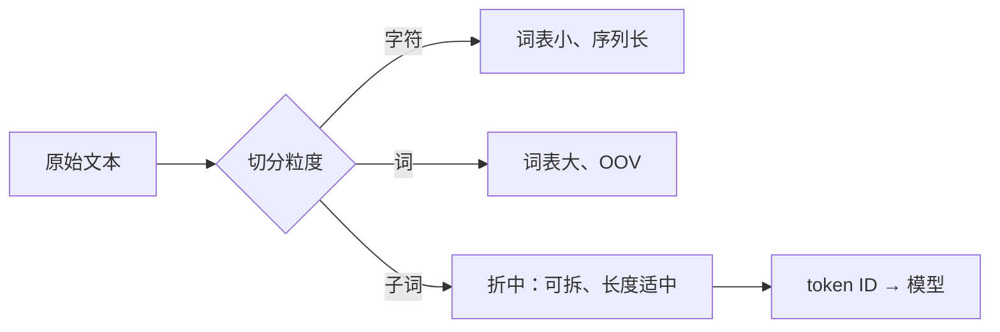

# Tokenizer 基础与子词切分

## 1. 本节学习目标

1. 说清三种粒度（**字符 / 词 / 子词**）的取舍。
2. 用实测看到"词级切分在真实句子上会 OOV"（本课 7 个词里 **4 个 OOV**）。
3. 理解子词（subword）为什么是工业标准答案。
4. 知道 Tokenizer 与模型是**绑定的**（换 tokenizer = 换模型语义）。

## 2. 为什么需要这个知识

因为 **token 是模型的"原子"**：

- 模型看到的一切都是 token ID；
- token 数决定**成本、上下文占用、推理速度**（LLM-035）；
- tokenizer 一变，同一句话的 token 数和 ID 全变 ⇒ 模型权重直接失效。

## 3. 直观解释

```text
句子：the cats are sitting on the mats

字符级：t h e _ c a t s _ a r e ...        （32 个）
词级  ：the / cats / are / sitting / on / the / mats   （7 个，但遇到新词就没 ID）
子词级：the / Ġcats / Ġare / Ġsitting / Ġon / Ġthe / Ġmats （7 个，且能拆未登录词）
```

**核心矛盾**：

| 粒度 | 词表 | 序列长度 | 未登录词 |
|---|---|---|---|
| 字符 | 极小 | **极长** | 无 |
| 词 | 极大 | 短 | **有（OOV）** |
| **子词** | 中 | 中 | 可拆成已知片段 |

## 4. 正式定义

**Tokenizer 是一个映射**

$$
\text{Tokenizer}:\ \text{str}\to[\text{id}_1,\dots,\text{id}_n]\in\{0,\dots,V-1\}^n
$$

并且（理想上）可逆：

$$
\text{decode}(\text{encode}(s))=s
$$

**词表大小 $V$**、**压缩率**

$$
\text{compression}=\frac{\text{字符数}}{\text{token 数}}
$$

## 5. 历史背景或技术背景

| 年代 | 方案 | 代表 |
|---|---|---|
| 早期 NLP | 词级 + 词表 | 传统统计机器翻译 |
| 2015 | 字符级 CNN/RNN | 一些序列标注 |
| 2016 | **BPE**（Sennrich 等） | NMT |
| 2018 | WordPiece | BERT |
| 2018 | **SentencePiece**（BPE/Unigram） | 多语言、T5 |
| 2020+ | tiktoken（BPE 变体） | GPT-3/4 |

**为什么子词成为标准**：它同时解决"词表爆炸"和"OOV"两个问题。

## 6. 核心原理

**本课实测（同一句子）**

```text
句子: the cats are sitting on the mats
字符级: ['t','h','e','_','c','a','t','s',...] 共 32 个
词级  : ['the','cats','are','sitting','on','the','mats'] 共 7 个
子词级: ['the','Ġcats','Ġare','Ġsitting','Ġon','Ġthe','Ġmats']  token 数: 7

词表大小（仅本语料）: 15
该句的 OOV 词: ['cats','are','sitting','mats']
```

**三个读法**：

1. **字符级 32 个** vs **词级 7 个**：序列长度差 4–5 倍 ⇒ 注意力成本差 16–25 倍（$T^2$）。
2. **词级在本语料上 OOV 4/7**：因为语料只有 6 句，词表 15 个；真实场景更严重（专有名词、新词、拼写变体）。
3. **子词同样 7 个 token**（gpt2 词表够大）⇒ 既短又不 OOV。

> 注意：`Ġ` 表示"前面有空格"（GPT-2 的字节级 BPE 用特殊字符编码空格），不是乱码。

## 7. 数学表达式

**子词的目标函数（简化）**

$$
\max_{\mathcal{V}}\ \sum_{i}\log P(\text{tokenize}(s_i))\quad\text{s.t.}\ |\mathcal{V}|=V
$$

**压缩率**

$$
\rho=\frac{|s|_{\text{chars}}}{|s|_{\text{tokens}}}
$$

本课：英文 10 token / 44 字符 ⇒ $\rho=4.40$；中文 34 token / 15 字符 ⇒ $\rho=0.44$（LLM-035）。

## 8. 详细数学推导

**推导：为什么词级会导致词表爆炸**

若词表要覆盖 $W$ 个词形（含屈折、拼写、专名），则：

$$
|\mathcal{V}_{\text{word}}|\approx\text{词形数}\ \Rightarrow\ 10^5\sim10^6
$$

而子词只需要覆盖"常见片段"：

$$
|\mathcal{V}_{\text{subword}}|\approx3\times10^4\sim2\times10^5
$$

**推导：为什么字符级太"贵"**

序列长度 $\approx$ 字符数。注意力成本 $O(T^2)$：

$$
\frac{\text{cost}_{\text{char}}}{\text{cost}_{\text{word}}}\approx\Big(\frac{32}{7}\Big)^2\approx21
$$

⇒ 同一句话，字符级要贵 **20 倍以上**。

## 9. 图解



## 10. 具体数值示例

```text
"the cats are sitting on the mats"
字符：32
词  ：7（但 4 个 OOV：cats/are/sitting/mats）
子词：7（gpt2）

语料词表：15
```

## 11. NumPy 实现

```python
from collections import Counter

corpus = [
    "the cat sat on the mat",
    "the dog sat on the log",
    "a cat and a dog sat on the mat",
] * 20

word_vocab = sorted({w for line in corpus for w in line.split()})
sentence = "the cats are sitting on the mats"

print("词表:", word_vocab[:8], "... 共", len(word_vocab))
print("字符级长度:", len(sentence))
print("词级长度  :", len(sentence.split()))
oov = [w for w in sentence.split() if w not in word_vocab]
print("OOV 词:", oov, "（%d/%d）" % (len(oov), len(sentence.split())))
```

## 12. PyTorch 实现

```python
import torch

# 用 tensor 表示"字符级"的 one-hot 序列，说明长度爆炸
s = "the cats are sitting on the mats"
chars = sorted(set(s))
stoi = {c: i for i, c in enumerate(chars)}

ids_char = torch.tensor([stoi[c] for c in s])
bad_chars = [c for c in s if c not in stoi]   # 本例用全字符表，故为空
print("字符表大小:", len(chars), " 字符级序列长度:", ids_char.shape[0])
print("若 1024 窗口，可容纳句子数（字符级）:", 1024 // ids_char.shape[0])
print("同上（词级，7 个 token）:", 1024 // 7)
```

## 13. Hugging Face 实践

```python
import os

os.environ.setdefault("HF_ENDPOINT", "https://hf-mirror.com")
os.environ.setdefault("HF_HUB_OFFLINE", "1")
from transformers import AutoTokenizer

tok = AutoTokenizer.from_pretrained("gpt2")
s = "the cats are sitting on the mats"
enc = tok(s)
print("token 数:", len(enc["input_ids"]))
print("切分:", [p.encode("ascii", "backslashreplace").decode() for p in
             tok.convert_ids_to_tokens(enc["input_ids"])])
print("往返一致:", tok.decode(enc["input_ids"]) == s)
print("词表大小:", tok.vocab_size)
```

## 14. 代码逐行解释

| 代码 | 作用 |
|---|---|
| `tok(s)["input_ids"]` | 切分并转 ID |
| `convert_ids_to_tokens` | 看实际片段（`Ġ` = 前导空格） |
| `tok.decode(...)` | 验证可逆 |
| `tok.vocab_size` | 词表大小 |
| `1024 // len` | 一个窗口能放几句话 |

## 15. 实际运行结果

```text
句子: the cats are sitting on the mats
字符级: ['t', 'h', 'e', '_', 'c', 'a', 't', 's', '_', 'a', 'r', 'e', '_', 's', 'i', 't', 't', 'i', 'n', 'g'] ... 共 32 个
词级  : ['the', 'cats', 'are', 'sitting', 'on', 'the', 'mats'] 共 7 个
子词级: ['the', 'Ġcats', 'Ġare', 'Ġsitting', 'Ġon', 'Ġthe', 'Ġmats']
token 数: 7

词表大小（仅本语料）: 15  该句的 OOV 词: ['cats', 'are', 'sitting', 'mats']
```

## 16. 应用场景

| 场景 | 说明 |
|---|---|
| 训练 LLM | 子词 BPE / Unigram |
| 多语言 | SentencePiece（不依赖空格） |
| 中文/日文 | 需专门词表，否则 token 爆炸（LLM-035） |
| 代码 | 需保留缩进与符号（GPT-4 用专门切分） |
| 生物序列 | 可用 k-mer 当作"子词" |

## 17. 优点与局限

| 粒度 | 优点 | 局限 |
|---|---|---|
| 字符 | 无 OOV、词表极小 | 序列极长、成本高 |
| 词 | 序列短、语义直接 | 词表爆炸、OOV |
| **子词** | 兼顾长度与覆盖 | 切分不直观、跨语言不均衡 |

## 18. 常见错误

| 错误 | 现象 | 纠正 |
|---|---|---|
| 把 token 当单词 | 成本估算错 | token≠word（LLM-035） |
| 换 tokenizer 不换模型 | 输出乱码/无意义 | tokenizer 与权重绑定 |
| 忽略 `Ġ` 等特殊符号 | 以为切分错了 | 那是空格标记 |
| 用词级词表处理新词 | OOV 崩 | 用子词 + `<unk>` |
| 以为所有语言 token 效率一样 | 中文成本高估/低估 | 按语言实测 |

## 19. 本节总结

- 三种粒度：**字符（32）/ 词（7，但 4/7 OOV）/ 子词（7）** ⇒ 子词是工业折中。
- 词级在真实场景 OOV 严重；字符级序列长度爆炸（成本约 20 倍）。
- **Tokenizer 与模型绑定**：换 tokenizer 等于换语义。

## 20. 前置与后续知识链接

- 前置：[[LLM-030 Transformer 参数量与计算量估算]]
- 后续：[[LLM-032 BPE 算法]]、[[LLM-033 WordPiece 与 SentencePiece]]、[[LLM-034 特殊 Token 与 Attention Mask]]、[[LLM-035 Token 数量、上下文窗口与成本]]
- 相关：[[LLM-036 Embedding 与向量表示]]

---

## 练习与参考答案

**基础 1**：字符级、词级、子词级各自的优缺点是什么？

**基础 2**：本课该句三种切分的长度各是多少？OOV 有几个？

**进阶 1**：为什么字符级的"成本"远高于词级？请用复杂度公式说明。

**综合**：你要做一个中文医疗问答系统。请说明 tokenizer 选择要考虑哪四点。

> [!success]- 参考答案

> **基础 1**
> - **字符级**：无 OOV、词表极小；但序列极长 ⇒ 注意力成本高。
> - **词级**：序列短、语义直接；但词表爆炸、**OOV 严重**（本课 4/7）。
> - **子词**：词表中等、可拆未登录词、长度适中 ⇒ 工业标准。

> **基础 2**
> 字符级 **32**、词级 **7**、子词 **7**；词级 OOV **4** 个（cats / are / sitting / mats）。

> **进阶 1**
> 注意力复杂度 $O(T^2d)$，所以
> $$\frac{\text{cost}_{\text{char}}}{\text{cost}_{\text{word}}}\approx\Big(\frac{32}{7}\Big)^2\approx21$$
> 即同一句话，字符级约贵 **20 倍**。此外序列变长还会增加 KV Cache 与延迟。

> **综合（参考）**
> **四点**：
> 1. **中文效率**：必须看"字符/token"（gpt2 中文 0.44，LLM-035）——选中文词表的模型，否则成本高 10 倍；
> 2. **专业术语覆盖**：医学术语（药名、解剖词）是否被切碎成很多 token ⇒ 影响成本与理解；
> 3. **数字/单位处理**：医学剂量（mg、ml）与数值是否稳定切分（避免 100 被切成 1/0/0）；
> 4. **可扩展性**：能否增量加词/微调词表，以及是否与目标模型权重**绑定**。
> **补充**：多语言/混合输入（中英 + 拉丁药名）要实测压缩率，别只看单语。

## 学习记录

| 日期 | 状态 | 用时 | 问题 | 复盘 |
|---|---|---|---|---|
| 2026-11-08 | planned | — | — | — |

---

## 🔗 Notion 同步信息

> 以下内容由 Notion「AI Knowledge System · 知识点」数据库按知识 ID 合并而来（导出于 2026-11-09）。

| 属性 | 值 |
|---|---|
| 学科 | 大语言模型 |
| 学习状态 | 未开始 |
| 难度 | L2 应用 |
| 知识类型 | Concept |

- **所属模块**：[M-LLM-04 Tokenizer、Embedding 与文本表示](../%E8%AF%BE%E7%A8%8B%E6%A8%A1%E5%9D%97/M-LLM-04%20Tokenizer%E3%80%81Embedding%20%E4%B8%8E%E6%96%87%E6%9C%AC%E8%A1%A8%E7%A4%BA.md)
- **前置知识**：[LLM-030 Transformer 参数量与计算量估算](../04%20Transformer%E6%9E%B6%E6%9E%84/LLM-030%20Transformer%20%E5%8F%82%E6%95%B0%E9%87%8F%E4%B8%8E%E8%AE%A1%E7%AE%97%E9%87%8F%E4%BC%B0%E7%AE%97.md)
- **后继知识**：[LLM-032 BPE 算法](LLM-032%20BPE%20%E7%AE%97%E6%B3%95.md) · [LLM-068 微调数据构造与质量](../05%20%E9%A2%84%E8%AE%AD%E7%BB%83%E4%B8%8E%E5%BE%AE%E8%B0%83/LLM-068%20%E5%BE%AE%E8%B0%83%E6%95%B0%E6%8D%AE%E6%9E%84%E9%80%A0%E4%B8%8E%E8%B4%A8%E9%87%8F.md)
