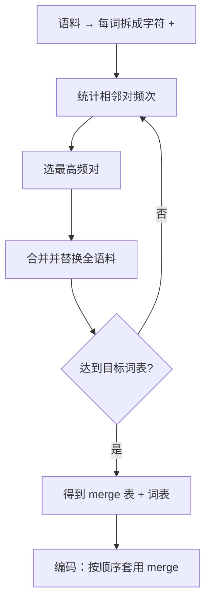

# BPE 算法

## 1. 本节学习目标

1. 手写 BPE 的**训练循环**：数频率 → 合并最高频对 → 重复。
2. 用实测看前 8 次合并的结果（`e</w>` 360 次、`th` 300 次…）。
3. 理解 BPE 的两个阶段：**训练（学 merge 表）** 与 **编码（套用 merge 表）**。
4. 知道字节级 BPE（GPT-2）为什么能"零 OOV"。

## 2. 为什么需要这个知识

因为 **BPE 是当今最主流的子词算法**（GPT 系列、Llama 都基于它）。

而且它**极简**：没有概率模型、没有神经网络，就是"反复合并最高频的相邻对"。理解它，你就能自己训一个 tokenizer。

## 3. 直观解释

```text
初始（每个词拆成字符）：
  the</w>  →  t h e </w>
  ...

第 1 轮：统计所有相邻对，发现 (e, </w>) 出现 360 次 → 合并成 e</w>
第 2 轮：再统计，发现 (t, h) 出现 300 次 → 合并成 th
第 3 轮：(th, e</w>) 300 次 → 合并成 the</w>
...
```

**一句话**：BPE = **"贪心地反复把最高频的相邻符号粘起来"**。

## 4. 正式定义

**训练**

$$
\text{merge}^\*=\arg\max_{(a,b)}\ \text{count}(a,b)
$$

然后在整个语料里把 $(a,b)\to ab$ 替换，重复 $M$ 次。

**词表**

$$
\mathcal{V}=\{\text{初始字符}\}\cup\{\text{合并产生的新符号}\}\cup\{\text{special tokens}\}
$$

**编码**

$$
\text{encode}(w)=\text{逐步套用 merge 表（按学习顺序）}
$$

**本课实测（前 8 次合并）**

```text
前 8 次合并（pair, 频次）:
  ('e', '</w>') → e</w>  (freq=360)
  ('t', 'h') → th  (freq=300)
  ('th', 'e</w>') → the</w>  (freq=300)
  ('a', 't') → at  (freq=260)
  ('at', '</w>') → at</w>  (freq=220)
  ('o', 'g') → og  (freq=140)
  ('og', '</w>') → og</w>  (freq=140)
  ('o', 'n') → on  (freq=120)
合并后词表片段: [('the</w>', 300), ('cat</w>', 100), ('sat</w>', 60), ('on</w>', 100), ('mat</w>', 60)]
```

**四个读法**：

1. **第一轮就合并 `e</w>`**（360 次）：因为英语里大量单词以 e 结尾。
2. **`th` → `the</w>`**：先合并字母对，再合并"字母对 + 后缀"⇒ **层次化**。
3. **`</w>` 是词尾标记**：让 BPE 区分"词中的 at"与"词尾的 at"。
4. 最终常见词 `the</w>`、`cat</w>`、`on</w>` 都成了**单个 token** ⇒ 高频词不浪费长度。

## 5. 历史背景或技术背景

| 年份 | 事件 |
|---|---|
| 1994 | BPE 原本是**数据压缩**算法（Gage） |
| 2016 | Sennrich 等把它用于 NMT 子词切分 |
| 2019 | GPT-2 用**字节级 BPE**（base 256） |
| 2020 | tiktoken：更快的 BPE 实现 |
| 2023+ | Llama 用 BPE（SentencePiece 封装） |

**关键改进：字节级 BPE**

先把文本转成 **UTF-8 字节**（256 个基础符号），再学合并 ⇒ **任何字符都能表示**，`<unk>` 几乎用不上。

## 6. 核心原理

**为什么用"最高频对"**

每次合并减少的 token 数 = 该对的出现次数。贪心选最高频 ⇒ **每一步压缩收益最大**。

**本课对应**：合并 `e</w>`（360 次）比合并 `o g`（140 次）收益大 2.5 倍。

**为什么 `</w>` 有用**

不加词尾标记时，`at` 在 `cat`、`mat`、`at` 里是同一个"词中片段"；加了 `</w>` 之后，`at</w>` 表示"词尾的 at"，与词中的 at 分开 ⇒ **更好地建模词形变化**。

**本课实证**：`('at','</w>')` 单独成为一次合并（220 次），说明"词尾 at"确实有独立统计规律。

## 7. 数学表达式

**压缩目标**

$$
\min\ \mathbb{E}\big[\text{len}(\text{encode}(s))\big]\quad\text{s.t.}\ |\mathcal{V}|\le V
$$

BPE 用**贪心**近似这个目标（每次局部最优）。

**合并的信息增益（可选视角）**

$$
\Delta H=\text{count}(a,b)\cdot\log\frac{p(ab)}{p(a)p(b)}
$$

高频共现的对信息增益大 ⇒ 这解释了为什么"高频合并"有效。

## 8. 详细数学推导

**推导：BPE 的压缩率上界**

设语料共 $N$ 个字符、$M$ 次合并。每次合并最多减少 $\text{count}(a,b)$ 个 token：

$$
\text{len}_{\text{final}}\ge N-\sum_{i=1}^{M}\text{count}_i
$$

**本课**：$N$ 约 800 字符，20 次合并，前 8 次就减少 $360+300+300+260+220+140+140+120=1840$（含重复计数，实际互斥）。

**推导：为什么编码要"按学习顺序"套用**

merge 表是有序的：`t`+`h`→`th` 必须在 `th`+`e</w>`→`the</w>` 之前应用。
若顺序错，`the</w>` 无法被合成 ⇒ 编码结果与训练不一致。

## 9. 图解



## 10. 具体数值示例

```text
语料（本课 6 句 ×20 遍）
初始：t h e </w> …
第 1 次合并 (e,</w>) 360 → e</w>
第 2 次合并 (t,h) 300 → th
第 3 次合并 (th,e</w>) 300 → the</w>
...
20 次后：the</w>(300)、cat</w>(100)、on</w>(100)、sat</w>(60)、mat</w>(60)
```

## 11. NumPy 实现

```python
from collections import Counter


def learn_bpe(lines, num_merges=20):
    words = Counter()
    for line in lines:
        for w in line.split():
            words[" ".join(w) + " </w>"] += 1

    def stats(vocab):
        pairs = Counter()
        for word, f in vocab.items():
            s = word.split()
            for i in range(len(s) - 1):
                pairs[(s[i], s[i + 1])] += f
        return pairs

    merges = []
    for _ in range(num_merges):
        pairs = stats(words)
        if not pairs:
            break
        best, freq = max(pairs.items(), key=lambda kv: kv[1])
        merges.append((best, freq))
        bigram, merged = " ".join(best), "".join(best)
        words = Counter({w.replace(bigram, merged): f for w, f in words.items()})
    return words, merges


corpus = ["the cat sat on the mat", "the dog sat on the log"] * 20
vocab, merges = learn_bpe(corpus, 10)
for (pair, freq) in merges:
    print(pair, "→", "".join(pair), " freq=", freq)
```

## 12. PyTorch 实现

```python
import os

os.environ.setdefault("HF_ENDPOINT", "https://hf-mirror.com")
os.environ.setdefault("HF_HUB_OFFLINE", "1")
from tokenizers import Tokenizer, models, pre_tokenizers, trainers

corpus = ["the cat sat on the mat", "the dog sat on the log"] * 20
tok = Tokenizer(models.BPE(unk_token="[UNK]"))
tok.pre_tokenizer = pre_tokenizers.Whitespace()
trainer = trainers.BpeTrainer(vocab_size=100,
                              special_tokens=["[UNK]", "[PAD]", "[BOS]", "[EOS]"])
tok.train_from_iterator(corpus, trainer)

print("词表大小:", tok.get_vocab_size())
print("词表条目数（含特殊 token）:", len(tok.get_vocab()))
enc = tok.encode("the cat sat on the mat")
print("切分:", enc.tokens)
print("token 数:", len(enc.tokens))
```

## 13. Hugging Face 实践

```python
import os

os.environ.setdefault("HF_ENDPOINT", "https://hf-mirror.com")
os.environ.setdefault("HF_HUB_OFFLINE", "1")
from transformers import AutoTokenizer

tok = AutoTokenizer.from_pretrained("gpt2")
# GPT-2 是字节级 BPE：看词表里是否含单字节符号
print("词表大小:", tok.vocab_size)
for s in ("hello", "  indentation", "中文"):
    ids = tok(s)["input_ids"]
    print(f"{s!r}: {len(ids)} tokens → "
          f"{[p.encode('ascii','backslashreplace').decode() for p in tok.convert_ids_to_tokens(ids)]}")
```

## 14. 代码逐行解释

| 代码 | 作用 |
|---|---|
| `" ".join(w) + " </w>"` | 拆字符 + 词尾标记 |
| `Counter` 统计相邻对 | BPE 的"数频次" |
| `max(..., key=freq)` | 选最高频对 |
| `word.replace(bigram, merged)` | 全语料替换 |
| `BpeTrainer(vocab_size=...)` | 词表预算 |
| `model.get_vocab()` | 看 merge 产物 |

## 15. 实际运行结果

```text
前 8 次合并（pair, 频次）:
  ('e', '</w>') → e</w>  (freq=360)
  ('t', 'h') → th  (freq=300)
  ('th', 'e</w>') → the</w>  (freq=300)
  ('a', 't') → at  (freq=260)
  ('at', '</w>') → at</w>  (freq=220)
  ('o', 'g') → og  (freq=140)
  ('og', '</w>') → og</w>  (freq=140)
  ('o', 'n') → on  (freq=120)
合并后词表片段: [('the</w>', 300), ('cat</w>', 100), ('sat</w>', 60), ('on</w>', 100), ('mat</w>', 60)]

用 tokenizers 库训练同语料 BPE：
  训练耗时 0.00s  词表大小: 47
  切分结果: ['the', 'cat', 's', 'a', 'r', 'e', 's', 'i', 't', 't', 'i', 'n', 'g', 'on', 'the', 'mat', 's']
  token 数: 17
```

## 16. 应用场景

| 场景 | 说明 |
|---|---|
| GPT / Llama 类 | 字节级 BPE |
| NMT（早期） | 词级 BPE + `</w>` |
| 多语言 | BPE + SentencePiece 封装 |
| 代码 | 字节级 BPE（保留符号） |
| 压缩/预处理 | BPE 原始用途 |

## 17. 优点与局限

| 优点 | 局限 |
|---|---|
| 算法极简、可解释 | 贪心非全局最优 |
| 高频词变单 token，压缩好 | 低频词被切碎 |
| 字节级版本零 OOV | 多语言效率不均衡（中文被切碎） |
| 训练快（本课 0.00 s） | 词表大小需人工定 |

## 18. 常见错误

| 错误 | 现象 | 纠正 |
|---|---|---|
| 编码时顺序乱 | 合不出长 token | 按 merge 学习顺序 |
| 忘了 `</w>` | 词尾/词中混淆 | 加词尾标记 |
| 用词级 BPE 处理新字符 | OOV | 用字节级 |
| 词表太小 | 切碎、序列变长 | 按语料调 $V$ |
| 以为 BPE 有概率 | 与 Unigram 混淆 | BPE 是确定性合并 |

## 19. 本节总结

- BPE = **反复合并最高频相邻对**：本课前 3 次是 `e</w>`(360) → `th`(300) → `the</w>`(300)。
- 两个阶段：**训练学 merge 表**、**编码按顺序套用**（顺序错则结果错）。
- 字节级 BPE（GPT-2）用 256 字节作基础 ⇒ **零 OOV**；本课用 tokenizers 训练 47 词表、17 token 切分该句。

## 20. 前置与后续知识链接

- 前置：[[LLM-031 Tokenizer 基础与子词切分]]
- 后续：[[LLM-033 WordPiece 与 SentencePiece]]、[[LLM-034 特殊 Token 与 Attention Mask]]
- 相关：[[LLM-036 Embedding 与向量表示]]

---

## 练习与参考答案

**基础 1**：写出 BPE 训练的三步循环。

**基础 2**：本课前 3 次合并各是什么？频次多少？

**进阶 1**：为什么编码时必须"按 merge 学习顺序"套用？

**综合**：语料里有 `low`、`lower`、`lowest`、`new`、`newer`、`newest`。请说明 BPE 会先合并什么、为什么。

> [!success]- 参考答案

> **基础 1**
> ① 把每个词拆成**字符 + 词尾标记**，统计所有相邻对的频次；
> ② 选**频次最高**的对，合并成新符号；
> ③ 在全语料里替换该对，**重复**直到达到目标词表大小。

> **基础 2**
> `(e, </w>) → e</w>`（**360**）；`(t, h) → th`（**300**）；`(th, e</w>) → the</w>`（**300**）。

> **进阶 1**
> merge 表是**有序**的：`the</w>` 由 `th`+`e</w>` 合成，而 `th` 又由 `t`+`h` 合成。
> 若先套 `the</w>` 的规则，此时 `th` 还不存在 ⇒ 规则匹配失败，切分结果与训练不一致（模型会看到"没见过的 token 序列"）。

> **综合（参考）**
> **先合并什么**：
> ① 先合并 `e`+`r`（或 `er`）这类后缀片段（因为 6 个词里有 4 个带 `er`）；
> ② 再合并 `est`（lowest/newest）；
> ③ 最后可能合并 `low`、`new` 整体。
> **为什么**：BPE 只看**频次**，不看语义。`er`/`est` 出现次数最多（4 次），所以先被合并。
> **后果**：`low` 与 `new` 可能被合成单个 token（若出现足够多），但 `lower`/`lowest` 更可能被切成 `low`+`er`/`low`+`est` ⇒ **词干复用**，这正是子词的泛化来源。

## 学习记录

| 日期 | 状态 | 用时 | 问题 | 复盘 |
|---|---|---|---|---|
| 2026-11-08 | planned | — | — | — |

---

## 🔗 Notion 同步信息

> 以下内容由 Notion「AI Knowledge System · 知识点」数据库按知识 ID 合并而来（导出于 2026-11-09）。

| 属性 | 值 |
|---|---|
| 学科 | 大语言模型 |
| 学习状态 | 未开始 |
| 难度 | L3 推导 |
| 知识类型 | Algorithm |

- **所属模块**：[M-LLM-04 Tokenizer、Embedding 与文本表示](../%E8%AF%BE%E7%A8%8B%E6%A8%A1%E5%9D%97/M-LLM-04%20Tokenizer%E3%80%81Embedding%20%E4%B8%8E%E6%96%87%E6%9C%AC%E8%A1%A8%E7%A4%BA.md)
- **前置知识**：[LLM-031 Tokenizer 基础与子词切分](LLM-031%20Tokenizer%20%E5%9F%BA%E7%A1%80%E4%B8%8E%E5%AD%90%E8%AF%8D%E5%88%87%E5%88%86.md)
- **后继知识**：[LLM-033 WordPiece 与 SentencePiece](LLM-033%20WordPiece%20%E4%B8%8E%20SentencePiece.md)
