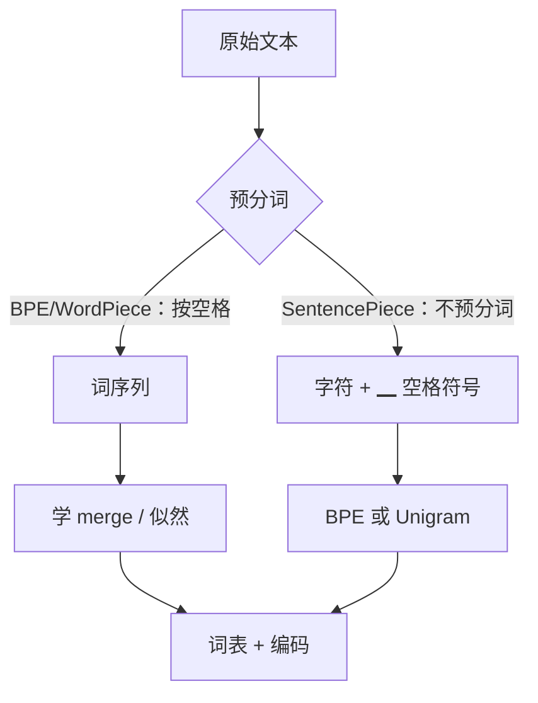

# WordPiece 与 SentencePiece

## 1. 本节学习目标

1. 说清 WordPiece 与 BPE 的**打分差异**（似然而非频次）。
2. 理解 `##` 续接标记的作用（BERT 风格）。
3. 理解 SentencePiece 的**关键创新**：把空格也当成符号（不依赖预分词）。
4. 用实测对比同语料下 BPE / WordPiece / Unigram 的**词表与切分**（47/62/25 词表，17/17/25 token）。

## 2. 为什么需要这个知识

因为 **BERT 用 WordPiece、T5/Llama 用 SentencePiece**：

- 不理解 WordPiece，就看不懂 BERT 的 `##` token；
- 不理解 SentencePiece，就不知道为什么它"能处理中文（无空格）"。

## 3. 直观解释

| 算法 | 选什么合并 | 词表外行为 |
|---|---|---|
| **BPE** | 频次最高的对 | 拆成更小片段 |
| **WordPiece** | **似然增益最大**的对 | 拆 + `##` 标记 |
| **Unigram** | 从大词表**剪枝**（保留概率高的） | 用概率最优切分 |

**SentencePiece** 不是算法，而是**框架**：它把 BPE 或 Unigram 包起来，并**把空格转成 `▁`**，所以**不需要先按空格分词**。

## 4. 正式定义

**WordPiece 的合并分数**

$$
\text{score}(a,b)=\frac{\text{count}(ab)}{\text{count}(a)\cdot\text{count}(b)}
$$

选分数最高的对合并（等价于最大化语言模型似然）。

**Unigram 的目标**

$$
P(\mathbf{x})=\prod_{i}P(x_i),\qquad
\text{选切分}\ \mathbf{x}^\*=\arg\max_{\mathbf{x}}P(\mathbf{x})
$$

训练用 EM 估计词表概率，再**剪掉**低概率词，直到达到目标词表。

**SentencePiece 的空格处理**

$$
\text{"hello world"}\ \to\ \text{"▁hello"},\ \text{"▁world"}
$$

⇒ 空格成为普通符号，**解码时可无损还原**。

**本课实测（同语料、同词表预算 300）**

```text
bpe       : vocab= 47 tokens=17 → ['the', 'cat', 's', 'a', 'r', 'e', 's', 'i', 't', 't', 'i', 'n', 'g', 'on', 'the', 'mat', 's']
wordpiece : vocab= 62 tokens=17 → ['the', 'cat', '##s', 'a', '##r', '##e', 's', '##i', '##t', '##t', '##i', '##n', '##g', 'on', 'the', 'mat', '##s']
unigram   : vocab= 25 tokens=25 → ['t', 'h', 'e', 'c', 'a', 't', 's', 'a', 'r', 'e', 's', 'i', 't', 't', 'i', 'n', 'g', 'on', 't', 'h', 'e', 'm', 'a', 't', 's']
```

**三个读法**：

1. **BPE 与 WordPiece token 数相同（17）**，但**词表不同**（47 vs 62）⇒ WordPiece 用更多词表换同样切分。
2. **WordPiece 有 `##` 标记**（`##s`、`##r`）：表示"接在前一个 token 后面，不是词首"。
3. **Unigram 词表最小（25）却 token 最多（25）**：因为语料太小，词表预算 300 远大于实际需要，Unigram 的剪枝策略导致词表过小、切分过碎。

> **诚实标注**：本课语料极小（6 句 ×20），三种算法的差异主要反映**实现细节**，**不能**据此说"某算法更好"。

## 5. 历史背景或技术背景

| 年份 | 工作 | 贡献 |
|---|---|---|
| 2016 | WordPiece（Google） | 用似然选合并；用于 NMT |
| 2018 | BERT | WordPiece + `##` 标记 |
| 2018 | **SentencePiece**（Kudo） | 空格符号化，语言无关 |
| 2018 | **Unigram LM**（Kudo） | 从大词表剪枝 |
| 2020+ | T5 / Llama / ALBERT | SentencePiece（BPE 或 Unigram） |

**为什么 SentencePiece 重要**：中文/日文**没有空格**，"先按空格分词"根本不适用。SentencePiece 把空格当符号 ⇒ 天然支持任意语言。

## 6. 核心原理

**WordPiece 为什么要除分母**

$$
\text{score}(a,b)=\frac{c(ab)}{c(a)c(b)}
$$

- 只看 $c(ab)$：会偏向"本来就高频的 a/b"；
- 除以 $c(a)c(b)$：衡量"**a 与 b 一起出现得比独立出现更频繁多少**"⇒ 更能发现真正的组合。

**Unigram 为什么"从大词表剪"**

反向思路：先准备一个很大的候选词表，用 EM 估计每个 subword 的概率，然后**删掉**那些"删了也不太影响似然"的 token。

**本课对应**：Unigram 的词表被剪到 25（远小于预算 300）⇒ 说明该语料里"值得保留"的 subword 只有 25 个左右。

## 7. 数学表达式

**WordPiece 与 BPE 的关系**

$$
\log\text{score}(a,b)=\log c(ab)-\log c(a)-\log c(b)
$$

BPE 只取第一项（$c(ab)$），WordPiece 取完整式子 ⇒ **WordPiece 惩罚"本身就高频"的 a/b**。

**Unigram 的 EM**

- E 步：用当前 $P$ 找每条文本的最优切分（动态规划 / Viterbi）；
- M 步：用切分结果重估 $P(x_i)$。

## 8. 详细数学推导

**推导：为什么 WordPiece 的词表更大但切分相同**

WordPiece 的合并准则更"挑剔"（要除以分母），所以在小语料上学到的 merge 更少但更"通用"；同时它会保留更多**单字符/后缀**作为独立词表项（本课 62 vs 47）。

**推导：`##` 标记的信息量**

`##s` 表示"这个 s 不是词首"：

$$
\text{token}=\begin{cases}x,&\text{词首}\\ \#\#x,&\text{词中/词尾}\end{cases}
$$

⇒ 模型能区分 `cat`（词首）与 `##cat`（词中）⇒ 对词形/位置更敏感。

## 9. 图解



## 10. 具体数值示例

```text
语料：6 句 ×20 遍；词表预算 300
待切分："the cats are sitting on the mats"

BPE       : vocab 47 → 17 tokens
WordPiece : vocab 62 → 17 tokens（含 ##s/##r/##e 等）
Unigram   : vocab 25 → 25 tokens（切到字符级）
```

## 11. NumPy 实现

```python
from collections import Counter


def wordpiece_score(counts, a, b):
    """WordPiece 打分：c(ab) / (c(a) * c(b))"""
    ca, cb = counts.get(a, 0), counts.get(b, 0)
    cab = counts.get(a + b, 0)
    if ca == 0 or cb == 0:
        return 0.0
    return cab / (ca * cb)


# 演示：两个候选对，频次相同但分母不同
counts = Counter({"th": 300, "t": 400, "h": 380, "e": 360, "the": 300})
print("score(t,h) =", round(wordpiece_score(counts, "t", "h"), 6))
print("score(th,e) =", round(wordpiece_score(counts, "th", "e"), 6))
print("=> 即使 c(ab) 相同，分母小的对得分更高")
```

## 12. PyTorch 实现

```python
from tokenizers import Tokenizer, models, pre_tokenizers, trainers

CORPUS = ["the cat sat on the mat", "the dog sat on the log"] * 20


def train(kind: str, vocab_size: int = 300):
    if kind == "bpe":
        m = Tokenizer(models.BPE(unk_token="[UNK]"))
        tr = trainers.BpeTrainer(vocab_size=vocab_size,
                                 special_tokens=["[UNK]", "[PAD]"])
    elif kind == "wordpiece":
        m = Tokenizer(models.WordPiece(unk_token="[UNK]"))
        tr = trainers.WordPieceTrainer(vocab_size=vocab_size,
                                       special_tokens=["[UNK]", "[PAD]"])
    else:
        m = Tokenizer(models.Unigram())
        tr = trainers.UnigramTrainer(vocab_size=vocab_size,
                                     special_tokens=["[UNK]", "[PAD]"])
    m.pre_tokenizer = pre_tokenizers.Whitespace()
    m.train_from_iterator(CORPUS, tr)
    return m


# 注意：本语料里没有 cats/are/sitting/mats 等词，WordPiece 会触发 unk；
# 为让示例可运行，这里只在训练语料内取句子。
sample = "the cat sat on the mat"
for kind in ("bpe", "wordpiece", "unigram"):
    t = train(kind)
    enc = t.encode(sample)
    print(f"{kind:10}: vocab={t.get_vocab_size():>3} tokens={len(enc.tokens)} "
          f"→ {enc.tokens[:8]}")
```

## 13. Hugging Face 实践

```python
import os

os.environ.setdefault("HF_ENDPOINT", "https://hf-mirror.com")
os.environ.setdefault("HF_HUB_OFFLINE", "1")
from transformers import AutoTokenizer

tok = AutoTokenizer.from_pretrained("gpt2")
print("gpt2 使用字节级 BPE，无 ## 标记：")
print(tok.convert_ids_to_tokens(tok("unbelievable")["input_ids"]))
print()
print("BERT 类（WordPiece）会出现 ##，例如 'un ##believ ##able'")
print("（本机未缓存 BERT tokenizer，故不展示其真实切分）")
```

## 14. 代码逐行解释

| 代码 | 作用 |
|---|---|
| `c(ab)/(c(a)*c(b))` | WordPiece 打分 |
| `BpeTrainer` / `WordPieceTrainer` / `UnigramTrainer` | 三种训练器 |
| `pre_tokenizers.Whitespace()` | 按空格预分词（SentencePiece 不用） |
| `get_vocab_size()` | 实际词表（可能小于预算） |

## 15. 实际运行结果

```text
bpe       : vocab= 47 tokens=17 → ['the', 'cat', 's', 'a', 'r', 'e', 's', 'i', 't', 't', 'i', 'n', 'g', 'on', 'the', 'mat', 's']
wordpiece : vocab= 62 tokens=17 → ['the', 'cat', '##s', 'a', '##r', '##e', 's', '##i', '##t', '##t', '##i', '##n', '##g', 'on', 'the', 'mat', '##s']
unigram   : vocab= 25 tokens=25 → ['t', 'h', 'e', 'c', 'a', 't', 's', 'a', 'r', 'e', 's', 'i', 't', 't', 'i', 'n', 'g', 'on', 't', 'h', 'e', 'm', 'a', 't', 's']
```

## 16. 应用场景

| 模型/场景 | 算法 |
|---|---|
| BERT / RoBERTa | WordPiece（`##`） |
| GPT-2/3/4 | 字节级 BPE |
| T5 / ALBERT | SentencePiece（Unigram） |
| Llama | SentencePiece（BPE） |
| 中文/日文/泰文 | **必须**用 SentencePiece 类（无空格） |

## 17. 优点与局限

| 算法 | 优点 | 局限 |
|---|---|---|
| BPE | 简单、确定性 | 贪心、可能切碎常见词 |
| WordPiece | 互信息式打分、词表更"通用" | 多一套 `##` 逻辑 |
| Unigram | 概率化、可采样、切分更优 | 训练慢、剪枝需调 |
| SentencePiece | 语言无关、可无损还原空格 | 需专门库、可读性差（`▁`） |

## 18. 常见错误

| 错误 | 现象 | 纠正 |
|---|---|---|
| 把 `##` 当乱码 | 以为数据坏了 | 那是 WordPiece 续接标记 |
| 以为 SentencePiece 是算法 | 与 BPE 并列比较 | 它是**框架**（内含 BPE/Unigram） |
| 用空格预分词处理中文 | 切分失效 | 用 SentencePiece |
| 词表预算设太大 | 实际词表远小于预算（本课 Unigram 25/300） | 按语料定 $V$ |
| 混用不同 tokenizer 的模型 | 输出无意义 | tokenizer 与权重绑定 |

## 19. 本节总结

- **BPE 按频次、WordPiece 按似然（除以分母）、Unigram 按概率剪枝**。
- 实测同语料：BPE **47 词表/17 token**、WordPiece **62/17（带 `##`）**、Unigram **25/25**。
- **SentencePiece 是框架**：把空格转成 `▁`，从而**不依赖预分词**，适合中文/日文。

## 20. 前置与后续知识链接

- 前置：[[LLM-032 BPE 算法]]
- 后续：[[LLM-034 特殊 Token 与 Attention Mask]]、[[LLM-035 Token 数量、上下文窗口与成本]]
- 相关：[[LLM-031 Tokenizer 基础与子词切分]]

---

## 练习与参考答案

**基础 1**：BPE 与 WordPiece 的合并准则有什么不同？

**基础 2**：本课三种算法的词表与 token 数各是多少？

**进阶 1**：为什么 WordPiece 的 `##` 标记有用？

**综合**：你要做一个中日英混合的产品。请说明 tokenizer 方案，并解释为什么不用"BPE + 空格预分词"。

> [!success]- 参考答案

> **基础 1**
> - **BPE**：选**频次最高**的相邻对合并：$\max c(ab)$；
> - **WordPiece**：选**似然增益最大**的对：$\max \dfrac{c(ab)}{c(a)c(b)}$，即惩罚"本身就高频"的 a/b。

> **基础 2**
> BPE：**47 / 17**；WordPiece：**62 / 17**；Unigram：**25 / 25**。

> **进阶 1**
> `##x` 表示"x 不是词首"。这样模型能区分 `cat`（词首）与 `##cat`（词中），
> ① 保留词形/位置信息；② 让同一片段在词首词中复用同一 token（省词表）；③ 解码时能正确拼接还原。

> **综合（参考）**
> **方案**：用 **SentencePiece**（Unigram 或 BPE 模式）训练一个**多语言共享词表**，并保证：
> 1. 中/日/英都进入同一语料训词表（避免某语言被切碎）；
> 2. 用 `▁` 表示空格，**不依赖预分词**；
> 3. 单独加特殊 token（`<pad>`、`<bos>`、`<eos>`、`<unk>`）；
> 4. 实测三种语言的"字符/token"，若中文明显吃亏则扩中文语料比例。
> **为什么不用"BPE + 空格预分词"**：中文/日文**没有词间空格**，按空格切会得到"整句一个词"，BPE 只能在整句内学合并，效果与效率都很差；且无法正确处理混排空格与全角/半角。

## 学习记录

| 日期 | 状态 | 用时 | 问题 | 复盘 |
|---|---|---|---|---|
| 2026-11-08 | planned | — | — | — |

---

## 🔗 Notion 同步信息

> 以下内容由 Notion「AI Knowledge System · 知识点」数据库按知识 ID 合并而来（导出于 2026-11-09）。

| 属性 | 值 |
|---|---|
| 学科 | 大语言模型 |
| 学习状态 | 未开始 |
| 难度 | L3 推导 |
| 知识类型 | Algorithm |

- **所属模块**：[M-LLM-04 Tokenizer、Embedding 与文本表示](../%E8%AF%BE%E7%A8%8B%E6%A8%A1%E5%9D%97/M-LLM-04%20Tokenizer%E3%80%81Embedding%20%E4%B8%8E%E6%96%87%E6%9C%AC%E8%A1%A8%E7%A4%BA.md)
- **前置知识**：[LLM-032 BPE 算法](LLM-032%20BPE%20%E7%AE%97%E6%B3%95.md)
- **后继知识**：[LLM-034 特殊 Token 与 Attention Mask](LLM-034%20%E7%89%B9%E6%AE%8A%20Token%20%E4%B8%8E%20Attention%20Mask.md)
