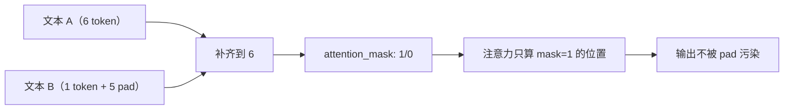

# 特殊 Token 与 Attention Mask

## 1. 本节学习目标

1. 分清四种特殊 token：**BOS / EOS / PAD / UNK**，以及 GPT 的 `<|endoftext|>`。
2. 用实测看 `attention_mask` 的真实内容（`[[1,1,1,1,1,1],[1,0,0,0,0,0]]`）。
3. 量化 mask 的作用：不加 mask 时 pad 位置分走权重 **4.9711**，加 mask 后 **0.0**。
4. 知道"未定义 pad_token"这个常见坑（本课 gpt2 的 `pad_token` 为 **None**）。

## 2. 为什么需要这个知识

因为**这些 token 决定"模型看到了什么"**：

- 忘传 `attention_mask` ⇒ pad 参与注意力，结果随 batch 组成变化；
- 用错 pad token ⇒ 模型把 padding 当内容；
- 忽略 EOS ⇒ 生成"停不下来"。

## 3. 直观解释

| Token | 作用 | 例子 |
|---|---|---|
| **BOS** | 序列开始 | `<s>` |
| **EOS** | 序列结束（生成停止条件） | `</s>`、`<|endoftext|>` |
| **PAD** | 补齐到同长度 | `<pad>` |
| **UNK** | 词表外 | `<unk>` |

**`attention_mask`**：`1` = 真实 token，`0` = padding。模型用它把 pad 位置的注意力权重压成 0。

## 4. 正式定义

**Batch 补齐**

$$
\mathbf{X}\in\mathbb{R}^{B\times T},\quad
\text{mask}_{b,t}=1\ \text{if } t<L_b\ \text{else } 0
$$

**注意力掩码（加性）**

$$
\alpha_{b,t,:}=\mathrm{softmax}\Big(\frac{q_tK^\top}{\sqrt{d_k}}+M_b\Big),\qquad
M_{b,j}=\begin{cases}0&\text{mask}_{b,j}=1\\-\infty&\text{mask}_{b,j}=0\end{cases}
$$

**本课实测**

```text
gpt2 的 bos/eos/pad/unk: <|endoftext|> <|endoftext|> None <|endoftext|>
input_ids:
 tensor([[ 1169,  3797,  3332,   319,   262,  2603],
        [ 5303, 50256, 50256, 50256, 50256, 50256]])
attention_mask:
 tensor([[1, 1, 1, 1, 1, 1],
        [1, 0, 0, 0, 0, 0]])
第 2 条有效长度: 1
```

**四个读法**：

1. **gpt2 没有专门的 pad token**（`pad_token = None`）⇒ 必须手动设成 `eos_token`（本课这么做）。
2. **pad 位置被填成 50256**（即 `<|endoftext|>`），但 **mask 为 0** ⇒ 模型知道它们是"占位"。
3. 第 2 条只有 **1** 个真实 token（"hi"），其余 5 个是 pad。
4. **如果没有 mask**，这 5 个 pad 会被当成 5 个 `<|endoftext|>` 词参与注意力 ⇒ 语义污染。

## 5. 历史背景或技术背景

| 模型 | BOS | EOS | PAD | 说明 |
|---|---|---|---|---|
| GPT-2 | — | `<\|endoftext\|>` | — | 无 pad，需手动设 |
| BERT | `[CLS]` | `[SEP]` | `[PAD]` | `[CLS]` 兼作"序列表示" |
| Llama | `<s>` | `</s>` | `<pad>` | 常用 `<unk>` 也复用 |
| T5 | — | `</s>` | `<pad>` | 用 `▁` 表示空格 |

**关键**：不同模型的特殊 token **不通用**，迁移时必须在 `tokenizer_config` 里对齐。

## 6. 核心原理

**mask 如何影响权重（本课量化）**

```text
T = 6
第 2 条 padding 列: [1, 2, 3, 4, 5]
不加 mask：这些列权重和 = 4.9711
加 mask  ：这些列权重和 = 0.0
加 mask 后行和仍为 1: [1.0, 1.0, 1.0, 1.0, 1.0, 1.0]
```

**三个读法**：

1. **不加 mask**：6 个位置上有 **近 5 份权重**（4.97/6）落在 padding 上 ⇒ 真实 token 的信息被严重稀释。
2. **加 mask 后严格为 0.0** ⇒ pad 完全不参与。
3. **行和仍为 1.0** ⇒ softmax 自动在"可见位置"上重新归一化（LLM-018）。

**为什么 EOS 重要**

训练时用 EOS 标记"序列结束"；生成时遇到 EOS 就停。若 EOS 缺失：

$$
\text{生成}\to\infty\quad(\text{不停})
$$

## 7. 数学表达式

**损失中的 mask（可选）**

$$
L=\frac{\sum_{b,t}\text{mask}_{b,t}\,\ell_{b,t}}{\sum_{b,t}\text{mask}_{b,t}}
$$

⇒ 分母用**有效 token 数**，而不是 $B\times T$（否则 pad 拉低 loss 数值）。

**位置 ID**

$$
\text{position\_ids}_{b,t}=t\quad(\text{对 pad 位置通常也递增，或置 0})
$$

## 8. 详细数学推导

**推导：为什么"不加 mask"会污染**

$$
\mathbf{o}_i=\sum_{j}\alpha_{ij}\mathbf{v}_j
$$

若 $\sum_{j\in\text{pad}}\alpha_{ij}=4.97/6\approx0.83$，则只有 17% 的权重给了真实 token。
而 pad 的 $V$ 来自 `<|endoftext|>` 的嵌入 ⇒ 输出被这个无关向量主导。

**推导：为什么"行和仍为 1"**

设可见集合 $\mathcal{S}$：

$$
\sum_{j\in\mathcal{S}}\frac{e^{s_{ij}}}{\sum_{k\in\mathcal{S}}e^{s_{ik}}}=1
$$

⇒ 归一化被限制在可见位置，**不会因为"少了几个位置"而变小**。

## 9. 图解



## 10. 具体数值示例

```text
batch = [["the","cat","sat","on","the","mat"], ["hi","<pad>","<pad>","<pad>","<pad>","<pad>"]]

attention_mask:
  [1,1,1,1,1,1]
  [1,0,0,0,0,0]

不加 mask：pad 列权重和 4.9711（占 83%）
加 mask  ：0.0
行和：仍为 1.0
```

## 11. NumPy 实现

```python
import numpy as np


def masked_softmax(scores, mask):
    s = np.where(mask[None, :] == 0, -np.inf, scores)
    e = np.exp(s - s.max(-1, keepdims=True))
    return e / e.sum(-1, keepdims=True)


T = 6
scores = np.random.default_rng(0).normal(size=(T, T))
mask = np.array([1, 0, 0, 0, 0, 0])

a_raw = np.exp(scores) / np.exp(scores).sum(-1, keepdims=True)
a_mask = masked_softmax(scores, mask)

print("不加 mask：pad 列权重和 =", round(float(a_raw[:, 1:].sum()), 4))
print("加 mask  ：pad 列权重和 =", round(float(a_mask[:, 1:].sum()), 4))
print("行和:", a_mask.sum(-1).round(6))
```

## 12. PyTorch 实现

```python
import math

import torch
import torch.nn.functional as F
from transformers import AutoTokenizer

tok = AutoTokenizer.from_pretrained("gpt2")
tok.pad_token = tok.eos_token
batch = tok(["the cat sat on the mat", "hi"], return_tensors="pt", padding=True)

T = batch["input_ids"].shape[1]
mask = batch["attention_mask"] == 0  # True = pad
q, k = torch.randn(2, T, 8), torch.randn(2, T, 8)
scores = q @ k.transpose(-2, -1) / math.sqrt(8)

a_raw = F.softmax(scores, dim=-1)
a_mask = F.softmax(scores.masked_fill(mask[:, None, :], float("-inf")), dim=-1)
pad_cols = mask[1].nonzero().flatten().tolist()
print("pad 列:", pad_cols)
print("不加 mask 权重和:", round(float(a_raw[1, :, pad_cols].sum()), 4))
print("加 mask 权重和  :", round(float(a_mask[1, :, pad_cols].sum()), 4))
print("行和:", [round(float(v), 6) for v in a_mask[1].sum(-1)])
```

## 13. Hugging Face 实践

```python
import os

os.environ.setdefault("HF_ENDPOINT", "https://hf-mirror.com")
os.environ.setdefault("HF_HUB_OFFLINE", "1")
from transformers import AutoTokenizer

tok = AutoTokenizer.from_pretrained("gpt2")
print("特殊 token:", {k: getattr(tok, f"{k}_token")
                     for k in ("bos", "eos", "pad", "unk")})
print("pad_token_id:", tok.pad_token_id)

# 未设 pad 时 padding=True 会报错或告警
try:
    tok(["a", "bb"], padding=True)
except Exception as e:
    print("未设 pad 时 padding=True:", type(e).__name__)
```

## 14. 代码逐行解释

| 代码 | 作用 |
|---|---|
| `tok.pad_token = tok.eos_token` | 借用 eos 当 pad（gpt2 常见做法） |
| `padding=True` | 自动补齐并生成 attention_mask |
| `mask == 0` | True 表示 pad |
| `masked_fill(..., -inf)` | 把 pad 位置压成 $-\infty$ |
| `attention_mask.sum()` | 有效长度 |

## 15. 实际运行结果

```text
gpt2 的 bos/eos/pad/unk: <|endoftext|> <|endoftext|> None <|endoftext|>
input_ids:
 tensor([[ 1169,  3797,  3332,   319,   262,  2603],
        [ 5303, 50256, 50256, 50256, 50256, 50256]])
attention_mask:
 tensor([[1, 1, 1, 1, 1, 1],
        [1, 0, 0, 0, 0, 0]])
第 2 条有效长度: 1

T = 6
第 2 条 padding 列: [1, 2, 3, 4, 5]
不加 mask：这些列权重和 = 4.9711
加 mask  ：这些列权重和 = 0.0
加 mask 后行和仍为 1: [1.0, 1.0, 1.0, 1.0, 1.0, 1.0]
```

## 16. 应用场景

| 场景 | 关键点 |
|---|---|
| 变长 batch 训练 | 必传 `attention_mask` |
| 生成停止 | 遇 EOS 停 |
| 分类（BERT） | `[CLS]` 位置作表示 |
| 填充式损失 | 用 mask 归一化 |
| 多轮对话 | 用 EOS/角色 token 分隔 |

## 17. 优点与局限

| 优点 | 局限 |
|---|---|
| 一个 mask 解决变长 | 各模型 token 语义不同 |
| softmax 自动重归一 | 整行全 pad 会 NaN |
| 可同时叠加 causal mask | 忘传 mask 不报错、只错结果 |

## 18. 常见错误

| 错误 | 现象 | 纠正 |
|---|---|---|
| 忘传 `attention_mask` | 结果随 batch 变化 | 必传 |
| gpt2 未设 pad_token | 报错/告警 | 设为 eos |
| pad 位置参与损失 | loss 偏低 | 用 mask 归一化 |
| 混淆 BOS 与 EOS | 生成不停/不启动 | 看模型文档 |
| 迁移模型不换特殊 token | 输出乱 | 对齐 tokenizer_config |

## 19. 本节总结

- 四种特殊 token：**BOS / EOS / PAD / UNK**；gpt2 实测：`bos=eos=unk=<|endoftext|>`，**`pad=None`**。
- 本课实测 mask：`[[1,1,1,1,1,1],[1,0,0,0,0,0]]`；不加 mask 时 pad 分走 **4.9711** 权重，加 mask 后 **0.0**，行和仍 **1.0**。
- 实践铁律：**变长 batch 必传 `attention_mask`；gpt2 必须手动设 `pad_token`**。

## 20. 前置与后续知识链接

- 前置：[[LLM-033 WordPiece 与 SentencePiece]]
- 后续：[[LLM-035 Token 数量、上下文窗口与成本]]
- 相关：[[LLM-018 掩码——Causal、Padding 与 Attention Mask]]

---

## 练习与参考答案

**基础 1**：BOS / EOS / PAD / UNK 各是什么作用？

**基础 2**：本课 `attention_mask` 的内容是什么？不加 mask 时 pad 权重是多少？

**进阶 1**：为什么加了 mask 之后"行和仍是 1"？

**综合**：你把两条长度 10 与 3 的句子拼成 batch 训练。请说明必须传什么、忘传会怎样、以及如何验证。

> [!success]- 参考答案

> **基础 1**
> - **BOS**：序列开始标记；
> - **EOS**：序列结束（生成时的停止条件）；
> - **PAD**：补齐到同长度；
> - **UNK**：词表外字符的占位。

> **基础 2**
> `[[1,1,1,1,1,1],[1,0,0,0,0,0]]`（第 2 条只有 1 个真实 token）；不加 mask 时 pad 列权重和 **4.9711**（约 83%），加 mask 后 **0.0**。

> **进阶 1**
> 因为 softmax 只在**可见集合** $\mathcal{S}$ 上归一化：
> $$\sum_{j\in\mathcal{S}}\frac{e^{s_{ij}}}{\sum_{k\in\mathcal{S}}e^{s_{ik}}}=1$$
> 被掩掉的位置贡献 $e^{-\infty}=0$，分母同步减少 ⇒ 行和仍为 1。

> **综合（参考）**
> **必须传**：`attention_mask`（1=真实，0=pad），以及（生成模型）causal mask 由模型内部处理。
> **忘传的后果**：pad 位置（7 个）参与注意力 ⇒ 约 $\frac{7}{10}$ 的权重落到 padding 上，输出被 pad 的 `V` 主导；且**结果会随 batch 里最长的句子变化**（同样的样本，换个 batch 结果就不同）。
> **验证方法**：
> 1. 检查 `batch["attention_mask"]` 是否与真实长度一致（`mask.sum(1) == 真实长度`）；
> 2. 断言 pad 列权重为 0：`assert (A[:, :, pad_cols] == 0).all()`；
> 3. 交换 batch 内顺序/改变最长句，**同一样本输出应不变**（不变性测试）。

## 学习记录

| 日期 | 状态 | 用时 | 问题 | 复盘 |
|---|---|---|---|---|
| 2026-11-08 | planned | — | — | — |

---

## 🔗 Notion 同步信息

> 以下内容由 Notion「AI Knowledge System · 知识点」数据库按知识 ID 合并而来（导出于 2026-11-09）。

| 属性 | 值 |
|---|---|
| 学科 | 大语言模型 |
| 学习状态 | 未开始 |
| 难度 | L2 应用 |
| 知识类型 | Technique |

- **所属模块**：[M-LLM-04 Tokenizer、Embedding 与文本表示](../%E8%AF%BE%E7%A8%8B%E6%A8%A1%E5%9D%97/M-LLM-04%20Tokenizer%E3%80%81Embedding%20%E4%B8%8E%E6%96%87%E6%9C%AC%E8%A1%A8%E7%A4%BA.md)
- **前置知识**：[LLM-033 WordPiece 与 SentencePiece](LLM-033%20WordPiece%20%E4%B8%8E%20SentencePiece.md)
- **后继知识**：[LLM-035 Token 数量、上下文窗口与成本](LLM-035%20Token%20%E6%95%B0%E9%87%8F%E3%80%81%E4%B8%8A%E4%B8%8B%E6%96%87%E7%AA%97%E5%8F%A3%E4%B8%8E%E6%88%90%E6%9C%AC.md)
- **对应项目**：[PROJ-024 结构化输出与约束解码](../../07_%E5%AE%9E%E6%88%98%E9%A1%B9%E7%9B%AE/05%20%E5%A4%A7%E6%A8%A1%E5%9E%8B%E9%A1%B9%E7%9B%AE/PROJ-024%20%E7%BB%93%E6%9E%84%E5%8C%96%E8%BE%93%E5%87%BA%E4%B8%8E%E7%BA%A6%E6%9D%9F%E8%A7%A3%E7%A0%81.md)
