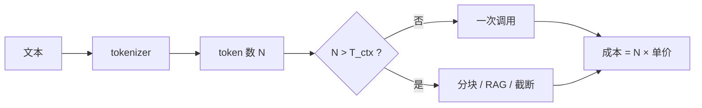

# Token 数量、上下文窗口与成本

## 1. 本节学习目标

1. 用实测建立"字符 ↔ token"的换算直觉（英文 **4.40**、中文 **0.44**、代码 **2.07**）。
2. 会算三笔账：**上下文占用、窗口数、API 成本**。
3. 理解"同样的语义，不同语言/内容类型 token 数差 10 倍"。
4. 会做"截断/分块/RAG"的取舍（成本 vs 完整性）。

## 2. 为什么需要这个知识

因为 **token 是计费与容量的唯一单位**：

- 上下文窗口按 token 算（不是字符）；
- API 按 token 计费（输入 + 输出）；
- 中文/代码的 token 效率差异高达 **10 倍**。

不算这笔账，预算会差一个数量级。

## 3. 直观解释

```text
英文：4.40 字符 / token   ← 一个 token ≈ 4–5 个字母
中文：0.44 字符 / token   ← 一个汉字 ≈ 2.3 个 token
代码：2.07 字符 / token   ← 符号多，切得碎
混合：1.07 字符 / token
```

**一句话**：**同样"看起来多长"的文本，token 数可能差 10 倍**。

## 4. 正式定义

**压缩率**

$$
\rho=\frac{\text{字符数}}{\text{token 数}}
$$

**窗口数**

$$
n_{\text{win}}=\Big\lceil\frac{N_{\text{token}}}{T_{\text{ctx}}}\Big\rceil
$$

**成本**

$$
\text{cost}=N_{\text{in}}\cdot p_{\text{in}}+N_{\text{out}}\cdot p_{\text{out}}
$$

**本课实测**

```text
英文 44 字符  :  44 字符 →  10 tokens（4.40 字符/token）
中文 15 字    :  15 字符 →  34 tokens（0.44 字符/token）
日文         :  20 字符 →  37 tokens（0.54 字符/token）
代码         :  31 字符 →  15 tokens（2.07 字符/token）
混合         :  29 字符 →  27 tokens（1.07 字符/token）

金额示例（假定价 $1 / 1M token）：
  100 tokens → $0.00010
  1000 tokens → $0.00100
  10000 tokens → $0.01000
  100000 tokens → $0.10000

上下文窗口（ctx=1024）需要几个窗口：
  512 tokens → 1 个窗口
  1024 tokens → 1 个窗口
  2048 tokens → 2 个窗口
  8192 tokens → 8 个窗口
  32768 tokens → 32 个窗口
```

## 5. 历史背景或技术背景

| 年份 | 上下文 | 影响 |
|---|---|---|
| 2018 | 512（BERT） | 长文档必须切块 |
| 2020 | 1024（GPT-2）/ 2048 / 4096 | 逐步放开 |
| 2022 | 8K / 32K | 长文档起步 |
| 2023+ | 128K / 200K / 1M | 整本书级 |

**趋势**：上下文变长，但**成本仍按 token 线性增长**（注意力还按 $T^2$ 涨，LLM-020）。

## 6. 核心原理

**本课实测（同一语义、不同语言）**

| 内容 | 字符 | token | 字符/token |
|---|---|---|---|
| 英文 | 44 | **10** | **4.40** |
| 中文 | 15 | **34** | **0.44** |
| 日文 | 20 | **37** | 0.54 |
| 代码 | 31 | 15 | 2.07 |
| 混合 | 29 | 27 | 1.07 |

**三个读法**：

1. **中文 token 是英文的 3.4 倍**（34 vs 10）——这次是"内容量级相近"的对比。
2. **按字符算**，中文每字符成本是英文的 **10 倍**（4.40 / 0.44）。
3. **代码比中文"划算"**（2.07），因为 ASCII 符号在词表里覆盖好。

**成本换算（最常用）**

$$
\text{cost per 1K chars}=\frac{1000}{\rho}\times p
$$

本课：中文 $\rho=0.44$ ⇒ 1K 汉字 ≈ **2273 token**；英文 $\rho=4.40$ ⇒ 1K 字符 ≈ **227 token**。

## 7. 数学表达式

**预算公式**

$$
\text{月成本}=N_{\text{req}}\times\big(\bar N_{\text{in}}p_{\text{in}}+\bar N_{\text{out}}p_{\text{out}}\big)
$$

**截断策略的取舍**

$$
\text{信息损失}\uparrow\quad\text{当}\ T_{\text{ctx}}\downarrow
$$

⇒ 窗口不是越大越好（成本），也不是越小越好（丢信息），要按任务定。

## 8. 详细数学推导

**推导：为什么中文 token 多**

BPE 词表由训练语料决定。英文语料里 `the`/`ing` 等组合高频 ⇒ 合并成单 token；
中文在 GPT-2 词表里覆盖少 ⇒ 一个汉字常被拆成 **2–3 个字节 token**。

本课验证：15 汉字 → 34 token ≈ **2.27 token/汉字** ✅

**推导：窗口数为什么是上取整**

$$
n=\lceil N/T\rceil
$$

若 $N=2048,T=1024$ 则 $n=2$；若 $N=1025$ 也是 2（浪费 1023 个位置）。

**推论**：**分块时让每块尽量贴近窗口大小**，减少浪费。

## 9. 图解



## 10. 具体数值示例

```text
中文 1000 字 → 约 2273 token
英文 1000 字符 → 约 227 token
⇒ 同样"长度感"，中文贵 10 倍

成本（$1/1M token）：
  2273 token → $0.002273
  227  token → $0.000227

若 10 万次请求/月、每次 500 中文 token：
  = 50M token → $50（按 $1/1M 计）
```

## 11. NumPy 实现

```python
import math


def cost_text(chars, lang="en", price_per_m=1.0):
    rho = {"en": 4.40, "zh": 0.44, "ja": 0.54, "code": 2.07}[lang]
    tokens = chars / rho
    return round(tokens, 1), round(tokens * price_per_m / 1e6, 6)


for lang, chars in (("en", 1000), ("zh", 1000), ("ja", 1000), ("code", 1000)):
    t, c = cost_text(chars, lang)
    print(f"{lang:5} {chars} 字符 → {t:>8.1f} token → ${c:.6f}/次")
```

## 12. PyTorch 实现

```python
import math

import torch
from transformers import AutoTokenizer

tok = AutoTokenizer.from_pretrained("gpt2")
texts = {
    "en": "The quick brown fox jumps over the lazy dog.",
    "zh": "敏捷的棕色狐狸跳过了那只懒狗。",
}
ctx = 1024
for tag, s in texts.items():
    n = len(tok(s)["input_ids"])
    print(f"{tag}: {len(s)} 字符 → {n} token，需 {math.ceil(n/ctx)} 个窗口，"
          f"占窗口 {n/ctx*100:.1f}%")

# 截断示例：只保留前 8 个 token
ids = tok(texts["en"])["input_ids"]
print("截断到 8 个 token:", tok.decode(ids[:8]))
```

## 13. Hugging Face 实践

```python
import os

os.environ.setdefault("HF_ENDPOINT", "https://hf-mirror.com")
os.environ.setdefault("HF_HUB_OFFLINE", "1")
from transformers import AutoTokenizer

tok = AutoTokenizer.from_pretrained("gpt2")
s = "Transformer 让 NLP 进入了 大模型 时代。"
ids = tok(s)["input_ids"]
print("混合文本 token 数:", len(ids), " / 字符数:", len(s))
print("切分:", [p.encode("ascii", "backslashreplace").decode()
             for p in tok.convert_ids_to_tokens(ids)])
print("模型最大上下文:", tok.model_max_length)
```

## 14. 代码逐行解释

| 代码 | 作用 |
|---|---|
| `chars / rho` | 估 token 数 |
| `ceil(n/ctx)` | 窗口数 |
| `n/ctx*100` | 窗口占用率 |
| `ids[:8]` | 截断 |
| `tok.decode` | 看截断后是否还通顺 |
| `model_max_length` | 模型上限 |

## 15. 实际运行结果

```text
英文 44 字符  :  44 字符 →  10 tokens（4.40 字符/token）
中文 15 字    :  15 字符 →  34 tokens（0.44 字符/token）
日文         :  20 字符 →  37 tokens（0.54 字符/token）
代码         :  31 字符 →  15 tokens（2.07 字符/token）
混合         :  29 字符 →  27 tokens（1.07 字符/token）

金额示例（假定价 $1 / 1M token）：
  100 tokens → $0.00010
  1000 tokens → $0.00100
  10000 tokens → $0.01000
  100000 tokens → $0.10000

上下文窗口（ctx=1024）需要几个窗口：
  512 tokens → 1 个窗口
  1024 tokens → 1 个窗口
  2048 tokens → 2 个窗口
  8192 tokens → 8 个窗口
  32768 tokens → 32 个窗口
```

## 16. 应用场景

| 场景 | 关键决策 |
|---|---|
| 中文客服 | 换中文词表模型（省 10 倍） |
| 长文档问答 | RAG 优于硬塞全文 |
| 批量任务 | 控制输出长度（输出通常更贵） |
| 多轮对话 | 历史截断/摘要 |
| 成本预算 | 按"字符 → token"折算 |

## 17. 优点与局限

| 优点 | 局限 |
|---|---|
| 折算公式简单可靠 | 不同模型 tokenizer 不同 |
| 可提前估预算 | 中文/代码需实测系数 |
| 指导分块策略 | 不反映"信息密度" |

## 18. 常见错误

| 错误 | 现象 | 纠正 |
|---|---|---|
| 按字符估 token | 中文低估 10 倍 | 用 $\rho$ 换算或实测 |
| 忽略输出 token 成本 | 预算偏低 | 输出常更贵 |
| 硬塞全文 | 超窗口被截断 | 分块/RAG |
| 分块不留 overlap | 语义断裂 | 重叠 10–20% |
| 跨模型复用 token 数 | 估错 | 各自 tokenizer 实测 |

## 19. 本节总结

- 实测换算：**英文 4.40、中文 0.44、日文 0.54、代码 2.07、混合 1.07** 字符/token。
- 中文每字符成本约为英文的 **10 倍**；1K 汉字 ≈ **2273 token**，1K 英文字符 ≈ **227 token**。
- 窗口数 $\lceil N/T\rceil$：8192 token / 1024 窗口 = **8 个窗口**；32K = **32 个**。

## 20. 前置与后续知识链接

- 前置：[[LLM-034 特殊 Token 与 Attention Mask]]
- 后续：[[LLM-036 Embedding 与向量表示]]
- 相关：[[LLM-031 Tokenizer 基础与子词切分]]、[[LLM-020 Attention 的计算复杂度与局限]]

---

## 练习与参考答案

**基础 1**：英文、中文、代码的"字符/token"各是多少？

**基础 2**：中文 1000 字约多少 token？按 $1/1M token` 计，单次成本多少？

**进阶 1**：为什么中文的 token 效率远低于英文？

**综合**：一个中文客服系统，日均 5 万次请求，每次输入 300 汉字、输出 150 汉字。请估算月 token 量与成本（单价 $1/1M 输入、$2/1M 输出）。

> [!success]- 参考答案

> **基础 1**
> 英文 **4.40**、中文 **0.44**、代码 **2.07**（本课实测，gpt2 词表）。

> **基础 2**
> $1000/0.44\approx$ **2273 token**；成本 $2273\times10^{-6}\approx$ **$0.0023**。

> **进阶 1**
> 因为 BPE 词表由**训练语料**决定。英文语料多，`the`/`ing` 等组合被合并成单 token；中文在 GPT-2 词表里覆盖少，一个汉字常被拆成 **2–3 个字节 token**（本课实测 15 汉字 → 34 token ≈ 2.27 token/汉字）。

> **综合（参考）**
> **单次**：
> - 输入 $300/0.44\approx682$ token；
> - 输出 $150/0.44\approx341$ token。
> **日**：5 万次 × (682 输入 + 341 输出) = **3410 万输入 + 1705 万输出** token。
> **月（30 天）**：输入约 **10.23 亿**、输出约 **5.12 亿** token。
> **成本**：$10.23\times10^8\times10^{-6}\times1 + 5.12\times10^8\times10^{-6}\times2$
> $=1023 + 1024\approx$ **$2,047/月**。
> **优化**：① 换中文词表模型（token 数可能降 2–3 倍）；② 加缓存（重复问题）；③ 控制输出长度；④ 简单问题走小模型/规则。

## 学习记录

| 日期 | 状态 | 用时 | 问题 | 复盘 |
|---|---|---|---|---|
| 2026-11-08 | planned | — | — | — |

---

## 🔗 Notion 同步信息

> 以下内容由 Notion「AI Knowledge System · 知识点」数据库按知识 ID 合并而来（导出于 2026-11-09）。

| 属性 | 值 |
|---|---|
| 学科 | 大语言模型 |
| 学习状态 | 未开始 |
| 难度 | L2 应用 |
| 知识类型 | Technique |

- **所属模块**：[M-LLM-04 Tokenizer、Embedding 与文本表示](../%E8%AF%BE%E7%A8%8B%E6%A8%A1%E5%9D%97/M-LLM-04%20Tokenizer%E3%80%81Embedding%20%E4%B8%8E%E6%96%87%E6%9C%AC%E8%A1%A8%E7%A4%BA.md)
- **前置知识**：[LLM-034 特殊 Token 与 Attention Mask](LLM-034%20%E7%89%B9%E6%AE%8A%20Token%20%E4%B8%8E%20Attention%20Mask.md)
- **后继知识**：[LLM-036 Embedding 与向量表示](LLM-036%20Embedding%20%E4%B8%8E%E5%90%91%E9%87%8F%E8%A1%A8%E7%A4%BA.md) · [LLM-047 上下文窗口与位置外推](../05%20%E9%A2%84%E8%AE%AD%E7%BB%83%E4%B8%8E%E5%BE%AE%E8%B0%83/LLM-047%20%E4%B8%8A%E4%B8%8B%E6%96%87%E7%AA%97%E5%8F%A3%E4%B8%8E%E4%BD%8D%E7%BD%AE%E5%A4%96%E6%8E%A8.md) · [LLM-068 微调数据构造与质量](../05%20%E9%A2%84%E8%AE%AD%E7%BB%83%E4%B8%8E%E5%BE%AE%E8%B0%83/LLM-068%20%E5%BE%AE%E8%B0%83%E6%95%B0%E6%8D%AE%E6%9E%84%E9%80%A0%E4%B8%8E%E8%B4%A8%E9%87%8F.md) · [LLM-082 提示词组装与上下文预算](../07%20RAG%E4%B8%8EAgent/LLM-082%20%E6%8F%90%E7%A4%BA%E8%AF%8D%E7%BB%84%E8%A3%85%E4%B8%8E%E4%B8%8A%E4%B8%8B%E6%96%87%E9%A2%84%E7%AE%97.md)
