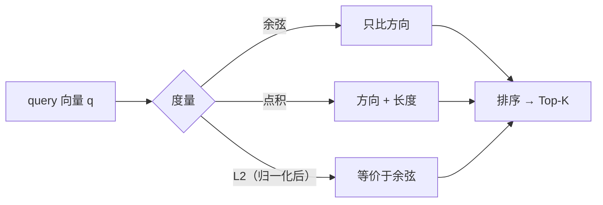

# 语义空间与相似度

## 1. 本节学习目标

1. 说清"语义空间"是什么：**距离 = 语义相似度**的向量空间。
2. 分清三种相似度：**余弦 / 点积 / 欧氏**，并知道何时用哪个。
3. 用实测看到关键差异：$a$ 与 $2a$ 的**余弦为 1.0**，但**点积 140.13**。
4. 知道 RAG 检索为什么默认用余弦（或归一化后点积）。

## 2. 为什么需要这个知识

因为**检索质量 = 相似度度量的质量**：

- 用错度量 ⇒ 检索结果跑偏 ⇒ RAG 答非所问；
- 不理解"余弦只看方向" ⇒ 无法解释"为什么长文档总是排前面/后面"。

## 3. 直观解释

```text
向量空间中：相似的东西靠得近
  "猫" 与 "狗"   近
  "猫" 与 "汽车" 远
```

**三种"近"的定义**：

| 度量 | 看什么 | 受长度影响 |
|---|---|---|
| **余弦** $\cos\theta$ | 方向夹角 | ❌ 不受 |
| **点积** $\mathbf{a}\cdot\mathbf{b}$ | 方向 × 长度 | ✅ 受 |
| **欧氏** $\|\mathbf{a}-\mathbf{b}\|_2$ | 绝对距离 | ✅ 受 |

## 4. 正式定义

**余弦相似度**

$$
\cos(\mathbf{a},\mathbf{b})=\frac{\mathbf{a}^\top\mathbf{b}}{\|\mathbf{a}\|\|\mathbf{b}\|}\in[-1,1]
$$

**点积**

$$
\mathbf{a}^\top\mathbf{b}
$$

**欧氏距离**

$$
\|\mathbf{a}-\mathbf{b}\|_2=\sqrt{\sum_i(a_i-b_i)^2}
$$

**归一化关系**

$$
\mathbf{a}^{\top}\mathbf{b}=\cos(\mathbf{a},\mathbf{b})\ \ \text{当}\ \|\mathbf{a}\|=\|\mathbf{b}\|=1
$$

## 5. 历史背景或技术背景

| 阶段 | 常用度量 |
|---|---|
| 词向量（word2vec/GloVe） | 余弦（因为长度无意义） |
| 句向量（Sentence-BERT） | 余弦 / 点积（模型训练时决定） |
| 向量数据库 | 余弦、内积、L2（可配置） |
| 推荐召回 | 内积（可学习长度作为"热度"） |

**经验**：**训练时用什么，推理时就用什么**——不一致会导致性能明显下降。

## 6. 核心原理

**本课实测**

```text
cos(a, 2a) = 1.0   点积 = 140.13
cos(a, c)  = -0.1651
cos(a, -a) = -1.0
⇒ 余弦只看方向；点积混入长度

归一化后点积: 1.0  与余弦一致
```

**四个读法**：

1. **$a$ 与 $2a$ 余弦为 1.0**（完全同向），但点积 **140.13** ⇒ 点积被长度放大。
2. **$\cos(a,-a)=-1.0$**：完全反向，说明余弦有符号（可区分"相反含义"）。
3. **归一化后点积 = 余弦**（1.0）⇒ 两者只差一次归一化。
4. 若库里向量长度差异大（如不同长度文本的句向量），**点积会让"长/强"的向量占优** ⇒ 需归一化。

## 7. 数学表达式

**余弦与欧氏的关系**

$$
\|\mathbf{a}-\mathbf{b}\|^2=\|\mathbf{a}\|^2+\|\mathbf{b}\|^2-2\mathbf{a}^\top\mathbf{b}
$$

⇒ 若向量都归一化（$\|\mathbf{a}\|=\|\mathbf{b}\|=1$）：

$$
\|\mathbf{a}-\mathbf{b}\|^2=2-2\cos(\mathbf{a},\mathbf{b})
$$

**结论**：**归一化后，L2 距离与余弦是单调对应的** ⇒ 三种度量等价。

## 8. 详细数学推导

**推导：为什么词向量/句向量常用余弦**

Embedding 的**模长**往往与"词频/长度"相关，而非语义强度。余弦丢掉模长 ⇒ 更关注"方向（语义）"。

**推导：点积何时更合适**

当"模长本身有信息"时（如推荐里的热度、检索里的文档重要性），点积更合适：

$$
\text{score}=\mathbf{q}^\top\mathbf{d}=\|\mathbf{q}\|\|\mathbf{d}\|\cos\theta
$$

⇒ 又相关又热门的排前面。

## 9. 图解



## 10. 具体数值示例

```text
a = 随机 64 维，b = 2a
cos(a,b) = 1.0
a·b = 140.13（= 2‖a‖²）

a 与随机 c：cos = -0.1651
a 与 -a：cos = -1.0

归一化后：a_n·b_n = 1.0 = cos
```

## 11. NumPy 实现

```python
import numpy as np

rng = np.random.default_rng(0)
a = rng.normal(size=64)
b = 2 * a
c = rng.normal(size=64)


def cos(x, y):
    return float(x @ y / (np.linalg.norm(x) * np.linalg.norm(y)))


print("cos(a,2a) =", round(cos(a, b), 4), " 点积 =", round(float(a @ b), 2))
print("cos(a,c)  =", round(cos(a, c), 4))
print("归一化后点积:", round(float((a / np.linalg.norm(a)) @ (b / np.linalg.norm(b))), 4))
```

## 12. PyTorch 实现

```python
import torch
import torch.nn.functional as F

torch.manual_seed(0)
a = torch.randn(64)
b = a * 2
c = torch.randn(64)

print("cos(a,2a):", round(float(F.cosine_similarity(a, b, dim=0)), 4))
print("点积 a·b :", round(float(a @ b), 2))
print("cos(a,c) :", round(float(F.cosine_similarity(a, c, dim=0)), 4))
print("cos(a,-a):", round(float(F.cosine_similarity(a, -a, dim=0)), 4))

# 归一化后点积 = 余弦
an, bn = F.normalize(a, dim=0), F.normalize(b, dim=0)
print("归一化点积:", round(float(an @ bn), 4))
print("L2 距离（归一化后）:", round(float((an - bn).norm()), 4), "（同向应为 0）")
```

## 13. Hugging Face 实践

```python
import os

os.environ.setdefault("HF_ENDPOINT", "https://hf-mirror.com")
os.environ.setdefault("HF_HUB_OFFLINE", "1")
import torch
import torch.nn.functional as F
from transformers import AutoModelForCausalLM, AutoTokenizer

# 用 gpt2 的嵌入向量演示"相似度排序"（不是句向量模型，仅演示度量）
tok = AutoTokenizer.from_pretrained("gpt2")
m = AutoModelForCausalLM.from_pretrained("gpt2")
E = m.transformer.wte.weight

words = ["cat", "dog", "car", "mat"]
ids = [tok(w)["input_ids"][0] for w in words]
vecs = E[torch.tensor(ids)]

q = vecs[0]  # cat
sims = F.cosine_similarity(q.unsqueeze(0), vecs, dim=1)
for w, s in zip(words, sims.tolist()):
    print(f"cos(cat, {w}) = {s:.4f}")
```

## 14. 代码逐行解释

| 代码 | 作用 |
|---|---|
| `x@y/(‖x‖‖y‖)` | 余弦定义 |
| `F.cosine_similarity` | PyTorch 内置（含 eps） |
| `F.normalize` | 归一化到单位长度 |
| `(an-bn).norm()` | 归一化后的 L2 距离 |
| `E[ids]` | 取词向量做相似度排序 |

## 15. 实际运行结果

```text
cos(a, 2a) = 1.0   点积 = 140.13
cos(a, c)  = -0.1651
cos(a, -a) = -1.0
⇒ 余弦只看方向；点积混入长度

归一化后点积: 1.0  与余弦一致
```

## 16. 应用场景

| 场景 | 度量 |
|---|---|
| 词/句向量检索 | **余弦** |
| 推荐召回 | 点积（长度=热度） |
| 向量库默认 | 余弦 / 内积 / L2 可选 |
| 聚类 | 余弦或 L2（归一化后） |
| 去重 | 余弦阈值 |

## 17. 优点与局限

| 度量 | 优点 | 局限 |
|---|---|---|
| 余弦 | 不受长度影响、有界 $[-1,1]$ | 丢失"强度"信息 |
| 点积 | 保留强度、计算最便宜 | 长度大者占优 |
| L2 | 直观 | 受长度影响（除非归一化） |

## 18. 常见错误

| 错误 | 现象 | 纠正 |
|---|---|---|
| 训练用余弦、检索用点积 | 效果下降 | 保持一致 |
| 忘记归一化 | 长向量霸榜 | 归一化或用余弦 |
| 认为余弦一定更好 | 推荐场景长度有信息 | 按任务选 |
| 跨模型比相似度 | 空间不同不可比 | 同一 embedding 模型 |
| 用余弦做"绝对阈值" | 不同任务阈值不同 | 用验证集定阈值 |

## 19. 本节总结

- 三种度量：**余弦（方向）**、**点积（方向×长度）**、**L2**；归一化后三者等价。
- 实测：$\cos(a,2a)=1.0$ 而点积 $=140.13$ ⇒ 长度只影响点积/L2。
- **训练与推理的度量必须一致**；RAG 默认余弦或归一化点积。

## 20. 前置与后续知识链接

- 前置：[[LLM-036 Embedding 与向量表示]]
- 后续：[[LLM-038 从静态词向量到上下文向量]]、[[LLM-041 多语言 Tokenizer 的取舍]]
- 相关：[[MATH-306 期望、方差与协方差]]
- 深化：[[LLM-070 过拟合、灾难性遗忘与缓解]]

---

## 练习与参考答案

**基础 1**：余弦、点积、L2 三种相似度各看什么？

**基础 2**：本课 $\cos(a,2a)$ 与点积各是多少？说明什么？

**进阶 1**：为什么说"归一化后余弦、点积、L2 等价"？请推导。

**综合**：你的 RAG 检索结果里，超长文档总是排前面。请诊断原因并给出修复。

> [!success]- 参考答案

> **基础 1**
> - **余弦**：只看方向（夹角），不受长度影响；
> - **点积**：方向 × 长度（模长会放大分数）；
> - **L2**：向量间绝对距离（受长度影响，除非归一化）。

> **基础 2**
> $\cos=1.0$（完全同向），点积 $=140.13$。说明**点积被长度放大**，而余弦只反映方向。

> **进阶 1**
> 若 $\|\mathbf{a}\|=\|\mathbf{b}\|=1$，则
> $$\mathbf{a}^\top\mathbf{b}=\cos(\mathbf{a},\mathbf{b})$$
> 且
> $$\|\mathbf{a}-\mathbf{b}\|^2=2-2\mathbf{a}^\top\mathbf{b}=2-2\cos$$
> ⇒ L2 是余弦的单调函数 ⇒ 排序完全相同。

> **综合（参考）**
> **诊断**：用了**点积**（或未归一化的 L2），而长文档的句向量模长更大 ⇒ 分数被长度放大，长文档霸榜。
> **修复**：
> 1. **归一化向量**（写入向量库前 `F.normalize`），或检索时改**余弦**；
> 2. 确认**训练与检索度量一致**（若 embedding 模型按余弦训练，就必须用余弦）；
> 3. 加**长度惩罚/BM25 混合**（Hybrid Search）平衡长短文档；
> 4. 用 Reranker 做二次排序（LLM-075 会讲）。
> **验证**：固定一批查询，看 Top-10 里长文档占比是否回到正常水平，并检查 Recall@k。

## 学习记录

| 日期 | 状态 | 用时 | 问题 | 复盘 |
|---|---|---|---|---|
| 2026-11-08 | planned | — | — | — |

---

## 🔗 Notion 同步信息

> 以下内容由 Notion「AI Knowledge System · 知识点」数据库按知识 ID 合并而来（导出于 2026-11-09）。

| 属性 | 值 |
|---|---|
| 学科 | 大语言模型 |
| 学习状态 | 未开始 |
| 难度 | L2 应用 |
| 知识类型 | Concept |

- **所属模块**：[M-LLM-04 Tokenizer、Embedding 与文本表示](../%E8%AF%BE%E7%A8%8B%E6%A8%A1%E5%9D%97/M-LLM-04%20Tokenizer%E3%80%81Embedding%20%E4%B8%8E%E6%96%87%E6%9C%AC%E8%A1%A8%E7%A4%BA.md)
- **前置知识**：[LLM-036 Embedding 与向量表示](LLM-036%20Embedding%20%E4%B8%8E%E5%90%91%E9%87%8F%E8%A1%A8%E7%A4%BA.md)
- **后继知识**：[LLM-038 从静态词向量到上下文向量](LLM-038%20%E4%BB%8E%E9%9D%99%E6%80%81%E8%AF%8D%E5%90%91%E9%87%8F%E5%88%B0%E4%B8%8A%E4%B8%8B%E6%96%87%E5%90%91%E9%87%8F.md)
- **关联数学**：[MATH-306 期望、方差与协方差](../../06_%E6%95%B0%E5%AD%A6%E5%9F%BA%E7%A1%80/03%20%E6%A6%82%E7%8E%87%E8%AE%BA/MATH-306%20%E6%9C%9F%E6%9C%9B%E3%80%81%E6%96%B9%E5%B7%AE%E4%B8%8E%E5%8D%8F%E6%96%B9%E5%B7%AE.md)
- **对应项目**：[PROJ-023 搭建一个最小可用的 RAG 问答系统](../../07_%E5%AE%9E%E6%88%98%E9%A1%B9%E7%9B%AE/05%20%E5%A4%A7%E6%A8%A1%E5%9E%8B%E9%A1%B9%E7%9B%AE/PROJ-023%20%E6%90%AD%E5%BB%BA%E4%B8%80%E4%B8%AA%E6%9C%80%E5%B0%8F%E5%8F%AF%E7%94%A8%E7%9A%84%20RAG%20%E9%97%AE%E7%AD%94%E7%B3%BB%E7%BB%9F.md)
