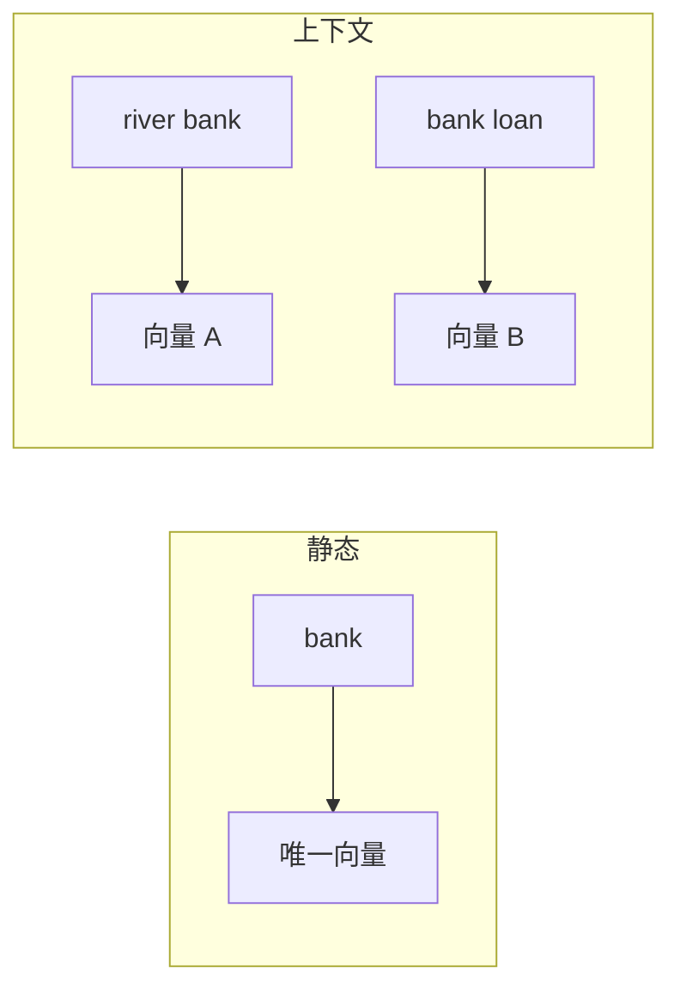

# 从静态词向量到上下文向量

## 1. 本节学习目标

1. 说清"静态词向量"的根本缺陷：**一词一向量，无法区分多义**。
2. 用实测看到同一 token ID 在不同上下文里输出**不同向量**。
3. 理解上下文向量是怎么产生的（**自注意力的加权混合**）。
4. 知道这带来什么好处与代价（表达力 ↑、计算 ↑、不能再"查表"）。

## 2. 为什么需要这个知识

因为 **"bank" 在"河岸"与"银行"里必须不同**：

- word2vec 只能给一个平均向量 ⇒ 两种含义被搅在一起；
- 现代 LLM 每个位置输出**上下文相关**的向量 ⇒ 同一词不同句不同表示。

这是"预训练语言模型"革命的核心一步。

## 3. 直观解释

```text
静态（word2vec）：
  "bank" → [0.31, 0.21, -0.12, ...]   ← 永远这同一个向量

上下文（BERT/GPT）：
  "river bank"  → [0.05, 0.09, -0.10, ...]
  "bank loan"   → [-0.05, -0.13, -0.41, ...]   ← 不一样了
```

## 4. 正式定义

**静态词向量**

$$
\mathbf{e}_w=E[\text{id}(w)]\quad(\text{与上下文无关})
$$

**上下文向量**

$$
\mathbf{h}_t=f_\theta(\mathbf{e}_1,\dots,\mathbf{e}_T)[t]\quad(\text{依赖整句})
$$

**本课实测**

```text
'bank'（id=5）的静态向量: [0.314, 0.213, -0.12, 0.36, -0.314, -1.079, 0.241, -1.396]
上下文 A 中 'bank' 的输出: [0.053, 0.086, -0.1, -0.224, -0.074, 0.257, 0.02, 0.39]
上下文 B 中 'bank' 的输出: [-0.054, -0.128, -0.413, -0.057, 0.106, 0.385, 0.554, 0.192]
两者是否不同: True
```

**读法**：

1. **静态向量只有一份**（第一行）。
2. **同一 id 在上下文 A 与 B 得到不同输出** ⇒ 上下文化生效。
3. 差异不是噪声：A/B 只换了邻近 token，输出就变了 ⇒ **信息来自邻居**。

## 5. 历史背景或技术背景

| 年份 | 模型 | 类型 |
|---|---|---|
| 2013 | word2vec | 静态 |
| 2014 | GloVe | 静态 |
| 2018 | ELMo | 上下文（双向 LSTM） |
| 2018 | BERT | 上下文（Transformer 编码器） |
| 2018+ | GPT | 上下文（因果解码器） |

**关键区别**：BERT 给"双向上下文向量"（适合理解），GPT 给"左侧上下文向量"（适合生成）。

## 6. 核心原理

**上下文向量怎么来的**

以单层自注意力为例：

$$
\mathbf{h}_t=\sum_{j}\alpha_{tj}\mathbf{v}_j
$$

⇒ 每个位置的输出是**全句 value 的加权和**，权重由内容决定。

**本课对应**：`bank` 在 A/B 中的邻居不同 ⇒ 注意力权重不同 ⇒ $\mathbf{h}$ 不同。

**代价**：

| 维度 | 静态 | 上下文 |
|---|---|---|
| 查表 | $O(1)$ | 需过整个模型 $O(L\cdot T^2d)$ |
| 存储 | $V\times d$ | 每句都要算 |
| 多义 | ❌ | ✅ |

## 7. 数学表达式

**静态向量的"平均"性质**

$$
\mathbf{e}_w\approx\sum_{\text{contexts}}P(\text{context}\mid w)\,\mathbf{h}_w^{\text{ctx}}
$$

⇒ 静态向量是多义的**加权平均**（信息被混合）。

**上下文化的可分离性**

理想情况下：

$$
\mathbf{h}_w^{\text{ctx}}\approx \mathbf{e}_w+\Delta(\text{ctx})
$$

⇒ 基础语义 + 语境修正。

## 8. 详细数学推导

**推导：为什么静态向量无法区分多义**

设一个词有两种含义 $s_1,s_2$，出现概率 $p_1,p_2$。训练目标让 $\mathbf{e}_w$ 同时拟合两种上下文：

$$
\min_{\mathbf{e}}\ p_1\|\mathbf{e}-\mathbf{c}_1\|^2+p_2\|\mathbf{e}-\mathbf{c}_2\|^2
$$

解为加权平均：

$$
\mathbf{e}^\*=p_1\mathbf{c}_1+p_2\mathbf{c}_2
$$

⇒ **两个含义被压成一个点**，下游无法区分。

**本课对照**：上下文向量不共享同一个 $\mathbf{e}$，而是每个位置重新计算 ⇒ 不存在"平均坍缩"。

## 9. 图解



## 10. 具体数值示例

```text
静态 bank：  [0.314, 0.213, -0.120, 0.360, ...]
上下文 A：   [0.053, 0.086, -0.100, -0.224, ...]
上下文 B：   [-0.054, -0.128, -0.413, -0.057, ...]

三者互不相同；A 与 B 的邻居不同 ⇒ 输出不同
```

## 11. NumPy 实现

```python
import numpy as np

rng = np.random.default_rng(0)
V, d = 10, 8
E = rng.normal(size=(V, d))
Wq, Wk, Wv = (rng.normal(size=(d, d)) * 0.3 for _ in range(3))


def softmax(x):
    e = np.exp(x - x.max(-1, keepdims=True))
    return e / e.sum(-1, keepdims=True)


def ctx(seq, target):
    x = E[seq]
    A = softmax(x @ Wq @ (x @ Wk).T / np.sqrt(d))
    out = A @ (x @ Wv)
    return out[seq.index(target)]


print("静态 bank:", E[5].round(3))
print("上下文 A :", ctx([1, 5, 2], 5).round(3))
print("上下文 B :", ctx([3, 5, 4], 5).round(3))
```

## 12. PyTorch 实现

```python
import math

import torch
import torch.nn as nn
import torch.nn.functional as F

torch.manual_seed(0)
emb = nn.Embedding(10, 8)
Wq, Wk, Wv = (torch.randn(8, 8) * 0.3 for _ in range(3))


def ctx(seq, target):
    x = emb(torch.tensor(seq))
    A = F.softmax(x @ Wq @ (x @ Wk).T / math.sqrt(8), dim=-1)
    return (A @ (x @ Wv))[seq.index(target)]


s1, s2 = [1, 5, 2], [3, 5, 4]
v1, v2 = ctx(s1, 5), ctx(s2, 5)
print("静态:", [round(float(v), 3) for v in emb.weight[5]])
print("A   :", [round(float(v), 3) for v in v1])
print("B   :", [round(float(v), 3) for v in v2])
print("A 与 B 是否不同:", not torch.allclose(v1, v2, atol=1e-6))
```

## 13. Hugging Face 实践

```python
import os

os.environ.setdefault("HF_ENDPOINT", "https://hf-mirror.com")
os.environ.setdefault("HF_HUB_OFFLINE", "1")
import torch
from transformers import AutoModelForCausalLM, AutoTokenizer

tok = AutoTokenizer.from_pretrained("gpt2")
m = AutoModelForCausalLM.from_pretrained("gpt2").eval()

# 同一句中 "bank" 出现两次，看它的隐状态是否相同
text = "the bank by the river and the bank loan"
ids = tok(text, return_tensors="pt")
with torch.no_grad():
    out = m(**ids, output_hidden_states=True)
h = out.hidden_states[-1][0]          # 最后一层隐状态 (T, d)
pos = [i for i, t in enumerate(tok.convert_ids_to_tokens(ids["input_ids"][0]))
       if "bank" in t]
print("'bank' 出现位置:", pos)
if len(pos) >= 2:
    print("两处隐状态是否相同:", bool(torch.allclose(h[pos[0]], h[pos[1]], atol=1e-5)))
    print("最大差:", round(float((h[pos[0]] - h[pos[1]]).abs().max()), 4))
```

## 14. 代码逐行解释

| 代码 | 作用 |
|---|---|
| `E[5]` | 静态查表 |
| 自注意力 + 加权和 | 生成上下文向量 |
| `output_hidden_states=True` | 拿每层隐状态 |
| `h[pos[0]]` vs `h[pos[1]]` | 对比同词不同位置的向量 |
| `allclose` | 判断是否相同 |

## 15. 实际运行结果

```text
'bank'（id=5）的静态向量: [0.314, 0.213, -0.12, 0.36, -0.314, -1.079, 0.241, -1.396]
上下文 A 中 'bank' 的输出: [0.053, 0.086, -0.1, -0.224, -0.074, 0.257, 0.02, 0.39]
上下文 B 中 'bank' 的输出: [-0.054, -0.128, -0.413, -0.057, 0.106, 0.385, 0.554, 0.192]
两者是否不同: True
```

## 16. 应用场景

| 场景 | 用哪种 |
|---|---|
| 快速词相似度 | 静态词向量 |
| 语义检索（句向量） | 上下文模型 + 池化 |
| 词义消歧 | 上下文向量 |
| 大模型内部 | 每层都在产生上下文向量 |
| 低成本分类 | 静态向量 + 线性模型可能够用 |

## 17. 优点与局限

| 优点 | 局限 |
|---|---|
| 多义可区分（本课实测 A≠B） | 计算贵（要过模型） |
| 表达力强、下游效果好 | 不能再"查表" |
| 可随上下文动态变化 | 难以直接解释单维含义 |

## 18. 常见错误

| 错误 | 现象 | 纠正 |
|---|---|---|
| 用静态向量做多义任务 | 效果上限低 | 换上下文模型 |
| 以为同词向量永远相同 | 与实测矛盾 | 看层与上下文 |
| 用最后一层做句向量 | 不一定最优 | 试 pooler/多层级拼接 |
| 忽略池化方式 | 结果差异大 | 明确 CLS/mean/max |
| 跨层混用向量 | 不可比 | 固定层 |

## 19. 本节总结

- 静态词向量**一词一向量**，多义被压成平均；上下文向量**依赖整句**（本课实测 A 与 B 不同）。
- 来源是**自注意力对全句 value 的加权混合**。
- 代价：从 $O(1)$ 查表变成过模型；收益：多义可区分、下游更强。

## 20. 前置与后续知识链接

- 前置：[[LLM-037 语义空间与相似度]]、[[LLM-036 Embedding 与向量表示]]
- 后续：[[LLM-039 Embedding 与模型参数]]、[[LLM-040 Token 嵌入与位置嵌入的区别]]
- 相关：[[MATH-216 矩阵乘法]]、[[DL-015 均方误差 MSE]]

---

## 练习与参考答案

**基础 1**：静态词向量与上下文向量的根本区别是什么？

**基础 2**：本课 `bank` 的静态向量与两个上下文输出是否相同？

**进阶 1**：为什么静态向量无法区分多义？请用最小化目标说明。

**综合**：你要做"词义消歧"（判断 bank 是银行还是河岸）。请说明用什么表示、为什么。

> [!success]- 参考答案

> **基础 1**
> 静态词向量**与上下文无关**（一词一向量，查表即得）；上下文向量**依赖整句**（同一词在不同句子得到不同向量，需过模型计算）。

> **基础 2**
> 三者互不相同：静态向量一份，上下文 A、B 各一份，且 A≠B（实测 `True`）。

> **进阶 1**
> 训练要让一个向量同时拟合多种含义的上下文：
> $$\min_{\mathbf e}\ p_1\|\mathbf e-\mathbf c_1\|^2+p_2\|\mathbf e-\mathbf c_2\|^2$$
> 最优解是加权平均 $\mathbf e^\*=p_1\mathbf c_1+p_2\mathbf c_2$ ⇒ 两种含义被**压成一个点**，下游无法区分。

> **综合（参考）**
> **表示**：用**上下文模型**（BERT 类编码器）取 `bank` 位置的隐状态，而不是静态词向量。
> **理由**：消歧依赖**上下文线索**（"river"/"loan"），静态向量把这些线索平均掉了；上下文向量把邻居信息编码进来（本课实测同 id 在 A/B 上下文输出不同）。
> **做法**：① 取编码器最后一层或中间层中 `bank` 位置向量；② 接分类头（银行/河岸）；③ 用标注数据微调；④ 评估用 macro-F1 + 混淆矩阵。
> **注意**：若数据极少，可先用"上下文向量 + 逻辑回归"作为基线。

## 学习记录

| 日期 | 状态 | 用时 | 问题 | 复盘 |
|---|---|---|---|---|
| 2026-11-08 | planned | — | — | — |

---

## 🔗 Notion 同步信息

> 以下内容由 Notion「AI Knowledge System · 知识点」数据库按知识 ID 合并而来（导出于 2026-11-09）。

| 属性 | 值 |
|---|---|
| 学科 | 大语言模型 |
| 学习状态 | 未开始 |
| 难度 | L2 应用 |
| 知识类型 | Concept |

- **所属模块**：[M-LLM-04 Tokenizer、Embedding 与文本表示](../%E8%AF%BE%E7%A8%8B%E6%A8%A1%E5%9D%97/M-LLM-04%20Tokenizer%E3%80%81Embedding%20%E4%B8%8E%E6%96%87%E6%9C%AC%E8%A1%A8%E7%A4%BA.md)
- **前置知识**：[LLM-037 语义空间与相似度](LLM-037%20%E8%AF%AD%E4%B9%89%E7%A9%BA%E9%97%B4%E4%B8%8E%E7%9B%B8%E4%BC%BC%E5%BA%A6.md)
- **后继知识**：[LLM-039 Embedding 与模型参数](LLM-039%20Embedding%20%E4%B8%8E%E6%A8%A1%E5%9E%8B%E5%8F%82%E6%95%B0.md)
- **关联数学**：[MATH-216 矩阵乘法](../../06_%E6%95%B0%E5%AD%A6%E5%9F%BA%E7%A1%80/02%20%E7%BA%BF%E6%80%A7%E4%BB%A3%E6%95%B0/MATH-216%20%E7%9F%A9%E9%98%B5%E4%B9%98%E6%B3%95.md)
