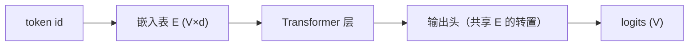

# Embedding 与模型参数

## 1. 本节学习目标

1. 算清嵌入层在总参数中的占比，并知道**小模型里它可能超过 1/3**。
2. 理解 **weight tying**（输入嵌入与输出头共享）：本课省 **50%**（6400 vs 12800）。
3. 会用 `is` 判断两个参数是否真的是同一张量。
4. 知道嵌入层的三个工程问题：**padding_idx、稀疏梯度、分布式分片**。

## 2. 为什么需要这个知识

因为嵌入层常被忽略，但它是**参数大头**：

- GPT-2：38.6M / 124.4M ≈ **31%**；
- 某些小模型（大词表）可能 **>50%**；
- 它还是**显存/通信**的热点（分布式训练要专门分片）。

## 3. 直观解释

```text
输入嵌入：token id → 向量    （V×d）
输出头  ：向量 → 词表分布    （d×V）
```

两者形状**互为转置** ⇒ 很自然可以**共用同一张表**（weight tying）。

## 4. 正式定义

**不共享**

$$
N_{\text{emb}}=Vd,\qquad N_{\text{head}}=Vd\ \Rightarrow\ 2Vd
$$

**共享（weight tying）**

$$
N=Vd
$$

**本课实测**

```text
不共享: 嵌入 6400 + 输出头 6400 = 12800
共享（weight tying）: 6400（省 50%）
绑定后输出形状: (2, 100)  是否同一张量: True
```

**读法**：

1. **省 50%**（$V{=}100,d{=}64$ 时 12800 → 6400）。
2. **真的是同一张量**（`is` 为 True）⇒ 梯度会累加，训练时同步更新。
3. 输出形状不变 $(2,100)$ ⇒ 结构无感。

## 5. 历史背景或技术背景

| 模型 | 是否 weight tying |
|---|---|
| GPT-2 | **是**（`lm_head` 与 `wte` 共享） |
| BERT | 是（MLM 头与嵌入共享） |
| T5 | 是 |
| 部分大模型 | 否（为灵活性/并行） |

**结论**：**大多数中小模型都做 tying**，大模型有时为了并行/精度放弃。

## 6. 核心原理

**为什么 tying 合理**

输入侧：$E[i]$ 应表示"token $i$ 的语义"；
输出侧：$\text{logits}=E\mathbf{h}$，第 $i$ 个 logit ≈ "$\mathbf{h}$ 与 $E[i]$ 的相似度"。

⇒ 两侧语义一致 ⇒ 共享是**归纳偏置的合理选择**，同时省参数、缓解小词表过拟合。

**本课对应**：绑定后 `head.weight is tie.weight` 为 True，输出仍 $(2,100)$。

## 7. 数学表达式

**占比**

$$
r=\frac{Vd}{12Ld^2+Vd}
$$

**本课 gpt2**：$\frac{38.6}{124.4}=31\%$。

**若 $d$ 很小、$V$ 很大**（如小模型 + 大词表）：$r$ 可接近 50%+。

## 8. 详细数学推导

**推导：tying 为什么不损失表达力（大致）**

输出头只需要"给每个 token 一个打分方向"，输入嵌入已经提供了这个方向；额外的独立输出头主要增加自由度，但在数据充足时收益有限。

**推导：tying 的梯度**

$$
\frac{\partial L}{\partial E}=\frac{\partial L_{\text{in}}}{\partial E}+\frac{\partial L_{\text{out}}}{\partial E}
$$

⇒ 两个来源的梯度**累加**到同一张表（本课 `is` 验证是同一张量）。

## 9. 图解



## 10. 具体数值示例

```text
V=100, d=64
不共享：6,400 + 6,400 = 12,800
共享  ：6,400（省 50%）

真实：gpt2 V=50257 d=768 ⇒ 38.6M，占 124.4M 的 31%
```

## 11. NumPy 实现

```python
V, d = 100, 64
emb = 6400
head = V * d
print("不共享:", emb + head)
print("共享  :", emb, " 省 %.0f%%" % (head / (emb + head) * 100))

# 占比：V*d / (12*L*d^2 + V*d)
def ratio(V, d, L):
    return V * d / (12 * L * d * d + V * d)


for V, d, L in ((50257, 768, 12), (32000, 4096, 32), (128000, 1024, 8)):
    print(f"V={V} d={d} L={L}: 嵌入占比 {ratio(V, d, L)*100:.1f}%")
```

## 12. PyTorch 实现

```python
import torch
import torch.nn as nn

V, d = 100, 64
emb = nn.Embedding(V, d)
head = nn.Linear(d, V, bias=False)

n_before = emb.weight.numel() + head.weight.numel()
print("不共享参数:", n_before)

head.weight = emb.weight              # 绑定
print("绑定后:", emb.weight.numel() + 0)
print("是否同一张量:", head.weight is emb.weight)

x = torch.randn(2, d)
print("输出形状:", tuple(head(x).shape))

# 梯度累加验证
emb(torch.tensor([1, 2])).sum().backward()
print("绑定后嵌入有梯度:", emb.weight.grad is not None)
```

## 13. Hugging Face 实践

```python
import os

os.environ.setdefault("HF_ENDPOINT", "https://hf-mirror.com")
os.environ.setdefault("HF_HUB_OFFLINE", "1")
from transformers import AutoModelForCausalLM

m = AutoModelForCausalLM.from_pretrained("gpt2")
wte = m.transformer.wte.weight
lm = m.lm_head.weight
print("gpt2 weight tying:", wte is lm)
print("嵌入形状:", tuple(wte.shape), " 参数量:", wte.numel())
total = sum(p.numel() for p in m.parameters())
print("占总参数: %.1f%%" % (wte.numel() / total * 100))
```

## 14. 代码逐行解释

| 代码 | 作用 |
|---|---|
| `head.weight = emb.weight` | 真正共享（同一张量） |
| `is` | 验证不是复制而是同对象 |
| `12*L*d*d + V*d` | 总参数估算 |
| `m.lm_head.weight is m.transformer.wte.weight` | 真实模型检查 |

## 15. 实际运行结果

```text
不共享: 嵌入 6400 + 输出头 6400 = 12800
共享（weight tying）: 6400（省 50%）
绑定后输出形状: (2, 100)  是否同一张量: True
```

## 16. 应用场景

| 场景 | 建议 |
|---|---|
| 中小模型 | **开 tying**（省参数、防过拟合） |
| 超大模型/并行训练 | 常关闭（灵活性与通信考虑） |
| 多语言大词表 | tying 省得最多 |
| 需要独立输出头（如多任务） | 不共享 |

## 17. 优点与局限

| 优点 | 局限 |
|---|---|
| 省 $Vd$ 参数（本课 50%） | 输出头自由度下降 |
| 缓解嵌入层过拟合 | 与张量并行/流水并行实现冲突 |
| 语义一致（输入输出同空间） | 某些任务精度略降 |

## 18. 常见错误

| 错误 | 现象 | 纠正 |
|---|---|---|
| 以为 `head.weight = emb.weight` 是复制 | 实际是同一张量 | 用 `is` 验证 |
| tying 后又单独初始化 | 覆盖共享表 | 先绑定后不要再 init |
| 分布式训练 shared 参数未处理 | 梯度不同步 | 用框架的 tying 支持 |
| 忘 `padding_idx` | pad 也更新 | 设置 padding_idx |
| 大词表不开 tying | 参数浪费 | 评估后用 tying |

## 19. 本节总结

- 嵌入层参数 $Vd$，GPT-2 占 **31%**；输出头再一份 $Vd$。
- **weight tying** 让二者共享：本课 **12800 → 6400（省 50%）**，且 `is` 验证为同一张量。
- 代价：输出头自由度下降；大规模并行训练中实现更复杂。

## 20. 前置与后续知识链接

- 前置：[[LLM-038 从静态词向量到上下文向量]]
- 后续：[[LLM-040 Token 嵌入与位置嵌入的区别]]、[[LLM-041 多语言 Tokenizer 的取舍]]
- 相关：[[LLM-036 Embedding 与向量表示]]、[[LLM-030 Transformer 参数量与计算量估算]]、[[DL-060 nn.Module 自定义网络]]

---

## 练习与参考答案

**基础 1**：weight tying 是什么？省多少参数？

**基础 2**：本课不共享与共享的参数量各是多少？

**进阶 1**：为什么 tying 在语义上"合理"？

**综合**：$V{=}50000,d{=}768,L{=}12$，嵌入层占总参数多少？若开 tying 能省多少？

> [!success]- 参考答案

> **基础 1**
> 让**输入嵌入矩阵**与**输出头（词表投影）**共享同一个参数张量（$E\in\mathbb{R}^{V\times d}$）。
> 省下的参数量为 $Vd$（原本两份）。

> **基础 2**
> 不共享 **12,800**；共享 **6,400**（省 **50%**）。

> **进阶 1**
> 输入侧 $E[i]$ 表示"token $i$ 的语义方向"；输出侧 $\text{logits}=E\mathbf h$ 的第 $i$ 项近似"$\mathbf h$ 与 $E[i]$ 的相似度"。
> 两侧本来就是同一个语义空间 ⇒ 共享是一致且自然的归纳偏置，同时减少参数、缓解过拟合。

> **综合（参考）**
> **嵌入参数**：$50000\times768=38{,}400{,}000$。
> **总参数**：$12\times768^2\times12=84{,}934{,}656$（层）+ 38.4M（嵌入）≈ **123.3M**。
> **占比**：$38.4/123.3\approx$ **31.2%**。
> **开 tying**：输出头原本也是 38.4M ⇒ 省下 **38.4M（约 31%）**，总参数降到约 **84.9M**。

## 学习记录

| 日期 | 状态 | 用时 | 问题 | 复盘 |
|---|---|---|---|---|
| 2026-11-08 | planned | — | — | — |

---

## 🔗 Notion 同步信息

> 以下内容由 Notion「AI Knowledge System · 知识点」数据库按知识 ID 合并而来（导出于 2026-11-09）。

| 属性 | 值 |
|---|---|
| 学科 | 大语言模型 |
| 学习状态 | 未开始 |
| 难度 | L2 应用 |
| 知识类型 | Technique |

- **所属模块**：[M-LLM-04 Tokenizer、Embedding 与文本表示](../%E8%AF%BE%E7%A8%8B%E6%A8%A1%E5%9D%97/M-LLM-04%20Tokenizer%E3%80%81Embedding%20%E4%B8%8E%E6%96%87%E6%9C%AC%E8%A1%A8%E7%A4%BA.md)
- **前置知识**：[LLM-038 从静态词向量到上下文向量](LLM-038%20%E4%BB%8E%E9%9D%99%E6%80%81%E8%AF%8D%E5%90%91%E9%87%8F%E5%88%B0%E4%B8%8A%E4%B8%8B%E6%96%87%E5%90%91%E9%87%8F.md)
- **后继知识**：[LLM-040 Token 嵌入与位置嵌入的区别](LLM-040%20Token%20%E5%B5%8C%E5%85%A5%E4%B8%8E%E4%BD%8D%E7%BD%AE%E5%B5%8C%E5%85%A5%E7%9A%84%E5%8C%BA%E5%88%AB.md)
