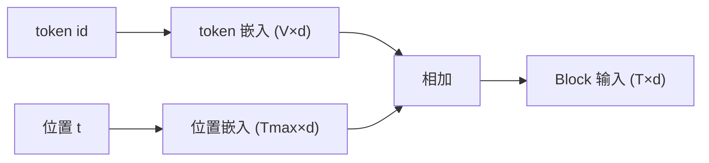

# Token 嵌入与位置嵌入的区别

## 1. 本节学习目标

1. 说清两者**各管什么**：token 嵌入管"是什么词"，位置嵌入管"在第几位"。
2. 用实测看参数量对比（本课 token **800**、位置 **192**，位置占 **19.4%**）。
3. 理解"相加"而不是"拼接"（为什么可行）。
4. 知道 RoPE 为什么**不需要**位置嵌入参数。

## 2. 为什么需要这个知识

因为这两者**形状相同、做法不同**，很容易混：

- token 嵌入：$V\times d$，每个词一行；
- 位置嵌入：$T_{\max}\times d$，每个位置一行；
- 最终输入 = **两者相加**。

混淆它们会导致：换模型时把位置嵌入当词嵌入加载（形状对但语义全错）。

## 3. 直观解释

```text
token 嵌入：(第 42 号词) → 向量
位置嵌入  ：(第 3 个位置) → 向量

输入 = 词向量 + 位置向量
```

**类比**：词向量是"这个人是谁"，位置向量是"他站第几排"。

## 4. 正式定义

**输入表示**

$$
\mathbf{x}_t=\mathbf{e}(w_t)+\mathbf{p}_t
$$

**参数量**

$$
N_{\text{token}}=Vd,\qquad N_{\text{pos}}=T_{\max}d
$$

**本课实测**

```text
token 嵌入参数: 800  位置嵌入参数: 192
比例: 位置嵌入占 19.4%
相加后形状: (3, 16)
RoPE 类模型没有位置嵌入参数 ⇒ 省 192 个参数
```

**读法**：

1. $V{=}50,d{=}16$ ⇒ token 800；$T{=}12,d{=}16$ ⇒ 位置 192。
2. 位置嵌入只占 **19.4%**（因为 $T_{\max}\ll V$）。
3. **相加不改变形状** $(3,16)$ ⇒ 可直接送进 Block。
4. RoPE 把位置"旋转"进 $Q/K$ ⇒ **没有位置嵌入参数**。

## 5. 历史背景或技术背景

| 年份 | 方案 | 位置参数 |
|---|---|---|
| 2017 | 正弦 PE | **0**（固定） |
| 2018 | 可学习位置嵌入（BERT/GPT-2） | $T_{\max}d$ |
| 2021+ | RoPE | **0**（旋转进 Q/K） |
| ALiBi | 距离惩罚 | 0 |

**趋势**：现代 LLM 多用 **RoPE**（无位置参数、可外推），这也是 LLM-028 的内容。

## 6. 核心原理

**为什么可以"相加"而不是"拼接"**

若拼接：维度变 $2d$，每层参数翻倍。
若相加：维度保持 $d$，且模型可以**学会区分**"内容方向"与"位置方向"（高维空间里两者可近似正交）。

**理论代价**：相加会让内容与位置**混在同一向量**里，无法无损分离；实践中效果良好。

**本课对应**：相加后形状仍是 $(3,16)$，直接可进后续层。

## 7. 数学表达式

**占比**

$$
r_{\text{pos}}=\frac{T_{\max}d}{Vd+T_{\max}d}=\frac{T_{\max}}{V+T_{\max}}
$$

本课：$\frac{12}{50+12}=19.4\%$ ✅

**GPT-2**：$\frac{1024}{50257+1024}\approx2\%$。

## 8. 详细数学推导

**推导：为什么正弦 PE 是"零参数"**

正弦 PE 由公式算出，不参与训练 ⇒ 参数量 0，但**表达力固定**（LLM-024）。

**推导：位置嵌入的硬上限**

位置嵌入只有 $T_{\max}$ 行：

$$
t\ge T_{\max}\ \Rightarrow\ \text{索引越界}
$$

⇒ 无法外推（这正是 RoPE 的动机）。

## 9. 图解



## 10. 具体数值示例

```text
V=50, T=12, d=16
token 嵌入: 800
位置嵌入  : 192
占比      : 192/(800+192) = 19.4%
相加后    : (3,16)

GPT-2: 1024/(50257+1024) ≈ 2%
```

## 11. NumPy 实现

```python
import numpy as np

V, T, d = 50, 12, 16
tok_emb = np.random.default_rng(0).normal(size=(V, d))
pos_emb = np.random.default_rng(1).normal(size=(T, d))

ids = np.array([1, 2, 3])
pos = np.arange(3)
x = tok_emb[ids] + pos_emb[pos]
print("输入形状:", x.shape)
print("token 参数:", tok_emb.size, " 位置参数:", pos_emb.size)
print("位置占比: %.1f%%" % (pos_emb.size / (tok_emb.size + pos_emb.size) * 100))
```

## 12. PyTorch 实现

```python
import torch
import torch.nn as nn

V, T, d = 50, 12, 16
tok = nn.Embedding(V, d)
pos = nn.Embedding(T, d)

ids = torch.tensor([[1, 2, 3], [4, 5, 6]])
positions = torch.arange(ids.size(1)).unsqueeze(0)
x = tok(ids) + pos(positions)
print("输入:", tuple(x.shape))
print("token 参数:", tok.weight.numel(), " 位置参数:", pos.weight.numel())

# 演示：位置嵌入越界（超出 T）
try:
    pos(torch.tensor([T]))
except Exception as e:
    print("超出 T_max 报错:", type(e).__name__)
```

## 13. Hugging Face 实践

```python
import os

os.environ.setdefault("HF_ENDPOINT", "https://hf-mirror.com")
os.environ.setdefault("HF_HUB_OFFLINE", "1")
from transformers import AutoModelForCausalLM

m = AutoModelForCausalLM.from_pretrained("gpt2")
print("token 嵌入:", tuple(m.transformer.wte.weight.shape))
print("位置嵌入:", tuple(m.transformer.wpe.weight.shape))
print("两者可以相加:", m.transformer.wte.weight.shape[1] == m.transformer.wpe.weight.shape[1])
print("位置参数占比: %.2f%%" % (
    m.transformer.wpe.weight.numel() /
    (m.transformer.wte.weight.numel() + m.transformer.wpe.weight.numel()) * 100))
```

## 14. 代码逐行解释

| 代码 | 作用 |
|---|---|
| `nn.Embedding(V, d)` | token 表（$V$ 行） |
| `nn.Embedding(T, d)` | 位置表（$T$ 行） |
| `tok(ids) + pos(positions)` | 相加得到输入 |
| `ids.size(1)` | 取序列长度 |
| `pos(torch.tensor([T]))` | 越界演示 |
| `wte` / `wpe` | GPT-2 的 token/位置嵌入 |

## 15. 实际运行结果

```text
token 嵌入参数: 800  位置嵌入参数: 192
比例: 位置嵌入占 19.4%
相加后形状: (3, 16)
RoPE 类模型没有位置嵌入参数 ⇒ 省 192 个参数
```

## 16. 应用场景

| 场景 | 位置方案 |
|---|---|
| BERT/GPT-2 | 可学习位置嵌入 |
| Llama/DeepSeek | RoPE（无位置参数） |
| 长上下文外推 | RoPE + 插值 |
| 图像 patch | 2D 位置嵌入 |
| 周期性任务 | 正弦 PE（无参数） |

## 17. 优点与局限

| 方案 | 优点 | 局限 |
|---|---|---|
| 可学习位置嵌入 | 灵活、简单 | 硬上限 $T_{\max}$、不可外推 |
| 正弦 PE | 零参数、可理论外推 | 表达力固定 |
| RoPE | 相对位置、可外推 | 实现复杂 |

## 18. 常见错误

| 错误 | 现象 | 纠正 |
|---|---|---|
| 把位置嵌入当 token 嵌入加载 | 形状对但语义错 | 看形状 $T_{\max}$ vs $V$ |
| 忘加位置嵌入 | 顺序信息丢失 | 必须加（LLM-024 实测 0.0 等变） |
| 位置越界 | 报错 | 截断或换 RoPE |
| 拼接而非相加 | 维度翻倍 | 通常相加 |
| 以为 RoPE 有位置参数 | 参数估算错 | 它没有 |

## 19. 本节总结

- token 嵌入（$V\times d$）管"什么词"，位置嵌入（$T_{\max}\times d$）管"第几位"，二者**相加**成输入。
- 本课实测：token **800**、位置 **192**（占 **19.4%**）；相加后形状 $(3,16)$ 不变。
- **RoPE 没有位置嵌入参数**，这是它省参数且能外推的原因。

## 20. 前置与后续知识链接

- 前置：[[LLM-039 Embedding 与模型参数]]、[[LLM-024 位置编码]]
- 后续：[[LLM-041 多语言 Tokenizer 的取舍]]
- 相关：[[LLM-036 Embedding 与向量表示]]、[[LLM-028 RoPE 与长上下文外推]]

---

## 练习与参考答案

**基础 1**：token 嵌入与位置嵌入各管什么？参数量各是多少？

**基础 2**：本课位置嵌入占多少比例？为什么？

**进阶 1**：为什么通常"相加"而不是"拼接"？各有什么代价？

**综合**：$V{=}32000$、$T_{\max}{=}4096$、$d{=}4096$。请算两种嵌入的参数量与占比，并说明若换成 RoPE 能省多少。

> [!success]- 参考答案

> **基础 1**
> - **token 嵌入**：管"是什么词"，参数 $V\times d$；
> - **位置嵌入**：管"在第几位"，参数 $T_{\max}\times d$。
> 二者相加得到 Block 输入。

> **基础 2**
> **19.4%**（192 / (800+192)）。因为 $T_{\max}$（12）远小于 $V$（50），位置表小得多。

> **进阶 1**
> **相加**：维度保持 $d$，参数量与计算量不变；代价是内容与位置混在同一向量，无法无损分离。
> **拼接**：内容与位置分开（更"干净"），但维度变 $2d$ ⇒ 后续每层参数与计算翻倍。所以实践中用相加。

> **综合（参考）**
> **token 嵌入**：$32000\times4096=131{,}072{,}000$（约 131M）。
> **位置嵌入**：$4096\times4096=16{,}777{,}216$（约 16.8M）。
> **占比**：$16.8/(131+16.8)\approx$ **11.4%**。
> **换 RoPE**：位置参数**归零**，省下 **16.8M**（约 11.4% 的嵌入部分），且获得相对位置与外推能力。
> **注意**：RoPE 仍需要"旋转角"计算，但那是由位置索引实时生成的，不占可训练参数。

## 学习记录

| 日期 | 状态 | 用时 | 问题 | 复盘 |
|---|---|---|---|---|
| 2026-11-08 | planned | — | — | — |

---

## 🔗 Notion 同步信息

> 以下内容由 Notion「AI Knowledge System · 知识点」数据库按知识 ID 合并而来（导出于 2026-11-09）。

| 属性 | 值 |
|---|---|
| 学科 | 大语言模型 |
| 学习状态 | 未开始 |
| 难度 | L2 应用 |
| 知识类型 | Concept |

- **所属模块**：[M-LLM-04 Tokenizer、Embedding 与文本表示](../%E8%AF%BE%E7%A8%8B%E6%A8%A1%E5%9D%97/M-LLM-04%20Tokenizer%E3%80%81Embedding%20%E4%B8%8E%E6%96%87%E6%9C%AC%E8%A1%A8%E7%A4%BA.md)
- **前置知识**：[LLM-039 Embedding 与模型参数](LLM-039%20Embedding%20%E4%B8%8E%E6%A8%A1%E5%9E%8B%E5%8F%82%E6%95%B0.md)
- **后继知识**：[LLM-041 多语言 Tokenizer 的取舍](LLM-041%20%E5%A4%9A%E8%AF%AD%E8%A8%80%20Tokenizer%20%E7%9A%84%E5%8F%96%E8%88%8D.md)
