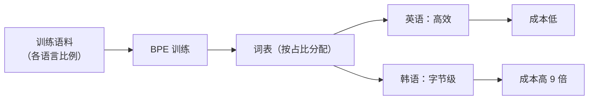

# 多语言 Tokenizer 的取舍

## 1. 本节学习目标

1. 用实测看六种语言在同一词表下的 token 效率（英 **4.33** 到韩 **0.46** 字符/token）。
2. 理解"词表分配"的本质：**语料比例决定 token 效率**。
3. 掌握三个取舍：**共享词表 vs 分语言词表**、**词表大小**、**公平性 vs 效率**。
4. 知道多语言场景的评估方法（**按语言分别算压缩率与成本**）。

## 2. 为什么需要这个知识

因为**多语言模型的能力差距很大程度来自 tokenizer**：

- 同一句话，英语 6 token、韩语 **26 token**（本课实测）；
- token 多 ⇒ 成本高、上下文被占满、推理慢；
- 团队常忽略这点，结果"同样的产品，某些语言贵 4 倍"。

## 3. 直观解释

**词表像一块蛋糕**：谁在训练语料里占比大，谁分到的 subword 就多，token 效率就高。

```text
英文占 90% 语料 ⇒ 词表里大量英文片段 ⇒ 英文高效
韩文占 1%      ⇒ 只能切成字节 ⇒ 韩文低效
```

## 4. 正式定义

**压缩率（每语言）**

$$
\rho_{\ell}=\frac{\text{chars}_{\ell}}{\text{tokens}_{\ell}}
$$

**多语言公平性指标**

$$
\text{gap}=\max_{\ell}\rho_{\ell}-\min_{\ell}\rho_{\ell}
$$

**成本**：$\text{cost}\propto 1/\rho_\ell$。

**本课实测（gpt2 词表）**

```text
英语    :  26 字符 →   6 token（4.33 字符/token）
中文    :   7 字符 →  11 token（0.64 字符/token）
日语    :  10 字符 →  13 token（0.77 字符/token）
韩语    :  12 字符 →  26 token（0.46 字符/token）
俄语    :  23 字符 →  27 token（0.85 字符/token）
阿拉伯语 :  17 字符 →  16 token（1.06 字符/token）
```

**四个读法**：

1. **英语 4.33**，韩语只有 **0.46** ⇒ 同样"一句天气"，韩语贵约 **9 倍**。
2. 中文 0.64、日语 0.77 ⇒ 中日韩都低效（gpt2 词表以英文为主）。
3. 阿拉伯语 1.06 反而比中日韩高一点（gpt2 语料里有部分阿语）。
4. 这不是"语言难度"，而是**词表分配问题**。

## 5. 历史背景或技术背景

| 模型 | 词表 | 多语言策略 |
|---|---|---|
| BERT-base | 30k | 英文为主 + `##` |
| mBERT | 110k | 104 语言共享 |
| XLM-R | 250k | 100 语言共享（大词表） |
| Llama 2 | 32k | 以英文为主（中文差） |
| Qwen / DeepSeek | 100k+ | 中英并重 |

**趋势**：多语言模型倾向**更大词表 + 平衡语料采样**。

## 6. 核心原理

**为什么词表大能改善多语言**

BPE 词表容量有限：$V$ 固定时，语料占比大的语言拿走大部分 merge。
扩大 $V$（如 250k）能让每种语言都有足够 subword ⇒ 压缩率上升。

**代价**：

$$
N_{\text{emb}}=Vd\ \Rightarrow\ V\ \text{翻倍，嵌入参数翻倍}
$$

⇒ 本课 LLM-039：$V{=}128000,d{=}4096$ 时嵌入就 **5.24 亿**。

## 7. 数学表达式

**语料比例与压缩率的近似关系**

$$
\rho_\ell\approx f\big(p_\ell,\ V\big)
$$

$p_\ell$ 是该语言在训练语料中的占比。$p_\ell$ 太小 ⇒ $\rho_\ell\to$ 字节级（约 0.3–0.5 字符/token）。

**本课验证**：韩语 0.46 ≈ 字节级；英语 4.33 是"充分覆盖"。

## 8. 详细数学推导

**推导：为什么"字节级"是下界**

UTF-8 中一个汉字/韩字通常 **3 字节**：

$$
\rho_{\text{byte}}\approx\frac{1\ \text{字符}}{3\ \text{byte}}\approx0.33
$$

本课中文 0.64、韩语 0.46 ⇒ **接近字节级**，说明词表几乎没有覆盖这些语言。

**推导：为什么"扩大词表"不是万能**

$V$ 增大 ⇒ 每语言都有更多 subword，但：

1. 嵌入参数与输出头线性增长；
2. 低频语言的 subword 训练不充分（出现次数少）；
3. 需要**平衡采样**（否则语料多的语言仍占优）。

## 9. 图解



## 10. 具体数值示例

```text
同一语义"今天天气很好"：
  英语 6 token  → 成本 1×
  中文 11 token → 1.8×
  日语 13 token → 2.2×
  韩语 26 token → 4.3×
  俄语 27 token → 4.5×

若按"字符"摊：
  英 4.33 vs 韩 0.46 ⇒ 每字符成本差约 9.4 倍
```

## 11. NumPy 实现

```python
# 用已知压缩率估算多语言成本
ratios = {"en": 4.33, "zh": 0.64, "ja": 0.77, "ko": 0.46, "ru": 0.85, "ar": 1.06}
base = ratios["en"]
for lang, r in ratios.items():
    print(f"{lang}: ρ={r:.2f}  相对成本 {base/r:.2f}×")
```

## 12. PyTorch 实现

```python
import torch
from transformers import AutoTokenizer

tok = AutoTokenizer.from_pretrained("gpt2")
texts = {
    "en": "The weather is nice today.",
    "zh": "今天天气很好。",
    "ko": "오늘 날씨가 좋습니다.",
}
rows = []
for lang, s in texts.items():
    n = len(tok(s)["input_ids"])
    rows.append((lang, len(s), n, len(s) / n))
for lang, c, n, r in rows:
    print(f"{lang}: {c} 字符 / {n} token = {r:.2f}")

# 相对成本
base = rows[0][3]
print("相对成本:", {lang: round(base / r, 2) for lang, _, _, r in rows})
```

## 13. Hugging Face 实践

```python
import os

os.environ.setdefault("HF_ENDPOINT", "https://hf-mirror.com")
os.environ.setdefault("HF_HUB_OFFLINE", "1")
from transformers import AutoConfig, AutoTokenizer

tok = AutoTokenizer.from_pretrained("gpt2")
print("gpt2 词表:", tok.vocab_size, "（以英文为主）")
print("参考：多语言模型常用 100k–250k 词表")
print("（本机未缓存多语言模型，故不展示其真实配置）")
```

## 14. 代码逐行解释

| 代码 | 作用 |
|---|---|
| `len(tok(s)["input_ids"])` | 该语言的 token 数 |
| `chars/tokens` | 压缩率 $\rho$ |
| `base/r` | 相对成本 |
| `AutoConfig` | 看词表大小 |

## 15. 实际运行结果

```text
英语    :  26 字符 →   6 token（4.33 字符/token）
中文    :   7 字符 →  11 token（0.64 字符/token）
日语    :  10 字符 →  13 token（0.77 字符/token）
韩语    :  12 字符 →  26 token（0.46 字符/token）
俄语    :  23 字符 →  27 token（0.85 字符/token）
阿拉伯语 :  17 字符 →  16 token（1.06 字符/token）
```

## 16. 应用场景

| 场景 | 策略 |
|---|---|
| 单语言产品 | 单语言词表（最高效） |
| 多语言产品 | 大词表 + 平衡采样 |
| 中文为主 | 中文词表模型（Qwen/DeepSeek 类） |
| 低成本边缘 | 小词表 + 目标语言微调 tokenizer |
| 新语言扩展 | 增量训练 tokenizer + 继续预训练 |

## 17. 优点与局限

| 策略 | 优点 | 局限 |
|---|---|---|
| 共享大词表 | 一套模型多语言 | 嵌入参数大、低频语言仍弱 |
| 分语言词表 | 每语言最高效 | 不能共享模型 |
| 小词表 | 参数省 | 压缩率低、序列长 |

## 18. 常见错误

| 错误 | 现象 | 纠正 |
|---|---|---|
| 用英文 tokenizer 做中文产品 | 成本高 9 倍（本课） | 换中文词表 |
| 只测英文压缩率 | 其他语言被忽略 | 按语言分别测 |
| 一味加大词表 | 嵌入参数爆炸 | 权衡 $Vd$ |
| 语料不平衡还训多语言 | 少数语言退化 | 平衡采样/上采样 |
| 混用不同 tokenizer 的模型 | 语义错位 | 词表与权重绑定 |

## 19. 本节总结

- 实测六语言压缩率：**英 4.33 / 中 0.64 / 日 0.77 / 韩 0.46 / 俄 0.85 / 阿 1.06** 字符每 token。
- 韩语相对英语成本约 **9.4 倍** ⇒ 差距来自**词表分配**，不是语言难度。
- 取舍：**共享大词表（多语言一套）** vs **分语言词表（每语言最高效）**；大词表代价是 $Vd$ 嵌入参数。

## 20. 前置与后续知识链接

- 前置：[[LLM-040 Token 嵌入与位置嵌入的区别]]、[[LLM-033 WordPiece 与 SentencePiece]]
- 后续：[[LLM-042 BERT 的预训练任务]]
- 相关：[[LLM-035 Token 数量、上下文窗口与成本]]

---

## 练习与参考答案

**基础 1**：本课六种语言的压缩率各是多少？

**基础 2**：韩语相对英语的成本大约是多少倍？为什么？

**进阶 1**：为什么"扩大词表"能改善多语言，但不是万能？

**综合**：产品要支持中英日韩四种语言，预算有限。请给出 tokenizer 方案与验证方法。

> [!success]- 参考答案

> **基础 1**
> 英 **4.33**、中 **0.64**、日 **0.77**、韩 **0.46**、俄 **0.85**、阿 **1.06**（字符/token）。

> **基础 2**
> 约 **9.4 倍**（4.33 / 0.46）。因为 GPT-2 词表以英文语料为主，韩文几乎只能按字节切（接近 0.33 的字节级下界），token 数多 ⇒ 成本高。

> **进阶 1**
> 扩大词表让每种语言都有更多 subword ⇒ 压缩率上升。
> 但：① 嵌入参数 $Vd$ 线性增长；② 低频语言的 subword 出现次数少、训练不充分；③ 若语料比例仍失衡，多的词表仍被高频语言占走。所以还要**平衡采样**。

> **综合（参考）**
> **方案**：
> 1. **用一个多语言 tokenizer**（中文/日文/韩文覆盖好的模型，词表 100k+），避免维护四套；
> 2. 训练/选择时**按语言平衡采样**（或对低频语言上采样）；
> 3. 若某语言仍明显低效，考虑**增量训练 tokenizer**（加该语言语料重训 BPE）并继续预训练。
> **验证方法**：
> - 对四种语言各取 500 句，算压缩率 $\rho$ 与**相对成本**；
> - 检查 $\max\rho-\min\rho$ 的差距（越小越公平）；
> - 同时看**下游任务指标**（不是只看 token 数）——压缩率高但语义切碎也会伤效果。

## 学习记录

| 日期 | 状态 | 用时 | 问题 | 复盘 |
|---|---|---|---|---|
| 2026-11-08 | planned | — | — | — |

---

## 🔗 Notion 同步信息

> 以下内容由 Notion「AI Knowledge System · 知识点」数据库按知识 ID 合并而来（导出于 2026-11-09）。

| 属性 | 值 |
|---|---|
| 学科 | 大语言模型 |
| 学习状态 | 未开始 |
| 难度 | L2 应用 |
| 知识类型 | Technique |

- **所属模块**：[M-LLM-04 Tokenizer、Embedding 与文本表示](../%E8%AF%BE%E7%A8%8B%E6%A8%A1%E5%9D%97/M-LLM-04%20Tokenizer%E3%80%81Embedding%20%E4%B8%8E%E6%96%87%E6%9C%AC%E8%A1%A8%E7%A4%BA.md)
- **前置知识**：[LLM-040 Token 嵌入与位置嵌入的区别](LLM-040%20Token%20%E5%B5%8C%E5%85%A5%E4%B8%8E%E4%BD%8D%E7%BD%AE%E5%B5%8C%E5%85%A5%E7%9A%84%E5%8C%BA%E5%88%AB.md)
- **后继知识**：[LLM-042 BERT 的预训练任务](../05%20%E9%A2%84%E8%AE%AD%E7%BB%83%E4%B8%8E%E5%BE%AE%E8%B0%83/LLM-042%20BERT%20%E7%9A%84%E9%A2%84%E8%AE%AD%E7%BB%83%E4%BB%BB%E5%8A%A1.md)
