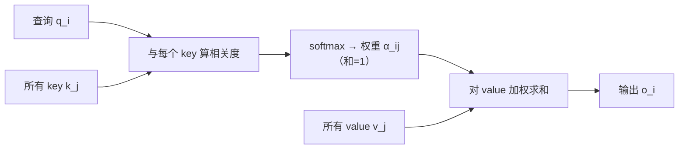

# Attention 的基本思想

## 1. 本节学习目标

1. 用**检索类比**说清 Attention 在做什么（**按相关性加权求和**）。
2. 写出"权重 + 加权平均"这两步，并解释为什么它天生解决长依赖。
3. 用本课实测看到"权重分布"的样子（真实 gpt2 的 6×6 注意力矩阵）。
4. 知道 Attention 与"池化/卷积"的本质区别：**权重是算出来的，不是固定的**。

## 2. 为什么需要这个知识

因为 Attention 是**整个大模型学科的核心操作**，但它常被讲成公式。

先建立直觉：**"我要查资料，先判断每条资料多相关，再按相关度加权汇总"**——这就是 Attention。后面所有 Q/K/V、多头、掩码，都是这句话的工程化。

## 3. 直观解释

**图书馆类比**：

```text
你的问题（query）："猫坐在哪里？"
书架上的资料（keys）：每段话的"标签"
资料内容（values）：每段话本身

第 1 步：问题 与 每个标签 算相关度 → 权重（0~1，和为 1）
第 2 步：按权重把资料内容加权求和 → 答案
```

**关键差别**：

| 操作 | 权重来源 | 能否长依赖 |
|---|---|---|
| 平均池化 | 固定 1/n | 能看全部，但**不区分重要性** |
| 卷积 | 固定核 | 只看局部窗口 |
| **Attention** | **算出来的**（与内容相关） | 能看全部，且**按相关性取舍** |

## 4. 正式定义

**Attention 的两步**

$$
\alpha_{ij}=\text{softmax}_j\big(\text{score}(\mathbf{q}_i,\mathbf{k}_j)\big),\qquad
\mathbf{o}_i=\sum_j\alpha_{ij}\mathbf{v}_j
$$

- $\alpha_{ij}$：第 $i$ 个查询对第 $j$ 个位置的**注意力权重**；
- $\mathbf{o}_i$：加权求和后的输出。

**约束**：$\sum_j\alpha_{ij}=1$，$\alpha_{ij}\ge0$（因为过 softmax）。

## 5. 历史背景或技术背景

| 年份 | 事件 |
|---|---|
| 2015 | Bahdanau 等：翻译时让解码器"对齐"源句（Attention 诞生） |
| 2016 | Luong 等：乘性注意力（点积形式） |
| 2017 | Transformer：把 Attention 变成唯一核心操作 |
| 2018+ | 自注意力成为 LLM 的骨架 |

**最初的动机非常具体**：Seq2Seq 把整个句子压成一个向量（LLM-003 的瓶颈），
Attention 让解码器**每一步都能回头看源句的所有位置**。

## 6. 核心原理

**本课实测（真实 gpt2，第 1 层第 1 头，"The cat sat on the mat"）**

```
tokens: ['The', 'Ġcat', 'Ġsat', 'Ġon', 'Ġthe', 'Ġmat']
注意力矩阵(6×6):
 [[1.    0.    0.    0.    0.    0.   ]
  [0.704 0.296 0.    0.    0.    0.   ]
  [0.604 0.105 0.291 0.    0.    0.   ]
  [0.45  0.184 0.326 0.04  0.    0.   ]
  [0.461 0.178 0.283 0.034 0.044 0.   ]
  [0.322 0.097 0.044 0.104 0.13  0.303]]
每行和: [1.0, 1.0, 1.0, 1.0, 1.0, 1.0]
'mat'(最后) 最关注的位置: 0 权重 0.3217
```

**四个读法**：

1. **第 1 行只有一个 1.0**：第一个 token 只能看自己（因果掩码，LLM-015）。
2. **每行和为 1**：这是 softmax 的硬约束 ⇒ 权重是"分配"而不是"打分"。
3. **第 1 层第 1 头几乎只看开头**（第 6 行 0.322 给了 "The"）——真实模型里这种"看开头"的头很常见（有专门的名称，后续会讲）。
4. **矩阵不是对称的**：$\alpha_{ij}\neq\alpha_{ji}$ ⇒ "A 关注 B"不代表"B 关注 A"。

## 7. 数学表达式

**加权平均的两个极端**

| 权重分布 | 输出 |
|---|---|
| 均匀（全 $1/n$） | 所有位置的平均（≈ 池化） |
| one-hot（某个位置为 1） | 直接复制那个位置（≈ 检索） |

Attention 在这两个极端之间**连续滑动**，且由内容决定。

**熵衡量"关注得多散"**

$$
H(\alpha_i)=-\sum_j\alpha_{ij}\log\alpha_{ij}
$$

- 均匀分布：$H=\log n$（最大）；
- one-hot：$H=0$（最聚焦）。

## 8. 详细数学推导

**推导：为什么加权平均能"选择信息"**

设某个位置 $j^\*$ 是答案所在，模型给 $\alpha_{ij^\*}\to1$，其余 $\to0$：

$$
\mathbf{o}_i=\sum_j\alpha_{ij}\mathbf{v}_j\ \to\ \mathbf{v}_{j^*}
$$

⇒ **输出直接等于目标位置的内容**。这就是"检索"。

反之若 $\alpha_{ij}=1/n$：

$$
\mathbf{o}_i=\frac1n\sum_j\mathbf{v}_j
$$

⇒ **信息被平均掉**，细节丢失。

**推导：为什么 Attention 天然解决长依赖**

$\mathbf{o}_i$ 是**一跳**求和，梯度从输出到任意 $\mathbf{v}_j$ 只经过 $\alpha_{ij}$：

$$
\frac{\partial\mathbf{o}_i}{\partial\mathbf{v}_j}=\alpha_{ij}
$$

**没有 $T$ 次矩阵连乘** ⇒ 不存在 RNN 那样的指数衰减（DL-052：$T=100$ 时梯度 0）。

## 9. 图解



## 10. 具体数值示例

```text
假设 3 个位置，某行权重 α = [0.1, 0.7, 0.2]
价值向量 v1=[1,0], v2=[0,1], v3=[1,1]

o = 0.1*[1,0] + 0.7*[0,1] + 0.2*[1,1]
  = [0.1, 0] + [0, 0.7] + [0.2, 0.2]
  = [0.3, 0.9]

⇒ 0.7 那一路贡献最大（第二维 0.7）
```

## 11. NumPy 实现

```python
import numpy as np

vals = np.array([[1., 0.], [0., 1.], [1., 1.]])
alpha = np.array([0.1, 0.7, 0.2])

out = alpha @ vals
print("权重:", alpha, " 和:", alpha.sum())
print("输出:", out)
print("贡献分解:", [alpha[i] * vals[i] for i in range(3)])
```

## 12. PyTorch 实现

```python
import torch
import torch.nn.functional as F

scores = torch.tensor([[0.1, 0.7, 0.2]])     # 某一行原始分数
alpha = F.softmax(scores, dim=-1)
vals = torch.tensor([[1., 0.], [0., 1.], [1., 1.]])

print("权重:", [round(float(v), 4) for v in alpha[0]])
print("输出:", (alpha @ vals)[0].tolist())
print("熵:", round(float(-(alpha * alpha.log()).sum()), 4))
```

## 13. Hugging Face 实践

```python
import os

os.environ.setdefault("HF_ENDPOINT", "https://hf-mirror.com")
os.environ.setdefault("HF_HUB_OFFLINE", "1")
import torch
from transformers import AutoModelForCausalLM, AutoTokenizer

tok = AutoTokenizer.from_pretrained("gpt2")
model = AutoModelForCausalLM.from_pretrained(
    "gpt2", attn_implementation="eager").eval()
ids = tok("The cat sat on the mat", return_tensors="pt")
with torch.no_grad():
    out = model(**ids, output_attentions=True)

A = out.attentions[0][0, 0]      # 第 1 层、第 1 头
print("注意力矩阵形状:", tuple(A.shape))
print("每行和:", [round(float(v), 3) for v in A.sum(-1)])
print("第 1 行:", [round(float(v), 3) for v in A[0]])
```

> **注意**：`attn_implementation="eager"` 才会返回注意力权重；`sdpa` 实现不返回。

## 14. 代码逐行解释

| 代码 | 作用 |
|---|---|
| `alpha @ vals` | 加权求和（权重 × 值） |
| `F.softmax(scores, dim=-1)` | 把任意分数变成"和为 1 的权重" |
| `alpha.sum()` | 验证归一化 |
| `output_attentions=True` | 让模型返回每层每头的注意力矩阵 |
| `[0][0]` | 取第 1 层、第 1 头 |

## 15. 实际运行结果

```text
注意力矩阵(6×6):
 [[1.    0.    0.    0.    0.    0.   ]
  [0.704 0.296 0.    0.    0.    0.   ]
  [0.604 0.105 0.291 0.    0.    0.   ]
  [0.45  0.184 0.326 0.04  0.    0.   ]
  [0.461 0.178 0.283 0.034 0.044 0.   ]
  [0.322 0.097 0.044 0.104 0.13  0.303]]
每行和: [1.0, 1.0, 1.0, 1.0, 1.0, 1.0]
'mat'(最后) 最关注的位置: 0 权重 0.3217
```

## 16. 应用场景

| 场景 | Attention 在做什么 |
|---|---|
| 机器翻译 | 生成每个词时对齐源句某个片段（原始动机） |
| 大模型 | 每个 token 汇总全上下文 |
| 图像（ViT） | 每个 patch 汇总其他 patch |
| 检索/重排 | 查询与候选的交互打分 |
| 可解释性分析 | 看权重分布理解模型"在看哪" |

## 17. 优点与局限

| 优点 | 局限 |
|---|---|
| 权重由内容决定，能选择性聚合 | $O(T^2)$ 计算/显存 |
| 一跳连接，长依赖不衰减 | 权重难有"因果解释"（注意力≠解释） |
| 可并行 | 需要位置编码补充顺序信息 |
| 可视化直观 | 权重矩阵大时难解读 |

## 18. 常见错误

| 错误 | 现象 | 纠正 |
|---|---|---|
| 把注意力权重当"解释" | 过度解读 | 权重只是中间量，需配合消融验证 |
| 以为权重对称 | 拿 $\alpha_{ij}$ 推 $\alpha_{ji}$ | 矩阵**不对称** |
| 忘记归一化 | 输出尺度爆炸 | 必须 softmax（LLM-014） |
| 认为 Attention 只在 NLP | 无法理解 ViT/多模态 | 它是通用"按相关性聚合" |
| 忽略掩码 | 生成时"看到未来" | 因果掩码（LLM-015） |

## 19. 本节总结

- Attention = **按相关性加权求和**：$\alpha=\mathrm{softmax}(\text{score})$，$o=\sum\alpha v$。
- 本课实测真实 gpt2 的 6×6 矩阵：**每行和 1.0**、**不对称**、第 1 层第 1 头**偏向开头**（0.322 给 "The"）。
- 与池化/卷积的本质区别：**权重是算出来的**；与 RNN 的区别：**一跳连接**，长依赖不衰减。

## 20. 前置与后续知识链接

- 前置：[[LLM-004 Attention 的历史背景与 Transformer 的提出]]
- 后续：[[LLM-012 Query、Key、Value 与 QKV 的来源]]、[[LLM-013 点积注意力与 Scaled Dot-Product Attention]]
- 相关：[[MATH-216 矩阵乘法]]、[[DL-046 感受野与参数共享]]

---

## 练习与参考答案

**基础 1**：用一句话概括 Attention 在做什么。

**基础 2**：本课 gpt2 的注意力矩阵满足哪两个性质？各对应什么约束？

**进阶 1**：为什么说 Attention "天然解决长依赖"？请用梯度路径说明。

**综合**：一个 4 位置的注意力行权重是 `[0.7, 0.1, 0.1, 0.1]`，对应的 value 是 `[[1,0],[0,1],[1,1],[0,0]]`。请算输出，并说明若把权重改成均匀分布，输出会怎么变。

> [!success]- 参考答案

> **基础 1**
> 对每个查询，先算出它对各个位置的**相关度权重**（归一化到和为 1），再按权重把所有位置的**内容**加权求和，得到这个查询的新表示。即"**按相关性加权平均**"。

> **基础 2**
> ① **每行和为 1**（softmax 的归一化约束，权重是"分配"）；
> ② **矩阵不对称**（$\alpha_{ij}\neq\alpha_{ji}$，"A 看 B"不等于"B 看 A"）。

> **进阶 1**
> 输出 $\mathbf{o}_i=\sum_j\alpha_{ij}\mathbf{v}_j$ 是**一跳求和**，所以
> $$\frac{\partial\mathbf{o}_i}{\partial\mathbf{v}_j}=\alpha_{ij}$$
> 梯度直接到任意位置，**不经过 $T$ 次矩阵连乘**。
> 对比 RNN：$\mathbf{h}_T$ 要经过 $T-1$ 次雅可比连乘，DL-052 实测 $T=100$ 时梯度为 **0**。

> **综合（参考）**
> **输出**：
> $$\mathbf{o}=0.7[1,0]+0.1[0,1]+0.1[1,1]+0.1[0,0]=[0.8,\ 0.2]$$
> **改为均匀（0.25 各）**：
> $$\mathbf{o}'=0.25([1,0]+[0,1]+[1,1]+[0,0])=[0.5,\ 0.5]$$
> **变化**：第一维从 0.8 降到 0.5，第二维从 0.2 升到 0.5 ⇒ **信息被平均化，"重点"能力消失**。
> 这正是"权重偏离均匀"才是 Attention 价值的证明：均匀权重等价于池化。

## 学习记录

| 日期 | 状态 | 用时 | 问题 | 复盘 |
|---|---|---|---|---|
| 2026-11-08 | planned | — | — | — |

---

## 🔗 Notion 同步信息

> 以下内容由 Notion「AI Knowledge System · 知识点」数据库按知识 ID 合并而来（导出于 2026-11-09）。

| 属性 | 值 |
|---|---|
| 学科 | 大语言模型 |
| 学习状态 | 未开始 |
| 难度 | L1 概念 |
| 知识类型 | Concept |

- **所属模块**：[M-LLM-02 Attention 机制与数学原理](../%E8%AF%BE%E7%A8%8B%E6%A8%A1%E5%9D%97/M-LLM-02%20Attention%20%E6%9C%BA%E5%88%B6%E4%B8%8E%E6%95%B0%E5%AD%A6%E5%8E%9F%E7%90%86.md)
- **前置知识**：[LLM-004 Attention 的历史背景与 Transformer 的提出](../01%20NLP%E5%9F%BA%E7%A1%80/LLM-004%20Attention%20%E7%9A%84%E5%8E%86%E5%8F%B2%E8%83%8C%E6%99%AF%E4%B8%8E%20Transformer%20%E7%9A%84%E6%8F%90%E5%87%BA.md)
- **后继知识**：[LLM-012 Query、Key、Value 与 QKV 的来源](LLM-012%20Query%E3%80%81Key%E3%80%81Value%20%E4%B8%8E%20QKV%20%E7%9A%84%E6%9D%A5%E6%BA%90.md)
- **关联数学**：[MATH-216 矩阵乘法](../../06_%E6%95%B0%E5%AD%A6%E5%9F%BA%E7%A1%80/02%20%E7%BA%BF%E6%80%A7%E4%BB%A3%E6%95%B0/MATH-216%20%E7%9F%A9%E9%98%B5%E4%B9%98%E6%B3%95.md)
