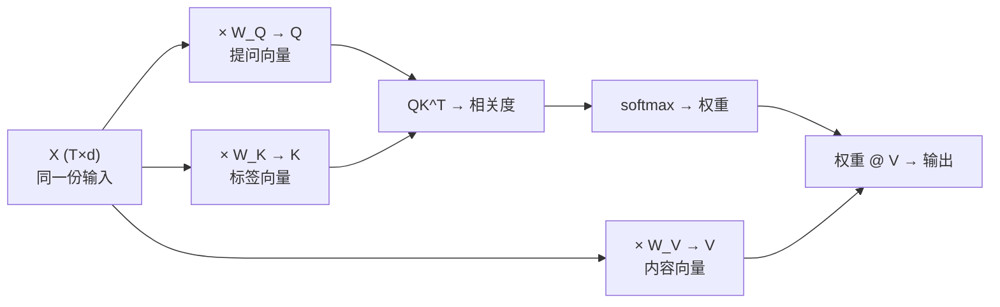

# Query、Key、Value 与 QKV 的来源

## 1. 本节学习目标

1. 写出 $Q=XW_Q,\ K=XW_K,\ V=XW_V$，并说清**同一个 X 为什么能变出三个不同角色**。
2. 算清维度：$X\in\mathbb{R}^{T\times d}$、$W_Q\in\mathbb{R}^{d\times d_k}$、$Q\in\mathbb{R}^{T\times d_k}$。
3. 用本课实测看到"三个投影互不相同"（Q-K 最大差 **2.4439**、K-V **2.6886**）。
4. 理解 $W_Q,W_K,W_V$ 是**可学习参数**——它们是"模型自己学会怎么提问/怎么标记"的地方。

## 2. 为什么需要这个知识

因为初学者最容易卡在这里：

> "Q、K、V 到底是什么？为什么是三个，而不是一个？"

答案不是"三个不同的输入"，而是**同一份输入被三组不同的权重投影成三种角色**。理解这一点，后面 Multi-Head、KV Cache 才能看懂。

## 3. 直观解释

**图书馆里同一个"我"扮演三种角色**：

| 角色 | 在做什么 | 类比 |
|---|---|---|
| **Query（Q）** | 我要找什么 | 我的**问题** |
| **Key（K）** | 每条资料的"标签" | 书脊上的**分类号** |
| **Value（V）** | 每条资料的内容 | 书里的**正文** |

**关键**：问题、标签、正文都是从**同一个知识库**里来的，只是**用法不同**。

在 Self-Attention 里，"知识库"就是输入 $X$ 本身 ⇒ 所以说"自己查自己"。

## 4. 正式定义

**三个线性投影**

$$
Q=XW_Q,\qquad K=XW_K,\qquad V=XW_V
$$

**维度（单头）**

$$
X\in\mathbb{R}^{T\times d},\quad
W_Q,W_K\in\mathbb{R}^{d\times d_k},\quad
W_V\in\mathbb{R}^{d\times d_v}
$$

$$
\Rightarrow Q,K\in\mathbb{R}^{T\times d_k},\quad V\in\mathbb{R}^{T\times d_v}
$$

通常 $d_k=d_v=d/H$（$H$ 为头数）。

**本课实测（$T=3,d=4,d_k=d_v=4$）**

```
X 形状: (3, 4) | W_Q/K/V 形状: (4, 4)
Q:
 [[-0.503 -1.739 -1.29  -0.495]
  [ 0.077 -0.445 -0.631 -1.026]
  [-0.424 -0.533 -1.165 -0.3  ]]
K:
 [[-1.599 -0.652  1.154  0.619]
  [ 0.264  0.766 -1.866  0.231]
  [-0.293  0.351 -0.177 -0.035]]
V:
 [[ 1.09  -0.834 -0.314  0.575]
  [-1.421 -0.877  0.129  1.17 ]
  [ 0.065 -0.223  0.165  0.587]]
三个投影互不相同：Q-K 最大差 2.4439，K-V 最大差 2.6886
```

**读法**：同一个 $X$，三组权重一乘，得到的三个矩阵**数值完全不同** ⇒ 模型可以学"用什么向量去提问"和"用什么向量去被匹配"。

## 5. 历史背景或技术背景

| 年份 | 演进 |
|---|---|
| 2015 | Bahdanau：注意力权重由一个**小型前馈网络**算出（加性） |
| 2016 | Luong：用**点积**算权重（更省） |
| 2017 | Transformer：把 Q/K/V 都做成**线性投影**，统一且可并行 |
| 2018+ | 多头：把 $d$ 切成 $H$ 份，每份独立投影 |

**为什么投影很重要**：如果直接用 $X$ 算相似度（$XX^\top$），那"提问"和"被匹配"就是同一个向量空间，表达能力受限。**三组独立权重**让模型分开学"怎么问"和"怎么标"。

## 6. 核心原理

**为什么不能只用一个投影**

若 $Q=K=X$：

$$
\alpha_{ij}=\mathrm{softmax}\Big(\frac{\mathbf{x}_i\cdot\mathbf{x}_j}{\sqrt{d}}\Big)
$$

⇒ 注意力只反映"原始特征相似度"，模型**无法**表达"我要找的是与我不同的东西"（比如指代消解中，代词要去找它指的名词，两者原始特征并不相似）。

**三组权重的自由度**：$3d^2$ 个可学习参数（单头），让"提问空间"与"被匹配空间"解耦。

## 7. 数学表达式

**参数量（单头）**

$$
\#=d\cdot d_k+d\cdot d_k+d\cdot d_v=2dd_k+dd_v
$$

**本课**：$2\times4\times4+4\times4=32+16=48$ 个参数。

**多头时**（$H$ 头，$d_k=d/H$）：

$$
\#=H\big(2d\cdot\frac dH+d\cdot\frac dH\big)=3d^2
$$

⇒ **多头不增加参数量**（相对单头满维），只是把维度切开（LLM-017）。

## 8. 详细数学推导

**推导：$W_Q$ 与 $W_K$ 必须"配套"才有意义**

$\alpha_{ij}$ 来自 $\mathbf{q}_i^\top\mathbf{k}_j$。若把 $W_K$ 换成 $W_K'=W_K R$（$R$ 正交），则

$$
\mathbf{q}_i^\top (W_K' \mathbf{x}_j)=\mathbf{q}_i^\top W_K R\mathbf{x}_j
$$

只要 $W_Q$ 相应变为 $W_Q R$，内积不变 ⇒ **存在等价参数化**（模型学到的"具体矩阵"不唯一，但函数等价）。

**推论**：不能通过"比较 $W_Q$ 与 $W_K$ 的数值"来解释模型行为——要看**内积结果**。

## 9. 图解



## 10. 具体数值示例

```text
X 第 1 行（第 1 个 token）：[-0.503 ... ]（原始）
投影后：
  Q 第 1 行: [-0.503 -1.739 -1.29  -0.495]
  K 第 1 行: [-1.599 -0.652  1.154  0.619]
  V 第 1 行: [ 1.09  -0.834 -0.314  0.575]

⇒ 同一 token 的三种表示完全不同（Q-K 差 2.44，K-V 差 2.69）
```

## 11. NumPy 实现

```python
import numpy as np

rng = np.random.default_rng(0)
T, d, dk = 3, 4, 4
X = rng.normal(size=(T, d))
W_Q = rng.normal(size=(d, dk)) * 0.5
W_K = rng.normal(size=(d, dk)) * 0.5
W_V = rng.normal(size=(d, dk)) * 0.5

Q, K, V = X @ W_Q, X @ W_K, X @ W_V
print("X:", X.shape, "Q:", Q.shape, "K:", K.shape, "V:", V.shape)
print("Q 第 1 行:", Q[0].round(3))
print("K 第 1 行:", K[0].round(3))
print("V 第 1 行:", V[0].round(3))
print("参数量:", W_Q.size + W_K.size + W_V.size)
```

## 12. PyTorch 实现

```python
import torch
import torch.nn as nn

d, dk = 8, 8
q_proj = nn.Linear(d, dk, bias=False)
k_proj = nn.Linear(d, dk, bias=False)
v_proj = nn.Linear(d, dk, bias=False)

X = torch.randn(5, d)          # 5 个 token
Q, K, V = q_proj(X), k_proj(X), v_proj(X)
print("X:", tuple(X.shape), "→ Q/K/V:", tuple(Q.shape))

# 也可以用 nn.Linear 的权重矩阵手算，验证等价
torch.manual_seed(0)
X2 = torch.randn(5, d)
manual_q = X2 @ q_proj.weight.T
print("nn.Linear 与手算差:", float((q_proj(X2) - manual_q).abs().max()))
print("三个投影的总参数量:", sum(p.numel() for p in
      list(q_proj.parameters()) + list(k_proj.parameters()) + list(v_proj.parameters())))
```

## 13. Hugging Face 实践

```python
import os

os.environ.setdefault("HF_ENDPOINT", "https://hf-mirror.com")
os.environ.setdefault("HF_HUB_OFFLINE", "1")
from transformers import AutoConfig

cfg = AutoConfig.from_pretrained("gpt2")
H, d = cfg.n_head, cfg.n_embd
print("gpt2: n_head=", H, " n_embd=", d, " head_dim=", d // H)
print("单头参数量（Q/K/V 合计）:", 3 * d * (d // H))
print("多头合并后参数量:", 3 * d * d)
print("注意：多头不增加参数量，只是把 d 切成 H 份")
```

## 14. 代码逐行解释

| 代码 | 作用 |
|---|---|
| `X @ W_Q` | 线性投影（等价 `nn.Linear` 无 bias） |
| `weight.T` | `nn.Linear` 内部存的是 $(d_{out},d_{in})$ |
| `bias=False` | 原论文 Q/K/V 投影常不带 bias |
| `d // H` | 每个头的维度 $d_k$ |
| `3*d*d` | 多头 Q/K/V 总参数 |

## 15. 实际运行结果

```text
X 形状: (3, 4) | W_Q/K/V 形状: (4, 4)
Q:
 [[-0.503 -1.739 -1.29  -0.495]
  [ 0.077 -0.445 -0.631 -1.026]
  [-0.424 -0.533 -1.165 -0.3  ]]
K:
 [[-1.599 -0.652  1.154  0.619]
  [ 0.264  0.766 -1.866  0.231]
  [-0.293  0.351 -0.177 -0.035]]
V:
 [[ 1.09  -0.834 -0.314  0.575]
  [-1.421 -0.877  0.129  1.17 ]
  [ 0.065 -0.223  0.165  0.587]]
三个投影互不相同：Q-K 最大差 2.4439，K-V 最大差 2.6886
```

## 16. 应用场景

| 场景 | Q/K/V 的含义 |
|---|---|
| Self-Attention | 三者都来自同一个 $X$ |
| Cross-Attention | $Q$ 来自解码器，$K/V$ 来自编码器 |
| 检索增强 | $Q$=查询向量，$K$=文档向量（同空间） |
| 多模态 | $Q$ 来自文本，$K/V$ 来自图像 patch |
| KV Cache | 缓存 K、V 避免重复计算（LLM-020+） |

## 17. 优点与局限

| 优点 | 局限 |
|---|---|
| 三个角色解耦，表达力强 | 参数量 $3d^2$（单头） |
| 全可微、端到端训练 | 参数不唯一（正交等价） |
| 适配多种任务（自/交叉） | 解释性弱（不能只看 $W$ 数值） |

## 18. 常见错误

| 错误 | 现象 | 纠正 |
|---|---|---|
| 以为 Q/K/V 是三种输入 | 无法理解 Self-Attn | 它们是**同一输入**的三个投影 |
| 忘记 `nn.Linear` 存 `(out,in)` | 手算对不上 | 用 `weight.T` |
| 以为多头增加参数 | 算错显存 | 多头只是切维度，$3d^2$ 不变 |
| 比较 $W_Q$ 与 $W_K$ 数值解释行为 | 结论不稳 | 看内积与输出 |
| 在 Cross-Attention 里也三投影同一输入 | 结构错 | Q 来自解码器，K/V 来自编码器 |

## 19. 本节总结

- $Q=XW_Q,\ K=XW_K,\ V=XW_V$：**同一份输入，三组权重，三种角色**。
- 本课实测三投影数值完全不同（Q-K 差 **2.4439**、K-V 差 **2.6886**），参数量 **48**（$d=4$ 时）。
- 多头把 $d$ 切成 $H$ 份，总参数仍是 **$3d^2$**（不增加）。

## 20. 前置与后续知识链接

- 前置：[[LLM-011 Attention 的基本思想]]
- 后续：[[LLM-013 点积注意力与 Scaled Dot-Product Attention]]、[[LLM-015 Self-Attention]]、[[LLM-017 Multi-Head Attention]]
- 相关：[[MATH-216 矩阵乘法]]、[[MATH-221 线性变换与几何意义]]、[[DL-012 线性变换的矩阵形式]]

---

## 练习与参考答案

**基础 1**：写出 Q/K/V 的定义，并说明它们与 $X$ 的关系。

**基础 2**：本课 $d=4$、$d_k=d_v=4$ 时，Q/K/V 三个投影共有多少参数？

**进阶 1**：为什么不能直接用 $X$ 同时当 Q 和 K（即 $Q=K=X$）？

**综合**：一个 Cross-Attention 层，解码器隐状态是 $T_y\times d$，编码器输出是 $T_x\times d$。请写出 Q/K/V 的形状与注意力矩阵的形状，并说明总参数量。

> [!success]- 参考答案

> **基础 1**
> $$Q=XW_Q,\quad K=XW_K,\quad V=XW_V$$
> 三者都来自**同一个输入 $X$**，只是乘了**三组不同的可学习权重**，因此扮演"提问 / 被匹配 / 提供内容"三种角色。

> **基础 2**
> $$3\times(d\times d_k)=3\times4\times4=48$$
> （本课实测参数量 48 ✅）

> **进阶 1**
> 因为那样注意力只能反映"原始特征相似度"$\mathbf{x}_i^\top\mathbf{x}_j$，模型无法表达"**我要找的是与我不同的东西**"。
> 例如指代消解：代词"它"要去匹配前面的"猫"，两者原始特征并不相似；只有让 $W_Q\neq W_K$，才能学出"提问空间 ≠ 被匹配空间"。

> **综合（参考）**
> **形状**：
> - $Q=X_{\text{dec}}W_Q\in\mathbb{R}^{T_y\times d_k}$
> - $K=X_{\text{enc}}W_K\in\mathbb{R}^{T_x\times d_k}$
> - $V=X_{\text{enc}}W_V\in\mathbb{R}^{T_x\times d_v}$
> - 注意力矩阵 $A=\mathrm{softmax}(QK^\top/\sqrt{d_k})\in\mathbb{R}^{T_y\times T_x}$
> - 输出 $AV\in\mathbb{R}^{T_y\times d_v}$
> **参数量**（单头）：$d\cdot d_k+d\cdot d_k+d\cdot d_v=2dd_k+dd_v$；若 $d_k=d_v=d$，则为 $3d^2$。
> **注意**：$A$ 不是方阵（$T_y\neq T_x$ 时），因为"解码器每个位置"对"编码器每个位置"打分。

## 学习记录

| 日期 | 状态 | 用时 | 问题 | 复盘 |
|---|---|---|---|---|
| 2026-11-08 | planned | — | — | — |

---

## 🔗 Notion 同步信息

> 以下内容由 Notion「AI Knowledge System · 知识点」数据库按知识 ID 合并而来（导出于 2026-11-09）。

| 属性 | 值 |
|---|---|
| 学科 | 大语言模型 |
| 学习状态 | 未开始 |
| 难度 | L3 推导 |
| 知识类型 | Algorithm |

- **所属模块**：[M-LLM-02 Attention 机制与数学原理](../%E8%AF%BE%E7%A8%8B%E6%A8%A1%E5%9D%97/M-LLM-02%20Attention%20%E6%9C%BA%E5%88%B6%E4%B8%8E%E6%95%B0%E5%AD%A6%E5%8E%9F%E7%90%86.md)
- **前置知识**：[LLM-011 Attention 的基本思想](LLM-011%20Attention%20%E7%9A%84%E5%9F%BA%E6%9C%AC%E6%80%9D%E6%83%B3.md)
- **后继知识**：[LLM-013 点积注意力与 Scaled Dot-Product Attention](LLM-013%20%E7%82%B9%E7%A7%AF%E6%B3%A8%E6%84%8F%E5%8A%9B%E4%B8%8E%20Scaled%20Dot-Product%20Attention.md)
- **关联数学**：[MATH-216 矩阵乘法](../../06_%E6%95%B0%E5%AD%A6%E5%9F%BA%E7%A1%80/02%20%E7%BA%BF%E6%80%A7%E4%BB%A3%E6%95%B0/MATH-216%20%E7%9F%A9%E9%98%B5%E4%B9%98%E6%B3%95.md) · [MATH-221 线性变换与几何意义](../../06_%E6%95%B0%E5%AD%A6%E5%9F%BA%E7%A1%80/02%20%E7%BA%BF%E6%80%A7%E4%BB%A3%E6%95%B0/MATH-221%20%E7%BA%BF%E6%80%A7%E5%8F%98%E6%8D%A2%E4%B8%8E%E5%87%A0%E4%BD%95%E6%84%8F%E4%B9%89.md)
