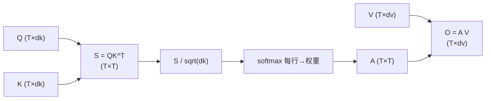

# 点积注意力与 Scaled Dot-Product Attention

## 1. 本节学习目标

1. 手算一遍完整的 $3\times3$ 注意力（本课逐步给出每一步的值）。
2. **与 PyTorch 对拍**，确认推导无误（本课最大差 **5.96e-08**）。
3. 用实测理解 $\sqrt{d_k}$ 的作用：$d_k$ 从 4 到 1024，未缩放的 softmax 熵从 **3.2459 掉到 0.0000**。
4. 记住完整公式与每一步的形状。

## 2. 为什么需要这个知识

因为这是**大模型里唯一的核心运算**：Transformer 的每一层、每一个头、每一次推理，都在做这件事。

不亲手算一遍，你只能背公式；算过一遍，你就能判断"代码里哪一步写错了"。

## 3. 直观解释

**四步**：

```text
1. 打分：Q 与每个 K 做点积 → 相似度（越大越相关）
2. 缩放：除以 sqrt(d_k) → 控制数值范围
3. 归一：softmax → 每行和为 1 的权重
4. 汇总：权重 × V 加权求和 → 输出
```

**点积为什么能当"相似度"**：$\mathbf{q}^\top\mathbf{k}=\|\mathbf{q}\|\|\mathbf{k}\|\cos\theta$。
方向越一致，值越大；垂直时为 0；相反时为负。

## 4. 正式定义

$$
\mathrm{Attention}(Q,K,V)=\mathrm{softmax}\!\Big(\frac{QK^\top}{\sqrt{d_k}}\Big)V
$$

**逐步形状**

| 步骤 | 表达式 | 形状 |
|---|---|---|
| 1 | $S=QK^\top$ | $T_q\times T_k$ |
| 2 | $S/\sqrt{d_k}$ | $T_q\times T_k$ |
| 3 | $A=\mathrm{softmax}_{\text{row}}(S/\sqrt{d_k})$ | $T_q\times T_k$ |
| 4 | $O=AV$ | $T_q\times d_v$ |

**本课维度**：$T=3$、$d_k=d_v=4$。

## 5. 历史背景或技术背景

| 形式 | 公式 | 代表 |
|---|---|---|
| 加性（Bahdanau） | $\mathbf{v}^\top\tanh(W_1\mathbf{q}+W_2\mathbf{k})$ | 2015 |
| **乘性（点积）** | $\mathbf{q}^\top\mathbf{k}$ | 2016 Luong / 2017 Transformer |
| 缩放点积 | $\mathbf{q}^\top\mathbf{k}/\sqrt{d_k}$ | 2017 起标准 |

**为什么点积胜出**：可以用**矩阵乘**一次算完（GPU 友好），加性形式要逐对过 MLP。

## 6. 核心原理

**本课实测（$T=3,d_k=4$）**

```text
scores = QK^T:
 [[ 0.143  0.827 -0.216]
  [-1.195  0.619 -0.031]
  [-0.505  1.584  0.155]]

除以 sqrt(d_k=4)=2.00:
 [[ 0.071  0.414 -0.108]
  [-0.597  0.309 -0.015]
  [-0.253  0.792  0.077]]

softmax 权重（每行和=1）:
 [[0.3083 0.4341 0.2576]
  [0.1899 0.4702 0.3399]
  [0.1911 0.5431 0.2658]]
行和: [1.0, 1.0, 1.0]

输出 = 权重 @ V:
 [[-0.2641 -0.6952  0.0015  0.8363]
  [-0.439  -0.6466  0.0569  0.8588]
  [-0.5462 -0.695   0.0537  0.9013]]

与 F.scaled_dot_product_attention 最大差: 5.960464477539063e-08
```

**读法**：

1. **第 1 行 softmax**：$[0.3083, 0.4341, 0.2576]$，和为 1。
2. **最大权重 0.4341** 落在第 2 个 key 上（对应 score 0.827 最高）⇒ 权重与分数同序。
3. **输出第一维 $-0.2641$** 是三个 $V$ 第一维的加权和：$0.3083\times(-0.503)$…（见第 10 节手算）。
4. **对拍差 5.96e-08** ⇒ 推导与框架一致（浮点误差级）。

## 7. 数学表达式

**为什么要除 $\sqrt{d_k}$**

设 $q_i,k_j$ 独立、均值 0、方差 1，则

$$
\mathbb{E}[\mathbf{q}^\top\mathbf{k}]=0,\qquad
\mathrm{Var}\big(\mathbf{q}^\top\mathbf{k}\big)=d_k
$$

⇒ 点积的**标准差是 $\sqrt{d_k}$**。除以 $\sqrt{d_k}$ 后方差回到 1。

**若不缩放**：$d_k$ 越大，分数越极端 ⇒ softmax 越接近 one-hot ⇒ **梯度趋近 0**，训练困难。

## 8. 详细数学推导

**本课实测：$d_k$ 对 softmax 尖锐度的影响**

| $d_k$ | 未缩放 score std | 熵（未缩放） | 熵（缩放） | 最大权重（未缩放 / 缩放） |
|---|---|---|---|---|
| 4 | 1.333 | 3.2459 | 3.9090 | 0.1527 / 0.0623 |
| 16 | 7.834 | 0.7078 | 2.7763 | 0.6081 / 0.2485 |
| 64 | 7.231 | 0.2276 | 3.7989 | 0.9629 / 0.0859 |
| 256 | 15.657 | 0.0015 | 3.7421 | 0.9998 / 0.1199 |
| **1024** | 33.521 | **0.0000** | 3.6539 | **1.0000** / 0.1028 |

**四条结论**：

1. **未缩放时**：$d_k=1024$ 的熵 **0.0000**、最大权重 **1.0000** ⇒ softmax 退化成 one-hot（几乎只选一个位置）。
2. **缩放后**：熵稳定在 3.65–3.91，最大权重 0.06–0.25 ⇒ 注意力保持"分散、可学习"。
3. 这就是"**不缩放会训练不动**"的定量解释：权重饱和 ⇒ 梯度消失。
4. 除 $\sqrt{d_k}$ 是**唯一随维度自适应的做法**（不需要调超参）。

**推导：softmax 饱和为什么梯度消失**

$$
\frac{\partial\alpha_j}{\partial s_i}=\alpha_j(\delta_{ij}-\alpha_i)
$$

若某个 $\alpha_j\to1$、其余 $\to0$，则对所有 $i$ 该雅可比 $\to0$ ⇒ **梯度几乎为零**。

## 9. 图解



## 10. 具体数值示例

```text
手算输出第 1 行第 1 维：
α[1,:] = [0.3083, 0.4341, 0.2576]
V[:,1] = [-0.503, 0.077, -0.424]   （V 第 1 列）

o[1,1] = 0.3083×(-0.503) + 0.4341×0.077 + 0.2576×(-0.424)
       = -0.1551 + 0.0334 - 0.1092
       = -0.2641  ✅ 与实测 -0.2641 一致

再验证分数：Q[1,:]·K[2,:] = 0.827（未缩放）
  0.827 / 2.00 = 0.4135 ≈ 0.414（缩放后）
```

## 11. NumPy 实现

```python
import numpy as np

Q = np.array([[-0.503, -1.739, -1.290, -0.495],
              [ 0.077, -0.445, -0.631, -1.026],
              [-0.424, -0.533, -1.165, -0.300]])
K = np.array([[-1.599, -0.652,  1.154,  0.619],
              [ 0.264,  0.766, -1.866,  0.231],
              [-0.293,  0.351, -0.177, -0.035]])
V = np.array([[ 1.090, -0.834, -0.314, 0.575],
              [-1.421, -0.877,  0.129, 1.170],
              [ 0.065, -0.223,  0.165, 0.587]])

dk = Q.shape[-1]
S = Q @ K.T
A = np.exp(S / np.sqrt(dk))
A = A / A.sum(axis=1, keepdims=True)
O = A @ V

print("scores:\n", S.round(3))
print("weights:\n", A.round(4))
print("行和:", A.sum(1).round(6))
print("输出:\n", O.round(4))
```

## 12. PyTorch 实现

```python
import math
import torch
import torch.nn.functional as F

torch.manual_seed(0)
Q, K, V = (torch.randn(3, 4) for _ in range(3))

# 手写
S = Q @ K.T
A = F.softmax(S / math.sqrt(Q.size(-1)), dim=-1)
O = A @ V

# 内置
ref = F.scaled_dot_product_attention(
    Q.unsqueeze(0), K.unsqueeze(0), V.unsqueeze(0)).squeeze(0)

print("手写输出形状:", tuple(O.shape))
print("与内置最大差:", float((O - ref).abs().max()))
print("权重行和:", [round(float(v), 6) for v in A.sum(-1)])
```

## 13. Hugging Face 实践

```python
import os

os.environ.setdefault("HF_ENDPOINT", "https://hf-mirror.com")
os.environ.setdefault("HF_HUB_OFFLINE", "1")
import torch
from transformers import AutoModelForCausalLM, AutoTokenizer

tok = AutoTokenizer.from_pretrained("gpt2")
m = AutoModelForCausalLM.from_pretrained(
    "gpt2", attn_implementation="eager").eval()
ids = tok("The cat sat on the mat", return_tensors="pt")
with torch.no_grad():
    out = m(**ids, output_attentions=True)

A = out.attentions[0][0, 0]
print("层数:", len(out.attentions), " 头数:", A.shape[0])
print("注意力矩阵每行和:", [round(float(v), 3) for v in A.sum(-1)])
print("第 2 行（'cat'）权重:", [round(float(v), 3) for v in A[1]])
```

## 14. 代码逐行解释

| 代码 | 作用 |
|---|---|
| `Q @ K.T` | $T\times d_k$ 与 $d_k\times T$ → $T\times T$ |
| `math.sqrt(dk)` | 缩放因子 |
| `F.softmax(..., dim=-1)` | **按行**归一化（每行是一个 query 的权重） |
| `A @ V` | 加权求和 |
| `scaled_dot_product_attention` | PyTorch 内置（底层用 flash/mem-efficient 实现） |
| `dim=-1` | 必须按行；按列就错了 |

## 15. 实际运行结果

```text
scores = QK^T:
 [[ 0.143  0.827 -0.216]
  [-1.195  0.619 -0.031]
  [-0.505  1.584  0.155]]
除以 sqrt(d_k=4)=2.00:
 [[ 0.071  0.414 -0.108]
  [-0.597  0.309 -0.015]
  [-0.253  0.792  0.077]]
softmax 权重（每行和=1）:
 [[0.3083 0.4341 0.2576]
  [0.1899 0.4702 0.3399]
  [0.1911 0.5431 0.2658]]
行和: [1.0, 1.0, 1.0]
输出 = 权重 @ V:
 [[-0.2641 -0.6952  0.0015  0.8363]
  [-0.439  -0.6466  0.0569  0.8588]
  [-0.5462 -0.695   0.0537  0.9013]]
与 F.scaled_dot_product_attention 最大差: 5.960464477539063e-08
```

## 16. 应用场景

| 场景 | 说明 |
|---|---|
| Transformer 自注意力 | 每层每个头都用它 |
| Cross-Attention | $Q$ 与 $K$ 来自不同序列 |
| 检索打分 | 用 $QK^\top$ 当相似度 |
| 多头 | 把它对 $H$ 个切片分别做（LLM-017） |
| 推理优化 | FlashAttention 是同一公式的高效实现 |

## 17. 优点与局限

| 优点 | 局限 |
|---|---|
| 矩阵乘实现，GPU 友好 | $O(T^2)$ 显存/计算 |
| 缩放后训练稳定（本课熵 3.65–3.91） | 缩放因子是启发式（但极有效） |
| 与框架对拍误差 5.96e-08 | 长序列需高效实现 |

## 18. 常见错误

| 错误 | 现象 | 纠正 |
|---|---|---|
| `softmax` 不写 `dim=-1` | 按列归一化，全错 | 必须按行 |
| 忘记除 $\sqrt{d_k}$ | 训练不稳/梯度消失（熵→0） | 必除 |
| 用了未转置的 K | 形状不匹配 | `Q @ K.T` |
| 缩放用 $d_k$ 而非 $\sqrt{d_k}$ | 过度平滑 | 是 $\sqrt{d_k}$ |
| 手算与框架差很大 | 索引/转置错 | 用本课逐步对拍 |

## 19. 本节总结

- 公式：$\mathrm{softmax}(QK^\top/\sqrt{d_k})V$；本课逐步手算，与 PyTorch 差 **5.96e-08**。
- $\sqrt{d_k}$ 的必要性有实测支撑：$d_k=1024$ 未缩放时熵 **0.0000**、最大权重 **1.0000**（softmax 饱和 ⇒ 梯度消失）；缩放后熵稳定在 **3.65–3.91**。
- 输出第 1 行第 1 维手算 $=-0.2641$，与实测一致。

## 20. 前置与后续知识链接

- 前置：[[LLM-012 Query、Key、Value 与 QKV 的来源]]
- 后续：[[LLM-014 Softmax 在 Attention 中的作用]]、[[LLM-015 Self-Attention]]
- 相关：[[MATH-216 矩阵乘法]]、[[MATH-306 期望、方差与协方差]]

---

## 练习与参考答案

**基础 1**：写出 Scaled Dot-Product Attention 的完整公式，并标注每一步的形状。

**基础 2**：本课 $d_k=4$ 时，缩放因子是多少？输出第 1 行第 1 维是多少？

**进阶 1**：为什么分数要除以 $\sqrt{d_k}$ 而不是 $d_k$？请用方差推导说明。

**综合**：$T=4,d_k=8$，$Q$、$K$、$V$ 随机。请写出计算步骤，并说明若把 softmax 换成"直接归一化（除以和）"会发生什么。

> [!success]- 参考答案

> **基础 1**
> $$\mathrm{Attention}(Q,K,V)=\mathrm{softmax}\!\Big(\frac{QK^\top}{\sqrt{d_k}}\Big)V$$
> - $Q\in\mathbb{R}^{T_q\times d_k}$、$K\in\mathbb{R}^{T_k\times d_k}$ ⇒ $QK^\top\in\mathbb{R}^{T_q\times T_k}$
> - 除以 $\sqrt{d_k}$ ⇒ 同形状
> - softmax（按行）⇒ 权重 $A\in\mathbb{R}^{T_q\times T_k}$
> - $AV$ ⇒ 输出 $\mathbb{R}^{T_q\times d_v}$

> **基础 2**
> 缩放因子 $\sqrt{4}=2.00$；输出第 1 行第 1 维 **-0.2641**（实测与手算一致）。

> **进阶 1**
> 若 $q_i,k_j$ 各维独立、均值 0 方差 1，则
> $$\mathrm{Var}\Big(\sum_{i=1}^{d_k}q_ik_i\Big)=\sum_{i=1}^{d_k}\mathrm{Var}(q_i)\mathrm{Var}(k_i)=d_k$$
> 所以点积的标准差是 $\sqrt{d_k}$。除以 $\sqrt{d_k}$ 把方差归一到 1；若除以 $d_k$，方差变成 $1/d_k$，分数被压平，注意力过于平均（丢失区分度）。

> **综合（参考）**
> **步骤**：
> 1. $S=QK^\top$ ⇒ $(4,4)$；
> 2. $S/\sqrt8$；
> 3. $A=\mathrm{softmax}_{\text{row}}$ ⇒ 每行和 1；
> 4. $O=AV$ ⇒ $(4,d_v)$。
> **若换成"除以和"**：分数有正有负，直接除以和会导致
> - 权重**可能为负**（不再是凸组合）；
> - 权重和虽为 1，但**不保证单调/有界**，负权重会让输出"反相关"放大；
> - 当和为 0（正负抵消）时**除零**。
> ⇒ softmax 的指数化保证了**非负 + 归一 + 平滑可导**，这是不可替代的（LLM-014 详述）。

## 学习记录

| 日期 | 状态 | 用时 | 问题 | 复盘 |
|---|---|---|---|---|
| 2026-11-08 | planned | — | — | — |

---

## 🔗 Notion 同步信息

> 以下内容由 Notion「AI Knowledge System · 知识点」数据库按知识 ID 合并而来（导出于 2026-11-09）。

| 属性 | 值 |
|---|---|
| 学科 | 大语言模型 |
| 学习状态 | 未开始 |
| 难度 | L3 推导 |
| 知识类型 | Algorithm |

- **所属模块**：[M-LLM-02 Attention 机制与数学原理](../%E8%AF%BE%E7%A8%8B%E6%A8%A1%E5%9D%97/M-LLM-02%20Attention%20%E6%9C%BA%E5%88%B6%E4%B8%8E%E6%95%B0%E5%AD%A6%E5%8E%9F%E7%90%86.md)
- **前置知识**：[LLM-012 Query、Key、Value 与 QKV 的来源](LLM-012%20Query%E3%80%81Key%E3%80%81Value%20%E4%B8%8E%20QKV%20%E7%9A%84%E6%9D%A5%E6%BA%90.md)
- **后继知识**：[LLM-014 Softmax 在 Attention 中的作用](LLM-014%20Softmax%20%E5%9C%A8%20Attention%20%E4%B8%AD%E7%9A%84%E4%BD%9C%E7%94%A8.md)
- **关联数学**：[MATH-216 矩阵乘法](../../06_%E6%95%B0%E5%AD%A6%E5%9F%BA%E7%A1%80/02%20%E7%BA%BF%E6%80%A7%E4%BB%A3%E6%95%B0/MATH-216%20%E7%9F%A9%E9%98%B5%E4%B9%98%E6%B3%95.md) · [MATH-306 期望、方差与协方差](../../06_%E6%95%B0%E5%AD%A6%E5%9F%BA%E7%A1%80/03%20%E6%A6%82%E7%8E%87%E8%AE%BA/MATH-306%20%E6%9C%9F%E6%9C%9B%E3%80%81%E6%96%B9%E5%B7%AE%E4%B8%8E%E5%8D%8F%E6%96%B9%E5%B7%AE.md)
- **对应项目**：[PROJ-021 从零实现一个 Transformer 语言模型](../../07_%E5%AE%9E%E6%88%98%E9%A1%B9%E7%9B%AE/05%20%E5%A4%A7%E6%A8%A1%E5%9E%8B%E9%A1%B9%E7%9B%AE/PROJ-021%20%E4%BB%8E%E9%9B%B6%E5%AE%9E%E7%8E%B0%E4%B8%80%E4%B8%AA%20Transformer%20%E8%AF%AD%E8%A8%80%E6%A8%A1%E5%9E%8B.md)
