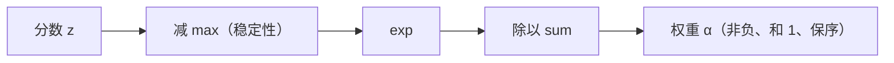

# Softmax 在 Attention 中的作用

## 1. 本节学习目标

1. 说清 softmax 在 Attention 里**同时**做了三件事：非负、归一、可导。
2. 用实测看"不减 max 会溢出"（本课 `exp([1000,1001,1002])` → **inf → NaN**）。
3. 理解温度参数如何控制"尖锐 vs 平滑"（本课 T=0.5/1.0/2.0：最大权重 **0.8668 → 0.6652 → 0.5065**）。
4. 知道为什么不能换成"直接归一化"（除法和）。

## 2. 为什么需要这个知识

因为 softmax 是 Attention 的**"决策"环节**：分数只是"倾向"，softmax 才把它变成"分配"。

而且它有两个工程陷阱：**数值溢出**（真的会 NaN）和**饱和**（梯度消失，LLM-013 已实测）。

## 3. 直观解释

**softmax = "把分数变成预算分配"**：

```text
分数:  [2, 1, 0]
exp:   [7.39, 2.72, 1.00]
归一:  [0.665, 0.245, 0.090]   ← 和为 1，全为正
```

**三个性质**：

| 性质 | 为什么重要 |
|---|---|
| **非负** | 权重不能"负相关" |
| **和为 1** | 输出是凸组合，不会尺度爆炸 |
| **保序** | 分数越大，权重越大（单调） |

## 4. 正式定义

$$
\mathrm{softmax}(z)_i=\frac{e^{z_i}}{\sum_j e^{z_j}}
$$

**带温度的版本**

$$
\mathrm{softmax}(z/T)_i=\frac{e^{z_i/T}}{\sum_j e^{z_j/T}}
$$

$T<1$ 更尖锐，$T>1$ 更平滑。

**数值稳定版（必须这样实现）**

$$
\mathrm{softmax}(z)_i=\frac{e^{z_i-\max_j z_j}}{\sum_j e^{z_j-\max_j z_j}}
$$

## 5. 历史背景或技术背景

| 背景 | 说明 |
|---|---|
| 统计物理 | softmax 与 Boltzmann 分布同形 |
| 分类输出 | 深度学习标准输出层（MATH-805） |
| Attention | 把"相似度"变成"权重" |
| 采样 | LLM 生成时用温度/Top-K/Top-P（LLM-020+） |

**关键**：同一个函数，在**注意力**里控制"看哪里"，在**生成**里控制"多随机"。

## 6. 核心原理

**本课实测 1：数值溢出**

```text
原始 logits: [1.0, 2.0, 3.0]
直接 exp 再归一: [0.09003057330846786, 0.2447284758090973, 0.6652409434318542]

大数值 exp 溢出: [inf, inf, inf] → 归一化后: NaN（inf/inf）
减 max 后: [-2.0, -1.0, 0.0] → softmax: [0.09, 0.2447, 0.6652]
```

**三个结论**：

1. 小数值时"直接 exp"与"减 max"结果一致（$0.0900/0.2447/0.6652$）。
2. 大数值时**直接 exp 溢出成 inf ⇒ 归一化变 NaN**。
3. **减 max 后完全等价且安全**（结果仍 0.09/0.2447/0.6652）。

**本课实测 2：温度**

```text
toy logits = [2, 1, 0]
T=0.5 : [0.8668, 0.1173, 0.0159]  最大=0.8668
T=1.0 : [0.6652, 0.2447, 0.09]    最大=0.6652
T=2.0 : [0.5065, 0.3072, 0.1863]  最大=0.5065
```

⇒ **T 越小越尖锐（0.8668），越大越平均（0.5065）**。Attention 里通常不用温度，但生成时大量使用。

## 7. 数学表达式

**softmax 的雅可比**

$$
\frac{\partial \alpha_i}{\partial z_j}=\alpha_i(\delta_{ij}-\alpha_j)
$$

**含义**：当某个 $\alpha_i\to1$、其余 $\to0$ 时，所有偏导 $\to0$ ⇒ **饱和 ⇒ 梯度消失**。

**熵**

$$
H(\alpha)=-\sum_i\alpha_i\log\alpha_i
$$

- 均匀：$H=\log n$；
- one-hot：$H=0$。

**本课对应**：LLM-013 实测 $d_k=1024$ 未缩放时熵 **0.0000**，正是饱和的证据。

## 8. 详细数学推导

**推导：减 max 为什么等价**

$$
\frac{e^{z_i-m}}{\sum_j e^{z_j-m}}
=\frac{e^{z_i}e^{-m}}{\sum_j e^{z_j}e^{-m}}
=\frac{e^{z_i}}{\sum_j e^{z_j}}
$$

$e^{-m}$ 上下约掉 ⇒ **数学等价**；但 $z_i-m\le0$ ⇒ $e^{z_i-m}\in(0,1]$ ⇒ **不会溢出**。

**推导：为什么不能用"除以和"代替**

若 $p_i=z_i/\sum_j z_j$：

1. 分数有负数 ⇒ **$p_i<0$**，权重为负 ⇒ 输出不再是凸组合；
2. $\sum z_j=0$ 时**除零**；
3. 不保序（负分母会翻转大小关系）。

**推导：softmax 是"最大值的平滑版本"**

当 $T\to0$：$\mathrm{softmax}(z/T)\to$ one-hot(argmax)；
当 $T\to\infty$：趋于均匀分布。
⇒ softmax 提供了一条**从"全都要"到"只要一个"的连续插值**。

## 9. 图解



## 10. 具体数值示例

```text
z = [2, 1, 0]，T = 1
exp(z) = [7.389, 2.718, 1.000]，和 = 11.107
α = [0.6652, 0.2447, 0.0900]  ✅ 实测一致

z = [2, 1, 0]，T = 0.5
exp(2z) = [54.598, 7.389, 1.000]，和 = 62.987
α = [0.8668, 0.1173, 0.0159]  ✅ 实测一致
```

## 11. NumPy 实现

```python
import numpy as np


def softmax(z):
    z = np.asarray(z, dtype=np.float64)
    z = z - z.max()                 # 稳定性关键
    e = np.exp(z)
    return e / e.sum()


print("小数值:", softmax([1.0, 2.0, 3.0]).round(4))
print("大数值:", softmax([1000.0, 1001.0, 1002.0]).round(4))

# 对比：不减 max
z = np.array([1000.0, 1001.0, 1002.0])
naive = np.exp(z) / np.exp(z).sum()
print("不减 max:", naive, "（NaN/inf）")
```

## 12. PyTorch 实现

```python
import torch
import torch.nn.functional as F

z = torch.tensor([2.0, 1.0, 0.0])
for T in (0.5, 1.0, 2.0):
    p = F.softmax(z / T, dim=-1)
    print(f"T={T}: {[round(float(v), 4) for v in p]} 最大={float(p.max()):.4f}")

big = torch.tensor([1000.0, 1001.0, 1002.0])
print("\n大数值 F.softmax:", [round(float(v), 4) for v in F.softmax(big, dim=-1)])

# 手工"不减 max"演示溢出
try:
    naive = big.exp() / big.exp().sum()
    print("手工不减 max:", naive)
except Exception as e:
    print("手工不减 max 出错:", type(e).__name__)
print("big.exp() 是否含 inf:", bool(torch.isinf(big.exp()).any()))
```

## 13. Hugging Face 实践

```python
import os

os.environ.setdefault("HF_ENDPOINT", "https://hf-mirror.com")
os.environ.setdefault("HF_HUB_OFFLINE", "1")
import torch
import torch.nn.functional as F
from transformers import AutoModelForCausalLM, AutoTokenizer

tok = AutoTokenizer.from_pretrained("gpt2")
m = AutoModelForCausalLM.from_pretrained("gpt2").eval()
ids = tok("The cat sat on the mat", return_tensors="pt")
with torch.no_grad():
    logits = m(**ids).logits[0, -1]     # 最后一个位置的词表分布

for T in (0.5, 1.0, 2.0):
    p = F.softmax(logits / T, dim=-1)
    top = torch.topk(p, 3)
    print(f"T={T}: top3 id={top.indices.tolist()} "
          f"概率={[round(float(v), 4) for v in top.values]}")
```

> **说明**：这就是"温度"在生成时的作用——同一组 logits，$T$ 改变分布的尖锐程度。

## 14. 代码逐行解释

| 代码 | 作用 |
|---|---|
| `z - z.max()` | 数值稳定（结果不变，避免溢出） |
| `e / e.sum()` | 归一化 |
| `F.softmax(z/T)` | 带温度：T 小更尖 |
| `logits[0, -1]` | 取最后一个 token 的预测分布 |
| `torch.topk` | 看前 3 个候选 |

## 15. 实际运行结果

```text
原始 logits: [1.0, 2.0, 3.0]
直接 exp 再归一: [0.09003057330846786, 0.2447284758090973, 0.6652409434318542]
大数值 exp 溢出: [inf, inf, inf] → 归一化后: NaN（inf/inf）
减 max 后: [-2.0, -1.0, 0.0] → softmax: [0.09, 0.2447, 0.6652]

温度参数（toy logits=[2,1,0]）:
  T=0.5 : [0.8668, 0.1173, 0.0159]  最大=0.8668
  T=1.0 : [0.6652, 0.2447, 0.09]    最大=0.6652
  T=2.0 : [0.5065, 0.3072, 0.1863]  最大=0.5065
```

## 16. 应用场景

| 场景 | softmax 的作用 |
|---|---|
| Attention 权重 | 把相似度变成分配 |
| 分类输出 | 多分类概率 |
| 生成采样 | 温度/Top-K/Top-P 的基础 |
| 对比学习 | InfoNCE 的归一化 |
| 多标签 | 不能用 softmax（用 sigmoid） |

## 17. 优点与局限

| 优点 | 局限 |
|---|---|
| 非负 + 归一 + 保序 + 可导 | 饱和时梯度消失（本课熵 0.0000） |
| 矩阵实现高效 | 需减 max 才安全（否则 NaN） |
| 温度可调平滑度 | 类别多时计算/显存大 |

## 18. 常见错误

| 错误 | 现象 | 纠正 |
|---|---|---|
| 不在 exp 前减 max | 大 logits → NaN | 减 max（或直接用框架） |
| Attention 里 softmax 按列 | 权重意义错 | `dim=-1`（按行） |
| 把 softmax 用于多标签 | 类别互相压制 | 用 sigmoid |
| 温度设 0 | 除零 | 最小 1e-3 |
| 以为 softmax 输出"概率"必然校准 | 过度自信 | 看校准/温度缩放 |

## 19. 本节总结

- softmax 在 Attention 里同时保证**非负、和为 1、保序、可导**；本课实测权重 `[0.3083, 0.4341, 0.2576]`（和 1）。
- **必须减 max**：否则 `exp([1000,1001,1002])` → **inf → NaN**；减 max 后结果完全等价。
- **温度**控制尖锐度：T=0.5/1.0/2.0 时最大权重 **0.8668 / 0.6652 / 0.5065**。

## 20. 前置与后续知识链接

- 前置：[[LLM-013 点积注意力与 Scaled Dot-Product Attention]]
- 后续：[[LLM-015 Self-Attention]]、[[LLM-017 Multi-Head Attention]]
- 相关：[[MATH-805 Softmax 与交叉熵]]、[[MATH-506 信息量与熵]]
- 延伸：[[LLM-021 Transformer 总体架构]]

---

## 练习与参考答案

**基础 1**：softmax 在 Attention 里保证了哪三个性质？各对应什么作用？

**基础 2**：`exp([1000, 1001, 1002])` 会给什么结果？减 max 后呢？

**进阶 1**：为什么"减 max"不改变数学结果却能避免溢出？请写出推导。

**综合**：注意力分数是 `[10, 9, 8]`（$d_k$ 很大时常见）。请计算 softmax，并说明若不除 $\sqrt{d_k}$ 会有什么问题。

> [!success]- 参考答案

> **基础 1**
> ① **非负**：权重不能为负，输出是凸组合；
> ② **和为 1**：分配总量固定，输出尺度稳定；
> ③ **保序 + 可导**：分数越大权重越大，且处处可微（能反向传播）。

> **基础 2**
> 直接 exp 得到 `[inf, inf, inf]`，再归一化 → **NaN**（inf/inf）。
> 减 max 后变成 `exp([-2,-1,0]) = [0.135, 0.368, 1.0]`，归一化 → **[0.09, 0.2447, 0.6652]**（与小数情况一致）。

> **进阶 1**
> $$\frac{e^{z_i-m}}{\sum_j e^{z_j-m}}
> =\frac{e^{z_i}e^{-m}}{\sum_j e^{z_j}e^{-m}}
> =\frac{e^{z_i}}{\sum_j e^{z_j}}$$
> 分子分母同乘 $e^{-m}$（约掉），数学完全等价；
> 但 $z_i-m\le0$ ⇒ $e^{z_i-m}\in(0,1]$ ⇒ **永不溢出**。

> **综合（参考）**
> **计算**（不减 max 的等价形式）：
> $$e^{[10,9,8]}=[22026.5,\ 8103.1,\ 2981.0],\quad \text{和}=33110.6$$
> $$\alpha=[0.6653,\ 0.2447,\ 0.0900]$$
> **若不除 $\sqrt{d_k}$**：
> - $d_k$ 大时分数方差 $\approx d_k$，本课 LLM-013 实测 $d_k=1024$ 时 softmax 熵 **0.0000**、最大权重 **1.0000**；
> - softmax **饱和成 one-hot** ⇒ 雅可比 $\alpha_i(\delta_{ij}-\alpha_j)\to0$ ⇒ **梯度消失**；
> - 模型只盯一个位置，学不到"多位置组合"。
> 除 $\sqrt{d_k}$ 后分数被拉回方差 1，注意力保持分散（本课熵稳定在 3.65–3.91）。

## 学习记录

| 日期 | 状态 | 用时 | 问题 | 复盘 |
|---|---|---|---|---|
| 2026-11-08 | planned | — | — | — |

---

## 🔗 Notion 同步信息

> 以下内容由 Notion「AI Knowledge System · 知识点」数据库按知识 ID 合并而来（导出于 2026-11-09）。

| 属性 | 值 |
|---|---|
| 学科 | 大语言模型 |
| 学习状态 | 未开始 |
| 难度 | L2 应用 |
| 知识类型 | Algorithm |

- **所属模块**：[M-LLM-02 Attention 机制与数学原理](../%E8%AF%BE%E7%A8%8B%E6%A8%A1%E5%9D%97/M-LLM-02%20Attention%20%E6%9C%BA%E5%88%B6%E4%B8%8E%E6%95%B0%E5%AD%A6%E5%8E%9F%E7%90%86.md)
- **前置知识**：[LLM-013 点积注意力与 Scaled Dot-Product Attention](LLM-013%20%E7%82%B9%E7%A7%AF%E6%B3%A8%E6%84%8F%E5%8A%9B%E4%B8%8E%20Scaled%20Dot-Product%20Attention.md)
- **后继知识**：[LLM-015 Self-Attention](LLM-015%20Self-Attention.md)
- **关联数学**：[MATH-805 Softmax 与交叉熵](../../06_%E6%95%B0%E5%AD%A6%E5%9F%BA%E7%A1%80/08%20%E6%9C%BA%E5%99%A8%E5%AD%A6%E4%B9%A0%E6%95%B0%E5%AD%A6%E5%BA%94%E7%94%A8/MATH-805%20Softmax%20%E4%B8%8E%E4%BA%A4%E5%8F%89%E7%86%B5.md) · [MATH-506 信息量与熵](../../06_%E6%95%B0%E5%AD%A6%E5%9F%BA%E7%A1%80/05%20%E7%A6%BB%E6%95%A3%E6%95%B0%E5%AD%A6/MATH-506%20%E4%BF%A1%E6%81%AF%E9%87%8F%E4%B8%8E%E7%86%B5.md)
