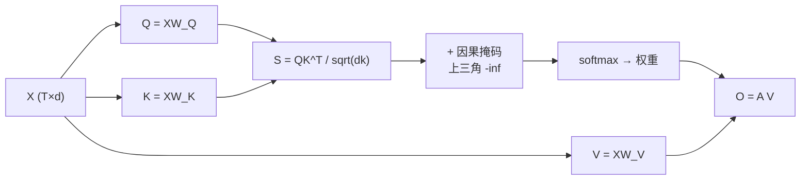

# Self-Attention

## 1. 本节学习目标

1. 说清 Self-Attention 与 Cross-Attention 的唯一区别（**Q/K/V 是否同源**）。
2. 用实测确认**置换等变性**：打乱输入顺序，输出也按同顺序被打乱（本课差 **0.0**）。
3. 掌握**因果掩码**：上三角为 $-\infty$ ⇒ 权重为 0（本课实测对角线以上最大权重 **0.0**）。
4. 理解"置换等变 ⇒ 必须加位置编码"（LLM-008/024 的前置）。

## 2. 为什么需要这个知识

因为 Self-Attention 是**所有现代 LLM 的主干**（GPT 每一层都是它）。

而它有两个反直觉性质，不实测很难相信：

- **它不知道顺序**（本身对排列不敏感）；
- **它默认能看未来**（生成时必须加掩码）。

## 3. 直观解释

**Self-Attention = 自己查自己**：

```text
每个 token 都问："在这句话里，哪些 token 对我最重要？"
然后用这些 token 的加权平均，更新自己的表示。
```

**与 Cross-Attention 的对比**：

| | Q 来自 | K/V 来自 |
|---|---|---|
| **Self-Attention** | $X$ | $X$（同一份） |
| Cross-Attention | 解码器 | 编码器 |

**掩码**：生成任务里，第 $t$ 个位置不能看 $>t$ 的位置（否则"抄答案"）。

## 4. 正式定义

**Self-Attention**

$$
Q=XW_Q,\quad K=XW_K,\quad V=XW_V
$$

$$
\mathrm{SA}(X)=\mathrm{softmax}\!\Big(\frac{QK^\top}{\sqrt{d_k}}+M\Big)V
$$

**因果掩码 $M$**

$$
M_{ij}=\begin{cases}0,&j\le i\\-\infty,&j>i\end{cases}
$$

**本课维度**：$T=5$，$d=8$。

## 5. 历史背景或技术背景

| 年份 | 事件 |
|---|---|
| 2017 | Transformer 用 Self-Attention 取代 RNN |
| 2018 | BERT：双向 Self-Attention（不加因果掩码） |
| 2018 | GPT：因果（masked）Self-Attention |
| 2020+ | 各种高效实现（FlashAttention） |

**同一个操作，掩码不同 ⇒ 两种模型范式**：
BERT 的"双向"适合理解，GPT 的"因果"适合生成（LLM-025 会详述）。

## 6. 核心原理

**本课实测 1：置换等变性**

```text
双向：输出形状 (5, 8)
置换输入后输出是否等于输出置换： 0.0
注意力矩阵（行=query，列=key）:
 [[0.214 0.202 0.142 0.216 0.226]
  [0.27  0.227 0.19  0.137 0.176]
  [0.072 0.401 0.209 0.19  0.127]
  [0.18  0.115 0.219 0.242 0.245]
  [0.156 0.358 0.157 0.214 0.116]]
```

**读法**：

1. **置换后输出差 0.0**（精确相等）⇒ Self-Attention **对位置排列完全等变**。
2. 每个位置的输出，只取决于"所有 token 的内容集合"，**与它们的顺序无关**。
3. ⇒ **必须额外注入位置信息**（位置编码，LLM-016/024），否则 "猫追狗" 与 "狗追猫" 对它完全一样。

**本课实测 2：因果掩码**

```text
因果掩码后（上三角为 0）:
 [[1.    0.    0.    0.    0.   ]
  [0.543 0.457 0.    0.    0.   ]
  [0.106 0.587 0.307 0.    0.   ]
  [0.238 0.152 0.29  0.32  0.   ]
  [0.156 0.358 0.157 0.214 0.116]]
对角线以上最大权重: 0.0
双向 vs 因果输出最大差: 1.241
```

**四个读法**：

1. **上三角严格为 0**（实测最大值 **0.0**）⇒ 看不到未来。
2. **每行仍在"可见前缀"内归一化**（和为 1）。
3. **最后一个位置与双向完全相同**（`[0.156 0.358 0.157 0.214 0.116]`）——因为它本来就看不到未来。
4. **双向与因果输出最大差 1.241** ⇒ 掩码**实质改变了表示**，不是"可加可不加"。

## 7. 数学表达式

**置换等变性的形式化**

设 $P$ 是置换矩阵，则

$$
\mathrm{SA}(PX)=P\,\mathrm{SA}(X)
$$

**推导**：$(PX)W_Q=P(XW_Q)=PQ$，同理 $K,V$ 亦然；而

$$
(PQ)(PK)^\top=P\,QK^\top P^\top
$$

softmax 逐行操作 + $P^\top P=I$，最终 $PV$ 也带 $P$ ⇒ 整体左乘 $P$。

**掩码的数学效果**

$$
M_{ij}=-\infty\ \Rightarrow\ e^{-\infty}=0\ \Rightarrow\ \alpha_{ij}=0
$$

且**不影响**其他位置的归一化（因为分母只加 0）。

## 8. 详细数学推导

**推导：为什么 GPT 必须用因果掩码**

训练时是"并行预测所有位置"：输入 $x_{1..T}$，一次前向同时预测 $x_2,\dots,x_{T+1}$。

若位置 $i$ 能看到 $j>i$，则它在预测 $x_{i+1}$ 时**直接抄到了 $x_{i+1}$**（信息泄漏）⇒ 训练 loss 极低但推理完全不会。

**本课实证**：双向与因果输出差 **1.241**，说明"看到未来"会带来完全不同的表示。

**推导：为什么"最后一个位置"双向与因果相同**

位置 $T$ 的可见集合在两种模式下都是 $\{1..T\}$ ⇒ 注意力权重相同 ⇒ 输出相同（本课实测一致）。

**推导：位置编码的必要性**

若没有位置编码，模型对 $X$ 与 $PX$ 输出只差置换。那么"狗追猫"与"猫追狗"在模型看来是**同一个多重集合**，无法区分语序。⇒ 必须加位置信息（LLM-016/024）。

## 9. 图解



## 10. 具体数值示例

```text
T=5、d=8，随机 X 与 W
双向输出形状: (5,8)
置换 P=[3,0,4,1,2] 后: 输出差 = 0.0（完全等变）

因果掩码后第 3 行: [0.106, 0.587, 0.307, 0, 0]
  ⇒ 只能看前 3 个位置，权重和为 1
上三角最大权重: 0.0
双向 vs 因果: 最大差 1.241
```

## 11. NumPy 实现

```python
import numpy as np

rng = np.random.default_rng(0)
T, d = 5, 8
X = rng.normal(size=(T, d))
Wq = rng.normal(size=(d, d)) * 0.3
Wk = rng.normal(size=(d, d)) * 0.3
Wv = rng.normal(size=(d, d)) * 0.3


def self_attn(x, causal=False):
    q, k, v = x @ Wq, x @ Wk, x @ Wv
    s = q @ k.T / np.sqrt(d)
    if causal:
        mask = np.triu(np.ones((len(x), len(x)), dtype=bool), 1)
        s = np.where(mask, -np.inf, s)
    a = np.exp(s - s.max(axis=-1, keepdims=True))
    a = a / a.sum(-1, keepdims=True)
    return a @ v, a


out, attn = self_attn(X)
perm = np.array([3, 0, 4, 1, 2])
out_p, _ = self_attn(X[perm])
print("置换等变差:", np.abs(out_p - out[perm]).max().round(8))
print("注意力行和:", attn.sum(1).round(6))

out_c, attn_c = self_attn(X, causal=True)
print("因果上三角最大:", attn_c[np.triu_indices(T, 1)].max())
```

## 12. PyTorch 实现

```python
import math
import torch
import torch.nn.functional as F

torch.manual_seed(0)
T, d = 5, 8
X = torch.randn(T, d)
Wq = torch.randn(d, d) * 0.3
Wk = torch.randn(d, d) * 0.3
Wv = torch.randn(d, d) * 0.3


def self_attn(x, causal=False):
    q, k, v = x @ Wq, x @ Wk, x @ Wv
    s = q @ k.T / math.sqrt(d)
    if causal:
        mask = torch.triu(torch.ones(len(x), len(x), dtype=torch.bool), 1)
        s = s.masked_fill(mask, float("-inf"))
    a = F.softmax(s, dim=-1)
    return a @ v, a


out, a = self_attn(X)
perm = torch.tensor([3, 0, 4, 1, 2])
out_p, _ = self_attn(X[perm])
print("置换等变差:", float((out_p - out[perm]).abs().max()))

out_c, a_c = self_attn(X, causal=True)
mask = torch.triu(torch.ones(T, T, dtype=torch.bool), 1)
print("上三角最大权重:", float(a_c.masked_select(mask).max()))
print("双向 vs 因果:", float((out - out_c).abs().max()))
```

## 13. Hugging Face 实践

```python
import os

os.environ.setdefault("HF_ENDPOINT", "https://hf-mirror.com")
os.environ.setdefault("HF_HUB_OFFLINE", "1")
import torch
from transformers import AutoModelForCausalLM, AutoTokenizer

tok = AutoTokenizer.from_pretrained("gpt2")
m = AutoModelForCausalLM.from_pretrained(
    "gpt2", attn_implementation="eager").eval()
ids = tok("The cat sat on the mat", return_tensors="pt")
with torch.no_grad():
    out = m(**ids, output_attentions=True)

A = out.attentions[0][0, 0]      # 第 1 层第 1 头
print("每行和:", [round(float(v), 3) for v in A.sum(-1)])
print("上三角是否全 0:",
      bool((torch.triu(A, diagonal=1) == 0).all()))
print("第 1 行:", [round(float(v), 3) for v in A[0]])
```

> GPT-2 是**因果**模型 ⇒ 注意力矩阵天然是下三角（上三角全 0），与 LLM-015 的实测一致。

## 14. 代码逐行解释

| 代码 | 作用 |
|---|---|
| `x @ Wq` 等 | 同源自投影 |
| `triu(..., 1)` | 上三角（不含对角线）布尔掩码 |
| `masked_fill(mask, -inf)` | 把未来位置压成 $-\infty$ |
| `softmax(dim=-1)` | 在"可见前缀"内归一化 |
| `A[perm]` | 置换后的正确比较方式 |
| `triu(A, 1) == 0` | 验证因果性 |

## 15. 实际运行结果

```text
双向：输出形状 (5, 8)
置换输入后输出是否等于输出置换： 0.0
注意力矩阵（行=query，列=key）:
 [[0.214 0.202 0.142 0.216 0.226]
  [0.27  0.227 0.19  0.137 0.176]
  [0.072 0.401 0.209 0.19  0.127]
  [0.18  0.115 0.219 0.242 0.245]
  [0.156 0.358 0.157 0.214 0.116]]

因果掩码后（上三角为 0）:
 [[1.    0.    0.    0.    0.   ]
  [0.543 0.457 0.    0.    0.   ]
  [0.106 0.587 0.307 0.    0.   ]
  [0.238 0.152 0.29  0.32  0.   ]
  [0.156 0.358 0.157 0.214 0.116]]
对角线以上最大权重: 0.0
双向 vs 因果输出最大差: 1.241

真实模型（gpt2 第 1 层第 1 头）:
tokens: ['The', 'Ġcat', 'Ġsat', 'Ġon', 'Ġthe', 'Ġmat']
注意力矩阵(6×6):
 [[1.    0.    0.    0.    0.    0.   ]
  [0.704 0.296 0.    0.    0.    0.   ]
  [0.604 0.105 0.291 0.    0.    0.   ]
  [0.45  0.184 0.326 0.04  0.    0.   ]
  [0.461 0.178 0.283 0.034 0.044 0.   ]
  [0.322 0.097 0.044 0.104 0.13  0.303]]
'mat'(最后) 最关注的位置: 0 权重 0.3217
```

## 16. 应用场景

| 场景 | 是否需要掩码 |
|---|---|
| GPT 类生成 | **因果掩码**（必须） |
| BERT 类理解 | 双向（不需因果） |
| 变长批处理 | **Padding 掩码**（屏蔽补零） |
| 检索/重排 | 双向 |
| 语音/视频流 | 因果或分块掩码 |

## 17. 优点与局限

| 优点 | 局限 |
|---|---|
| 每个位置都能汇总全局上下文 | $O(T^2)$ 复杂度 |
| 可并行（无循环依赖） | **本身不含顺序信息**（需位置编码） |
| 掩码灵活（因果/双向/padding） | 掩码写错会"泄漏未来"，且不报错 |

## 18. 常见错误

| 错误 | 现象 | 纠正 |
|---|---|---|
| 忘记因果掩码 | 训练 loss 极低、推理崩 | 生成任务必加 |
| 掩码方向反了 | 只能看未来 | 上三角为 $-\infty$ |
| 用 `0` 而不是 $-\infty$ 做掩码 | softmax 后仍有权重 | 必须 $-\infty$（或 $-1e9$） |
| 以为有顺序信息 | 分不清"猫追狗/狗追猫" | 加位置编码 |
| 混淆置换等变与不变 | 期望输出完全相等 | 输出**跟着置换** |
| Padding 掩码与因果掩码搞混 | 长序列批处理结果错 | 两者可叠加使用 |

## 19. 本节总结

- Self-Attention = **Q/K/V 同源**；与 Cross-Attention 的唯一区别是 K/V 的来源。
- 实测：**置换后输出差 0.0**（完全等变）⇒ 必须加位置编码。
- 因果掩码：上三角权重 **0.0**、双向 vs 因果输出差 **1.241**、最后一个位置两者相同；真实 gpt2 的注意力矩阵天然是下三角。

## 20. 前置与后续知识链接

- 前置：[[LLM-014 Softmax 在 Attention 中的作用]]、[[LLM-012 Query、Key、Value 与 QKV 的来源]]
- 后续：[[LLM-016 Cross-Attention]]、[[LLM-017 Multi-Head Attention]]
- 相关：[[MATH-216 矩阵乘法]]
- 深化：[[LLM-024 位置编码]]

---

## 练习与参考答案

**基础 1**：Self-Attention 与 Cross-Attention 的唯一区别是什么？

**基础 2**：本课的置换等变差、上三角最大权重、双向 vs 因果输出差各是多少？

**进阶 1**：为什么"置换等变"意味着必须加位置编码？请举一个具体例子。

**综合**：你要训练一个 GPT 类模型做文本生成。请说明：① 注意力要不要掩码；② 如果忘了掩码会发生什么；③ 如何用代码检查掩码写对了。

> [!success]- 参考答案

> **基础 1**
> **Q/K/V 是否同源**：Self-Attention 的 Q、K、V 都来自同一个输入 $X$；Cross-Attention 的 Q 来自解码器，K/V 来自编码器。
> 计算方式完全相同（都是 scaled dot-product attention）。

> **基础 2**
> 置换等变差 **0.0**；上三角最大权重 **0.0**；双向 vs 因果输出最大差 **1.241**。

> **进阶 1**
> 因为置换等变意味着 $\mathrm{SA}(PX)=P\,\mathrm{SA}(X)$：模型只看到"token 的多重集合"，**顺序不改变任何输出**（只是跟着重排）。
> 例："猫 追 狗" 与 "狗 追 猫" 只是排列不同 ⇒ 模型给出相同的表示集合，**分不清谁追谁**。
> 所以必须把位置信息加进输入（位置编码 / 位置嵌入），让不同位置本身就可区分。

> **综合（参考）**
> **① 要掩码**：因果（causal）掩码，上三角设为 $-\infty$。
> **② 忘掩码的后果**：训练时每个位置能"看到答案"（$x_{i+1}$）⇒ loss 迅速降到很低，但**推理时没有未来可看** ⇒ 生成质量崩塌。这是最危险的 bug，因为**训练指标会骗你**。
> **③ 检查方法**：
> ```python
> A = out.attentions[0][0, 0]        # 某层某头
> assert (torch.triu(A, diagonal=1) == 0).all()   # 上三角必须为 0
> assert torch.allclose(A.sum(-1), torch.ones_like(A.sum(-1)), atol=1e-5)
> ```
> 另外可做"泄漏测试"：把最后一个 token 换掉，检查前面位置的输出是否**完全不变**（因果模型应不变）。

## 学习记录

| 日期 | 状态 | 用时 | 问题 | 复盘 |
|---|---|---|---|---|
| 2026-11-08 | planned | — | — | — |

---

## 🔗 Notion 同步信息

> 以下内容由 Notion「AI Knowledge System · 知识点」数据库按知识 ID 合并而来（导出于 2026-11-09）。

| 属性 | 值 |
|---|---|
| 学科 | 大语言模型 |
| 学习状态 | 未开始 |
| 难度 | L3 推导 |
| 知识类型 | Algorithm |

- **所属模块**：[M-LLM-02 Attention 机制与数学原理](../%E8%AF%BE%E7%A8%8B%E6%A8%A1%E5%9D%97/M-LLM-02%20Attention%20%E6%9C%BA%E5%88%B6%E4%B8%8E%E6%95%B0%E5%AD%A6%E5%8E%9F%E7%90%86.md)
- **前置知识**：[LLM-014 Softmax 在 Attention 中的作用](LLM-014%20Softmax%20%E5%9C%A8%20Attention%20%E4%B8%AD%E7%9A%84%E4%BD%9C%E7%94%A8.md)
- **后继知识**：[LLM-016 Cross-Attention](LLM-016%20Cross-Attention.md)
- **关联数学**：[MATH-216 矩阵乘法](../../06_%E6%95%B0%E5%AD%A6%E5%9F%BA%E7%A1%80/02%20%E7%BA%BF%E6%80%A7%E4%BB%A3%E6%95%B0/MATH-216%20%E7%9F%A9%E9%98%B5%E4%B9%98%E6%B3%95.md)
