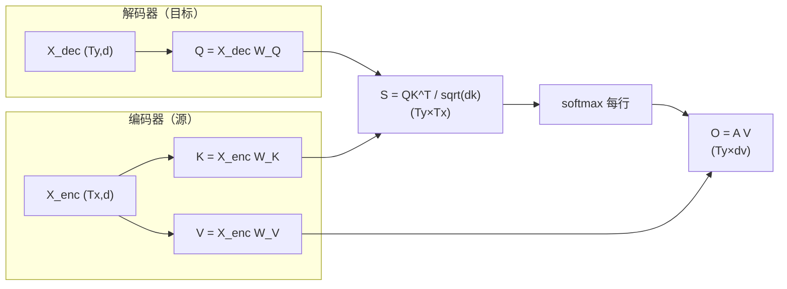

# Cross-Attention

## 1. 本节学习目标

1. 说清 Cross-Attention 与 Self-Attention 的**唯一区别**：Q 与 K/V 不同源。
2. 算清形状：$Q\in(T_y,d_k)$、$K,V\in(T_x,d_k)$ ⇒ 注意力矩阵 $(T_y,T_x)$ **不是方阵**。
3. 理解它解决的原始问题（Seq2Seq 的固定向量瓶颈）。
4. 知道今天的 Cross-Attention 出现在哪（T5、多模态、扩散模型）。

## 2. 为什么需要这个知识

因为**不是所有注意力都是"自己看自己"**：

- 翻译时，解码器要"看源句"——这是 Cross；
- 图像描述模型要"看图说话"——文本看图像，这是 Cross；
- 现代 GPT 是纯 Decoder，**没有 Cross**，但 T5/多模态模型有。

分不清 Self 与 Cross，你会在读架构图时把两条输入线搞混。

## 3. 直观解释

```text
Self-Attention：我一个人查我自己的笔记
Cross-Attention：我拿着问题（Q），去查别人的资料库（K/V）
```

| | Q 来自 | K/V 来自 | 矩阵形状 |
|---|---|---|---|
| Self | 序列 A | 序列 A | 方阵 $(T,T)$ |
| **Cross** | 序列 **A**（解码器） | 序列 **B**（编码器） | $(T_A,T_B)$ |

## 4. 正式定义

$$
Q=X_{\text{dec}}W_Q,\quad K=X_{\text{enc}}W_K,\quad V=X_{\text{enc}}W_V
$$

$$
\mathrm{CrossAttn}=\mathrm{softmax}\!\Big(\frac{QK^\top}{\sqrt{d_k}}\Big)V
$$

**本课实测**

```text
Q(4, 8) K(6, 8) V(6, 8) → S/A(4, 6) → O(4, 8)
注意力矩阵行和: [1.0, 1.0, 1.0, 1.0]
```

**读法**：

1. 解码器有 **4** 个位置、编码器有 **6** 个位置；
2. 注意力矩阵是 **$(4,6)$**——每个解码位置对 6 个编码位置分配权重；
3. 行和为 1（每个解码位置独立归一化）；
4. 输出仍是解码器的形状 $(4,8)$ ⇒ **Cross 不改变 Q 侧的长度**。

## 5. 历史背景或技术背景

| 年份 | 事件 |
|---|---|
| 2015 | Bahdanau Attention：解码器每步对齐源句（**Cross 的起点**） |
| 2017 | Transformer 原始架构：解码器中间层就是 Cross-Attention |
| 2019 | T5：Encoder-Decoder 统一框架 |
| 2021+ | 多模态：文本 Q 看图像 K/V（如 CLIP 类对比、Flamingo） |
| 2022+ | 扩散模型（Stable Diffusion）：U-Net 用 Cross 注入文本条件 |

**注意**：GPT 系列是 **Decoder-only**，用因果 Self-Attention，**没有 Cross**。所以"LLM 都有 Cross-Attention"是错的。

## 6. 核心原理

**为什么需要 Cross（原始动机）**

Seq2Seq 把整句压成一个向量 $\mathbf{c}$（LLM-003 的瓶颈）：

$$
\mathbf{h}^{\text{enc}}\in\mathbb{R}^{d}\quad\Rightarrow\quad \text{长句必丢信息}
$$

Cross-Attention 让解码器**每一步**都能访问编码器的**全部位置**：

$$
\mathbf{o}_t=\sum_{j=1}^{T_x}\alpha_{tj}\mathbf{v}_j
$$

⇒ 长句不再"压成一个点"。

**本课对应**：$T_x=6$ 个编码位置，每个解码位置可以按需取用（权重和为 1）。

## 7. 数学表达式

**参数量（单头）**

$$
\#=d_{\text{dec}}\cdot d_k+d_{\text{enc}}\cdot d_k+d_{\text{enc}}\cdot d_v
$$

若 $d_{\text{dec}}=d_{\text{enc}}=d$、$d_k=d_v=d$，则 $3d^2$（与 Self 相同）。

**形状链**

| 量 | 形状 |
|---|---|
| $X_{\text{dec}}$ | $(T_y,d)$ |
| $X_{\text{enc}}$ | $(T_x,d)$ |
| $Q$ | $(T_y,d_k)$ |
| $K,V$ | $(T_x,d_k)$ |
| $A$ | $(T_y,T_x)$ |
| $O$ | $(T_y,d_v)$ |

## 8. 详细数学推导

**推导：为什么 $A$ 不是方阵**

$$
QK^\top:(T_y,d_k)\times(d_k,T_x)\Rightarrow(T_y,T_x)
$$

只有 $T_y=T_x$ 时才是方阵。**翻译里源句与译句长度通常不同**，所以 Cross 的矩阵天然是矩形。

**推论**：Cross-Attention **没有"对称性"可言**（Self 也没有，但 Cross 连形状都不对称）。

**推导：Cross 的"对齐"能力**

若训练后 $\alpha_{t,j^\*}\approx1$，表示解码第 $t$ 步主要"看"编码第 $j^\*$ 个位置——这正是**词对齐**（翻译里"猫"对"cat"）。这是 Attention 最早的可解释性来源。

## 9. 图解



## 10. 具体数值示例

```text
Ty=4（解码 4 个位置），Tx=6（编码 6 个位置），d=dv=8

Q: (4,8)   K: (6,8)   V: (6,8)
S = QK^T / sqrt(8): (4,6)
A = softmax(S, dim=-1): (4,6)，每行和 1
O = A @ V: (4,8)  ⇒ 长度仍是解码器的 4

若源句更长（Tx=20），A 变成 (4,20)，输出仍是 (4,8)
```

## 11. NumPy 实现

```python
import numpy as np

rng = np.random.default_rng(0)
Ty, Tx, d = 4, 6, 8
X_dec = rng.normal(size=(Ty, d))
X_enc = rng.normal(size=(Tx, d))
Wq, Wk, Wv = (rng.normal(size=(d, d)) * 0.3 for _ in range(3))

Q, K, V = X_dec @ Wq, X_enc @ Wk, X_enc @ Wv
S = Q @ K.T / np.sqrt(d)
A = np.exp(S - S.max(axis=-1, keepdims=True))
A = A / A.sum(-1, keepdims=True)
O = A @ V

print("Q/K/V:", Q.shape, K.shape, V.shape)
print("注意力矩阵:", A.shape, " 行和:", A.sum(1).round(4))
print("输出:", O.shape)
```

## 12. PyTorch 实现

```python
import math
import torch
import torch.nn as nn
import torch.nn.functional as F

Ty, Tx, d = 4, 6, 8
q_proj = nn.Linear(d, d, bias=False)
kv_proj = nn.Linear(d, d * 2, bias=False)

X_dec = torch.randn(Ty, d)
X_enc = torch.randn(Tx, d)

Q = q_proj(X_dec)                        # (Ty, d)
K, V = kv_proj(X_enc).chunk(2, dim=-1)   # 各 (Tx, d)

A = F.softmax(Q @ K.T / math.sqrt(d), dim=-1)
O = A @ V

print("Q:", tuple(Q.shape), "K:", tuple(K.shape), "V:", tuple(V.shape))
print("A:", tuple(A.shape), " 行和:", [round(float(v), 4) for v in A.sum(-1)])
print("O:", tuple(O.shape))

# 用内置 MHA 做 Cross（q 与 k/v 不同）
mha = nn.MultiheadAttention(d, 2, batch_first=True, bias=False)
out, _ = mha(X_dec.unsqueeze(0), X_enc.unsqueeze(0), X_enc.unsqueeze(0))
print("内置 MHA 输出:", tuple(out.shape))
```

## 13. Hugging Face 实践

```python
import os

os.environ.setdefault("HF_ENDPOINT", "https://hf-mirror.com")
os.environ.setdefault("HF_HUB_OFFLINE", "1")
from transformers import AutoConfig

# 区分架构：decoder-only（无 Cross） vs encoder-decoder（有 Cross）
for name, local in (("gpt2", True), ("t5-small", False)):
    try:
        cfg = AutoConfig.from_pretrained(name, local_files_only=local)
        print(f"{name:10} encoder-decoder={cfg.is_encoder_decoder} "
              f"arch={cfg.architectures}")
    except Exception as e:
        print(f"{name:10} 未缓存（需联网下载）：{type(e).__name__}")
```

> **本机情况**：只有 `gpt2` 缓存，`t5-small` 需联网；因此上例对 t5 会打印"未缓存"，**不做假数据**。

## 14. 代码逐行解释

| 代码 | 作用 |
|---|---|
| `q_proj(X_dec)` | Q 只来自解码器 |
| `kv_proj(X_enc).chunk(2)` | K/V 来自编码器（一次投影拆两半，省参数矩阵） |
| `Q @ K.T` | $(T_y,d)\times(d,T_x)\to(T_y,T_x)$ |
| `softmax(dim=-1)` | 每个解码位置在**源序列**上归一化 |
| `mha(q, k, v)` | 三个参数不同即 Cross |
| `cfg.is_encoder_decoder` | 判断架构是否有 Cross |

## 15. 实际运行结果

```text
### LLM-016 Cross-Attention：Q 与 K/V 不同源
  Qtorch.Size([4, 8]) Ktorch.Size([6, 8]) Vtorch.Size([6, 8]) → S/Atorch.Size([4, 6]) → Otorch.Size([4, 8])
  注意力矩阵行和: [1.0, 1.0, 1.0, 1.0]
  与 Self-Attn 区别：S 是 (Ty×Tx) 而非方阵，Ty≠Tx 时不对称
```

## 16. 应用场景

| 场景 | Q | K/V |
|---|---|---|
| 机器翻译（T5） | 目标语言解码器 | 源语言编码器 |
| 图像描述 | 文本 | 图像 patch |
| 语音识别 | 文本解码器 | 音频编码器 |
| 扩散模型条件注入 | 图像 latent | 文本 embedding |
| 检索重排 | 查询 | 文档词元 |

## 17. 优点与局限

| 优点 | 局限 |
|---|---|
| 打破"整句压一个向量"的瓶颈 | 多一套 K/V 投影参数与显存 |
| 可对齐、可解释（$A$ 可视化） | 编码器输出必须一直保留（占显存） |
| 支持变长源/目标 | 推理时无法像 Self 那样复用 KV（源固定可缓存） |

## 18. 常见错误

| 错误 | 现象 | 纠正 |
|---|---|---|
| 以为所有 LLM 都有 Cross | 把 GPT 图画错 | GPT 是 Decoder-only，无 Cross |
| Q 也用编码器输出 | 注意力形状错 | Q 来自解码器 |
| 对 $A$ 求对称性质 | 无意义 | $A$ 是 $(T_y,T_x)$，通常非方阵 |
| Cross 里用因果掩码 | 解码器看不到完整源句 | Cross 通常**不加因果掩码**（源全可见） |
| 推理时不缓存源 K/V | 每步重算，慢 | 源 K/V 可预计算并缓存 |

## 19. 本节总结

- Cross-Attention：**Q 来自解码器，K/V 来自编码器**；公式与 Self 相同。
- 实测形状链：$Q(4,8),K(6,8),V(6,8)\to A(4,6)\to O(4,8)$，行和 **1.0**；$A$ **不是方阵**。
- 它解决了 Seq2Seq 的固定向量瓶颈；GPT 是 Decoder-only，**没有** Cross。

## 20. 前置与后续知识链接

- 前置：[[LLM-015 Self-Attention]]、[[LLM-012 Query、Key、Value 与 QKV 的来源]]
- 后续：[[LLM-017 Multi-Head Attention]]、[[LLM-018 掩码——Causal、Padding 与 Attention Mask]]
- 相关：[[MATH-216 矩阵乘法]]
- 深化：[[LLM-027 Encoder-Only、Decoder-Only 与 Encoder-Decoder]]

---

## 练习与参考答案

**基础 1**：Self-Attention 与 Cross-Attention 的唯一区别是什么？

**基础 2**：本课 Cross-Attention 的 $Q/K/V/A/O$ 形状各是什么？

**进阶 1**：为什么 Cross-Attention 的注意力矩阵通常不是方阵？这带来什么工程影响？

**综合**：一个翻译模型：源句 20 个 token，目标句 12 个 token，$d_k=64$。请写出 Cross-Attention 各张量形状，并说明推理时如何减少重复计算。

> [!success]- 参考答案

> **基础 1**
> **K/V 的来源**：Self-Attention 的 Q/K/V 都来自同一输入；Cross-Attention 的 Q 来自解码器，K/V 来自编码器。计算方式（scaled dot-product）完全相同。

> **基础 2**
> $Q:(4,8)$、$K:(6,8)$、$V:(6,8)$、$A:(4,6)$、$O:(4,8)$（$T_y=4,T_x=6,d=8$）。

> **进阶 1**
> 因为 $A=QK^\top$ 的形状是 $(T_y,T_x)$，而源句与目标句长度通常不同 ⇒ 不是方阵。
> **工程影响**：① 不能复用为 Self 的"对称/方阵"假设；② 解码时源 K/V 固定，可**预计算并缓存**（Cross 的 KV Cache 只需算一次），而 Self 的 KV 每步都在增长。

> **综合（参考）**
> **形状**：
> - $Q:(12,64)$
> - $K,V:(20,64)$
> - $A:(12,20)$
> - $O:(12,64)$
> **减少重复计算**：
> 1. **预计算源端 K/V**：编码器只跑一次，$K=X_{\text{enc}}W_K$、$V=X_{\text{enc}}W_V$ 存起来，解码每步复用（不必每步重算编码器）；
> 2. **增量解码**：解码第 $t$ 步只算新位置的 $Q_t$，与固定 $K$ 相乘得到一行 $A_t$；
> 3. **批量**：把同时到达的请求合并成 batch，提高 GPU 利用率（LLM-090+ 会讲批处理）。

## 学习记录

| 日期 | 状态 | 用时 | 问题 | 复盘 |
|---|---|---|---|---|
| 2026-11-08 | planned | — | — | — |

---

## 🔗 Notion 同步信息

> 以下内容由 Notion「AI Knowledge System · 知识点」数据库按知识 ID 合并而来（导出于 2026-11-09）。

| 属性 | 值 |
|---|---|
| 学科 | 大语言模型 |
| 学习状态 | 未开始 |
| 难度 | L2 应用 |
| 知识类型 | Algorithm |

- **所属模块**：[M-LLM-02 Attention 机制与数学原理](../%E8%AF%BE%E7%A8%8B%E6%A8%A1%E5%9D%97/M-LLM-02%20Attention%20%E6%9C%BA%E5%88%B6%E4%B8%8E%E6%95%B0%E5%AD%A6%E5%8E%9F%E7%90%86.md)
- **前置知识**：[LLM-015 Self-Attention](LLM-015%20Self-Attention.md)
- **后继知识**：[LLM-017 Multi-Head Attention](LLM-017%20Multi-Head%20Attention.md)
- **关联数学**：[MATH-216 矩阵乘法](../../06_%E6%95%B0%E5%AD%A6%E5%9F%BA%E7%A1%80/02%20%E7%BA%BF%E6%80%A7%E4%BB%A3%E6%95%B0/MATH-216%20%E7%9F%A9%E9%98%B5%E4%B9%98%E6%B3%95.md)
