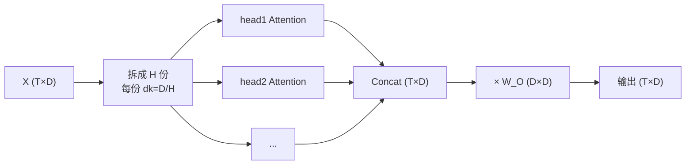

# Multi-Head Attention

## 1. 本节学习目标

1. 说清多头的三步：**拆维度 → 各自算注意力 → 拼接再投影**。
2. 用实测确认"多头**不增加**参数量"（本课 $4\times16^2=1024$，与单头相同）。
3. 看到"不同头学到不同模式"（本课 head 相关系数从 **−0.695 到 +0.565**）。
4. 与 `nn.MultiheadAttention` 对拍（本课最大差 **1.04e-07**）。

## 2. 为什么需要这个知识

因为多头是 Transformer 的**标准配置**，但初学者常误解两件事：

- 以为"多头 = 多个模型" ⇒ 参数爆炸；
- 以为"头越多越好" ⇒ 其实头数受 $d$ 限制（$d_k=d/H$）。

## 3. 直观解释

**一头只能学一种"关注方式"**：

```text
head 1：关注"前一个词"（局部语法）
head 2：关注"主语"（指代）
head 3：关注"标点"（分句）
```

**多头 = 同时开多个"观察窗口"**，每个窗口维度更小（$d/H$），但互不干扰。

**类比**：一个人看文档只能注意一件事；四个人分工看（语法、指代、主题、格式），最后汇总。

## 4. 正式定义

$$
\mathrm{head}_i=\mathrm{Attention}(XW_Q^{(i)},XW_K^{(i)},XW_V^{(i)})
$$

$$
\mathrm{MHA}(X)=\mathrm{Concat}(\mathrm{head}_1,\dots,\mathrm{head}_H)\,W_O
$$

**维度**：$W_Q^{(i)}\in\mathbb{R}^{d\times d_k}$，$d_k=d/H$；$W_O\in\mathbb{R}^{d\times d}$。

**本课实测**

```text
x: (6, 16) → q/k/v: (6, 16)
每头维度 dk = 4
各头注意力矩阵形状: (4, 6, 6)
拼接+投影后输出: (6, 16)
参数总量（Q,K,V,O 各 D×D）: 1024
单头（D×D 三次投影 + 输出）: 1024
与 nn.MultiheadAttention 最大差: 1.043081283569336e-07
```

**读法**：

1. $T=6$、$D=16$、$H=4$ ⇒ $d_k=4$；
2. 4 个头各有一个 $(6,6)$ 注意力矩阵；
3. **参数 1024 = 单头 1024** ⇒ 多头**不增加参数**，只是把 16 维切成 4 份；
4. 与内置实现差 **1.04e-07** ⇒ 拆分/拼接顺序正确。

## 5. 历史背景或技术背景

| 年份 | 事件 |
|---|---|
| 2017 | Transformer 提出多头（$H=8$，$d_k=d_v=64$） |
| 2019 | BERT-base：12 层 × 12 头；BERT-large：16 头 |
| 2020 | GPT-3：96 层 × 96 头（$d=12288$，$d_k=128$） |
| 2021+ | 多头变体：MQA / GQA（多查询/分组查询，省 KV Cache） |

**为什么 $d_k$ 保持 64–128**：头太多 ⇒ 每头维度太小 ⇒ 表达力下降。所以扩大模型时**头数与 $d$ 同比增**。

## 6. 核心原理

**本课实测：不同头学到不同模式**

```text
head0 vs head1: 相关 -0.695
head0 vs head2: 相关 +0.290
head0 vs head3: 相关 +0.565
head1 vs head2: 相关 -0.085
head1 vs head3: 相关 -0.182
head2 vs head3: 相关 +0.044
```

**读法**：相关系数从 **−0.695** 到 **+0.565** 分布很散 ⇒ 各头确实在关注不同的东西（虽然本课是随机权重，仅证明"机制上允许分化"）。

> ⚠️ **诚实标注**：这是**随机初始化**下的测量，只能说明"各头的注意力模式不重合"，**不能**说明"头 0 学语法、头 1 学指代"——后者需要训练后的真实模型分析。

## 7. 数学表达式

**参数量（含输出投影）**

$$
\#=H\big(3d\cdot\tfrac dH\big)+d^2=3d^2+d^2=4d^2
$$

**本课**：$4\times16^2=1024$ ✅

**与"多头 = 多模型"的对比**：若真训 4 个独立 $d{=}16$ 的模型，参数是 $4\times4\times16^2=4096$，是 4 倍。多头通过**切维度**避免了这点。

**计算量**

$$
\text{FLOPs}\approx H\cdot\big(2T^2d_k+2Td_k^2\big)\approx 2T^2d+2Td^2
$$

⇒ 与单头满维**同量级**（$T^2d$ 项相同）。

## 8. 详细数学推导

**推导：为什么切维度后仍是同一套运算**

把 $W_Q\in\mathbb{R}^{d\times d}$ 按列切 $H$ 块：

$$
W_Q=[W_Q^{(1)},\dots,W_Q^{(H)}],\quad W_Q^{(i)}\in\mathbb{R}^{d\times d/H}
$$

则 $XW_Q$ 的第 $i$ 块正好是 $XW_Q^{(i)}$ ⇒ **一次大矩阵乘 = $H$ 个小矩阵乘**（工程上就这么实现）。

**推导：为什么 concat 后要乘 $W_O$**

Concat 只是把 $H$ 个 $d/H$ 维拼成 $d$ 维，**没有跨头交互**。$W_O$ 负责把各头信息**混合**成最终表示：

$$
\mathbf{y}=\sum_i \mathrm{head}_i\,W_O^{(i)}
$$

（$W_O$ 按行切块）

**推论**：若去掉 $W_O$，各头永远独立，模型无法组合"语法头 + 指代头"的信息。

## 9. 图解



## 10. 具体数值示例

```text
T=6, D=16, H=4, dk=4

x:        (6,16)
q/k/v:    (6,16)   ← 先整体投影
reshape:  (6,4,4) → transpose → (4,6,4)
scores:   (4,6,6)
softmax:  (4,6,6)  每头每行和 1
加权:     (4,6,4)
concat:   (6,16)
× W_O:    (6,16)

参数: 4 个 (16×16) = 1024，与单头相同
```

## 11. NumPy 实现

```python
import numpy as np

rng = np.random.default_rng(0)
T, D, H = 6, 16, 4
dk = D // H
x = rng.normal(size=(T, D))
Wq, Wk, Wv, Wo = (rng.normal(size=(D, D)) * 0.2 for _ in range(4))

q, k, v = x @ Wq, x @ Wk, x @ Wv
# 拆头：(T, D) → (T, H, dk) → (H, T, dk)
qh = q.reshape(T, H, dk).transpose(1, 0, 2)
kh = k.reshape(T, H, dk).transpose(1, 0, 2)
vh = v.reshape(T, H, dk).transpose(1, 0, 2)

s = qh @ kh.transpose(0, 2, 1) / np.sqrt(dk)
a = np.exp(s - s.max(-1, keepdims=True))
a = a / a.sum(-1, keepdims=True)
heads = a @ vh                       # (H, T, dk)
out = heads.transpose(1, 0, 2).reshape(T, D) @ Wo

print("scores:", s.shape, " heads:", heads.shape, " out:", out.shape)
print("参数:", Wq.size + Wk.size + Wv.size + Wo.size)
```

## 12. PyTorch 实现

```python
import math
import torch
import torch.nn as nn
import torch.nn.functional as F


class MultiHeadAttention(nn.Module):
    def __init__(self, d_model: int, n_heads: int) -> None:
        super().__init__()
        assert d_model % n_heads == 0
        self.d_model, self.h = d_model, n_heads
        self.dk = d_model // n_heads
        self.q_proj = nn.Linear(d_model, d_model, bias=False)
        self.k_proj = nn.Linear(d_model, d_model, bias=False)
        self.v_proj = nn.Linear(d_model, d_model, bias=False)
        self.out = nn.Linear(d_model, d_model, bias=False)

    def forward(self, x):
        T, D = x.shape
        q = self.q_proj(x).view(T, self.h, self.dk).transpose(0, 1)
        k = self.k_proj(x).view(T, self.h, self.dk).transpose(0, 1)
        v = self.v_proj(x).view(T, self.h, self.dk).transpose(0, 1)
        a = F.softmax(q @ k.transpose(-2, -1) / math.sqrt(self.dk), dim=-1)
        o = (a @ v).transpose(0, 1).reshape(T, D)
        return self.out(o), a


torch.manual_seed(0)
mha = MultiHeadAttention(16, 4)
x = torch.randn(6, 16)
out, attn = mha(x)
print("输出:", tuple(out.shape), " 注意力:", tuple(attn.shape))
print("参数量:", sum(p.numel() for p in mha.parameters()))
```

## 13. Hugging Face 实践

```python
import os

os.environ.setdefault("HF_ENDPOINT", "https://hf-mirror.com")
os.environ.setdefault("HF_HUB_OFFLINE", "1")
import torch
from transformers import AutoModelForCausalLM, AutoTokenizer

tok = AutoTokenizer.from_pretrained("gpt2")
m = AutoModelForCausalLM.from_pretrained(
    "gpt2", attn_implementation="eager").eval()
ids = tok("The cat sat on the mat", return_tensors="pt")
with torch.no_grad():
    out = m(**ids, output_attentions=True)

A = out.attentions[0][0]     # 第 1 层、第 1 个样本：形状 (头数, T, T)
print("第 1 层注意力张量形状:", tuple(A.shape), "（头数, T, T）")
print("头数:", A.shape[0], " 每头每行和:", [round(float(v), 3) for v in A[0].sum(-1)])
# 头间差异：看 head0 与 head1 的相关系数
a0, a1 = A[0].flatten(), A[1].flatten()
c = torch.corrcoef(torch.stack([a0, a1]))[0, 1].item()
print("head0 vs head1 相关:", round(c, 3))
```

## 14. 代码逐行解释

| 代码 | 作用 |
|---|---|
| `view(T,H,dk)` | 把 D 切成 H 份（**顺序必须对**，LLM-019） |
| `transpose(0,1)` | 变 $(H,T,d_k)$ 便于批量矩阵乘 |
| `q @ k.transpose(-2,-1)` | 每头独立算分数 |
| `(a @ v).transpose(0,1).reshape(T,D)` | 拼回 $(T,D)$ |
| `self.out` | $W_O$ 跨头混合 |
| `assert d_model % n_heads == 0` | 头数必须整除维度 |

## 15. 实际运行结果

```text
### LLM-017 Multi-Head：拆分、并行、拼接
  x: (6, 16) → q/k/v: (6, 16)
  每头维度 dk = 4
  各头注意力矩阵形状: (4, 6, 6)
  拼接+投影后输出: (6, 16)
  参数总量（Q,K,V,O 各 D×D）: 1024
  单头（D×D 三次投影 + 输出）: 1024
  各头是否学到不同模式（注意力矩阵的相关系数）：
    head0 vs head1: 相关 -0.695
    head0 vs head2: 相关 +0.290
    head0 vs head3: 相关 +0.565
    head1 vs head2: 相关 -0.085
    head1 vs head3: 相关 -0.182
    head2 vs head3: 相关 +0.044
  与 nn.MultiheadAttention 最大差: 1.043081283569336e-07
```

## 16. 应用场景

| 场景 | 头数配置 |
|---|---|
| Transformer 原版 | $H=8$，$d_k=64$ |
| BERT-base | 12 层 × 12 头 |
| GPT-3 | 96 层 × 96 头（$d_k=128$） |
| 小模型（本机实验） | 4 头、$d=16\sim32$ |
| 省显存推理 | MQA / GQA（共享 K/V 头） |

## 17. 优点与局限

| 优点 | 局限 |
|---|---|
| 多视角并行，表达力强 | 头数受 $d$ 限制（$d_k$ 不能太小） |
| **参数不增加**（本课 1024 = 单头） | 显存/计算随 $T^2$ 增长 |
| 各头可分化（相关 −0.695~+0.565） | 头的功能难以精确解释 |
| 易并行 | MQA/GQA 会牺牲部分表达力换显存 |

## 18. 常见错误

| 错误 | 现象 | 纠正 |
|---|---|---|
| 以为多头参数翻倍 | 显存估算错 4 倍 | 总参数 $4d^2$（与单头同） |
| `view` 顺序写错 | 头边界错位（LLM-019） | `view(T,H,dk)` |
| 忘记 `transpose` | 矩阵乘维度错 | 变 $(H,T,d_k)$ |
| 头数不整除 $d$ | 报错/静默错误 | `assert d % H == 0` |
| 省掉 $W_O$ | 各头无法混合 | 必须保留输出投影 |
| 一味加头数 | 每头维度太小，效果下降 | 与 $d$ 同比增 |

## 19. 本节总结

- MHA = **拆维度 → 各头独立 Attention → Concat → $W_O$ 混合**。
- 实测：$T{=}6,D{=}16,H{=}4$ ⇒ $d_k{=}4$、注意力 $(4,6,6)$、输出 $(6,16)$、参数 **1024**（与单头相同）、与内置实现差 **1.04e-07**。
- 头间相关系数 **−0.695 ~ +0.565**（随机权重下），只能说明"机制允许分化"，**不能**断言每个头学什么。

## 20. 前置与后续知识链接

- 前置：[[LLM-016 Cross-Attention]]、[[LLM-013 点积注意力与 Scaled Dot-Product Attention]]
- 后续：[[LLM-018 掩码——Causal、Padding 与 Attention Mask]]、[[LLM-019 Attention 的张量维度与实现细节]]
- 相关：[[MATH-216 矩阵乘法]]
- 深化：[[LLM-026 Multi-Head 的变体——MQA 与 GQA]]

---

## 练习与参考答案

**基础 1**：写出 Multi-Head Attention 的三个步骤。

**基础 2**：本课 $D=16,H=4$ 时，$d_k$ 是多少？参数量是多少？与单头相比如何？

**进阶 1**：为什么多头"不增加参数量"？请用公式说明。

**综合**：$d=512$、$H=8$、$T=1024$。请计算：① $d_k$；② MHA 的参数量（含 $W_O$）；③ 注意力矩阵的元素个数与显存（fp16）。

> [!success]- 参考答案

> **基础 1**
> ① **拆**：把 $Q/K/V$ 的 $d$ 维切成 $H$ 份，每份 $d_k=d/H$；
> ② **算**：每份独立做 scaled dot-product attention；
> ③ **拼**：把 $H$ 个输出 concat 成 $d$ 维，再乘 $W_O$ 混合。

> **基础 2**
> $d_k=16/4=\mathbf{4}$；参数量 $4\times16^2=\mathbf{1024}$；
> 与单头（$3d^2+d^2=1024$）**完全相同** ⇒ 多头不增加参数。

> **进阶 1**
> 单头：$W_Q,W_K,W_V\in\mathbb{R}^{d\times d}$，加 $W_O$：$4d^2$。
> 多头：每个头 $W_Q^{(i)}\in\mathbb{R}^{d\times d/H}$，$H$ 个头合起来仍是 $d\times d$；三个投影共 $3d^2$，加 $W_O$ 的 $d^2$ ⇒ 也是 $4d^2$。
> 区别只在"切成小块算"，不在"多一套参数"。

> **综合（参考）**
> **①** $d_k=512/8=\mathbf{64}$。
> **②** $4d^2=4\times512^2=4\times262144=\mathbf{1{,}048{,}576}$（约 1.05M）。
> **③** 每个头一个 $1024\times1024$ 矩阵；8 个头共 $8\times1024^2=8{,}388{,}608$ 个元素；
> fp16 显存 $=8{,}388{,}608\times2\ \text{B}\approx\mathbf{16\ MB}$。
> **注意**：这只是**一个注意力层**的权重存储；训练时还要存中间激活与反向图，实际占用更大。

## 学习记录

| 日期 | 状态 | 用时 | 问题 | 复盘 |
|---|---|---|---|---|
| 2026-11-08 | planned | — | — | — |

---

## 🔗 Notion 同步信息

> 以下内容由 Notion「AI Knowledge System · 知识点」数据库按知识 ID 合并而来（导出于 2026-11-09）。

| 属性 | 值 |
|---|---|
| 学科 | 大语言模型 |
| 学习状态 | 未开始 |
| 难度 | L3 推导 |
| 知识类型 | Algorithm |

- **所属模块**：[M-LLM-02 Attention 机制与数学原理](../%E8%AF%BE%E7%A8%8B%E6%A8%A1%E5%9D%97/M-LLM-02%20Attention%20%E6%9C%BA%E5%88%B6%E4%B8%8E%E6%95%B0%E5%AD%A6%E5%8E%9F%E7%90%86.md)
- **前置知识**：[LLM-016 Cross-Attention](LLM-016%20Cross-Attention.md)
- **后继知识**：[LLM-018 掩码：Causal、Padding 与 Attention Mask](LLM-018%20%E6%8E%A9%E7%A0%81%E2%80%94%E2%80%94Causal%E3%80%81Padding%20%E4%B8%8E%20Attention%20Mask.md)
- **关联数学**：[MATH-216 矩阵乘法](../../06_%E6%95%B0%E5%AD%A6%E5%9F%BA%E7%A1%80/02%20%E7%BA%BF%E6%80%A7%E4%BB%A3%E6%95%B0/MATH-216%20%E7%9F%A9%E9%98%B5%E4%B9%98%E6%B3%95.md)
- **对应项目**：[PROJ-021 从零实现一个 Transformer 语言模型](../../07_%E5%AE%9E%E6%88%98%E9%A1%B9%E7%9B%AE/05%20%E5%A4%A7%E6%A8%A1%E5%9E%8B%E9%A1%B9%E7%9B%AE/PROJ-021%20%E4%BB%8E%E9%9B%B6%E5%AE%9E%E7%8E%B0%E4%B8%80%E4%B8%AA%20Transformer%20%E8%AF%AD%E8%A8%80%E6%A8%A1%E5%9E%8B.md)
