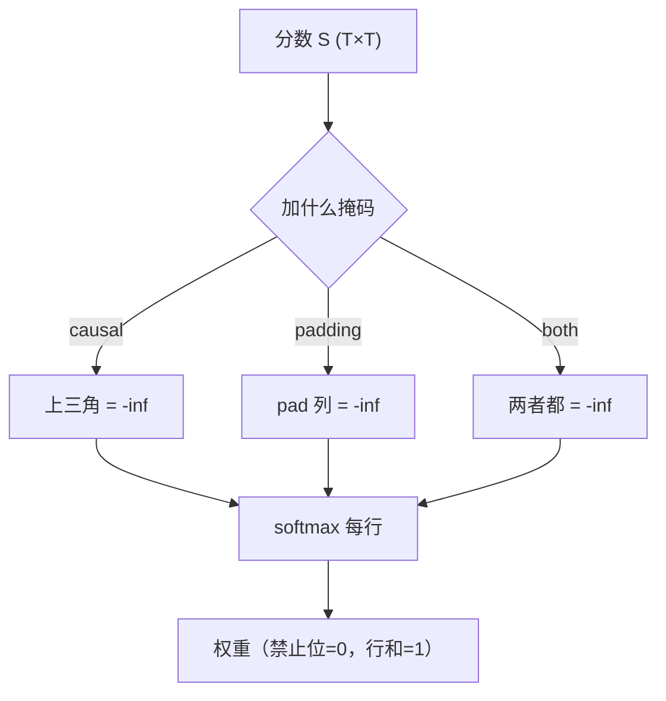

# 掩码：Causal、Padding 与 Attention Mask

## 1. 本节学习目标

1. 分清三种掩码：**因果（causal）/ 补零（padding）/ 两者组合**。
2. 用实测确认掩码效果：causal 上三角 **0.0000**、padding 位置权重 **0.0**。
3. 记住**必须用 $-\infty$ 而不是 0**：本课用 0 掩码后上三角权重 **0.2783**（泄漏！）。
4. 会写 `attention_mask` 与 `causal mask` 的正确组合。

## 2. 为什么需要这个知识

因为**掩码写错的后果是"训练指标很好、上线就崩"**：

- 生成任务不掩未来 ⇒ 训练时直接抄答案（loss 极低，推理崩）；
- 变长批处理不掩 padding ⇒ 模型把"补零"当内容，结果随 batch 组成变化；
- 用 0 代替 $-\infty$ ⇒ **掩码等于没掩**（本课实测 0.2783 的泄漏权重）。

## 3. 直观解释

**三种掩码 = 三种"不许看"**：

| 掩码 | 禁止看什么 | 用在哪 |
|---|---|---|
| **Causal** | 未来的 token | 生成模型（GPT） |
| **Padding** | 补齐的 `<pad>` | 变长批处理 |
| **组合** | 两者都不许 | 生成 + 变长（最常见） |

**做法统一**：把禁止位置的分数改成 $-\infty$，softmax 后自动变 0。

## 4. 正式定义

**加性掩码**

$$
\mathrm{softmax}\Big(\frac{QK^\top}{\sqrt{d_k}}+M\Big),\qquad
M_{ij}=\begin{cases}0,&\text{允许}\\-\infty,&\text{禁止}\end{cases}
$$

**因果掩码**：$M_{ij}=-\infty$ 当 $j>i$。

**Padding 掩码**：$M_{ij}=-\infty$ 当第 $j$ 个位置是 padding。

**本课实测**

```text
仅 causal: 上三角最大=0.0000 行和=[1.0, 1.0, 1.0, 1.0, 1.0]
仅 padding(长度3): 上三角最大=0.5048 行和=[1.0, 1.0, 1.0, 1.0, 1.0]
causal + padding: 上三角最大=0.0000 行和=[1.0, 1.0, 1.0, 1.0, 1.0]
padding 位置权重（应为 0）: [0.0, 0.0]

常见 bug：用 0 而不是 -inf 当掩码
  用 0 掩码后上三角最大权重: 0.2783 （应≈0 却不为 0）
```

**四个读法**：

1. **causal**：上三角严格 **0.0000**，行和仍为 1（在可见前缀内归一化）。
2. **padding-only**：上三角 **0.5048**（因为没禁未来，只禁了第 4、5 位）。
3. **组合**：两者都生效——上三角 0.0 且 padding 权重 0.0。
4. **用 0 掩码**：上三角权重 **0.2783** ⇒ **等于没掩**（0 加在分数上不改变 softmax 排序，只是平移）。

## 5. 历史背景或技术背景

| 年份 | 事件 |
|---|---|
| 2017 | Transformer 用 causal mask 做自回归解码 |
| 2018 | BERT 双向（不用 causal），但需要 padding mask |
| 2019+ | HF 统一 `attention_mask` 语义（1=可见，0=pad） |
| 2023+ | 变长训练（packing）让掩码更复杂（如 document mask） |

**HF 的两套掩码**：

- `attention_mask`：标记"哪些是真实 token"（padding 用）；
- `causal mask`：由模型内部自动生成（decoder-only 模型）。

## 6. 核心原理

**为什么必须 $-\infty$**

softmax 对**平移不变**：

$$
\mathrm{softmax}(z+c)=\mathrm{softmax}(z)
$$

所以加 0 完全无效；加 $-\infty$ 才让 $e^{-\infty}=0$。

**本课量化**：用 0 掩码后上三角权重 **0.2783**（本该 0）⇒ 未来信息被泄漏。

**为什么行和仍是 1**

掩码把部分项变 0，分母同步减少，**softmax 自动在剩余项上重新归一化**：

$$
\sum_{j\in\text{可见}}\alpha_{ij}=\frac{\sum_{j\in\text{可见}}e^{s_{ij}}}{\sum_{j\in\text{可见}}e^{s_{ij}}}=1
$$

## 7. 数学表达式

**组合掩码**

$$
M^{\text{total}}_{ij}=M^{\text{causal}}_{ij}\ \text{or}\ M^{\text{pad}}_{ij}
$$

即**任一条件禁止就禁止**。

**全掩行的问题**

若某一行**全部被禁止**（例如整句都是 padding），则

$$
e^{-\infty}=0\ \Rightarrow\ \sum=0\ \Rightarrow\ \frac00=\text{NaN}
$$

⇒ 工程上要保证"每行至少一个可见位置"（通常是 causal 的对角线永远可见）。

## 8. 详细数学推导

**推导：causal 后为什么第 1 行只能是 1**

位置 1 只能看自己（$j\le1$ 只有 $j=1$）⇒ 权重必然为 1：

$$
\alpha_{1,:}=[1,0,\dots,0]
$$

本课实测 `上三角最大=0.0000` 且第 1 行符合。

**推导：padding 掩码为什么必须同时作用于 key**

若只把 padding 的 **query** 行掩掉、却让真实 query 看 padding 的 **key**：

$$
\alpha_{i,\text{pad}}>0\ \Rightarrow\ \mathbf{o}_i\ \text{混入 padding 的 }V
$$

⇒ 结果依赖 pad 的内容（虽然 pad 通常是 0，但会稀释注意力）。所以**列也要掩**（本课 `pad[:, 3:] = True` 就是把第 4、5 列全部禁掉）。

## 9. 图解



## 10. 具体数值示例

```text
T=5，假设长度 3（第 4、5 是 padding）

causal 上三角: 0.0
padding 列禁后: 第 4、5 列权重 = 0
组合后第 1 行: [1, 0, 0, 0, 0]

用 0 当掩码的错误做法：
  上三角最大权重 = 0.2783  ⇒ 未来信息泄漏
```

## 11. NumPy 实现

```python
import numpy as np


def masked_softmax(scores, mask):
    s = np.where(mask, -np.inf, scores)
    e = np.exp(s - s.max(axis=-1, keepdims=True))
    return e / e.sum(-1, keepdims=True)


T = 5
scores = np.random.default_rng(0).normal(size=(T, T))
causal = np.triu(np.ones((T, T), dtype=bool), 1)
pad = np.zeros((T, T), dtype=bool)
pad[:, 3:] = True          # 长度 3

a_c = masked_softmax(scores, causal)
a_b = masked_softmax(scores, causal | pad)

print("causal 上三角最大:", a_c[np.triu_indices(T, 1)].max())
print("组合后 padding 列:", a_b[:, 3:].max())
print("行和:", a_b.sum(1).round(6))
```

## 12. PyTorch 实现

```python
import torch
import torch.nn.functional as F

T = 5
scores = torch.randn(T, T)
causal = torch.triu(torch.ones(T, T, dtype=torch.bool), 1)
pad = torch.zeros(T, T, dtype=torch.bool)
pad[:, 3:] = True


def softmax_with(mask):
    s = scores.masked_fill(mask, float("-inf"))
    return F.softmax(s, dim=-1)


a_c = softmax_with(causal)
a_b = softmax_with(causal | pad)

print("causal 上三角最大:", float(a_c.masked_select(causal).max()))
print("组合后 padding 列最大:", float(a_b[:, 3:].max()))
print("行和:", [round(float(v), 6) for v in a_b.sum(-1)])

# 正确做法的等价形式：用 -1e9（大负数）而非 -inf，避免 NaN 风险
s = scores.masked_fill(causal, -1e9)
print("用 -1e9 时的上三角最大权重:", float(F.softmax(s, dim=-1).masked_select(causal).max()))
```

## 13. Hugging Face 实践

```python
import os

os.environ.setdefault("HF_ENDPOINT", "https://hf-mirror.com")
os.environ.setdefault("HF_HUB_OFFLINE", "1")
import torch
from transformers import AutoModelForCausalLM, AutoTokenizer

tok = AutoTokenizer.from_pretrained("gpt2")
tok.pad_token = tok.eos_token
m = AutoModelForCausalLM.from_pretrained(
    "gpt2", attn_implementation="eager").eval()

batch = tok(["The cat sat on the mat", "Hi"],
            return_tensors="pt", padding=True)
print("input_ids 形状:", tuple(batch["input_ids"].shape))
print("attention_mask:", batch["attention_mask"].tolist())

with torch.no_grad():
    out = m(**batch, output_attentions=True)
A = out.attentions[0][0]      # 第 1 层、第 1 个样本
print("注意力矩阵形状:", tuple(A.shape))
print("上三角全 0:", bool((torch.triu(A, diagonal=1) == 0).all()))
```

> **注意**：`attention_mask` 里的 0 表示 padding，模型内部会把它变成 $-∞$；而 causal 由模型自动加。

## 14. 代码逐行解释

| 代码 | 作用 |
|---|---|
| `masked_fill(mask, -inf)` | 把禁止位置压成 $-∞$ |
| `mask \| pad` | 两个掩码取"或"（任一禁止即禁止） |
| `masked_select(causal)` | 取出被掩位置，验证是否为 0 |
| `padding=True` | 自动补 `<pad>` 并生成 `attention_mask` |
| `-1e9` 替代 $-\infty$ | 避免"整行被掩"时出现 NaN |

## 15. 实际运行结果

```text
仅 causal: 上三角最大=0.0000 行和=[1.0, 1.0, 1.0, 1.0, 1.0]
仅 padding(长度3): 上三角最大=0.5048 行和=[1.0, 1.0, 1.0, 1.0, 1.0]
causal + padding: 上三角最大=0.0000 行和=[1.0, 1.0, 1.0, 1.0, 1.0]
padding 位置权重（应为 0）: [0.0, 0.0]

常见 bug：用 0 而不是 -inf 当掩码
  用 0 掩码后上三角最大权重: 0.2783 （应≈0 却不为 0）
```

## 16. 应用场景

| 场景 | 掩码组合 |
|---|---|
| GPT 生成训练 | causal + padding |
| BERT 理解 | padding（无 causal） |
| 翻译（Encoder-Decoder） | 解码器 causal；Cross 只 padding |
| 变长 batch | padding（必须，含列） |
| 文档打包训练 | causal + document mask（防跨文档泄漏） |

## 17. 优点与局限

| 优点 | 局限 |
|---|---|
| 一个加法就实现"禁止看" | 整行全掩会 NaN |
| softmax 自动重归一 | $-\infty$ 在某些 kernel 上不稳定 |
| 组合灵活 | 掩码写错**不报错**，只错结果 |

## 18. 常见错误

| 错误 | 现象 | 纠正 |
|---|---|---|
| 用 0 当掩码 | 上三角 0.2783（泄漏） | 用 $-\infty$ 或 $-1e9$ |
| padding 只掩行不掩列 | 输出混入 pad | 行列都掩 |
| 掩码方向反 | 只能看未来 | 上三角（$j>i$）为 $-\infty$ |
| 整行被掩 | NaN | 保证对角线可见 / 用 $-1e9$ |
| Cross 加 causal | 看不到完整源句 | Cross 不加 causal |
| 忘记 `attention_mask` | batch 结果随组成变化 | 传 mask |

## 19. 本节总结

- 三种掩码：**causal（禁未来）/ padding（禁补零）/ 组合**；统一做法是"禁止位置 $-\infty$"。
- 实测：causal 上三角 **0.0000**、padding 权重 **0.0**、组合两者都成立。
- **必须用 $-\infty$（或 $-1e9$）**：用 0 掩码后上三角权重 **0.2783**，等于没掩。

## 20. 前置与后续知识链接

- 前置：[[LLM-017 Multi-Head Attention]]、[[LLM-015 Self-Attention]]
- 后续：[[LLM-019 Attention 的张量维度与实现细节]]、[[LLM-020 Attention 的计算复杂度与局限]]
- 相关：[[LLM-025 残差、LayerNorm 与 Pre-LN、Post-LN]]

---

## 练习与参考答案

**基础 1**：三种掩码各禁什么？分别用在什么场景？

**基础 2**：本课用 0 当掩码时上三角最大权重是多少？说明什么？

**进阶 1**：为什么 padding 掩码必须同时作用在 key 上（列），而不只是 query（行）？

**综合**：一个 batch 里有长度 3 和 5 的两句话，用 GPT 做生成训练。请写出掩码组合，并说明如何验证"没有泄漏未来"。

> [!success]- 参考答案

> **基础 1**
> - **Causal**：禁止看未来 token（$j>i$），用于生成模型训练；
> - **Padding**：禁止看补齐的 pad 位置，用于变长批处理；
> - **组合**：两者同时，用于"生成 + 变长"（最常见）。

> **基础 2**
> **0.2783**。说明加 0 对 softmax **完全无效**（softmax 平移不变），未来信息仍然被看到 ⇒ 必须用 $-\infty$（或 $-1e9$）。

> **进阶 1**
> 因为注意力输出是 $\mathbf{o}_i=\sum_j\alpha_{ij}\mathbf{v}_j$。若某列（pad 的 key）权重不为 0，则 pad 的 $V$ 会被混进输出。
> 虽然 pad token 通常是 0 向量，但这会**稀释**真实位置的权重（分母含 pad 的 $e^{s}$），导致结果依赖 batch 里 padding 的多少。所以必须把 pad 列也压成 0。

> **综合（参考）**
> **掩码组合**：
> 1. 先按 batch 最长（5）补齐，短句的 2 个位置为 pad；
> 2. **causal**：$5\times5$ 上三角为 $-\infty$；
> 3. **padding**：pad 行、pad 列都设为 $-\infty$；
> 4. 两者取"或"。
> **验证"没有泄漏未来"**：
> ```python
> A = out.attentions[0][0]                     # 某层某样本
> assert (torch.triu(A, diagonal=1) == 0).all() # 上三角必须为 0
> # 更强的测试：把最后一个 token 换掉，检查前面位置的输出是否不变
> ```
> **注意**：短句的 pad 行可能"整行可见集合为空"（若同时要求 causal 且前缀全 pad），实际实现会保留对角线或直接把这些行的输出置零。

## 学习记录

| 日期 | 状态 | 用时 | 问题 | 复盘 |
|---|---|---|---|---|
| 2026-11-08 | planned | — | — | — |

---

## 🔗 Notion 同步信息

> 以下内容由 Notion「AI Knowledge System · 知识点」数据库按知识 ID 合并而来（导出于 2026-11-09）。

| 属性 | 值 |
|---|---|
| 学科 | 大语言模型 |
| 学习状态 | 未开始 |
| 难度 | L2 应用 |
| 知识类型 | Technique |

- **所属模块**：[M-LLM-02 Attention 机制与数学原理](../%E8%AF%BE%E7%A8%8B%E6%A8%A1%E5%9D%97/M-LLM-02%20Attention%20%E6%9C%BA%E5%88%B6%E4%B8%8E%E6%95%B0%E5%AD%A6%E5%8E%9F%E7%90%86.md)
- **前置知识**：[LLM-017 Multi-Head Attention](LLM-017%20Multi-Head%20Attention.md)
- **后继知识**：[LLM-019 Attention 的张量维度与实现细节](LLM-019%20Attention%20%E7%9A%84%E5%BC%A0%E9%87%8F%E7%BB%B4%E5%BA%A6%E4%B8%8E%E5%AE%9E%E7%8E%B0%E7%BB%86%E8%8A%82.md) · [LLM-046 双向上下文与单向生成](../05%20%E9%A2%84%E8%AE%AD%E7%BB%83%E4%B8%8E%E5%BE%AE%E8%B0%83/LLM-046%20%E5%8F%8C%E5%90%91%E4%B8%8A%E4%B8%8B%E6%96%87%E4%B8%8E%E5%8D%95%E5%90%91%E7%94%9F%E6%88%90.md)
