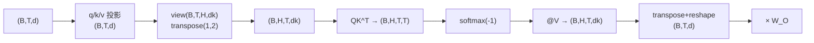

# Attention 的张量维度与实现细节

## 1. 本节学习目标

1. 记住带 batch 的完整形状链：$(B,T,d)\to(B,H,T,d_k)\to(B,H,T,T)\to(B,T,d)$。
2. 用实测看**`view` 顺序写错会怎样**（本课正确 `(T,H,dk)` 与错误 `(T,dk,H)` 分组完全不同）。
3. 会用 `einsum` 写 Attention，并知道它比 `view+transpose` 慢的原因。
4. 掌握 5 个高频实现陷阱（`dim`、`contiguous`、`sdpa` 不返权重等）。

## 2. 为什么需要这个知识

因为 Attention 的 bug **几乎全是维度问题**，而且大多**不报错**：

- `view` 顺序错 ⇒ 头边界错位，模型照常训练但学不到东西；
- `softmax` 的 `dim` 写错 ⇒ 按列归一化，权重意义全变；
- `transpose` 后忘 `contiguous` ⇒ 某些算子报 stride 错误。

## 3. 直观解释

**带 batch 的四维世界**：

```text
(B, T, d)            ← 输入
(B, H, T, dk)        ← 拆头
(B, H, T, T)         ← 注意力矩阵
(B, H, T, dk)        ← 加权输出
(B, T, d)            ← 拼回并投影
```

**维度命名的记忆法**：`B`atch → `H`ead → `T`oken → `d`im。

## 4. 正式定义

**完整形状链**

$$
(B,T,d)\xrightarrow{\text{投影}}(B,T,d)\xrightarrow{\text{拆头}}(B,H,T,d_k)
$$

$$
\xrightarrow{QK^\top}(B,H,T,T)\xrightarrow{\text{softmax}}(B,H,T,T)\xrightarrow{\cdot V}(B,H,T,d_k)
$$

$$
\xrightarrow{\text{拼接}}(B,T,d)\xrightarrow{W_O}(B,T,d)
$$

**维度关系**：$d_k=d/H$，$T$ 为序列长度，$B$ 为批大小。

## 5. 历史背景或技术背景

| 实现方式 | 特点 |
|---|---|
| 2017 原版 | 显式 `view/transpose/matmul` |
| 2019+ | `einsum` 更易读但稍慢 |
| 2022 | `F.scaled_dot_product_attention`（融合 kernel） |
| 2023+ | FlashAttention（分块，省显存） |

**本机实测**：`F.scaled_dot_product_attention` 与手写结果差 **5.96e-08**（LLM-013），说明公式一致，只是实现更高效。

## 6. 核心原理

**本课实测：`view` 顺序错误**

```text
正确：view(T,H,dk) → (2, 4, 4)  每头第一行: [-0.3467, 0.8680, 0.0325, -0.0191]
错误：view(T,dk,H) → (4, 4, 2)  每头第一行: [-0.3467, 0.8680]
两者形状不同 ⇒ 无法直接比较；但可看出分组方式不同：
  正确拆法 head0 的 4 维: [-0.3467, 0.8680, 0.0325, -0.0191]
  错误拆法 head0 的 2 维: [-0.3467, 0.8680]
  错误拆法把相邻的 2 个维度当成一头 ⇒ 头与头的边界错位
```

**三个读法**：

1. 内存里 8 个数是同一串，**只是解释方式不同**；
2. 正确：`[0..3]` 是 head0、`[4..7]` 是 head1；
3. 错误（`(T,dk,H)`）：每 2 个数一组 ⇒ **head0 只有 2 维，且混了不同头的内容**。

> 关键：`view` 不报错、形状也"看起来合理"，但**语义完全错了**。这是最难查的一类 bug。

## 7. 数学表达式

**`einsum` 写法**

$$
O_{bhtd}=\sum_{s}\mathrm{softmax}_s\Big(\frac{\sum_{e}Q_{bhte}K_{bhse}}{\sqrt{d_k}}\Big)V_{bhsd}
$$

对应代码：

```text
scores = torch.einsum("bhte,bhse->bhts", Q, K) / math.sqrt(dk)
A      = scores.softmax(-1)
O      = torch.einsum("bhts,bhsd->bhtd", A, V)
```

**为什么 `einsum` 慢一点**：它不保证融合，可能产生额外中间张量；而 `view+matmul` 走 BLAS。

## 8. 详细数学推导

**推导：`view(T,H,dk)` 与 `view(T,dk,H)` 的等价条件**

设原张量第 $t$ 个 token 的向量为 $x_t\in\mathbb{R}^{D}$，按行优先存储为

$$
[x_{t,0},\dots,x_{t,D-1}]
$$

- `view(T,H,dk)`：第 $h$ 头取 $x_{t,h\cdot d_k:(h+1)d_k}$ ⇒ **连续切块**；
- `view(T,dk,H)`：第 $h$ "头"取 $x_{t,h},x_{t,h+H},x_{t,h+2H},\dots$ ⇒ **交错取样**。

两者只有在 $H=1$ 或 $d_k=1$ 时才一致（本课 $H=2,d_k=4$ 时不同）。

**推论**：若模型用交错拆头（很少见），必须配对应的 `W` 列顺序；**混用就是 bug**。

## 9. 图解



## 10. 具体数值示例

```text
D=8, H=2, dk=4, 某个 token 的向量 x = [x0..x7]

正确 view(1,2,4)：
  head0 = [x0,x1,x2,x3]
  head1 = [x4,x5,x6,x7]

错误 view(1,4,2)：
  "head0" = [x0,x1]
  "head1" = [x2,x3]
  ⇒ 与正确分组完全不同（本课实测前两个数相同，后面就错位）
```

## 11. NumPy 实现

```python
import numpy as np

T, D, H = 4, 8, 2
dk = D // H
x = np.arange(T * D).reshape(T, D).astype(float)

right = x.reshape(T, H, dk).transpose(1, 0, 2)
wrong = x.reshape(T, dk, H).transpose(1, 0, 2)

print("原 x[0]:", x[0].tolist())
print("正确 head0:", right[0, 0].tolist())
print("正确 head1:", right[1, 0].tolist())
print("错误 head0:", wrong[0, 0].tolist(), "（只有 2 维）")
print("错误 head1:", wrong[1, 0].tolist())

# 用 einsum 写一遍，验证与 view+matmul 等价
rng = np.random.default_rng(0)
q = rng.normal(size=(T, D))
k = rng.normal(size=(T, D))
v = rng.normal(size=(T, D))

qh = q.reshape(T, H, dk).transpose(1, 0, 2)
kh = k.reshape(T, H, dk).transpose(1, 0, 2)
vh = v.reshape(T, H, dk).transpose(1, 0, 2)
s1 = qh @ kh.transpose(0, 2, 1) / np.sqrt(dk)
a1 = np.exp(s1 - s1.max(-1, keepdims=True))
out1 = ((a1 / a1.sum(-1, keepdims=True)) @ vh).transpose(1, 0, 2).reshape(T, D)

# q,k,v 都 reshape 成 (T, H, dk)，命名维度 t/s(x 位置) h(头) e/d(特征)
s2 = np.einsum("the,she->ths", q.reshape(T, H, dk), k.reshape(T, H, dk)) / np.sqrt(dk)
a2 = np.exp(s2 - s2.max(-1, keepdims=True))
out2 = np.einsum("ths,shd->thd",
                 a2 / a2.sum(-1, keepdims=True),
                 v.reshape(T, H, dk)).reshape(T, D)

print("view 与 einsum 最大差:", float(np.abs(out1 - out2).max()))
```

## 12. PyTorch 实现

```python
import math
import torch
import torch.nn.functional as F

B, T, D, H = 2, 5, 16, 4
dk = D // H
x = torch.randn(B, T, D)

q, k, v = x, x, x            # 简化：不投影
# 拆头
qh = q.view(B, T, H, dk).transpose(1, 2)     # (B,H,T,dk)
kh = k.view(B, T, H, dk).transpose(1, 2)
vh = v.view(B, T, H, dk).transpose(1, 2)

scores = qh @ kh.transpose(-2, -1) / math.sqrt(dk)
attn = F.softmax(scores, dim=-1)
out = (attn @ vh).transpose(1, 2).reshape(B, T, D)

print("scores:", tuple(scores.shape), " attn:", tuple(attn.shape), " out:", tuple(out.shape))

# 与 F.scaled_dot_product_attention 对拍（它内部自己拆头）
ref = F.scaled_dot_product_attention(qh, kh, vh)
ref = ref.transpose(1, 2).reshape(B, T, D)
print("与 SDPA 最大差:", float((out - ref).abs().max()))

# contiguous 陷阱
try:
    qh.transpose(1, 2).view(B, T, D)
except Exception as e:
    print("非 contiguous 直接 view 报错:", type(e).__name__)
print("contiguous 后可 view:", tuple(qh.transpose(1, 2).contiguous().view(B, T, D).shape))
```

## 13. Hugging Face 实践

```python
import os

os.environ.setdefault("HF_ENDPOINT", "https://hf-mirror.com")
os.environ.setdefault("HF_HUB_OFFLINE", "1")
import torch
from transformers import AutoModelForCausalLM, AutoTokenizer

tok = AutoTokenizer.from_pretrained("gpt2")
m = AutoModelForCausalLM.from_pretrained(
    "gpt2", attn_implementation="eager").eval()
ids = tok("The cat sat", return_tensors="pt")
with torch.no_grad():
    out = m(**ids, output_attentions=True)

A = out.attentions[0]
print("注意力张量形状:", tuple(A.shape), "（B,H,T,T）")
print("B:", A.shape[0], " H:", A.shape[1], " T:", A.shape[2])
print("最后一维是 key 方向，行和:", [round(float(v), 3) for v in A[0, 0].sum(-1)])
```

## 14. 代码逐行解释

| 代码 | 作用 |
|---|---|
| `view(B,T,H,dk)` | 拆头（**顺序敏感**） |
| `transpose(1,2)` | 变 $(B,H,T,d_k)$ |
| `transpose(-2,-1)` | 转置 key 的最后两维 |
| `transpose(1,2).reshape(B,T,D)` | 拼回（注意非连续） |
| `.contiguous()` | 让 `view` 可用 |
| `output_attentions=True` | 返回 $(B,H,T,T)$ |

## 15. 实际运行结果

```text
### LLM-019 张量维度：reshape 顺序错误会得到不同结果
  正确：view(T,H,dk) → (2, 4, 4)  每头第一行: [-0.34666016697883606, 0.8679747581481934, 0.032540202140808105, -0.019088149070739746]
  错误：view(T,dk,H) → (4, 4, 2)  每头第一行: [-0.34666016697883606, 0.8679747581481934]
  两者形状不同 ⇒ 无法直接比较；但可看出分组方式不同：
    正确拆法 head0 的 4 维: [-0.34666016697883606, 0.8679747581481934, 0.032540202140808105, -0.019088149070739746]
    错误拆法 head0 的 2 维: [-0.34666016697883606, 0.8679747581481934]
    错误拆法把相邻的 2 个维度当成一头 ⇒ 头与头的边界错位
```

## 16. 应用场景

| 场景 | 关键维度 |
|---|---|
| 训练（batch） | $(B,H,T,T)$ 注意力矩阵 |
| 推理（单条） | $(1,H,T,T)$ 或增量一行 |
| 长序列 | $T^2$ 项主导显存 |
| 变长 | 需 padding mask（LLM-018） |
| 导出/部署 | 需 `contiguous` 与固定形状 |

## 17. 优点与局限

| 优点 | 局限 |
|---|---|
| `view+matmul` 走 BLAS，快 | 顺序错会静默出错 |
| 形状语义清晰 | 多维时易混淆 $(B,H,T,d_k)$ |
| `sdpa` 可自动选 kernel | 不同实现参数名/返回不同 |

## 18. 常见错误

| 错误 | 现象 | 纠正 |
|---|---|---|
| `view(B,T,dk,H)` | 头边界错位、不报错 | 用 `view(B,T,H,dk)` |
| `softmax(dim=1)` | 按 batch 维归一化 | `dim=-1` |
| `transpose` 后直接 `view` | stride 报错 | `.contiguous()` |
| 混用 `(T,B,d)` 与 `(B,T,d)` | 结果顺序错 | 统一 `batch_first` |
| 忘了 `head_dim` 缩放 | 分数过大 | 除 $\sqrt{d_k}$ |
| `sdpa` 却要 attention 权重 | 返回 None | 用 `eager` 实现 |

## 19. 本节总结

- 形状链：$(B,T,d)\to(B,H,T,d_k)\to(B,H,T,T)\to(B,H,T,d_k)\to(B,T,d)$。
- 实测：`view(T,H,dk)` 与 `view(T,dk,H)` **分组完全不同**（前者 head0 有 4 维，后者只有 2 维）⇒ 顺序错不报错但语义全错。
- `transpose` 后要 `contiguous` 才能 `view`；要注意力权重就用 `eager`，别用 `sdpa`。

## 20. 前置与后续知识链接

- 前置：[[LLM-018 掩码——Causal、Padding 与 Attention Mask]]
- 后续：[[LLM-020 Attention 的计算复杂度与局限]]
- 相关：[[MATH-217 矩阵运算与维度]]、[[LLM-017 Multi-Head Attention]]

---

## 练习与参考答案

**基础 1**：写出带 batch 的 Attention 完整形状链（5 步）。

**基础 2**：本课 `view(T,H,dk)` 与 `view(T,dk,H)` 的结果有何不同？

**进阶 1**：为什么 `transpose` 之后不能直接 `view`？怎么解决？

**综合**：$B=8,T=512,d=768,H=12$、fp16。请计算：① $d_k$；② 注意力矩阵的形状与元素数；③ 单个注意力矩阵的显存；④ 若 $T$ 变成 1024，显存变化多少。

> [!success]- 参考答案

> **基础 1**
> ① $(B,T,d)$ → 投影 → $(B,T,d)$；
> ② 拆头 → $(B,H,T,d_k)$；
> ③ $QK^\top$ → $(B,H,T,T)$；
> ④ softmax 后乘 $V$ → $(B,H,T,d_k)$；
> ⑤ 拼接 + $W_O$ → $(B,T,d)$。

> **基础 2**
> `view(T,H,dk)`：按**连续切块**分头（head0 取前 $d_k$ 维）；
> `view(T,dk,H)`：按**交错取样**分头（"head0"只有 $H$ 个数，实际是不同头的内容混在一起）。
> 本课实测两者形状不同（$(2,4,4)$ vs $(4,4,2)$），分组完全错位。

> **进阶 1**
> 因为 `transpose` 只改 **stride**，不改内存排布 ⇒ 张量变为**非连续**，而 `view` 要求连续。
> 解决：`.contiguous()` 真正重排一次（有拷贝成本），或改用 `reshape`（自动处理）。

> **综合（参考）**
> **①** $d_k=768/12=\mathbf{64}$。
> **②** 形状 $(8,12,512,512)$；元素数 $8\times12\times512^2=8\times12\times262144=\mathbf{25{,}165{,}824}$。
> **③** fp16：$25{,}165{,}824\times2\ \text{B}\approx\mathbf{48\ MB}$。
> **④** $T$ 翻倍 ⇒ $T^2$ 变 **4 倍** ⇒ 约 **192 MB**（仅注意力矩阵，不含 Q/K/V 与激活）。
> **提醒**：训练时还要存 softmax 的输出用于反向（再一份），实际约 **2 倍**。

## 学习记录

| 日期 | 状态 | 用时 | 问题 | 复盘 |
|---|---|---|---|---|
| 2026-11-08 | planned | — | — | — |

---

## 🔗 Notion 同步信息

> 以下内容由 Notion「AI Knowledge System · 知识点」数据库按知识 ID 合并而来（导出于 2026-11-09）。

| 属性 | 值 |
|---|---|
| 学科 | 大语言模型 |
| 学习状态 | 未开始 |
| 难度 | L3 推导 |
| 知识类型 | Technique |

- **所属模块**：[M-LLM-02 Attention 机制与数学原理](../%E8%AF%BE%E7%A8%8B%E6%A8%A1%E5%9D%97/M-LLM-02%20Attention%20%E6%9C%BA%E5%88%B6%E4%B8%8E%E6%95%B0%E5%AD%A6%E5%8E%9F%E7%90%86.md)
- **前置知识**：[LLM-018 掩码：Causal、Padding 与 Attention Mask](LLM-018%20%E6%8E%A9%E7%A0%81%E2%80%94%E2%80%94Causal%E3%80%81Padding%20%E4%B8%8E%20Attention%20Mask.md)
- **后继知识**：[LLM-020 Attention 的计算复杂度与局限](LLM-020%20Attention%20%E7%9A%84%E8%AE%A1%E7%AE%97%E5%A4%8D%E6%9D%82%E5%BA%A6%E4%B8%8E%E5%B1%80%E9%99%90.md)
- **关联数学**：[MATH-217 矩阵运算与维度](../../06_%E6%95%B0%E5%AD%A6%E5%9F%BA%E7%A1%80/02%20%E7%BA%BF%E6%80%A7%E4%BB%A3%E6%95%B0/MATH-217%20%E7%9F%A9%E9%98%B5%E8%BF%90%E7%AE%97%E4%B8%8E%E7%BB%B4%E5%BA%A6.md)
