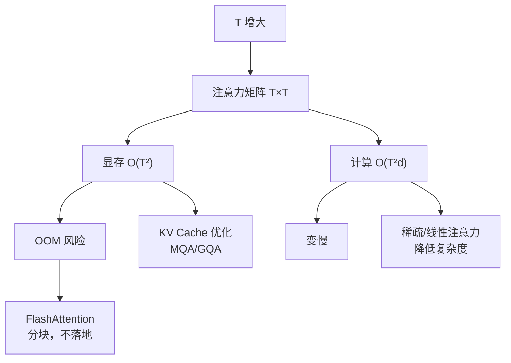

# Attention 的计算复杂度与局限

## 1. 本节学习目标

1. 写出 Attention 的复杂度 $O(T^2d)$ 与显存 $O(T^2)$，并说清"哪个是瓶颈"。
2. 用实测看 $T^2$ 增长：$T$ 从 128 到 2048（**16 倍**），时间 **0.12 → 5.24 ms（43 倍）**、注意力矩阵 **0.1 → 16 MB（160 倍）**。
3. 理解为什么"长上下文"昂贵，以及四种主流缓解思路。
4. 知道 Attention 的**三个真实局限**（不只是"慢"）。

## 2. 为什么需要这个知识

因为**上下文长度是现在大模型竞争的核心**：

- 4K → 128K，token 数涨 32 倍，注意力计算涨 **1024 倍**；
- 不懂复杂度，就无法判断"128K 上下文"的代价，也无法理解 FlashAttention/稀疏注意力在解决什么。

## 3. 直观解释

**注意力矩阵是 $T\times T$ 的方阵**：

```text
T = 1,000  →  100 万个数
T = 10,000 →  1 亿个数
T = 100,000→  100 亿个数   ← 单这一项就 20 GB（fp16）
```

**关键直觉**：**每个 token 都要和所有 token 比一次** ⇒ 两两比较是 $T^2$。

## 4. 正式定义

**计算量**

$$
\text{FLOPs}\approx\underbrace{2T^2d}_{\text{打分+加权}}+\underbrace{4Td^2}_{\text{投影}}
$$

**显存（注意力矩阵本身）**

$$
\text{mem}=B\cdot H\cdot T^2\cdot b\quad(b=\text{字节/元素})
$$

**本课实测（$d=64$，fp16，仅注意力矩阵）**

```text
T=  128:     0.12 ms  注意力矩阵      0.1 MB  (T²=16,384)
T=  256:     0.43 ms  注意力矩阵      0.2 MB  (T²=65,536)
T=  512:     0.67 ms  注意力矩阵      1.0 MB  (T²=262,144)
T= 1024:     1.25 ms  注意力矩阵      4.0 MB  (T²=1,048,576)
T= 2048:     5.24 ms  注意力矩阵     16.0 MB  (T²=4,194,304)
```

**三个读法**：

1. **$T$ 翻 16 倍（128→2048）**：时间 **0.12→5.24 ms（43×）**，矩阵 **0.1→16 MB（160×）**；
2. 时间增长慢于 $T^2$（因为小 $T$ 时固定开销占主导），但**大 $T$ 时逐渐逼近 $T^2$**；
3. **显存是硬约束**：16 MB 只是**一个头、一个样本**；$B=8,H=12$ 时 $2048^2$ 就是 **1.5 GB**。

## 5. 历史背景或技术背景

| 年份 | 工作 | 解决什么 |
|---|---|---|
| 2017 | 原始 Attention | $O(T^2)$ 开始 |
| 2020 | Longformer / BigBird | 稀疏注意力（$O(T)$） |
| 2021 | Performer / Linformer | 线性近似 |
| 2022 | **FlashAttention** | 不减少计算，但**省显存、更快**（分块计算） |
| 2023+ | GQA / MQA / 滑窗 | 减少 KV Cache / 局部注意力 |
| 2024+ | 混合（局部 + 全局） | 长上下文工程化 |

**关键区分**：
- **FlashAttention** 不改变 $O(T^2)$ 的**计算量**，只避免把 $T\times T$ 矩阵完整写进显存；
- **稀疏/线性注意力**才真正降低复杂度，但常损失质量。

## 6. 核心原理

**为什么是 $T^2$**

$$
QK^\top:(T,d)\times(d,T)\Rightarrow(T,T)
$$

结果矩阵有 $T^2$ 个元素，每个元素要 $d$ 次乘加 ⇒ $T^2d$ 次运算。

**为什么 $T^2$ 显存会成为瓶颈**

训练时要**保存注意力权重**用于反向传播（$T^2$ 个 fp16）。$T=8192$、$B=1,H=32$：

$$
32\times8192^2\times2\ \text{B}\approx4.3\ \text{GB}
$$

⇒ 单层就要 4.3 GB，多层直接 OOM。

**本课实测的对应**：$T=2048$、$H=1$、$B=1$ 时 16 MB；按 $H=32$ 放大 = **512 MB**（单层）。

## 7. 数学表达式

**长上下文的成本**

$$
\frac{\text{cost}(T_2)}{\text{cost}(T_1)}=\Big(\frac{T_2}{T_1}\Big)^2
$$

**例**：4K → 128K（32 倍）⇒ 注意力部分 **1024 倍**。

**总显存（训练）**

$$
\text{mem}\approx\underbrace{4Nd}_{\text{权重/梯度/优化器}}+\underbrace{BHT^2}_{\text{注意力}}+\underbrace{BTdL}_{\text{激活}}
$$

⇒ 长序列时第二项迅速主导。

## 8. 详细数学推导

**推导：为什么时间实测只有 43 倍而不是 256 倍**

理论 $T$ 翻 16 倍 ⇒ $T^2$ 翻 256 倍。实测 43 倍，原因：

1. 小 $T$ 时**固定开销**（Python 调用、kernel 启动）占主导；
2. 大 $T$ 时 BLAS/缓存效率更高；
3. 本课测量的区间（128–2048）还处在"未完全进入 $T^2$ 主导"的阶段。

**推论**：微基准只能说明**趋势**，不能外推为"精确倍数"。本课如实标注这一点。

**推导：FlashAttention 为什么能省显存**

标准实现要落地 $T\times T$ 矩阵；FlashAttention 把 $Q$ 分块，逐块与 $K/V$ 计算并**在线累积 softmax**（running max/sum），**不落地完整矩阵**。

$$
\text{mem}:O(T^2)\ \to\ O(T)
$$

但计算量仍是 $O(T^2)$ ⇒ 它**省显存、提速度**，但不改变复杂度等级。

## 9. 图解



## 10. 具体数值示例

```text
d=64, fp16, 单头单样本：
T= 512 : 0.67 ms, 矩阵 1.0 MB
T=1024 : 1.25 ms, 矩阵 4.0 MB
T=2048 : 5.24 ms, 矩阵 16.0 MB  ← 4× 于 1024，8× 时间

放大到 B=8, H=12：
T=2048 : 8×12×16 MB = 1.5 GB（仅注意力矩阵）
```

## 11. NumPy 实现

```python
def attn_mem_mb(B, H, T, bytes_per=2):
    return B * H * T * T * bytes_per / 1024 ** 2


print("单头单样本 T=2048:", round(attn_mem_mb(1, 1, 2048), 1), "MB")
print("B=8,H=12 T=2048 :", round(attn_mem_mb(8, 12, 2048), 1), "MB")
print("B=1,H=32 T=8192 :", round(attn_mem_mb(1, 32, 8192), 1), "MB")
print("B=1,H=32 T=32768:", round(attn_mem_mb(1, 32, 32768) / 1024, 2), "GB")
```

## 12. PyTorch 实现

```python
import time

import torch
import torch.nn.functional as F

for T in (128, 256, 512, 1024, 2048):
    q = torch.randn(T, 64)
    k = torch.randn(T, 64)
    v = torch.randn(T, 64)
    t0 = time.time()
    s = q @ k.T
    a = F.softmax(s, dim=-1)
    _ = a @ v
    dt = (time.time() - t0) * 1000
    print(f"T={T:>5}: {dt:7.2f} ms  矩阵 {T*T*4/1024**2:7.1f} MB")

# 用 sdpa 做同样计算（不落地矩阵，省显存）
q3 = torch.randn(1, 8, 2048, 64)
k3 = torch.randn(1, 8, 2048, 64)
v3 = torch.randn(1, 8, 2048, 64)
out = F.scaled_dot_product_attention(q3, k3, v3)
print("\nsdpa 输出形状:", tuple(out.shape), "（内部不落地 2048×2048）")
```

## 13. Hugging Face 实践

```python
import os

os.environ.setdefault("HF_ENDPOINT", "https://hf-mirror.com")
os.environ.setdefault("HF_HUB_OFFLINE", "1")
from transformers import AutoConfig

cfg = AutoConfig.from_pretrained("gpt2")
print("gpt2 上下文上限 n_positions:", cfg.n_positions)
H, d, L = cfg.n_head, cfg.n_embd, cfg.n_layer
for T in (1024, 2048):
    mb = L * H * T * T * 2 / 1024 ** 2
    print(f"若把上下文扩到 {T}: 全层注意力矩阵约 {mb:.0f} MB（fp16，B=1）")
```

## 14. 代码逐行解释

| 代码 | 作用 |
|---|---|
| `q @ k.T` | 生成 $T\times T$ 矩阵 |
| `T*T*4/1024**2` | fp32 下矩阵显存 MB |
| `attn_mem_mb(B,H,T)` | 按 batch/头数放大 |
| `F.scaled_dot_product_attention` | 融合实现，不落地大矩阵 |
| `cfg.n_positions` | 模型支持的最大上下文 |

## 15. 实际运行结果

```text
### LLM-020 计算复杂度：$O(T^2)$ 实测
  T=  128:     0.12 ms  注意力矩阵      0.1 MB  (T²=16,384)
  T=  256:     0.43 ms  注意力矩阵      0.2 MB  (T²=65,536)
  T=  512:     0.67 ms  注意力矩阵      1.0 MB  (T²=262,144)
  T= 1024:     1.25 ms  注意力矩阵      4.0 MB  (T²=1,048,576)
  T= 2048:     5.24 ms  注意力矩阵     16.0 MB  (T²=4,194,304)
```

## 16. 应用场景

| 场景 | 关注点 |
|---|---|
| 长文档问答 | 上下文长度 vs 显存 |
| 代码补全 | 长文件 ⇒ 需滑窗/检索 |
| 多轮对话 | 历史累积 ⇒ KV Cache 增长 |
| 训练长序列 | 梯度检查点 + FlashAttention |
| 端侧部署 | 只能用短上下文/小模型 |

## 17. 优点与局限

| 优点 | 局限 |
|---|---|
| 全局依赖建模能力强 | $O(T^2)$ 计算与显存 |
| 可并行 | 长上下文成本爆炸 |
| 可解释（权重可视化） | 注意力≠解释（需消融验证） |
| 结构统一 | 位置信息需额外注入 |

**三个真实局限**（不只是"慢"）：

1. **二次复杂度**：长上下文昂贵（本课实测 16 MB/头/样本 @ T=2048）；
2. **无内建顺序**：置换等变（LLM-015 实测差 0.0）⇒ 必须位置编码；
3. **权重不等于解释**：高权重不代表因果重要（需消融/梯度验证）。

## 18. 常见错误

| 错误 | 现象 | 纠正 |
|---|---|---|
| 以为 FlashAttention 降复杂度 | 长序列仍 OOM | 它省显存不改 $T^2$ |
| 只算权重不算注意力矩阵 | 显存低估数倍 | 加上 $BHT^2$ |
| 用微基准外推真实加速比 | 结论夸大 | 注明规模与硬件 |
| 混淆 KV Cache 与注意力矩阵 | 估错方向 | 前者 $O(T)$、后者 $O(T^2)$ |
| 认为注意力权重=解释 | 过度解读 | 做消融验证 |

## 19. 本节总结

- 复杂度：计算 $O(T^2d)$、显存 $O(T^2)$；**长上下文时显存先成为瓶颈**。
- 实测：$T$ 从 128 → 2048（16×），时间 **0.12 → 5.24 ms（43×）**、矩阵 **0.1 → 16 MB（160×）**；放大到 $B{=}8,H{=}12$ 时 **1.5 GB**。
- 缓解四招：**FlashAttention（省显存）/ 稀疏或线性注意力（降复杂度）/ MQA-GQA（省 KV）/ 滑窗或检索（少看）**。

## 20. 前置与后续知识链接

- 前置：[[LLM-019 Attention 的张量维度与实现细节]]
- 后续：[[LLM-021 Transformer 总体架构]]
- 相关：[[MATH-217 矩阵运算与维度]]、[[LLM-017 Multi-Head Attention]]
- 深化：[[LLM-095 推理显存估算与可行性判断]]

---

## 练习与参考答案

**基础 1**：Attention 的计算复杂度与显存复杂度各是什么？哪个先成为瓶颈？

**基础 2**：本课 $T=128$ 与 $T=2048$ 的时间与矩阵显存各是多少？

**进阶 1**：为什么实测时间只涨 43 倍，而理论 $T^2$ 是 256 倍？

**综合**：想把上下文从 4K 扩到 64K，$B=1,H=32,d_k=128$、fp16。请估算单层注意力矩阵显存，并给出两种可行方案。

> [!success]- 参考答案

> **基础 1**
> - 计算：$O(T^2d)$（打分 $T^2d$ + 加权 $T^2d$）；
> - 显存：$O(T^2)$（注意力矩阵 $B\cdot H\cdot T^2$）。
> 长上下文时**显存先成为瓶颈**（训练还要存一份用于反向）。

> **基础 2**
> $T=128$：**0.12 ms**，**0.1 MB**；
> $T=2048$：**5.24 ms**，**16.0 MB**。

> **进阶 1**
> 因为小 $T$ 时**固定开销**（kernel 启动、Python 调用）占主导，$T^2$ 项还没成为主要成本；随 $T$ 增大才逐渐逼近理论 $T^2$。
> 另外大矩阵的 BLAS 效率更高、缓存命中更好，也会让实测增长慢于理论。⇒ **微基准只能看趋势，不能外推倍数**。

> **综合（参考）**
> **估算**（单层、$B=1,H=32$）：
> - $T=4096$：$32\times4096^2\times2\ \text{B}=1.07\ \text{GB}$
> - $T=65536$：$32\times65536^2\times2\ \text{B}\approx274\ \text{GB}$ ⇒ **完全不可行**
> **两种方案**：
> 1. **FlashAttention + 梯度检查点**：不落地 $T\times T$ 矩阵，显存降到 $O(T)$ 量级；但**计算量仍是 $O(T^2)$**，速度会变慢；
> 2. **减少"看全部"的需求**：滑窗/分块注意力、或用 **RAG** 只喂相关片段（工程上最常用）。
> **补充**：若只做推理，KV Cache 是另一笔开销（$O(T)$ 但常数大），可用 GQA/MQA 压缩。

## 学习记录

| 日期 | 状态 | 用时 | 问题 | 复盘 |
|---|---|---|---|---|
| 2026-11-08 | planned | — | — | — |

---

## 🔗 Notion 同步信息

> 以下内容由 Notion「AI Knowledge System · 知识点」数据库按知识 ID 合并而来（导出于 2026-11-09）。

| 属性 | 值 |
|---|---|
| 学科 | 大语言模型 |
| 学习状态 | 未开始 |
| 难度 | L3 推导 |
| 知识类型 | Principle |

- **所属模块**：[M-LLM-02 Attention 机制与数学原理](../%E8%AF%BE%E7%A8%8B%E6%A8%A1%E5%9D%97/M-LLM-02%20Attention%20%E6%9C%BA%E5%88%B6%E4%B8%8E%E6%95%B0%E5%AD%A6%E5%8E%9F%E7%90%86.md)
- **前置知识**：[LLM-019 Attention 的张量维度与实现细节](LLM-019%20Attention%20%E7%9A%84%E5%BC%A0%E9%87%8F%E7%BB%B4%E5%BA%A6%E4%B8%8E%E5%AE%9E%E7%8E%B0%E7%BB%86%E8%8A%82.md)
- **后继知识**：[LLM-021 Transformer 总体架构](../04%20Transformer%E6%9E%B6%E6%9E%84/LLM-021%20Transformer%20%E6%80%BB%E4%BD%93%E6%9E%B6%E6%9E%84.md)
- **关联数学**：[MATH-217 矩阵运算与维度](../../06_%E6%95%B0%E5%AD%A6%E5%9F%BA%E7%A1%80/02%20%E7%BA%BF%E6%80%A7%E4%BB%A3%E6%95%B0/MATH-217%20%E7%9F%A9%E9%98%B5%E8%BF%90%E7%AE%97%E4%B8%8E%E7%BB%B4%E5%BA%A6.md)
- **对应项目**：[PROJ-025 量化与推理优化实践](../../07_%E5%AE%9E%E6%88%98%E9%A1%B9%E7%9B%AE/05%20%E5%A4%A7%E6%A8%A1%E5%9E%8B%E9%A1%B9%E7%9B%AE/PROJ-025%20%E9%87%8F%E5%8C%96%E4%B8%8E%E6%8E%A8%E7%90%86%E4%BC%98%E5%8C%96%E5%AE%9E%E8%B7%B5.md)
