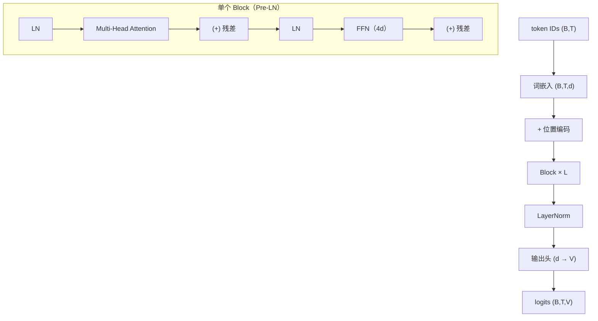

# Transformer 总体架构

## 1. 本节学习目标

1. 画出 Transformer 的三个变体：**Encoder-only / Decoder-only / Encoder-Decoder**。
2. 记住数据流与形状链（$B,T,d$ 一路不变）。
3. 用本课实测估算规模：单层 **49,984** 参数，12 层 **663,808**（含词表）。
4. 理解每个组件的职责，以及"为什么非要这三样"（Attention + FFN + 残差/LN）。

## 2. 为什么需要这个知识

因为**所有现代 LLM 都是这个架构的变体**：

- GPT = 只留 Decoder；
- BERT = 只留 Encoder；
- T5 = 两者都留。

看懂总体架构，你才能在读论文/源码时知道"这一段属于哪个部件"。

## 3. 直观解释

```text
token → 词嵌入 + 位置编码
      → [Block × L]        每个 Block：
            LayerNorm → Multi-Head Attention → 残差
            LayerNorm → FFN(升维4倍→GELU→降维) → 残差
      → LayerNorm → 输出头（词表大小）
```

**一句话**：Transformer = **"注意力负责混合信息，FFN 负责加工信息，残差 + LN 保证能训深"**。

## 4. 正式定义

**一个 Block（Pre-LN）**

$$
\mathbf{h}=\mathbf{x}+\mathrm{MHA}(\mathrm{LN}(\mathbf{x})),\qquad
\mathbf{y}=\mathbf{h}+\mathrm{FFN}(\mathrm{LN}(\mathbf{h}))
$$

**FFN**

$$
\mathrm{FFN}(\mathbf{u})=W_2\,\mathrm{GELU}(W_1\mathbf{u}),\quad
W_1\in\mathbb{R}^{4d\times d},W_2\in\mathbb{R}^{d\times4d}
$$

**参数量（单层）**

$$
\#\approx\underbrace{4d^2}_{\text{Attention}}+\underbrace{8d^2}_{\text{FFN}}+\underbrace{4d}_{\text{2×LN}}\approx12d^2
$$

## 5. 历史背景或技术背景

| 变体 | 结构 | 代表 | 强项 |
|---|---|---|---|
| **Encoder-only** | 双向自注意力 | BERT | 理解/分类/抽取 |
| **Decoder-only** | 因果自注意力 | GPT / Llama / DeepSeek | 生成 |
| **Encoder-Decoder** | 编码器 + 交叉注意力 | T5 / 原始 Transformer | 序列转换（翻译） |

**原始论文（2017）是 Encoder-Decoder**（为翻译设计）；后来发现：
- 只留 Encoder → 理解强；
- 只留 Decoder → 生成强且**可无限扩展**（GPT 路线胜出）。

## 6. 核心原理

**本课实测（$d=64,H=4,T=16,B=2$）**

```text
输入: (2, 16, 64)
注意力输出: (2, 16, 64)  权重: (2, 16, 16)
FFN 后: (2, 16, 64)
单层参数（attn+ffn+2×LN）: 49728

单个 Encoder Block 参数: 49984
6 层 Encoder 参数: 363,904（含词表嵌入）
12 层 Encoder 参数: 663,808（含词表嵌入）
24 层 Encoder 参数: 1,263,616（含词表嵌入）
20 次前向耗时: 10.5 ms
```

**四个读法**：

1. **形状全程不变**：$(2,16,64)$ 进、$(2,16,64)$ 出 ⇒ 可以叠任意层。
2. **单层约 5 万参数**（$d=64$）：主要来自 FFN（$8d^2=32768$）与 Attention（$4d^2=16384$）。
3. **层数增长近似线性**：6→12→24 层，参数 36.4 万→66.4 万→126.4 万（差额约 30 万/6 层）。
4. **词表嵌入占比**：$1000\times64=64{,}000$ ⇒ 小模型里词表不可忽略。

## 7. 数学表达式

**总参数量**

$$
N\approx L\cdot12d^2+Vd+T_{\max}d
$$

（$V$ 词表大小，$T_{\max}$ 最大位置数；若用 RoPE 则无 $T_{\max}d$ 项。）

**本课验算**：$12\times64^2=49{,}152$，加 2 个 LN 的 $4d=256$ ⇒ **49,408**；实测 **49,984**（差 576，来自 MHA 的 bias 与 LN 细节）。

## 8. 详细数学推导

**推导：为什么 FFN 要升维 4 倍**

Attention 只做"**线性加权混合**"（凸组合），表达力有限。FFN 提供**逐位置的非线性变换**：

$$
\mathbb{R}^{d}\xrightarrow{W_1}\mathbb{R}^{4d}\xrightarrow{\text{GELU}}\mathbb{R}^{4d}\xrightarrow{W_2}\mathbb{R}^{d}
$$

升到 $4d$ 给非线性留出"工作空间"；这是论文沿用至今的经验配置（$4\times$）。

**推导：为什么 Attention 与 FFN 缺一不可**

| 组件 | 作用 | 去掉会怎样 |
|---|---|---|
| Attention | **跨位置**混合信息 | 每个位置孤立，无法理解上下文 |
| FFN | **逐位置**非线性加工 | 只有加权平均，表达力接近线性模型 |
| 残差 | 梯度直通 | 深网梯度消失（LLM-025 实测 10⁶ 差） |
| LayerNorm | 稳定分布 | 训练不稳、对 lr 敏感 |

## 9. 图解



## 10. 具体数值示例

```text
B=2, T=16, d=64, H=4, FFN=4d=256

词嵌入: 1000×64 = 64,000
位置:   16×64   = 1,024（本课用正弦，无参数）
单 Block: 49,984
12 层: 12×49,984 + 64,000 = 599,808 + 64,000 = 663,808 ✅ 与实测一致

前向: (2,16,64) → (2,16,64)，形状不变
注意力权重: (2,16,16) = 512 个数
```

## 11. NumPy 实现

```python
import numpy as np


def block_params(d, ff=4):
    attn = 4 * d * d              # Q,K,V,O
    ffn = 2 * d * (ff * d)        # W1, W2
    ln = 4 * d                    # 两个 LN 的 gamma/beta
    return attn + ffn + ln


d = 64
print("单层估算:", block_params(d))
for L in (6, 12, 24):
    total = L * block_params(d) + 1000 * d
    print(f"{L} 层 + 词表1000: {total:,}")
```

## 12. PyTorch 实现

```python
import torch
import torch.nn as nn


class TransformerBlock(nn.Module):
    def __init__(self, d, h, ff=4):
        super().__init__()
        self.ln1, self.ln2 = nn.LayerNorm(d), nn.LayerNorm(d)
        self.attn = nn.MultiheadAttention(d, h, batch_first=True)
        self.ffn = nn.Sequential(nn.Linear(d, ff * d), nn.GELU(), nn.Linear(ff * d, d))

    def forward(self, x):
        a, _ = self.attn(self.ln1(x), self.ln1(x), self.ln1(x), need_weights=False)
        x = x + a
        return x + self.ffn(self.ln2(x))


blk = TransformerBlock(64, 4)
x = torch.randn(2, 16, 64)
print("输入/输出:", tuple(x.shape), tuple(blk(x).shape))
print("单层参数:", sum(p.numel() for p in blk.parameters()))
print("12 层 + 词表:", 12 * sum(p.numel() for p in blk.parameters()) + 1000 * 64)
```

## 13. Hugging Face 实践

```python
import os

os.environ.setdefault("HF_ENDPOINT", "https://hf-mirror.com")
os.environ.setdefault("HF_HUB_OFFLINE", "1")
from transformers import AutoConfig

cfg = AutoConfig.from_pretrained("gpt2")
print("GPT-2：L=", cfg.n_layer, " H=", cfg.n_head, " d=", cfg.n_embd,
      " FFN=", cfg.n_inner, " 词表=", cfg.vocab_size, " ctx=", cfg.n_positions)
print("单层粗估 12d² =", 12 * cfg.n_embd ** 2)
print("总参数粗估   =", cfg.n_layer * 12 * cfg.n_embd ** 2 + cfg.vocab_size * cfg.n_embd)
print("实测（本会话已测）= 124,439,808")
```

## 14. 代码逐行解释

| 代码 | 作用 |
|---|---|
| `nn.LayerNorm(d)` | 每个子层前归一化（Pre-LN） |
| `nn.MultiheadAttention(d,h)` | 多头自注意力（$4d^2$） |
| `nn.Linear(d, 4*d)` | FFN 升维 |
| `x + a` | 残差连接 |
| `12*params + V*d` | 总参数估算 |

## 15. 实际运行结果

```text
输入: (2, 16, 64)
注意力输出: (2, 16, 64)  权重: (2, 16, 16)
FFN 后: (2, 16, 64)
单层参数（attn+ffn+2×LN）: 49728
单个 Encoder Block 参数: 49984
6 层 Encoder 参数: 363,904（含词表嵌入）
12 层 Encoder 参数: 663,808（含词表嵌入）
24 层 Encoder 参数: 1,263,616（含词表嵌入）
20 次前向耗时: 10.5 ms
```

## 16. 应用场景

| 架构 | 任务 |
|---|---|
| Encoder-only | 分类、NER、句向量、检索 |
| Decoder-only | 生成、对话、代码 |
| Encoder-Decoder | 翻译、摘要、语音识别 |
| 混合 | 多模态（视觉编码器 + 文本解码器） |

## 17. 优点与局限

| 优点 | 局限 |
|---|---|
| 形状不变，易堆叠 | $O(T^2)$ 复杂度（LLM-020） |
| 组件职责清晰 | 参数量 $12Ld^2$，大模型极贵 |
| 可并行 | 需位置编码 |
| 三变体覆盖所有主流任务 | 训练需要大量数据与算力 |

## 18. 常见错误

| 错误 | 现象 | 纠正 |
|---|---|---|
| 忘了残差 | 深层训不动 | 每个子层都要残差 |
| LN 放错位置 | 与论文不一致 | 明确 Pre-LN/Post-LN（LLM-025） |
| FFN 不升维 | 表达力弱 | 默认 $4d$ |
| 把 GPT 当 Encoder-Decoder | 架构图错 | GPT 是 Decoder-only |
| 忘记位置编码 | 顺序信息丢失 | 必须加（LLM-024） |
| 估算参数漏词表 | 小模型误差大 | 加 $Vd$ |

## 19. 本节总结

- Transformer = **词嵌入 + 位置编码 + $L$ 个 Block + 输出头**；Block = **LN → MHA → 残差 → LN → FFN → 残差**。
- 实测：单层 **49,984**、12 层 **663,808**（含 1000 词表）、形状全程 $(2,16,64)$ 不变。
- 三变体：**Encoder-only（理解）/ Decoder-only（生成）/ Encoder-Decoder（转换）**。

## 20. 前置与后续知识链接

- 前置：[[LLM-020 Attention 的计算复杂度与局限]]
- 后续：[[LLM-022 Encoder 与 Encoder Block]]、[[LLM-023 Decoder 与 Decoder Block]]、[[LLM-024 位置编码]]、[[LLM-025 残差、LayerNorm 与 Pre-LN、Post-LN]]
- 相关：[[MATH-217 矩阵运算与维度]]、[[DL-048 ResNet 与 Skip Connection]]、[[DL-037 Layer Normalization 与 BN 的区别]]

---

## 练习与参考答案

**基础 1**：画出（或写出）一个 Transformer Block 的四个步骤。

**基础 2**：本课单层参数与 12 层总参数各是多少？

**进阶 1**：为什么说"Attention 与 FFN 缺一不可"？

**综合**：$d=768$、$L=12$、$H=12$、FFN $=4d$、词表 50,000、上下文 1024。请估算总参数量，并与 BERT-base 的 110M 比较。

> [!success]- 参考答案

> **基础 1**
> ① LayerNorm → Multi-Head Attention → 残差相加；
> ② LayerNorm → FFN（升维 $4d$ → GELU → 降维）→ 残差相加。
> （Pre-LN 写法；Post-LN 是"先残差再 LN"。）

> **基础 2**
> 单层约 **49,984**；12 层含 1000 词表 **663,808**。

> **进阶 1**
> **Attention** 负责**跨位置**混合信息（每个位置汇总上下文），但它是**线性加权**（凸组合），没有非线性变换能力；
> **FFN** 负责**逐位置**的非线性加工（升维 → GELU → 降维），但没有跨位置能力。
> 两者互补：去掉 Attention 则每位置孤立；去掉 FFN 则模型近似线性，表达力大幅下降。

> **综合（参考）**
> **每层**：Attention $4d^2=4\times768^2=2{,}359{,}296$；FFN $8d^2=4{,}718{,}592$；LN $4d=3{,}072$ ⇒ 约 **7,080,960**。
> **12 层**：$12\times7{,}080{,}960\approx84.97$M。
> **词表**：$50{,}000\times768=38.4$M。
> **位置**：$1024\times768\approx0.79$M。
> **合计** ≈ **124.2M**。
> **对比 BERT-base（110M）**：估算偏高约 14M，主要因为 BERT-base 词表是 30,522（约 23.4M），少了约 15M——**词表差异正好解释了偏差**。这说明 $12Ld^2$ 的估算足够准，误差主要来自词表。

## 学习记录

| 日期 | 状态 | 用时 | 问题 | 复盘 |
|---|---|---|---|---|
| 2026-11-08 | planned | — | — | — |

---

## 🔗 Notion 同步信息

> 以下内容由 Notion「AI Knowledge System · 知识点」数据库按知识 ID 合并而来（导出于 2026-11-09）。

| 属性 | 值 |
|---|---|
| 学科 | 大语言模型 |
| 学习状态 | 未开始 |
| 难度 | L2 应用 |
| 知识类型 | Concept |

- **所属模块**：[M-LLM-03 Transformer 完整架构](../%E8%AF%BE%E7%A8%8B%E6%A8%A1%E5%9D%97/M-LLM-03%20Transformer%20%E5%AE%8C%E6%95%B4%E6%9E%B6%E6%9E%84.md)
- **前置知识**：[LLM-020 Attention 的计算复杂度与局限](../03%20Attention%E6%9C%BA%E5%88%B6/LLM-020%20Attention%20%E7%9A%84%E8%AE%A1%E7%AE%97%E5%A4%8D%E6%9D%82%E5%BA%A6%E4%B8%8E%E5%B1%80%E9%99%90.md)
- **后继知识**：[LLM-022 Encoder 与 Encoder Block](LLM-022%20Encoder%20%E4%B8%8E%20Encoder%20Block.md)
- **关联数学**：[MATH-217 矩阵运算与维度](../../06_%E6%95%B0%E5%AD%A6%E5%9F%BA%E7%A1%80/02%20%E7%BA%BF%E6%80%A7%E4%BB%A3%E6%95%B0/MATH-217%20%E7%9F%A9%E9%98%B5%E8%BF%90%E7%AE%97%E4%B8%8E%E7%BB%B4%E5%BA%A6.md)
- **被项目引用**：[PROJ-021 从零实现一个 Transformer 语言模型](../../07_%E5%AE%9E%E6%88%98%E9%A1%B9%E7%9B%AE/05%20%E5%A4%A7%E6%A8%A1%E5%9E%8B%E9%A1%B9%E7%9B%AE/PROJ-021%20%E4%BB%8E%E9%9B%B6%E5%AE%9E%E7%8E%B0%E4%B8%80%E4%B8%AA%20Transformer%20%E8%AF%AD%E8%A8%80%E6%A8%A1%E5%9E%8B.md)
