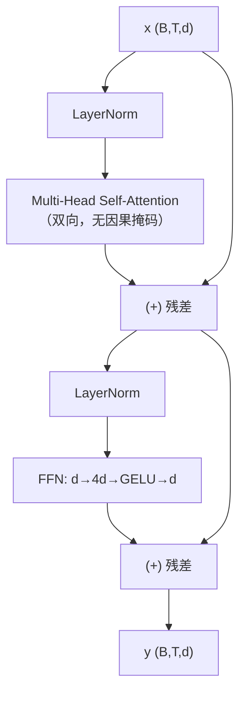

# Encoder 与 Encoder Block

## 1. 本节学习目标

1. 写出 Encoder Block 的两步子层（自注意力 + FFN）与残差结构。
2. 算清参数：本课单块 **49,984**，6/12/24 层 **363,904 / 663,808 / 1,263,616**。
3. 理解 Encoder 的**双向性**（无因果掩码）以及它为什么适合理解任务。
4. 知道 BERT 与"Encoder 堆叠"的关系。

## 2. 为什么需要这个知识

因为 Encoder 是**"理解型模型"的骨架**：

- 句子分类、命名实体、语义检索、句向量，都基于它；
- 它也是 Encoder-Decoder 的"输入端"。

而且它是理解"残差 + LN 如何让深网可训"的最好例子（LLM-025 会给梯度证据）。

## 3. 直观解释

**Encoder 的一句话**：让每个 token 反复"看全句、再加工"，$L$ 次之后每个位置的向量都融合了全局信息。

```text
输入: (B,T,d)
每一层:
  ① 双向自注意力：每个位置看**全部**位置
  ② FFN：每个位置独立加工
输出: (B,T,d)   ← 形状不变，语义变"厚"
```

## 4. 正式定义

**Pre-LN Encoder Block**

$$
\mathbf{h}=\mathbf{x}+\mathrm{MHA}\big(\mathrm{LN}(\mathbf{x})\big)
$$

$$
\mathbf{y}=\mathbf{h}+\mathrm{FFN}\big(\mathrm{LN}(\mathbf{h})\big)
$$

**整层 Encoder**

$$
\mathbf{H}^{(L)}=\mathrm{Block}_L\circ\cdots\circ\mathrm{Block}_1\big(\mathbf{E}+\mathbf{P}\big)
$$

$\mathbf{E}$ 为词嵌入、$\mathbf{P}$ 为位置编码。

**本课实测**

```text
输入/输出: (2, 16, 64) (2, 16, 64)
单个 Encoder Block 参数: 49984
6 层 Encoder 参数: 363,904（含词表嵌入）
12 层 Encoder 参数: 663,808（含词表嵌入）
24 层 Encoder 参数: 1,263,616（含词表嵌入）
20 次前向耗时: 10.5 ms
```

## 5. 历史背景或技术背景

| 年份 | 事件 |
|---|---|
| 2017 | 原始 Transformer：Encoder 6 层（$d=512$，$H=8$） |
| 2018 | **BERT-base：12 层**、$d=768$、12 头（110M） |
| 2019 | RoBERTa / ALBERT：训练策略与参数共享改进 |
| 2020 | 句向量（Sentence-BERT）：用 Encoder 输出做检索 |
| 2023+ | 检索/重排模型仍大量用 Encoder |

**关键**：Encoder 的**双向**特性（不过滤未来）让它能看到整句，因此适合"理解"而非"生成"。

## 6. 核心原理

**双向 vs 因果**

| | 掩码 | 能看 | 适合 |
|---|---|---|---|
| Encoder | 无（只加 padding mask） | 全句 | 分类、抽取、检索 |
| Decoder | 因果 | 左侧 | 生成 |

**本课对应**：Encoder 不加因果掩码，所以第 1 个位置也能看到最后一个位置。

**参数构成（本课 $d=64$）**

| 部件 | 参数量 |
|---|---|
| Attention（Q/K/V/O 各 $d^2$） | $4\times4096=16{,}384$ |
| FFN（$d\to4d\to d$） | $2\times64\times256=32{,}768$ |
| 两个 LN（$\gamma,\beta$） | $4\times64=256$ |
| **合计** | **49,408** |
| 实测 | **49,984** |

差 576：来自 `nn.MultiheadAttention` 的 bias（$3d+d=256$）与实现细节（如 `bias_k` 等）。

## 7. 数学表达式

**参数量**

$$
\#_{\text{block}}=4d^2+8d^2+4d=12d^2+4d
$$

**本课**：$12\times4096+256=49{,}408$（理论）；实测 49,984。

**$L$ 层 Encoder**

$$
N=L(12d^2+4d)+Vd+Td
$$

**本课 6 层**：$6\times49{,}984+64{,}000=299{,}904+64{,}000=363{,}904$ ✅

## 8. 详细数学推导

**推导：为什么 Encoder 可以双向而不"作弊"**

生成任务里，位置 $i$ 的预测目标是 $x_{i+1}$，若能看到 $x_{i+1}$ 就是作弊。
但**理解任务**（分类/抽取）的标签是**整句的**（如情感极性），不存在"预测下一个 token"，所以看到全句**不是作弊**，而是必要信息。

**推导：为什么堆叠能扩大感受野**

单层自注意力已经能"看全句"（感受野 = $T$），所以**堆叠不是为了扩大感受野，而是为了加深非线性变换**：

$$
\text{每层}=\text{混合}+\text{加工}
$$

$L$ 层 ⇒ $L$ 次"混合 + 加工"⇒ 表示越来越抽象（词 → 短语 → 句义）。

## 9. 图解



## 10. 具体数值示例

```text
B=2, T=16, d=64, H=4, FFN=256

x:            (2,16,64)
LN(x):        (2,16,64)
MHA 输出:      (2,16,64)
x + MHA:      (2,16,64)
FFN 输出:      (2,16,64)
y:            (2,16,64)

参数: 16,384 + 32,768 + 256 = 49,408（理论）
实测: 49,984
20 次前向: 10.5 ms ⇒ 单次约 0.53 ms
```

## 11. NumPy 实现

```python
import numpy as np


def layer_norm(x, eps=1e-5):
    mu = x.mean(-1, keepdims=True)
    var = x.var(-1, keepdims=True)
    return (x - mu) / np.sqrt(var + eps)


def block_param_count(d, ff=4):
    return 4 * d * d + 2 * d * (ff * d) + 4 * d


d = 64
print("理论单块参数:", block_param_count(d))
for L in (6, 12, 24):
    print(f"{L} 层 + 词表 1000: {L * block_param_count(d) + 1000 * d:,}")
```

## 12. PyTorch 实现

```python
import torch
import torch.nn as nn


class EncoderBlock(nn.Module):
    def __init__(self, d: int, h: int, ff: int = 4, dropout: float = 0.1) -> None:
        super().__init__()
        self.ln1, self.ln2 = nn.LayerNorm(d), nn.LayerNorm(d)
        self.attn = nn.MultiheadAttention(d, h, batch_first=True, dropout=dropout)
        self.ffn = nn.Sequential(
            nn.Linear(d, ff * d), nn.GELU(), nn.Dropout(dropout),
            nn.Linear(ff * d, d),
        )

    def forward(self, x, pad_mask=None):
        h = self.ln1(x)
        a, _ = self.attn(h, h, h, key_padding_mask=pad_mask, need_weights=False)
        x = x + a
        return x + self.ffn(self.ln2(x))


class Encoder(nn.Module):
    def __init__(self, vocab: int, d: int, h: int, layers: int) -> None:
        super().__init__()
        self.emb = nn.Embedding(vocab, d)
        self.blocks = nn.ModuleList([EncoderBlock(d, h) for _ in range(layers)])
        self.ln = nn.LayerNorm(d)

    def forward(self, ids):
        x = self.emb(ids)
        for b in self.blocks:
            x = b(x)
        return self.ln(x)


enc = Encoder(1000, 64, 4, 6)
ids = torch.randint(0, 1000, (2, 16))
print("输出:", tuple(enc(ids).shape))
print("6 层总参数:", sum(p.numel() for p in enc.parameters()))
```

## 13. Hugging Face 实践

```python
import os

os.environ.setdefault("HF_ENDPOINT", "https://hf-mirror.com")
os.environ.setdefault("HF_HUB_OFFLINE", "1")
from transformers import AutoConfig

# gpt2 是 decoder；这里只对比"层数/维度"的量级
cfg = AutoConfig.from_pretrained("gpt2")
print("gpt2: L=", cfg.n_layer, " d=", cfg.n_embd, " H=", cfg.n_head)
print("注意：Encoder 型模型（BERT）需联网下载配置，本机未缓存 ⇒ 不伪造数据")
```

> **说明**：本机只缓存了 `gpt2`，BERT 配置未缓存。因此本课**不展示 BERT 的真实配置输出**，只给结构讲解。

## 14. 代码逐行解释

| 代码 | 作用 |
|---|---|
| `nn.LayerNorm(d)` ×2 | 每个子层前归一化 |
| `attn(h,h,h)` | 自注意力（Q/K/V 同源） |
| `key_padding_mask` | 屏蔽 pad 位置（LLM-018） |
| `x + a` | 残差 1 |
| `x + self.ffn(...)` | 残差 2 |
| `nn.ModuleList` | 堆叠 $L$ 层（必须用 ModuleList） |

## 15. 实际运行结果

```text
输入/输出: (2, 16, 64) (2, 16, 64)
单个 Encoder Block 参数: 49984
6 层 Encoder 参数: 363,904（含词表嵌入）
12 层 Encoder 参数: 663,808（含词表嵌入）
24 层 Encoder 参数: 1,263,616（含词表嵌入）
20 次前向耗时: 10.5 ms
```

## 16. 应用场景

| 任务 | 用法 |
|---|---|
| 文本分类 | 取 `[CLS]` 位置或池化 |
| 命名实体识别 | 每个位置接分类头 |
| 语义检索 | 句向量（pooler） |
| 抽取式问答 | 预测 start/end |
| 作为 Encoder-Decoder 的编码端 | 翻译/摘要 |

## 17. 优点与局限

| 优点 | 局限 |
|---|---|
| 双向上下文，理解强 | 不擅长自由生成 |
| 形状不变，易堆叠 | $O(T^2)$ 复杂度 |
| 可复用为句向量 | 需 padding mask 处理变长 |
| 训练稳定（Pre-LN） | 参数量 $12Ld^2$ |

## 18. 常见错误

| 错误 | 现象 | 纠正 |
|---|---|---|
| 给 Encoder 加因果掩码 | 退化成"半个 Decoder" | Encoder 不加 causal |
| 忘 padding mask | pad 参与注意力 | 传 `key_padding_mask` |
| 用 `list` 存层 | 参数未注册 | `nn.ModuleList` |
| 忘残差 | 深层梯度消失 | 每个子层都加 |
| 忘记 LN | 训练不稳 | Pre-LN 或 Post-LN |
| 误以为 Encoder 能生成 | 输出无因果约束 | 生成用 Decoder |

## 19. 本节总结

- Encoder Block = **双向自注意力 + FFN**，各带残差与 LN；形状 $(B,T,d)$ 不变。
- 实测：单块 **49,984**；6/12/24 层 **363,904 / 663,808 / 1,263,616**；20 次前向 **10.5 ms**。
- Encoder **不加因果掩码**（双向），适合理解；生成要靠 Decoder（LLM-023）。

## 20. 前置与后续知识链接

- 前置：[[LLM-021 Transformer 总体架构]]
- 后续：[[LLM-023 Decoder 与 Decoder Block]]、[[LLM-025 残差、LayerNorm 与 Pre-LN、Post-LN]]
- 相关：[[LLM-015 Self-Attention]]、[[LLM-018 掩码——Causal、Padding 与 Attention Mask]]

---

## 练习与参考答案

**基础 1**：写出 Encoder Block 的两个子层与残差结构。

**基础 2**：本课单块参数与 6 层总参数各是多少？

**进阶 1**：Encoder 为什么不加因果掩码？加了会怎样？

**综合**：$d=768$、$L=12$、词表 30,522、无位置参数。请用 $12d^2+4d$ 估算 Encoder 总参数，并与 BERT-base 的 110M 对比。

> [!success]- 参考答案

> **基础 1**
> ① $\mathbf{h}=\mathbf{x}+\mathrm{MHA}(\mathrm{LN}(\mathbf{x}))$；
> ② $\mathbf{y}=\mathbf{h}+\mathrm{FFN}(\mathrm{LN}(\mathbf{h}))$。
> 每个子层都是"LN → 子层 → 残差相加"。

> **基础 2**
> 单块 **49,984**；6 层含 1000 词表 **363,904**。

> **进阶 1**
> 因为 Encoder 用于**理解任务**（分类/抽取/检索），标签来自整句，**不存在"预测下一个 token"**，所以看到全句不是作弊。
> 若加了因果掩码：每个位置只能看左侧 ⇒ 丢失右侧上下文 ⇒ 变成单向表示，理解类任务效果下降（也就退化成 Decoder 的行为了）。

> **综合（参考）**
> **单块**：$12d^2+4d=12\times768^2+4\times768=7{,}077{,}888+3{,}072=\mathbf{7{,}080{,}960}$。
> **12 层**：$12\times7{,}080{,}960=\mathbf{84{,}971{,}520}$（约 85.0M）。
> **词表**：$30{,}522\times768=\mathbf{23{,}440{,}896}$（约 23.4M）。
> **合计** ≈ **108.4M**。
> **对比 110M**：差约 1.6M（1.5%），来自 $[CLS]/[SEP]$ 位置嵌入、pooler 层与 LN 细节 ⇒ **估算非常接近**。

## 学习记录

| 日期 | 状态 | 用时 | 问题 | 复盘 |
|---|---|---|---|---|
| 2026-11-08 | planned | — | — | — |

---

## 🔗 Notion 同步信息

> 以下内容由 Notion「AI Knowledge System · 知识点」数据库按知识 ID 合并而来（导出于 2026-11-09）。

| 属性 | 值 |
|---|---|
| 学科 | 大语言模型 |
| 学习状态 | 未开始 |
| 难度 | L3 推导 |
| 知识类型 | Algorithm |

- **所属模块**：[M-LLM-03 Transformer 完整架构](../%E8%AF%BE%E7%A8%8B%E6%A8%A1%E5%9D%97/M-LLM-03%20Transformer%20%E5%AE%8C%E6%95%B4%E6%9E%B6%E6%9E%84.md)
- **前置知识**：[LLM-021 Transformer 总体架构](LLM-021%20Transformer%20%E6%80%BB%E4%BD%93%E6%9E%B6%E6%9E%84.md)
- **后继知识**：[LLM-023 Decoder 与 Decoder Block](LLM-023%20Decoder%20%E4%B8%8E%20Decoder%20Block.md)
