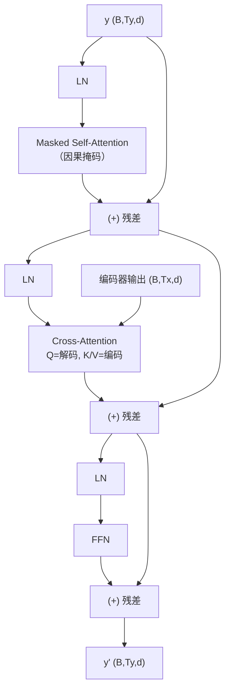

# Decoder 与 Decoder Block

## 1. 本节学习目标

1. 说清 Decoder Block 的**三个子层**（掩码自注意力 / 交叉注意力 / FFN）。
2. 用实测确认形状：解码 $(2,4,64)$、编码 $(2,6,64)$ ⇒ Cross 权重 $(2,4,6)$、输出 $(2,4,64)$。
3. 算清参数：本课 Decoder Block **66,752**，是 Encoder Block 的 **1.34 倍**。
4. 理解"Decoder-only 为什么能取代 Encoder-Decoder"。

## 2. 为什么需要这个知识

因为 **GPT/Llama/DeepSeek 全是 Decoder-only**——今天你用的所有大模型，都是这个 Block 堆出来的。

而"掩码自注意力 + 交叉注意力"的差别，正是"理解源句"与"生成目标句"的分界线。

## 3. 直观解释

```text
Encoder Block：看全句 → 加工
Decoder Block：看左边（不能看未来）→ 看编码器（源句）→ 加工
```

| 子层 | Q 来自 | K/V 来自 | 掩码 |
|---|---|---|---|
| 掩码自注意力 | 目标序列 | 目标序列 | **因果** |
| 交叉注意力 | 目标序列 | **源序列** | 通常无（源全可见） |
| FFN | — | — | — |

## 4. 正式定义

$$
\mathbf{h}_1=\mathbf{y}+\mathrm{MaskedMHA}\big(\mathrm{LN}(\mathbf{y})\big)
$$

$$
\mathbf{h}_2=\mathbf{h}_1+\mathrm{CrossMHA}\big(\mathrm{LN}(\mathbf{h}_1),\ \mathbf{H}^{\text{enc}}\big)
$$

$$
\mathbf{y}'=\mathbf{h}_2+\mathrm{FFN}\big(\mathrm{LN}(\mathbf{h}_2)\big)
$$

**本课实测**

```text
编码器输出: (2, 6, 64)  解码输入: (2, 4, 64)
解码输出: (2, 4, 64)  Cross 权重: (2, 4, 6)
Decoder Block 参数: 66752
Encoder vs Decoder 参数比: 1.34
```

**读法**：

1. 源长 6、目标长 4 ⇒ **Cross 权重 $(2,4,6)$**（矩形，非方阵）。
2. 解码输出仍是 $(2,4,64)$ ⇒ 关注源句**不改变目标长度**。
3. 参数 **66,752 ≈ 1.34 × 49,984**（多的就是那套 Cross 投影）。

## 5. 历史背景或技术背景

| 年份 | 事件 |
|---|---|
| 2017 | 原始 Transformer Decoder：3 子层 × 6 层 |
| 2018 | GPT-1：**只用 Decoder**（去掉 Cross，保留因果自注意力） |
| 2019 | GPT-2：证明 Decoder-only 可做零样本多任务 |
| 2020 | GPT-3：175B，Decoder-only 成为主流 |
| 2023+ | Llama/DeepSeek：全部 Decoder-only（+ RoPE + SwiGLU） |

**关键转折**：**去掉 Cross 后，Decoder 不再需要"源序列"**，于是可以拿**任意文本**训练（下一 token 预测）——这是"用海量数据预训练"的前提。

## 6. 核心原理

**为什么 Decoder-only 能赢**

| 维度 | Encoder-Decoder | Decoder-only |
|---|---|---|
| 训练信号 | 需要配对数据（翻译） | **任意文本**（自监督） |
| 参数量分配 | 编码器占一半 | 全部给生成 |
| 推理 | 两段式 | 单段 |
| 扩展性 | 受配对数据限制 | 可无限扩数据 |

⇒ 当"数据规模"成为瓶颈时，Decoder-only 的**自监督优势**决定性胜出。

**代价**：没有独立的"源句编码"，只能把源信息拼进 prompt ⇒ 长上下文压力更大（这就是 RAG 与长上下文技术的动机）。

## 7. 数学表达式

**参数量**

$$
\#_{\text{dec}}=12d^2+4d\ (\text{自注意力+FFN+2LN})+4d^2\ (\text{Cross})+2d\ (\text{LN})
$$

**本课**：Encoder 49,984 + Cross（$4d^2+2d=16{,}384+128=16{,}512$）≈ **66,496**；实测 **66,752**。

**比值**

$$
\frac{66{,}752}{49{,}984}\approx1.34
$$

## 8. 详细数学推导

**推导：为什么 Cross 的 K/V 不需要因果掩码**

Cross 的 K/V 来自**源序列**（已完整给出）。生成目标第 $t$ 步时，源句是**已知输入**，不是"未来"，所以无需掩码；只需 **padding mask**（屏蔽源句补零）。

**推导：为什么 Decoder 必须掩码自注意力**

训练时并行预测所有位置：若位置 $i$ 能看到 $j>i$，就能直接读到 $x_{i+1}$（答案）⇒ 训练 loss 极低但推理崩（LLM-018 实测用 0 掩码时泄漏权重 **0.2783**）。

**推导：位置编码在 Decoder 里更重要**

Decoder-only 无 Cross，"源信息"全在 prompt 里 ⇒ 顺序信息全靠位置编码（LLM-024）。

## 9. 图解



## 10. 具体数值示例

```text
B=2, Ty=4, Tx=6, d=64, H=4

y:            (2,4,64)
掩码自注意力:  (2,4,64)
Cross 权重:    (2,4,6)   ← 4 个查询 × 6 个源位置
Cross 输出:    (2,4,64)
FFN 后:        (2,4,64)

参数: Encoder 49,984 + Cross 约 16,512 ⇒ 66,496（实测 66,752）
```

## 11. NumPy 实现

```python
import numpy as np


def masked_softmax(s, mask=None):
    if mask is not None:
        s = np.where(mask, -np.inf, s)
    e = np.exp(s - s.max(-1, keepdims=True))
    return e / e.sum(-1, keepdims=True)


Ty, Tx, d = 4, 6, 64
y = np.random.default_rng(0).normal(size=(Ty, d))
enc = np.random.default_rng(1).normal(size=(Tx, d))
Wq, Wk, Wv = (np.random.default_rng(i).normal(size=(d, d)) * 0.1 for i in range(3))

# 掩码自注意力
s1 = y @ Wq @ (y @ Wk).T / np.sqrt(d)
causal = np.triu(np.ones((Ty, Ty), dtype=bool), 1)
a1 = masked_softmax(s1, causal)
print("自注意力权重:", a1.shape, " 上三角最大:", float(np.where(causal, a1, 0).max()))

# Cross
s2 = y @ Wq @ (enc @ Wk).T / np.sqrt(d)
a2 = masked_softmax(s2)
print("Cross 权重:", a2.shape, " 行和:", a2.sum(1).round(4))
print("Cross 输出:", (a2 @ (enc @ Wv)).shape)
```

## 12. PyTorch 实现

```python
import torch
import torch.nn as nn


class DecoderBlock(nn.Module):
    def __init__(self, d: int, h: int, ff: int = 4) -> None:
        super().__init__()
        self.ln1, self.ln2, self.ln3 = (nn.LayerNorm(d) for _ in range(3))
        self.self_attn = nn.MultiheadAttention(d, h, batch_first=True)
        self.cross_attn = nn.MultiheadAttention(d, h, batch_first=True)
        self.ffn = nn.Sequential(nn.Linear(d, ff * d), nn.GELU(), nn.Linear(ff * d, d))

    def forward(self, y, enc):
        Ty = y.size(1)
        causal = torch.triu(torch.ones(Ty, Ty, dtype=torch.bool), 1)
        h = self.ln1(y)
        a, _ = self.self_attn(h, h, h, attn_mask=causal, need_weights=False)
        y = y + a
        c, w = self.cross_attn(self.ln2(y), enc, enc, need_weights=True)
        y = y + c
        return y + self.ffn(self.ln3(y)), w


dec = DecoderBlock(64, 4)
out, w = dec(torch.randn(2, 4, 64), torch.randn(2, 6, 64))
print("输出:", tuple(out.shape), " Cross 权重:", tuple(w.shape))
print("参数:", sum(p.numel() for p in dec.parameters()))
```

## 13. Hugging Face 实践

```python
import os

os.environ.setdefault("HF_ENDPOINT", "https://hf-mirror.com")
os.environ.setdefault("HF_HUB_OFFLINE", "1")
import torch
from transformers import AutoModelForCausalLM, AutoTokenizer

tok = AutoTokenizer.from_pretrained("gpt2")
m = AutoModelForCausalLM.from_pretrained(
    "gpt2", attn_implementation="eager").eval()

# GPT-2 的 Decoder 只有"掩码自注意力"，没有 Cross
print("gpt2 的层结构（前 2 层）:")
for i, layer in enumerate(m.transformer.h[:2]):
    names = [n for n, _ in layer.named_children()]
    print(f"  layer {i}: {names}")

ids = tok("The cat sat", return_tensors="pt")
with torch.no_grad():
    out = m(**ids, output_attentions=True)
print("注意力上三角全 0（因果）:",
      bool((torch.triu(out.attentions[0][0, 0], diagonal=1) == 0).all()))
```

## 14. 代码逐行解释

| 代码 | 作用 |
|---|---|
| `self_attn(..., attn_mask=causal)` | 掩码自注意力（禁未来） |
| `cross_attn(q=解码, k=v=编码)` | 交叉注意力（源全可见） |
| `x + a` / `y + c` | 每个子层都残差 |
| `nn.LayerNorm` ×3 | 三个子层各一 |
| `layer.named_children()` | 看真实 GPT 层结构 |

## 15. 实际运行结果

```text
编码器输出: (2, 6, 64)  解码输入: (2, 4, 64)
解码输出: (2, 4, 64)  Cross 权重: (2, 4, 6)
Decoder Block 参数: 66752
Encoder vs Decoder 参数比: 1.34
```

## 16. 应用场景

| 场景 | Decoder 用法 |
|---|---|
| 机器翻译 | Encoder-Decoder（带 Cross） |
| 文本生成 | Decoder-only（无 Cross） |
| 对话 | Decoder-only |
| 语音识别 | Encoder-Decoder（音频 → 文本） |
| 图像描述 | 视觉编码器 + 文本 Decoder（Cross） |

## 17. 优点与局限

| 优点 | 局限 |
|---|---|
| 生成能力强（自回归） | 训练需因果掩码（写错即泄漏） |
| Decoder-only 可用任意文本训练 | 无独立编码 ⇒ 长 prompt 代价高 |
| Cross 可引入外部信息 | 每层多一套 Cross 参数（+34%） |

## 18. 常见错误

| 错误 | 现象 | 纠正 |
|---|---|---|
| 忘因果掩码 | 训练 loss 假低 | 必须掩（LLM-018） |
| Cross 也加因果掩码 | 看不到完整源句 | Cross 只加 padding mask |
| 以为 GPT 有 Cross | 架构图画错 | Decoder-only 无 Cross |
| 掩码方向反 | 只能看未来 | 上三角为 $-\infty$ |
| 位置编码漏掉 | 顺序乱 | Decoder 尤其需要 |

## 19. 本节总结

- Decoder Block = **掩码自注意力 + 交叉注意力 + FFN**，三处残差 + 三个 LN。
- 实测：源 6 / 目标 4 ⇒ Cross 权重 **$(2,4,6)$**、输出 **$(2,4,64)$**；参数 **66,752**（Encoder 的 **1.34 倍**）。
- Decoder-only 去掉 Cross ⇒ 可用**任意文本**自监督训练 ⇒ 这是 GPT 路线胜出的关键。

## 20. 前置与后续知识链接

- 前置：[[LLM-022 Encoder 与 Encoder Block]]
- 后续：[[LLM-024 位置编码]]、[[LLM-025 残差、LayerNorm 与 Pre-LN、Post-LN]]
- 相关：[[LLM-016 Cross-Attention]]、[[LLM-018 掩码——Causal、Padding 与 Attention Mask]]

---

## 练习与参考答案

**基础 1**：Decoder Block 有哪三个子层？各自的 Q/K/V 来源是什么？

**基础 2**：本课 Cross 权重的形状与 Decoder Block 参数各是多少？

**进阶 1**：为什么 Cross-Attention 不需要因果掩码，而自注意力必须加？

**综合**：一个翻译模型：源 20、目标 12、$d=512$、$H=8$、$L=6$。请估算 Decoder 每层参数量，并说明推理时如何加速。

> [!success]- 参考答案

> **基础 1**
> ① **掩码自注意力**：Q/K/V 都来自目标序列（加因果掩码）；
> ② **交叉注意力**：Q 来自目标序列，K/V 来自编码器输出（只加 padding mask）；
> ③ **FFN**：逐位置变换。
> 每个子层都带残差 + LayerNorm。

> **基础 2**
> Cross 权重 **$(2,4,6)$**（batch 2、目标 4、源 6）；Decoder Block **66,752** 参数。

> **进阶 1**
> 因为 Cross 的 K/V 是**源句**，它是**已经完整给出的输入**，不存在"未来"；生成第 $t$ 步时源句全部已知。
> 而自注意力的 K/V 是**目标序列本身**，训练时并行预测 ⇒ 若不掩码，位置 $i$ 会看到 $x_{i+1}$（答案），造成信息泄漏。

> **综合（参考）**
> **每层参数**（$d=512$）：
> - 自注意力 $4d^2=1{,}048{,}576$；
> - Cross $4d^2=1{,}048{,}576$；
> - FFN $8d^2=2{,}097{,}152$；
> - LN $3\times2d=3{,}072$；
> - 合计约 **4,197,376**（约 4.2M/层）；6 层 ≈ **25.2M**（不含词表嵌入）。
> **推理加速**：
> 1. **KV Cache**：已生成部分的 K/V 缓存，每步只算新 token 的 Q；
> 2. **预计算源端 K/V**（Cross 的 K/V 固定，可算一次复用）；
> 3. **批处理**：多请求合并；
> 4. 量化/高效注意力（LLM-020）。

## 学习记录

| 日期 | 状态 | 用时 | 问题 | 复盘 |
|---|---|---|---|---|
| 2026-11-08 | planned | — | — | — |

---

## 🔗 Notion 同步信息

> 以下内容由 Notion「AI Knowledge System · 知识点」数据库按知识 ID 合并而来（导出于 2026-11-09）。

| 属性 | 值 |
|---|---|
| 学科 | 大语言模型 |
| 学习状态 | 未开始 |
| 难度 | L3 推导 |
| 知识类型 | Algorithm |

- **所属模块**：[M-LLM-03 Transformer 完整架构](../%E8%AF%BE%E7%A8%8B%E6%A8%A1%E5%9D%97/M-LLM-03%20Transformer%20%E5%AE%8C%E6%95%B4%E6%9E%B6%E6%9E%84.md)
- **前置知识**：[LLM-022 Encoder 与 Encoder Block](LLM-022%20Encoder%20%E4%B8%8E%20Encoder%20Block.md)
- **后继知识**：[LLM-024 位置编码](LLM-024%20%E4%BD%8D%E7%BD%AE%E7%BC%96%E7%A0%81.md)
