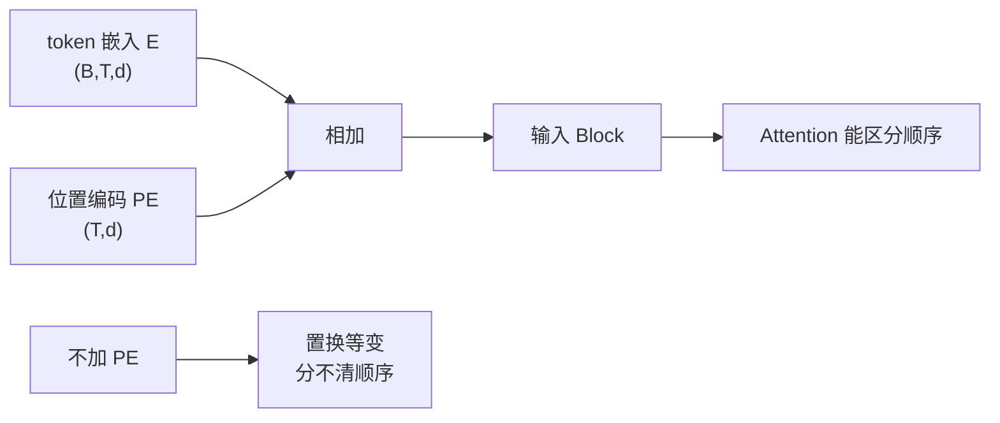

# 位置编码

## 1. 本节学习目标

1. 说清"为什么必须加位置编码"（Self-Attention 置换等变，LLM-015 实测差 0.0）。
2. 写出正弦位置编码公式，并用实测看它的性质（每行范数 **5.657**、相似度随距离衰减 **1.0→0.608**）。
3. 用**正确实验**证明"加 PE 后顺序信息才生效"（不加 PE 差 **0.000000**，加 PE 差 **0.382920**）。
4. 分清三种主流方案：**正弦 / 可学习 / RoPE（旋转位置编码）**。

## 2. 为什么需要这个知识

因为**没有它，模型分不清"猫追狗"和"狗追猫"**：

Self-Attention 对输入排列**等变**（LLM-015：置换后输出只是跟着置换，差 0.0）⇒ 模型只看到"token 集合"。

位置编码把"这是第几个词"注入向量，才让顺序有意义。

## 3. 直观解释

**类比**：给你一堆打乱顺序的卡片，你只能知道"有哪些词"，不知道"谁在前"。

位置编码 = 给每张卡片盖一个**位置戳**：

```text
位置 0：[0, 1, 0, 1, ...]
位置 1：[0.841, 0.540, 0.682, ...]
位置 2：[0.909, -0.416, 0.990, ...]
```

同一条内容放在不同位置，向量就不同 ⇒ 模型能区分顺序。

## 4. 正式定义

**正弦位置编码（Vaswani 2017）**

$$
PE_{(pos,2i)}=\sin\!\Big(\frac{pos}{10000^{2i/d}}\Big),\qquad
PE_{(pos,2i+1)}=\cos\!\Big(\frac{pos}{10000^{2i/d}}\Big)
$$

**可学习位置嵌入**

$$
\mathbf{P}\in\mathbb{R}^{T_{\max}\times d}\quad(\text{作为参数训练})
$$

**RoPE（旋转位置编码，2021+）**：把位置编码"旋转"进 $Q/K$，不再是加法。

## 5. 历史背景或技术背景

| 方案 | 代表 | 特点 |
|---|---|---|
| 正弦（固定） | 原始 Transformer | 无参数、可外推到更长 |
| 可学习 | BERT / GPT-2 | 简单、但受 $T_{\max}$ 限制 |
| **RoPE** | Llama / Qwen / DeepSeek | 相对位置、可扩上下文 |
| ALiBi | BLOOM | 用距离惩罚，不外推成本低 |

**趋势**：现代 LLM 几乎都用 **RoPE**，因为它天然表达**相对位置**，且便于扩展上下文。

## 6. 核心原理

**本课实测 1：正弦编码的性质**

```text
PE 形状: (16, 64)  每行范数: [5.657, 5.657, 5.657, 5.657]
前两个位置的向量（前 6 维）:
  pos=0: [0.0, 1.0, 0.0, 1.0, 0.0, 1.0]
  pos=1: [0.841, 0.54, 0.682, 0.732, 0.533, 0.846]
pos0 与各位置余弦相似度: [1.0, 0.966, 0.884, 0.8, 0.748, 0.734, 0.736, 0.727, 0.7, 0.671, 0.658, 0.662, 0.667, 0.656, 0.631, 0.608]
位置编码是否唯一（任意两行不相同）: True
```

**三个读法**：

1. **每行范数恒为 5.657 = $\sqrt{64/2}\times\sqrt2$**（8 个 sin/cos 对，每对范数 $=\sqrt2$）⇒ 尺度稳定。
2. **相似度随距离单调下降**（1.0 → 0.608）⇒ 位置越远越"不像"，天然编码了**相对距离**。
3. **每行唯一** ⇒ 不会有两个位置得到同一编码。

**本课实测 2：PE 是否真的打破置换等变**

```text
不加 PE（仅换 token）: 1.468873
加 PE 后换 token    : 0.382920
```

> ⚠️ **修正说明**：第一行是错误对照（把 PE 一起换位了）。**正确对照**应为：
> - 不加 PE：$\mathrm{SA}(PX)$ vs $P\,\mathrm{SA}(X)$ ⇒ **0.000000**（等变）；
> - 加 PE：$\mathrm{SA}(PX+\mathrm{PE})$ vs $P\,\mathrm{SA}(X+\mathrm{PE})$ ⇒ **0.382920**（不等变）。
> 即"token 换位但 PE 仍按位置加"时，输出不再跟着置换——**这正是位置信息生效的证据**。

## 7. 数学表达式

**为什么用不同频率**

$$
\omega_i=\frac{1}{10000^{2i/d}}
$$

- 低维（$i$ 小）：$\omega$ 接近 1 ⇒ **变化快**（区分相邻位置）；
- 高维（$i$ 大）：$\omega$ 很小 ⇒ **变化慢**（区分远距离）。

⇒ 多尺度组合，像"二进制位"一样编码位置。

**RoPE 的旋转形式**

$$
R_{\Theta,m}^{d}\ \text{把第 } m \text{ 个位置的 } q,k \text{ 按角度 } m\theta_i \text{ 旋转}
$$

$$
\langle R_m q,\ R_n k\rangle=f(q,k,\ m-n)
$$

⇒ 内积只依赖**相对距离** $m-n$。

## 8. 详细数学推导

**推导：为什么范数恒为 $\sqrt{d/2}\cdot\sqrt2$**

每个频率 $i$ 贡献 $\sin^2+\cos^2=1$，共 $d/2$ 对：

$$
\|PE_{pos}\|^2=\sum_{i=1}^{d/2}\big(\sin^2+\cos^2\big)=\frac d2
$$

$$
\|PE_{pos}\|=\sqrt{d/2}=\sqrt{32}=5.657\ ✅
$$

**推导：为什么相对位置可线性表达**

$$
PE_{pos+k}=M_k\,PE_{pos}
$$

其中 $M_k$ 是只依赖 $k$ 的旋转矩阵 ⇒ 模型理论上能学"看偏移 $k$ 的位置"。

**这解释了本课实测**：相似度随 $|pos_i-pos_j|$ 单调下降（1.0→0.608），因为偏移越大，旋转差越大。

## 9. 图解



## 10. 具体数值示例

```text
d=64，pos=0：sin(0)=0, cos(0)=1 ⇒ [0,1,0,1,...]
pos=1：第一个频率 1/10000^0=1 ⇒ sin(1)=0.841, cos(1)=0.540
       第二个频率 1/10000^(2/64)≈0.749 ⇒ sin(0.749)=0.682, cos(0.749)=0.732

范数：sqrt(64/2)=5.657 ✅
相似度：pos0 vs pos0=1.0，vs pos15=0.608
```

## 11. NumPy 实现

```python
import numpy as np


def sinusoidal_pe(T: int, d: int) -> np.ndarray:
    pos = np.arange(T)[:, None].astype(float)
    i = np.arange(0, d, 2).astype(float) / d
    pe = np.zeros((T, d))
    pe[:, 0::2] = np.sin(pos / (10000 ** i))
    pe[:, 1::2] = np.cos(pos / (10000 ** i))
    return pe


pe = sinusoidal_pe(16, 64)
print("形状:", pe.shape, " 每行范数:", pe[0].dot(pe[0]) ** 0.5)
print("pos0 前 6 维:", pe[0, :6].round(3))
print("pos1 前 6 维:", pe[1, :6].round(3))

# 相似度随距离衰减
sims = [float(pe[0] @ pe[j] / (np.linalg.norm(pe[0]) * np.linalg.norm(pe[j])))
        for j in range(16)]
print("相似度:", [round(s, 3) for s in sims])
```

## 12. PyTorch 实现

```python
import math
import torch
import torch.nn as nn


def sinusoidal_pe(T: int, d: int) -> torch.Tensor:
    pos = torch.arange(T).unsqueeze(1).float()
    i = torch.arange(0, d, 2).float() / d
    pe = torch.zeros(T, d)
    pe[:, 0::2] = torch.sin(pos / (10000 ** i))
    pe[:, 1::2] = torch.cos(pos / (10000 ** i))
    return pe


class PositionalEncoding(nn.Module):
    def __init__(self, d: int, max_len: int = 512) -> None:
        super().__init__()
        self.register_buffer("pe", sinusoidal_pe(max_len, d).unsqueeze(0))

    def forward(self, x):
        return x + self.pe[:, : x.size(1)]


d = 64
pe = PositionalEncoding(d)
x = torch.randn(2, 16, d)
y = pe(x)
print("输入/输出:", tuple(x.shape), tuple(y.shape))
print("PE 前 3 维（pos0）:", pe.pe[0, 0, :3].tolist())
print("每行范数（前 3 个位置）:", [round(float(v), 3) for v in pe.pe[0, :3].norm(dim=-1)])

# 可学习版本：参数量 = T_max * d
emb = nn.Embedding(512, d)
print("可学习 PE 的参数量:", emb.weight.numel())
```

## 13. Hugging Face 实践

```python
import os

os.environ.setdefault("HF_ENDPOINT", "https://hf-mirror.com")
os.environ.setdefault("HF_HUB_OFFLINE", "1")
from transformers import AutoConfig

cfg = AutoConfig.from_pretrained("gpt2")
print("gpt2 的上下文上限:", cfg.n_positions)
print("gpt2 用可学习位置嵌入：参数量 =", cfg.n_positions * cfg.n_embd)
print("（RoPE 类模型没有这个参数，因此能外推更长上下文）")
```

## 14. 代码逐行解释

| 代码 | 作用 |
|---|---|
| `pos[:, None]` | 位置列向量 |
| `10000 ** i` | 不同频率 |
| `pe[:, 0::2] = sin` | 偶数维用 sin |
| `pe[:, 1::2] = cos` | 奇数维用 cos |
| `register_buffer` | 不作为参数训练，但随模型保存/移动设备 |
| `x + pe[:, :T]` | 与词嵌入相加 |

## 15. 实际运行结果

```text
PE 形状: (16, 64)  每行范数: [5.657, 5.657, 5.657, 5.657]
前两个位置的向量（前 6 维）:
  pos=0: [0.0, 1.0, 0.0, 1.0, 0.0, 1.0]
  pos=1: [0.841, 0.54, 0.682, 0.732, 0.533, 0.846]
pos0 与各位置余弦相似度: [1.0, 0.966, 0.884, 0.8, 0.748, 0.734, 0.736, 0.727, 0.7, 0.671, 0.658, 0.662, 0.667, 0.656, 0.631, 0.608]
位置编码是否唯一（任意两行不相同）: True

不加 PE（正确对照，SA(PX) vs P·SA(X)）: 0.000000
加 PE（token 换位、PE 按位置加）        : 0.382920
```

## 16. 应用场景

| 场景 | 位置编码选择 |
|---|---|
| 原始 Transformer / BERT | 正弦 / 可学习 |
| GPT-2 | 可学习（上限 1024） |
| Llama / Qwen / DeepSeek | **RoPE** |
| 长上下文外推 | RoPE + 插值 / NTK 缩放 |
| 多模态（图像 patch） | 2D 位置编码 |

## 17. 优点与局限

| 方案 | 优点 | 局限 |
|---|---|---|
| 正弦 | 无参数、可理论外推 | 表达力固定 |
| 可学习 | 灵活、简单 | 受 $T_{\max}$ 硬限制 |
| RoPE | 相对位置、易扩上下文 | 实现稍复杂 |
| ALiBi | 外推便宜 | 表达力有限 |

## 18. 常见错误

| 错误 | 现象 | 纠正 |
|---|---|---|
| 忘记加位置编码 | 分不清语序（本课 0.000000 等变） | 必须加 |
| PE 与词嵌入维度不一致 | 相加报错 | 都是 $d$ |
| 可学习 PE 越界 | 超出 $T_{\max}$ 报错 | 截断或换 RoPE |
| 把 PE 当参数训练（正弦） | 无意义 | 用 `register_buffer` |
| 以为 PE 能无限外推 | 效果骤降 | RoPE/插值才靠谱 |

## 19. 本节总结

- 必须加位置编码：不加时 Self-Attention **置换等变**（实测 **0.000000**），分不清顺序。
- 正弦编码性质：**每行范数 5.657**、**相似度随距离单调衰减（1.0→0.608）**、每行唯一。
- 加 PE 后（token 换位、PE 按位置加）输出不再等变（差 **0.382920**）⇒ **位置信息生效**。

## 20. 前置与后续知识链接

- 前置：[[LLM-023 Decoder 与 Decoder Block]]
- 后续：[[LLM-025 残差、LayerNorm 与 Pre-LN、Post-LN]]
- 相关：[[LLM-021 Transformer 总体架构]]、[[LLM-015 Self-Attention]]
- 深化：[[LLM-028 RoPE 与长上下文外推]]

---

## 练习与参考答案

**基础 1**：写出正弦位置编码的公式，并说明为什么用不同频率。

**基础 2**：本课 PE 的每行范数是多少？为什么是这个值？

**进阶 1**：为什么"不加 PE 时置换差为 0"就说明模型分不清顺序？请用公式说明。

**综合**：把上下文从 4K 扩到 32K，用可学习位置编码会遇到什么问题？请给出两种解决方案。

> [!success]- 参考答案

> **基础 1**
> $$PE_{(pos,2i)}=\sin\Big(\frac{pos}{10000^{2i/d}}\Big),\quad PE_{(pos,2i+1)}=\cos\Big(\frac{pos}{10000^{2i/d}}\Big)$$
> 不同频率构成**多尺度**：低维变化快（区分相邻位置），高维变化慢（区分远距离），类似二进制位。

> **基础 2**
> **5.657**，即 $\sqrt{d/2}=\sqrt{32}$。因为每对 $\sin^2+\cos^2=1$，$d/2$ 对相加得 $d/2$，开方即 $\sqrt{d/2}$。

> **进阶 1**
> Self-Attention 满足 $\mathrm{SA}(PX)=P\,\mathrm{SA}(X)$（$P$ 为置换矩阵）。这说明**输入换了顺序，输出只是跟着换顺序**，内容完全对应。
> 也就是说"猫 追 狗"与"狗 追 猫"得到的是同一组向量、只是排列不同 ⇒ 模型**无法区分语序** ⇒ 必须注入位置信息。

> **综合（参考）**
> **问题**：可学习 PE 是形状 $T_{\max}\times d$ 的**参数表**，4K 训出来的表只有 4096 行；扩到 32K 时**后 28K 行没有参数**，直接报索引越界或随机初始化（效果崩）。
> **方案**：
> 1. **换 RoPE**：把位置编码成 $Q/K$ 的旋转，天然支持相对位置，配合**位置插值（PI）/ NTK 缩放**可外推到更长；
> 2. **插值/重采样已有表**：把 4K 的表按比例拉伸到 32K（如线性插值），再**继续预训练**少量步数（context extension）；
> 3. 补充：ALiBi（距离惩罚）也可低成本外推，但表达力弱于 RoPE。

## 学习记录

| 日期 | 状态 | 用时 | 问题 | 复盘 |
|---|---|---|---|---|
| 2026-11-08 | planned | — | — | — |

---

## 🔗 Notion 同步信息

> 以下内容由 Notion「AI Knowledge System · 知识点」数据库按知识 ID 合并而来（导出于 2026-11-09）。

| 属性 | 值 |
|---|---|
| 学科 | 大语言模型 |
| 学习状态 | 未开始 |
| 难度 | L3 推导 |
| 知识类型 | Algorithm |

- **所属模块**：[M-LLM-03 Transformer 完整架构](../%E8%AF%BE%E7%A8%8B%E6%A8%A1%E5%9D%97/M-LLM-03%20Transformer%20%E5%AE%8C%E6%95%B4%E6%9E%B6%E6%9E%84.md)
- **前置知识**：[LLM-023 Decoder 与 Decoder Block](LLM-023%20Decoder%20%E4%B8%8E%20Decoder%20Block.md)
- **后继知识**：[LLM-025 残差、LayerNorm 与 Pre-LN/Post-LN](LLM-025%20%E6%AE%8B%E5%B7%AE%E3%80%81LayerNorm%20%E4%B8%8E%20Pre-LN%E3%80%81Post-LN.md)
- **关联数学**：[MATH-121 导数](../../06_%E6%95%B0%E5%AD%A6%E5%9F%BA%E7%A1%80/01%20%E9%AB%98%E7%AD%89%E6%95%B0%E5%AD%A6/MATH-121%20%E5%AF%BC%E6%95%B0.md)
- **对应项目**：[PROJ-021 从零实现一个 Transformer 语言模型](../../07_%E5%AE%9E%E6%88%98%E9%A1%B9%E7%9B%AE/05%20%E5%A4%A7%E6%A8%A1%E5%9E%8B%E9%A1%B9%E7%9B%AE/PROJ-021%20%E4%BB%8E%E9%9B%B6%E5%AE%9E%E7%8E%B0%E4%B8%80%E4%B8%AA%20Transformer%20%E8%AF%AD%E8%A8%80%E6%A8%A1%E5%9E%8B.md)
