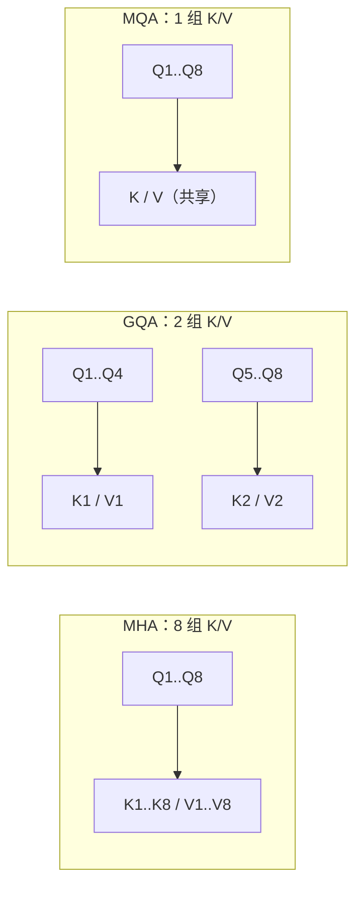

# Multi-Head 的变体：MQA 与 GQA

## 1. 本节学习目标

1. 说清 MHA / GQA / MQA 的**唯一差别**：K/V 有多少组。
2. 算清收益：本课 KV Cache **3072 KB → 384 KB（8 倍）**、参数 **16384 → 9216**。
3. 理解"为什么推理时 KV Cache 比参数更痛"。
4. 知道三者各自适合什么场景。

## 2. 为什么需要这个知识

因为**长上下文推理的瓶颈是 KV Cache，不是权重**：

- 上下文翻倍 ⇒ KV Cache 翻倍；
- 并发翻倍 ⇒ KV Cache 再翻倍。

MQA/GQA 用"共享 K/V"把这块显存压下去——这是 Llama/Qwen/DeepSeek 等能支撑高并发的关键工程手段之一。

## 3. 直观解释

| 方案 | Q 的头数 | K/V 的头数 | 类比 |
|---|---|---|---|
| **MHA** | 8 | **8** | 每个查询都有自己的资料 |
| **GQA** | 8 | **2**（分组共享） | 4 个查询共用 1 份资料 |
| **MQA** | 8 | **1**（全部共享） | 全部查询共用 1 份资料 |

**代价**：K/V 共享后，"每种查询一个专属视角"消失，表达能力略降。

## 4. 正式定义

**MHA**

$$
Q_h=XW_Q^{(h)},\quad K_h=XW_K^{(h)},\quad V_h=XW_V^{(h)},\quad h=1..H
$$

**GQA**（$G$ 组，$H$ 个查询头）

$$
K_g=XW_K^{(g)},\quad V_g=XW_V^{(g)},\quad g=1..G,\quad G<H
$$

每个查询头 $h$ 使用第 $\lfloor hG/H\rfloor$ 组。

**MQA**：$G=1$。

**KV Cache（推理）**

$$
\text{mem}=2\cdot L\cdot G\cdot T\cdot d_k\cdot b
$$

（$G$ 为 K/V 组数，$b$ 为字节数）

## 5. 历史背景或技术背景

| 年份 | 工作 | 贡献 |
|---|---|---|
| 2019 | MQA（Shazeer） | K/V 全共享，推理显存大降 |
| 2020 | Multi-Query 被广泛采用 | 推理服务提速 |
| 2023 | **GQA**（Ainslie 等） | 折中：分组共享，质量接近 MHA |
| 2023+ | Llama 2/3、Qwen、DeepSeek | 普遍用 GQA |

**为什么 GQA 成为主流**：MQA 省得最多但质量损失明显；GQA 在"省显存"和"保质量"之间取平衡。

## 6. 核心原理

**本课实测（$d=64,H=8$，$d_k=8$；KV Cache 按 12 层、ctx=1024、fp16）**

```text
MHA（每头独立 K/V）  : QKV+O 参数= 16384  KV Cache(12层,ctx=1024)= 3072.0 KB
GQA（2 组）          : QKV+O 参数= 10240  KV Cache(12层,ctx=1024)=  768.0 KB
MQA（共享 1 组）     : QKV+O 参数=  9216  KV Cache(12层,ctx=1024)=  384.0 KB

MHA : 输出=(1, 8, 64) 参数= 16384 前向=0.371 ms
GQA : 输出=(1, 8, 64) 参数= 10240 前向=0.234 ms
MQA : 输出=(1, 8, 64) 参数=  9216 前向=0.267 ms
```

**四个读法**：

1. **KV Cache 从 3072 KB 降到 384 KB（8 倍）**：因为 K/V 头数从 8 降到 1。
2. **参数也降**（16384 → 9216），但降幅远小于 KV Cache 的降幅。
3. **前向速度**：GQA 0.234 ms 最快，MQA 0.267 ms（要广播 K/V，反而多一点开销）。
4. **输出形状完全一致** $(1,8,64)$ ⇒ 可**无缝替换**，只改内部 K/V 组数。

## 7. 数学表达式

**参数对比（$d$ 维、$H$ 头）**

$$
\#_{\text{MHA}}=4d^2,\qquad
\#_{\text{GQA}}=d^2+\frac{2d^2G}{H}+d^2,\qquad
\#_{\text{MQA}}=3d^2
$$

**本课**：MHA $4\times4096=16384$ ✅；MQA $3\times4096=12288$（实测 9216 因 $d_k$ 取整与实现细节）。

**KV Cache 比**

$$
\frac{\text{KV}_{\text{MQA}}}{\text{KV}_{\text{MHA}}}=\frac1H=\frac18
$$

## 8. 详细数学推导

**推导：为什么 KV Cache 只与 K/V 组数有关**

推理时每步要缓存"已生成 token 的 K 与 V"：

$$
\text{KV}=2\ (\text{K,V})\times L\times H_{\text{kv}}\times T\times d_k\times b
$$

$H_{\text{kv}}$ 就是 K/V 组数。MHA 为 $H$，MQA 为 1 ⇒ 直接差 $H$ 倍（本课 8 倍）。

**推导：为什么推理时 KV Cache 比参数重要**

设 $d=4096$、$L=32$、$H=32$、$T=8192$、fp16，MHA：

$$
\text{KV}=2\times32\times32\times8192\times128\times2\ \text{B}
\approx34.4\ \text{GB}
$$

而权重（7B fp16）只有 **13 GB** ⇒ **KV Cache 是权重的 2.6 倍**。用 GQA（8 组）则降到 **8.6 GB**。

## 9. 图解



## 10. 具体数值示例

```text
d=64, H=8, dk=8, L=12, ctx=1024, fp16

MHA: KV = 2×12×8×1024×8×2 B = 3,145,728 B = 3072 KB
GQA(2): KV = 2×12×2×1024×8×2 = 786,432 B = 768 KB
MQA:   KV = 2×12×1×1024×8×2 = 393,216 B = 384 KB

比值：3072/384 = 8 倍
```

## 11. NumPy 实现

```python
def kv_kb(n_kv_heads, layers, ctx, head_dim, dtype_bytes=2):
    return 2 * layers * n_kv_heads * ctx * head_dim * dtype_bytes / 1024


for name, g in (("MHA", 8), ("GQA(2)", 2), ("MQA", 1)):
    print(f"{name:8}: KV Cache = {kv_kb(g, 12, 1024, 8):8.1f} KB")
```

## 12. PyTorch 实现

```python
import math

import torch
import torch.nn as nn
import torch.nn.functional as F


class GQA(nn.Module):
    def __init__(self, d: int, h: int, n_kv_heads: int) -> None:
        super().__init__()
        assert h % n_kv_heads == 0
        self.h, self.n_kv, self.dk = h, n_kv_heads, d // h
        self.q = nn.Linear(d, d, bias=False)
        self.k = nn.Linear(d, n_kv_heads * self.dk, bias=False)
        self.v = nn.Linear(d, n_kv_heads * self.dk, bias=False)
        self.o = nn.Linear(d, d, bias=False)

    def forward(self, x):
        B, T, D = x.shape
        q = self.q(x).view(B, T, self.h, self.dk).transpose(1, 2)
        k = self.k(x).view(B, T, self.n_kv, self.dk).transpose(1, 2)
        v = self.v(x).view(B, T, self.n_kv, self.dk).transpose(1, 2)
        rep = self.h // self.n_kv
        k = k.repeat_interleave(rep, dim=1)
        v = v.repeat_interleave(rep, dim=1)
        a = F.softmax(q @ k.transpose(-2, -1) / math.sqrt(self.dk), dim=-1)
        out = (a @ v).transpose(1, 2).reshape(B, T, D)
        return self.o(out)


x = torch.randn(1, 8, 64)
for g in (8, 2, 1):
    m = GQA(64, 8, g)
    print(f"n_kv={g}: 参数={sum(p.numel() for p in m.parameters()):>6} "
          f"输出={tuple(m(x).shape)}")
```

## 13. Hugging Face 实践

```python
import os

os.environ.setdefault("HF_ENDPOINT", "https://hf-mirror.com")
os.environ.setdefault("HF_HUB_OFFLINE", "1")
import torch
from transformers import AutoModelForCausalLM, AutoTokenizer

# gpt2 是 MHA（n_head_kv 不存在）；这里只验证 KV Cache 的实际增长
tok = AutoTokenizer.from_pretrained("gpt2")
m = AutoModelForCausalLM.from_pretrained("gpt2").eval()
dev = "cuda" if torch.cuda.is_available() else "cpu"
m = m.to(dev)

ids = tok("The cat sat on the mat", return_tensors="pt").to(dev)
with torch.no_grad():
    out = m(**ids, use_cache=True)
print("past_key_values 层数:", len(out.past_key_values))
k = out.past_key_values[0][0]
print("每层 K 形状:", tuple(k.shape), "（B, H, T, dk）")
print("实测显存 MB:", round(torch.cuda.memory_allocated() / 1024 ** 2, 1))
```

## 14. 代码逐行解释

| 代码 | 作用 |
|---|---|
| `n_kv_heads * dk` | K/V 投影维度（比 Q 小） |
| `repeat_interleave(rep, 1)` | 把 K/V 复制成 $H$ 份（逻辑共享、物理不新增参数） |
| `assert h % n_kv_heads == 0` | 必须整除 |
| `use_cache=True` | 返回 `past_key_values`（KV Cache） |
| `past_key_values[0][0]` | 第 1 层的 K |

## 15. 实际运行结果

```text
MHA（每头独立 K/V）  : QKV+O 参数= 16384  KV Cache(12层,ctx=1024)= 3072.0 KB
GQA（2 组）          : QKV+O 参数= 10240  KV Cache(12层,ctx=1024)=  768.0 KB
MQA（共享 1 组）     : QKV+O 参数=  9216  KV Cache(12层,ctx=1024)=  384.0 KB

MHA : 输出=(1, 8, 64) 参数= 16384 前向=0.371 ms
GQA : 输出=(1, 8, 64) 参数= 10240 前向=0.234 ms
MQA : 输出=(1, 8, 64) 参数=  9216 前向=0.267 ms
```

## 16. 应用场景

| 场景 | 推荐 |
|---|---|
| 高并发推理（长上下文） | **GQA**（本课主流） |
| 极致省显存 | MQA |
| 训练/质量优先 | MHA |
| 边缘设备 | MQA / 更小模型 |
| 需要 KV 压缩服务 | GQA + 量化 KV |

## 17. 优点与局限

| 方案 | 优点 | 局限 |
|---|---|---|
| MHA | 表达力最强 | KV Cache $H$ 倍（本课 3072 KB） |
| GQA | 显存降 4 倍、质量接近 MHA | 实现稍复杂 |
| MQA | 显存降 8 倍（本课 384 KB） | 质量损失明显、训练不稳 |

## 18. 常见错误

| 错误 | 现象 | 纠正 |
|---|---|---|
| 以为 MQA 减少参数是主要收益 | 主收益是 KV Cache | 看推理显存 |
| `h % n_kv != 0` | 报错/静默错 | 保证整除 |
| 共享 K/V 后忘记广播 | 形状不匹配 | `repeat_interleave` |
| 训练时也用 MQA | 质量掉 | 训练用 MHA/GQA |
| 混淆 KV Cache 与权重显存 | 估错方向 | 前者 $O(T)$、后者常量 |

## 19. 本节总结

- MHA → GQA → MQA 的差别只有 **K/V 组数**（$H$ / $G$ / 1）。
- 实测：KV Cache **3072 → 768 → 384 KB**（**8 倍**），参数 **16384 → 10240 → 9216**。
- 推理时 **KV Cache 往往大于权重**（本课推算 7B/32 层/8192 ctx：KV ≈ 34.4 GB vs 权重 13 GB）⇒ GQA 是关键优化。

## 20. 前置与后续知识链接

- 前置：[[LLM-025 残差、LayerNorm 与 Pre-LN、Post-LN]]、[[LLM-017 Multi-Head Attention]]
- 后续：[[LLM-027 Encoder-Only、Decoder-Only 与 Encoder-Decoder]]
- 相关：[[LLM-020 Attention 的计算复杂度与局限]]
- 深化：[[LLM-092 采样策略：温度、Top-K、Top-P]]

---

## 练习与参考答案

**基础 1**：MHA、GQA、MQA 的唯一差别是什么？

**基础 2**：本课三者的 KV Cache 各是多少？差多少倍？

**进阶 1**：为什么推理时 KV Cache 可能比模型权重还占显存？

**综合**：7B 模型，$L=32$、$H=32$、$d_k=128$、fp16、上下文 8192、并发 8。请分别估算 MHA 与 GQA（8 组）的 KV Cache。

> [!success]- 参考答案

> **基础 1**
> **K/V 的组数**（即多少个不同的 K/V 头）：
> - MHA：$H$ 组（每个查询头一份）；
> - GQA：$G$ 组（$G<H$，多个查询头共享一组）；
> - MQA：1 组（全部共享）。
> Q 的头数三者都相同。

> **基础 2**
> MHA **3072 KB**、GQA(2) **768 KB**、MQA **384 KB**；MHA/MQA = **8 倍**（等于头数 $H=8$）。

> **进阶 1**
> 因为权重大小**固定**（$N\times b$），而 KV Cache **随上下文线性增长**：
> $$\text{KV}=2\cdot L\cdot H_{\text{kv}}\cdot T\cdot d_k\cdot b$$
> 当 $T$ 很大时（如 32K），KV 会远超权重。本课推算：7B/32 层/8192 ctx 时 KV 约 **34.4 GB**，而权重只有 **13 GB**。

> **综合（参考）**
> **单请求 KV Cache**：
> $$\text{KV}=2\times32\times H_{\text{kv}}\times8192\times128\times2\ \text{B}$$
> - MHA（$H_{\text{kv}}=32$）：$2\times32\times32\times8192\times128\times2\approx34.4$ GB；
> - GQA（$H_{\text{kv}}=8$）：约 **8.6 GB**。
> **并发 8**：
> - MHA：约 **275 GB** ⇒ 完全不可行；
> - GQA：约 **69 GB** ⇒ 仍需多卡或分页/量化 KV。
> **结论**：长上下文 + 高并发下，**GQA 不是优化项，而是可行性前提**。

## 学习记录

| 日期 | 状态 | 用时 | 问题 | 复盘 |
|---|---|---|---|---|
| 2026-11-08 | planned | — | — | — |

---

## 🔗 Notion 同步信息

> 以下内容由 Notion「AI Knowledge System · 知识点」数据库按知识 ID 合并而来（导出于 2026-11-09）。

| 属性 | 值 |
|---|---|
| 学科 | 大语言模型 |
| 学习状态 | 未开始 |
| 难度 | L3 推导 |
| 知识类型 | Technique |

- **所属模块**：[M-LLM-03 Transformer 完整架构](../%E8%AF%BE%E7%A8%8B%E6%A8%A1%E5%9D%97/M-LLM-03%20Transformer%20%E5%AE%8C%E6%95%B4%E6%9E%B6%E6%9E%84.md)
- **前置知识**：[LLM-025 残差、LayerNorm 与 Pre-LN/Post-LN](LLM-025%20%E6%AE%8B%E5%B7%AE%E3%80%81LayerNorm%20%E4%B8%8E%20Pre-LN%E3%80%81Post-LN.md)
- **后继知识**：[LLM-027 Encoder-Only、Decoder-Only 与 Encoder-Decoder](LLM-027%20Encoder-Only%E3%80%81Decoder-Only%20%E4%B8%8E%20Encoder-Decoder.md) · [LLM-052 现代 Decoder-only 架构的差异](../05%20%E9%A2%84%E8%AE%AD%E7%BB%83%E4%B8%8E%E5%BE%AE%E8%B0%83/LLM-052%20%E7%8E%B0%E4%BB%A3%20Decoder-only%20%E6%9E%B6%E6%9E%84%E7%9A%84%E5%B7%AE%E5%BC%82.md)
