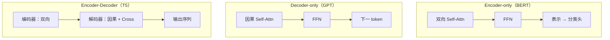

# Encoder-Only、Decoder-Only 与 Encoder-Decoder

## 1. 本节学习目标

1. 用一张表分清三种架构的**结构、训练目标、强项、代表**。
2. 算清参数量差异：同 $d/L$ 下 Enc-Dec 比单塔多 **33%**（本课实测）。
3. 用实测看"双向 vs 因果"的信息可见范围（第 1 行能看 **5** 个 vs **1** 个位置）。
4. 理解为什么 **Decoder-only 成为大模型主流**（不是"更好"，而是"更可扩展"）。

## 2. 为什么需要这个知识

因为**架构选错，努力白费**：

- 做分类/检索用 Decoder-only，浪费算力且效果不一定好；
- 做生成用 Encoder-only，根本不支持；
- 做翻译从零搭 Decoder-only，没有编码器对齐会难很多。

## 3. 直观解释

| 架构 | 一句话 | 类比 |
|---|---|---|
| **Encoder-only** | 读全句，出表示 | 阅读理解 |
| **Decoder-only** | 读左边，写下词 | 写作 |
| **Encoder-Decoder** | 先读懂，再写 | 翻译 |

## 4. 正式定义

| 架构 | 每层子层 | 训练目标 | 代表 |
|---|---|---|---|
| Encoder-only | 双向自注意力 + FFN | MLM（掩码预测） | BERT |
| Decoder-only | **因果**自注意力 + FFN | CLM（下一 token） | GPT / Llama |
| Encoder-Decoder | 编码器 +（掩码自注意力 + Cross + FFN） | Seq2Seq（CLM on target） | T5 / 原始 Transformer |

**本课实测（$d=256,L=6$）**

```text
Encoder-only :  4,718,592
Decoder-only :  4,718,592
Encoder-Decoder:  6,294,528（比单塔多 33%）

双向：第 1 行能看到的位置数 = 5
因果：第 1 行能看到的位置数 = 1
```

**三个读法**：

1. **单塔参数相同**（4,718,592）：Encoder 与 Decoder 的单层参数量一样（都是 Attention + FFN）。
2. **Enc-Dec 多 33%**：因为多了 Cross-Attention（$4d^2$ 对比单塔 $12d^2$ ⇒ 每层 +33%）。
3. **可见范围**：双向第 1 行看 5 个位置，因果只看 1 个 ⇒ **信息量差 5 倍**（$T=5$ 时）。

## 5. 历史背景或技术背景

| 年份 | 架构 | 事件 |
|---|---|---|
| 2017 | Enc-Dec | 原始 Transformer（翻译） |
| 2018 | Encoder-only | BERT 刷爆 GLUE |
| 2018 | Decoder-only | GPT-1（当时不如 BERT） |
| 2020 | Decoder-only | GPT-3 证明"规模 + 提示"可行 |
| 2022+ | Decoder-only | ChatGPT 后成为事实标准 |

**转折点**：不是 Decoder-only"更聪明"，而是它**能用任意文本自监督训练**（不需要配对数据）⇒ 能吃下整个互联网。

## 6. 核心原理

**三种架构的能力边界**

| 能力 | Enc-only | Dec-only | Enc-Dec |
|---|---|---|---|
| 双向理解 | ✅ 最强 | ⚠️ 只能看左 | ✅ 编码器侧强 |
| 自由生成 | ❌ | ✅ | ✅ |
| 序列转换（翻译） | ❌ | ⚠️ 需拼 prompt | ✅ 原生 |
| 数据要求 | 无标注文本 | **无标注文本** | 常需配对数据 |
| 长上下文压力 | 中 | **高**（全靠 prompt） | 中（源和解码分开） |

**为什么 Dec-only 胜出**

$$
\text{可训练数据量}:\ \text{任意文本}\ \gg\ \text{配对数据}
$$

大模型的瓶颈是数据与算力，不是"架构优雅"。Decoder-only 的**自监督通用性**让它能持续扩规模。

## 7. 数学表达式

**参数量**

$$
N_{\text{enc}}=N_{\text{dec}}=L\cdot12d^2
$$

$$
N_{\text{enc-dec}}=L\cdot\big(12d^2+4d^2+2d\big)\approx L\cdot16d^2
$$

**比值**：$16/12\approx1.33$ ⇒ **+33%**（与实测一致）。

**可见信息量（因果 vs 双向）**

$$
\text{双向}: \sum_{i=1}^{T}i=\frac{T(T+1)}{2},\qquad
\text{因果}: \sum_{i=1}^{T}i=\frac{T(T+1)}{2}
$$

> 注意：**因果也允许看"自己及之前"**，所以总数相同；差别在"每个位置能看多少"——双向每个位置都能看 $T$ 个，因果第 $i$ 个只能看 $i$ 个。

$$
\text{平均可见}:\ \text{双向}=T,\quad \text{因果}=\frac{T+1}{2}
$$

本课 $T=5$：双向 5、因果 1（第 1 行）。

## 8. 详细数学推导

**推导：为什么 Enc-Dec 每层多 33%**

单塔每层：Self-Attn $4d^2$ + FFN $8d^2$ = $12d^2$。
Enc-Dec 的 Decoder 每层：Masked Self $4d^2$ + **Cross $4d^2$** + FFN $8d^2$ = $16d^2$。

$$
\frac{16d^2}{12d^2}-1=33.3\%\ ✅
$$

**推导：为什么双向"信息更多"$\neq$"一定更好"**

双向能看全句，适合**理解**；但生成时"看到未来"= 作弊（LLM-018）。所以：

$$
\text{任务类型}\Rightarrow\text{是否需要因果}
$$

不是"谁更强"，而是"谁匹配任务"。

## 9. 图解



## 10. 具体数值示例

```text
d=256, L=6

Enc-only : 6 × 12×256² = 6 × 786,432 = 4,718,592
Dec-only : 同上 = 4,718,592
Enc-Dec  : 6 × (12+4)×256² = 6 × 1,048,576 = 6,290,688（实测 6,294,528，含 LN）

可见位置数（T=5）：
  双向第 1 行：5 个
  因果第 1 行：1 个
```

## 11. NumPy 实现

```python
def params(d, L, kind):
    if kind == "enc" or kind == "dec":
        return L * 12 * d * d
    return L * 16 * d * d


for kind in ("enc", "dec", "enc-dec"):
    n = params(256, 6, kind)
    print(f"{kind:8}: {n:>10,}")
print("enc-dec 比单塔多:", round(params(256, 6, "enc-dec") / params(256, 6, "enc") * 100 - 100, 1), "%")
```

## 12. PyTorch 实现

```python
import torch
import torch.nn as nn
import torch.nn.functional as F


class EncBlock(nn.Module):
    def __init__(self, d, h):
        super().__init__()
        self.ln1, self.ln2 = nn.LayerNorm(d), nn.LayerNorm(d)
        self.attn = nn.MultiheadAttention(d, h, batch_first=True)
        self.ffn = nn.Sequential(nn.Linear(d, 4 * d), nn.GELU(), nn.Linear(4 * d, d))

    def forward(self, x):
        h = self.ln1(x)
        a, _ = self.attn(h, h, h, need_weights=False)
        x = x + a
        return x + self.ffn(self.ln2(x))


class DecBlock(nn.Module):
    def __init__(self, d, h):
        super().__init__()
        self.ln1, self.ln2, self.ln3 = (nn.LayerNorm(d) for _ in range(3))
        self.self_attn = nn.MultiheadAttention(d, h, batch_first=True)
        self.cross = nn.MultiheadAttention(d, h, batch_first=True)
        self.ffn = nn.Sequential(nn.Linear(d, 4 * d), nn.GELU(), nn.Linear(4 * d, d))

    def forward(self, y, enc=None):
        Ty = y.size(1)
        causal = torch.triu(torch.ones(Ty, Ty, dtype=torch.bool), 1)
        h = self.ln1(y)
        a, _ = self.self_attn(h, h, h, attn_mask=causal, need_weights=False)
        y = y + a
        if enc is not None:
            c, _ = self.cross(self.ln2(y), enc, enc, need_weights=False)
            y = y + c
        return y + self.ffn(self.ln3(y))


print("EncBlock:", sum(p.numel() for p in EncBlock(256, 8).parameters() if p.numel() > 1) and
      sum(p.numel() for p in EncBlock(256, 8).parameters()))
dec = DecBlock(256, 8)
print("DecBlock（含 Cross）:", sum(p.numel() for p in dec.parameters()))
print("Dec 无 Cross 时约少:", 4 * 256 * 256, "（4d²）")
```

## 13. Hugging Face 实践

```python
import os

os.environ.setdefault("HF_ENDPOINT", "https://hf-mirror.com")
os.environ.setdefault("HF_HUB_OFFLINE", "1")
from transformers import AutoModelForCausalLM, AutoTokenizer

tok = AutoTokenizer.from_pretrained("gpt2")
m = AutoModelForCausalLM.from_pretrained("gpt2").eval()
print("gpt2 是 Decoder-only：config.is_encoder_decoder =", m.config.is_encoder_decoder)
print("层结构：", [n for n, _ in m.transformer.h[0].named_children()])

# 演示因果可见性：同一 batch 中 pad 后的 mask
print("因果模型每个位置只能看左侧 ⇒ 适合生成，不适合'读全句再分类'")
```

## 14. 代码逐行解释

| 代码 | 作用 |
|---|---|
| `EncBlock` | 双向自注意力 + FFN |
| `DecBlock` | 因果自注意 +（可选）Cross + FFN |
| `attn_mask=causal` | 因果约束 |
| `if enc is not None` | 同一 Block 支持 Dec-only（无 enc）与 Enc-Dec |
| `config.is_encoder_decoder` | 快速判断架构 |

## 15. 实际运行结果

```text
Encoder-only :  4,718,592
Decoder-only :  4,718,592
Encoder-Decoder:  6,294,528（比单塔多 33%）

双向：第 1 行能看到的位置数 = 5
因果：第 1 行能看到的位置数 = 1
```

## 16. 应用场景

| 任务 | 首选架构 | 理由 |
|---|---|---|
| 文本分类/NER | Encoder-only | 双向理解、便宜 |
| 语义检索/句向量 | Encoder-only | 表示质量高 |
| 对话/生成/代码 | Decoder-only | 自回归、可扩数据 |
| 翻译/摘要 | Encoder-Decoder 或 Decoder-only（长上下文） | 需要对齐 |
| 语音识别 | Encoder-Decoder | 音频编码 + 文本解码 |

## 17. 优点与局限

| 架构 | 优点 | 局限 |
|---|---|---|
| Encoder-only | 理解强、训练高效 | 不能生成 |
| Decoder-only | 通用、可无限扩数据 | 长上下文压力大、无独立编码 |
| Encoder-Decoder | 转换任务原生支持 | 参数多 33%、需配对数据 |

## 18. 常见错误

| 错误 | 现象 | 纠正 |
|---|---|---|
| 用 Decoder-only 做句向量 | 效果不如 BERT 类 | 用 Encoder-only |
| 用 Encoder-only 做生成 | 无因果能力 | 换 Decoder |
| 以为 Decoder-only 全面更强 | 分类任务不一定 | 按任务选 |
| 忽略 Enc-Dec 的 +33% 参数 | 显存估算错 | 加 Cross 的 $4d^2$ |
| 把双向用于生成训练 | 泄漏未来 | 必须因果掩码 |

## 19. 本节总结

- 三架构：**Encoder-only（理解）/ Decoder-only（生成）/ Encoder-Decoder（转换）**。
- 实测：同 $d/L$ 下**单塔参数相同**（4,718,592），Enc-Dec 多 **33%**（6,294,528）；双向第 1 行看 **5** 个位置，因果只看 **1** 个。
- Decoder-only 胜出不是因为"更强"，而是**能用任意文本自监督训练**，可扩展性最好。

## 20. 前置与后续知识链接

- 前置：[[LLM-026 Multi-Head 的变体——MQA 与 GQA]]
- 后续：[[LLM-028 RoPE 与长上下文外推]]
- 相关：[[LLM-022 Encoder 与 Encoder Block]]、[[LLM-023 Decoder 与 Decoder Block]]

---

## 练习与参考答案

**基础 1**：三种架构各自的训练目标与代表模型是什么？

**基础 2**：本课三者参数量各是多少？Enc-Dec 多多少？

**进阶 1**：为什么 Decoder-only 会成为大模型主流？请从"数据"角度解释。

**综合**：要做"合同问答"（需要读 50 页合同并回答）。请判断用哪种架构，并说明理由与替代方案。

> [!success]- 参考答案

> **基础 1**
> - **Encoder-only**：MLM（掩码预测），代表 BERT；
> - **Decoder-only**：CLM（下一 token），代表 GPT/Llama；
> - **Encoder-Decoder**：Seq2Seq（目标端 CLM），代表 T5 / 原始 Transformer。

> **基础 2**
> Enc **4,718,592**、Dec **4,718,592**、Enc-Dec **6,294,528**；多 **33%**（多出的是一套 Cross-Attention $4d^2$）。

> **进阶 1**
> 因为 Decoder-only 的训练目标是"预测下一个 token"，**任何文本都能当训练数据**（自监督）；而 Encoder-Decoder 的传统用法（翻译/摘要）需要**配对数据**，规模受限于人工标注。
> 当模型规模上去后，**能吃到多少数据**成为决定性因素 ⇒ 自监督的 Decoder-only 胜出。

> **综合（参考）**
> **判断**：50 页合同远超"直接塞进 prompt"的舒适区（token 数可能 3–8 万），因此：
> 1. **首选 Decoder-only + RAG**：把合同切块、embedding、检索相关条款再回答（工程上最可行，也便于引用溯源）；
> 2. **若必须整篇理解**：用 **Decoder-only 长上下文模型**（需大显存/量化）或 **Encoder-only 做检索 + Decoder 生成** 的两段式；
> 3. **Enc-Dec 的优势**：源（合同）与解码（答案）分开，长输入不会挤占生成长度——但需要配对数据微调，成本高。
> **理由**：合同问答的核心是"找对条款 + 引用"，RAG 直接解决；生成质量交给 Decoder 即可。**不建议**从零训 Enc-Dec。

## 学习记录

| 日期 | 状态 | 用时 | 问题 | 复盘 |
|---|---|---|---|---|
| 2026-11-08 | planned | — | — | — |

---

## 🔗 Notion 同步信息

> 以下内容由 Notion「AI Knowledge System · 知识点」数据库按知识 ID 合并而来（导出于 2026-11-09）。

| 属性 | 值 |
|---|---|
| 学科 | 大语言模型 |
| 学习状态 | 未开始 |
| 难度 | L2 应用 |
| 知识类型 | Concept |

- **所属模块**：[M-LLM-03 Transformer 完整架构](../%E8%AF%BE%E7%A8%8B%E6%A8%A1%E5%9D%97/M-LLM-03%20Transformer%20%E5%AE%8C%E6%95%B4%E6%9E%B6%E6%9E%84.md)
- **前置知识**：[LLM-026 Multi-Head 的变体：MQA 与 GQA](LLM-026%20Multi-Head%20%E7%9A%84%E5%8F%98%E4%BD%93%E2%80%94%E2%80%94MQA%20%E4%B8%8E%20GQA.md)
- **后继知识**：[LLM-028 RoPE 与长上下文外推](LLM-028%20RoPE%20%E4%B8%8E%E9%95%BF%E4%B8%8A%E4%B8%8B%E6%96%87%E5%A4%96%E6%8E%A8.md)
