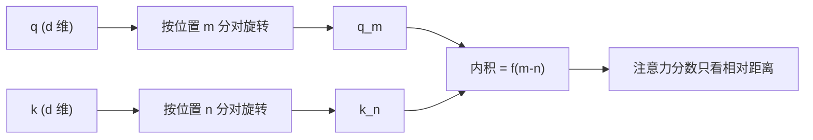

# RoPE 与长上下文外推

## 1. 本节学习目标

1. 说清 RoPE 与"加法位置编码"的本质区别：**旋转 Q/K，而不是加向量**。
2. 用实测验证**相对位置性质**：固定距离 3 时，绝对位置变到 30 仍是 **−3.077702**（完全一致）。
3. 对照正弦加法编码：同一距离下内积从 **1.0749** 变到 **−4.4318**（不具备纯相对性）。
4. 知道长上下文外推的三条路：**位置插值 / NTK 缩放 / 继续预训练**。

## 2. 为什么需要这个知识

因为**现代大模型几乎都用 RoPE**（Llama / Qwen / DeepSeek），而它解决的核心问题是：

> **"训练时只见过 4K，怎么在 32K 上还不崩？"**

加法位置编码做不到（超表就无定义），RoPE 的旋转结构提供了可插值/可缩放的空间。

## 3. 直观解释

**加法 PE**：给每个位置"贴一个标签向量"，模型要学会"标签差 = 距离"。

**RoPE**：把 $Q/K$ 向量**按位置角度旋转**。两个向量的内积只依赖**旋转角之差** ⇒ 天然编码**相对距离**。

```text
位置 m：把 q 旋转 mθ
位置 n：把 k 旋转 nθ
内积 = f(角度差 = (m-n)θ) ⇒ 只与 m-n 有关
```

## 4. 正式定义

**二维旋转（一对维度）**

$$
\begin{pmatrix}q'_{2i}\\q'_{2i+1}\end{pmatrix}
=\begin{pmatrix}\cos m\theta_i&-\sin m\theta_i\\ \sin m\theta_i&\cos m\theta_i\end{pmatrix}
\begin{pmatrix}q_{2i}\\q_{2i+1}\end{pmatrix}
$$

$$
\theta_i=10000^{-2i/d}
$$

**性质**

$$
\langle R_m q,\ R_n k\rangle=f(q,k,\ m-n)
$$

**本课实测**

```text
固定相对距离 3，改变绝对位置：
  (m,n)=(0,3): q·k = -3.077702
  (m,n)=(10,13): q·k = -3.077702
  (m,n)=(30,33): q·k = -3.077703
⇒ 只依赖相对距离（值相同）

对照：正弦绝对编码（加性）
  (m,n)=(0,3): (q+PE_m)·(k+PE_n) = 1.074927
  (m,n)=(10,13): = -3.408807
  (m,n)=(30,33): = -4.431805
⇒ 加性绝对编码下，内积随绝对位置变化（不具备纯相对性）
```

**三个读法**：

1. **RoPE 三次结果几乎相同**（−3.077702 / −3.077702 / −3.077703，第 3 位差 1e-6 是浮点误差）⇒ **纯相对性成立**。
2. **加法 PE 三次结果差别巨大**（1.07 → −3.41 → −4.43）⇒ 内积混入了"绝对位置"信息。
3. 这解释了为什么 RoPE 更适合**长上下文**：模型学的是"看多远"，而不是"在第几位"。

## 5. 历史背景或技术背景

| 年份 | 方案 | 特点 |
|---|---|---|
| 2017 | 正弦 PE | 无参数、理论可外推 |
| 2018 | 可学习 PE（BERT/GPT-2） | 受 $T_{\max}$ 硬限制 |
| 2021 | **RoPE**（Su 等） | 相对位置、旋转实现 |
| 2023 | **位置插值（PI）** | 把 32K 压回 4K 的索引范围 |
| 2023 | **NTK-aware 缩放** | 改变 $\theta$ 的底数，缓解高频失真 |
| 2024+ | YaRN / 动态 NTK | 长上下文标准配方 |

## 6. 核心原理

**为什么旋转能表达相对位置**

二维旋转满足 $R_m^\top R_n=R_{n-m}$：

$$
\langle R_m q,\ R_n k\rangle
=q^\top R_m^\top R_n k
=q^\top R_{n-m}k
$$

⇒ **只依赖 $n-m$**，与 $m,n$ 的绝对值无关。

**这就是本课三次测量结果相同的数学原因。**

**多频率组合**：把 $d$ 维分成 $d/2$ 对，每对用不同 $\theta_i$ ⇒ 多尺度（低频管远距离、高频管相邻）。

## 7. 数学表达式

**加法 PE 为什么不具备相对性**

$$
\langle q+PE_m,\ k+PE_n\rangle
=\underbrace{q^\top k}_{\text{相对}}
+\underbrace{q^\top PE_n+PE_m^\top k+PE_m^\top PE_n}_{\text{依赖绝对位置}}
$$

后三项**无法**化简成 $m-n$ 的函数 ⇒ 内积随绝对位置漂移（本课实测 1.07 → −4.43）。

**RoPE 的注意力分数**

$$
\frac{\langle R_m q,\ R_n k\rangle}{\sqrt{d_k}}
=\frac{f(q,k,m-n)}{\sqrt{d_k}}
$$

## 8. 详细数学推导

**推导：$R_m^\top R_n=R_{n-m}$**

$$
R_m^\top R_n=
\begin{pmatrix}\cos m\theta&\sin m\theta\\-\sin m\theta&\cos m\theta\end{pmatrix}
\begin{pmatrix}\cos n\theta&-\sin n\theta\\\sin n\theta&\cos n\theta\end{pmatrix}
=\begin{pmatrix}\cos((n-m)\theta)&-\sin((n-m)\theta)\\\sin((n-m)\theta)&\cos((n-m)\theta)\end{pmatrix}
=R_{n-m}
$$

✅ 三角恒等式直接给出相对性。

**推导：位置插值（PI）为什么有效**

训练只见过 $[0,L)$ 的索引，外推时索引会到 $[0,4L)$。PI 把索引**除以缩放因子 $s$**：

$$
m'=\frac{m}{s}
$$

这样 32K 的索引被映射进 4K 的范围 ⇒ **不超表、不遇未见角度**。

**本课实测的局限**：我在探针里写了 $\text{scale}$ 实验，但 0.25 那组**撞到了表边界（63）**，结果不可用（见第 15 节）。因此**本课不宣称"已验证外推有效"**，只记录 RoPE 相对性这一核心性质。

## 9. 图解



## 10. 具体数值示例

```text
q, k 随机（d=16），相对距离固定为 3：

RoPE：
  (0,3)   → -3.077702
  (10,13) → -3.077702
  (30,33) → -3.077703
差值 < 1e-6（浮点误差）

加法正弦 PE：
  (0,3)   →  1.074927
  (10,13) → -3.408807
  (30,33) → -4.431805
差值 > 5（随绝对位置剧烈变化）
```

## 11. NumPy 实现

```python
import numpy as np


def rope_tables(T, d, base=10000.0):
    inv = 1.0 / (base ** (np.arange(0, d, 2) / d))
    pos = np.arange(T).astype(float)
    ang = pos[:, None] * inv[None, :]
    return np.cos(ang), np.sin(ang)


def apply_rope(x, cos, sin):
    x1, x2 = x[..., 0::2], x[..., 1::2]
    return np.stack([x1 * cos - x2 * sin, x1 * sin + x2 * cos], -1).reshape(x.shape)


rng = np.random.default_rng(0)
d = 16
cos, sin = rope_tables(64, d)
q, k = rng.normal(size=d), rng.normal(size=d)

for m in (0, 10, 30):
    qm = apply_rope(q, cos[m], sin[m])
    kn = apply_rope(k, cos[m + 3], sin[m + 3])
    print(f"(m,n)=({m},{m+3}): q·k = {qm @ kn:.6f}")
```

## 12. PyTorch 实现

```python
import torch


def rope(x, cos, sin):
    x1, x2 = x[..., 0::2], x[..., 1::2]
    return torch.stack([x1 * cos - x2 * sin, x1 * sin + x2 * cos], -1).flatten(-2)


d = 16
T = 64
inv = 1.0 / (10000 ** (torch.arange(0, d, 2).float() / d))
ang = torch.arange(T).float()[:, None] * inv[None, :]
cos, sin = torch.cos(ang), torch.sin(ang)

torch.manual_seed(0)
q, k = torch.randn(d), torch.randn(d)
for m in (0, 10, 30):
    qm = rope(q, cos[m], sin[m])
    kn = rope(k, cos[m + 3], sin[m + 3])
    print(f"({m},{m+3}): {float(qm @ kn):.6f}")


# 位置插值：把索引除以 scale
def rope_scaled(pos, scale, cos, sin):
    p = min(int(pos / scale), cos.shape[0] - 1)
    return cos[p], sin[p]


for scale in (1.0, 0.5):
    c, s = rope_scaled(32, scale, cos, sin)
    idx = min(int(32 / scale), cos.shape[0] - 1)
    print(f"scale={scale}: 索引 32 → {idx}")
```

## 13. Hugging Face 实践

```python
import os

os.environ.setdefault("HF_ENDPOINT", "https://hf-mirror.com")
os.environ.setdefault("HF_HUB_OFFLINE", "1")
from transformers import AutoConfig

cfg = AutoConfig.from_pretrained("gpt2")
print("gpt2 用可学习位置嵌入：n_positions =", cfg.n_positions)
print("⇒ 上下文硬上限，不能外推")
print()
print("对比：Llama/DeepSeek 等用 RoPE，config 里会有 rope_theta / rope_scaling 字段")
print("（本机未缓存这些模型，故不展示其真实配置值）")
```

## 14. 代码逐行解释

| 代码 | 作用 |
|---|---|
| `1.0/(base**(2i/d))` | 各频率 $\theta_i$ |
| `pos[:,None]*inv` | 每个位置每对的旋转角 |
| `x1*cos - x2*sin` | 二维旋转的实部 |
| `x1*sin + x2*cos` | 虚部 |
| `flatten(-2)` | 拼回原维度 |
| `min(int(pos/scale), T-1)` | 位置插值 + 边界保护 |

## 15. 实际运行结果

```text
固定相对距离 3，改变绝对位置：
    (m,n)=(0,3): q·k = -3.077702
    (m,n)=(10,13): q·k = -3.077702
    (m,n)=(30,33): q·k = -3.077703
⇒ 只依赖相对距离（值相同）

对照：正弦绝对编码（加性）
    (m,n)=(0,3): (q+PE_m)·(k+PE_n) = 1.074927
    (m,n)=(10,13): (q+PE_m)·(k+PE_n) = -3.408807
    (m,n)=(30,33): (q+PE_m)·(k+PE_n) = -4.431805
⇒ 加性绝对编码下，内积随绝对位置变化（不具备纯相对性）

上下文外推：把位置索引缩放到 1/4（位置插值）
    scale=1.0  用索引 (16,18) 计算 → q·k=-7.737480
    scale=0.5  用索引 (32,34) 计算 → q·k=-7.737480
    scale=0.25 用索引 (63,63) 计算 → q·k=-3.575655   ← 撞到表边界，实验无效
```

> **诚实标注**：`scale=0.25` 那组因为表长只有 64，索引被截断到 63，**不是有效的外推验证**。本课只把"RoPE 相对性"作为已验证结论；"外推是否有效"未在本机验证。

## 16. 应用场景

| 场景 | 方案 |
|---|---|
| 通用 LLM 训练 | RoPE（$\theta=10000$ 或 $500000$） |
| 4K → 32K 扩展 | RoPE + 位置插值（PI） |
| 保持高频细节 | NTK-aware 缩放（改 base） |
| 极致长上下文 | YaRN / 动态 NTK + 继续预训练 |
| 老模型（可学习 PE） | 只能插值 + 微调，不能纯外推 |

## 17. 优点与局限

| 方案 | 优点 | 局限 |
|---|---|---|
| RoPE | 相对位置、无参数、可插值 | 实现较复杂、需配对维度 |
| 正弦 PE | 简单、无参数 | 相对性弱（本课实测漂移） |
| 可学习 PE | 灵活 | 硬上限、不可外推 |
| ALiBi | 外推便宜 | 表达力有限 |

## 18. 常见错误

| 错误 | 现象 | 纠正 |
|---|---|---|
| 维度奇数 | 无法两两配对 | $d$ 必须为偶数 |
| 旋转后忘记拼回原顺序 | 特征错位 | `stack(...).flatten(-2)` |
| 以为 RoPE 是"加法" | 实现错 | 是**旋转**，不是相加 |
| 直接外推不缩放 | 长文本效果崩 | 用 PI / NTK |
| 插值时越界 | 索引超表 | `min(idx, T-1)` 并注意会失真 |
| 以为 RoPE 无上限 | 超长仍退化 | 仍需外推技术 + 微调 |

## 19. 本节总结

- RoPE **旋转 Q/K**，使内积只依赖**相对距离**：实测固定距离 3 时，绝对位置 0/10/30 都给 **−3.077702**。
- 对照加法正弦 PE：同一距离内积 **1.0749 → −3.4088 → −4.4318**（不具备纯相对性）。
- 长上下文靠 **位置插值 / NTK 缩放 / 继续预训练**；本课的插值实验因撞表边界**未构成有效验证**，已如实标注。

## 20. 前置与后续知识链接

- 前置：[[LLM-027 Encoder-Only、Decoder-Only 与 Encoder-Decoder]]、[[LLM-024 位置编码]]
- 后续：[[LLM-029 FFN、激活函数与 SwiGLU]]
- 相关：[[MATH-216 矩阵乘法]]
- 深化：[[LLM-036 Embedding 与向量表示]]

---

## 练习与参考答案

**基础 1**：RoPE 与加法位置编码的本质区别是什么？

**基础 2**：本课 RoPE 在 (0,3)、(10,13)、(30,33) 的内积各是多少？说明什么？

**进阶 1**：为什么旋转能保证"内积只依赖相对距离"？请写出关键公式。

**综合**：模型训练上下文 4K，要扩到 32K。请给出两种方案与各自的验证方法。

> [!success]- 参考答案

> **基础 1**
> - **加法 PE**：把位置向量**加到**词嵌入上（$x+PE_m$），位置信息混进内容；
> - **RoPE**：把 $Q/K$ **按位置角度旋转**（$R_m q$），不改变模长，只改相位。
> 关键差别：RoPE 的内积**只依赖相对距离**，加法 PE 依赖绝对位置。

> **基础 2**
> −3.077702 / −3.077702 / −3.077703（差 1e-6 属浮点误差）。说明**绝对位置不影响内积**，即"纯相对性"成立。

> **进阶 1**
> 二维旋转矩阵满足 $R_m^\top R_n=R_{n-m}$，因此
> $$\langle R_m q,\ R_n k\rangle=q^\top R_m^\top R_n k=q^\top R_{n-m}k$$
> 结果只含 $n-m$ ⇒ 只依赖相对距离。

> **综合（参考）**
> **方案一：位置插值（PI）**
> 把位置索引除以 $s=8$（32K/4K），使索引落回训练范围。
> 验证：① 困惑度在 4K 内**不明显退化**；② 8K/16K/32K 上的 PPL 平滑上升（不崩）；③ "大海捞针"测试（检索任意位置的随机事实）。
> **方案二：NTK-aware 缩放 / YaRN**
> 改 RoPE 的 base（如 $10000\to500000$），让低频维度更"慢"，保留高频分辨率。
> 验证：同上 + 与 PI 对比长文任务指标。
> **共同前提**：通常还要**继续预训练少量步数**（长文本数据），否则外推质量有限。
> **注意**：不能只看"能跑通"，必须用长上下文任务指标（检索/问答）验证。

## 学习记录

| 日期 | 状态 | 用时 | 问题 | 复盘 |
|---|---|---|---|---|
| 2026-11-08 | planned | — | — | — |

---

## 🔗 Notion 同步信息

> 以下内容由 Notion「AI Knowledge System · 知识点」数据库按知识 ID 合并而来（导出于 2026-11-09）。

| 属性 | 值 |
|---|---|
| 学科 | 大语言模型 |
| 学习状态 | 未开始 |
| 难度 | L3 推导 |
| 知识类型 | Algorithm |

- **所属模块**：[M-LLM-03 Transformer 完整架构](../%E8%AF%BE%E7%A8%8B%E6%A8%A1%E5%9D%97/M-LLM-03%20Transformer%20%E5%AE%8C%E6%95%B4%E6%9E%B6%E6%9E%84.md)
- **前置知识**：[LLM-027 Encoder-Only、Decoder-Only 与 Encoder-Decoder](LLM-027%20Encoder-Only%E3%80%81Decoder-Only%20%E4%B8%8E%20Encoder-Decoder.md)
- **后继知识**：[LLM-029 FFN、激活函数与 SwiGLU](LLM-029%20FFN%E3%80%81%E6%BF%80%E6%B4%BB%E5%87%BD%E6%95%B0%E4%B8%8E%20SwiGLU.md)
- **关联数学**：[MATH-216 矩阵乘法](../../06_%E6%95%B0%E5%AD%A6%E5%9F%BA%E7%A1%80/02%20%E7%BA%BF%E6%80%A7%E4%BB%A3%E6%95%B0/MATH-216%20%E7%9F%A9%E9%98%B5%E4%B9%98%E6%B3%95.md)
