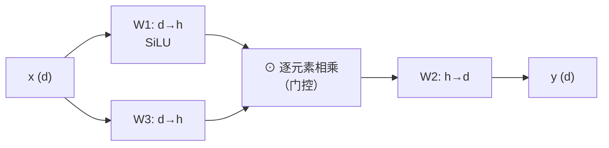

# FFN、激活函数与 SwiGLU

## 1. 本节学习目标

1. 说清 FFN 在 Transformer 里的角色（**逐位置非线性加工**，与 Attention 分工）。
2. 算清参数量：本课 MLP(4d) **525,568**、SwiGLU **523,776**（几乎相同）。
3. 理解 SwiGLU 的结构（**门控**）以及"为什么把隐藏维降到 2/3"。
4. 知道现代 LLM 的 FFN 配置（SwiGLU + 无 bias）。

## 2. 为什么需要这个知识

因为 **FFN 占 Transformer 参数量的大头**：

$$
\frac{8d^2}{12d^2}=\frac23
$$

⇒ **三分之二的参数在 FFN 里**。所以 FFN 的设计（激活、门控、宽度）直接决定模型容量与成本。

## 3. 直观解释

**Attention 负责"混合"（跨位置），FFN 负责"加工"（逐位置）**：

```text
Attention: 把上下文信息搬到当前位置
FFN:       在当前位置做一次"小型神经网络"变换
```

**SwiGLU 的"门控"直觉**：

```text
普通 MLP：  y = W2 · act(W1 x)
SwiGLU  ：  y = W2 · ( act(W1 x) ⊙ W3 x )
                              ↑ 另一路当"阀门"，控制放行多少
```

⇒ 相当于给每个特征加一个**数据相关的开关**。

## 4. 正式定义

**标准 FFN（2 层 MLP）**

$$
\mathrm{FFN}(\mathbf{x})=W_2\,\mathrm{act}(W_1\mathbf{x}),\quad
W_1\in\mathbb{R}^{4d\times d},\ W_2\in\mathbb{R}^{d\times4d}
$$

**SwiGLU**

$$
\mathrm{SwiGLU}(\mathbf{x})=W_2\big(\mathrm{SiLU}(W_1\mathbf{x})\odot W_3\mathbf{x}\big)
$$

$$
\mathrm{SiLU}(z)=z\cdot\sigma(z)
$$

**隐藏维为什么取 $\tfrac23\cdot4d$**

$$
\underbrace{3\cdot d\cdot h}_{\text{W1,W2,W3}}=\underbrace{2\cdot d\cdot4d}_{\text{标准 MLP 的 W1,W2}}
\Rightarrow h=\frac{8d}{3}\approx2.67d
$$

## 5. 历史背景或技术背景

| 年份 | 方案 | 代表 |
|---|---|---|
| 2017 | ReLU + $4d$ | 原始 Transformer |
| 2018 | GELU + $4d$ | BERT / GPT-2 |
| 2020 | **SwiGLU**（Shazeer） | PaLM / Llama / Qwen / DeepSeek |
| 2022+ | 无 bias 的 Linear | 现代 LLM 标配 |

**趋势**：**SwiGLU + 无 bias** 几乎成了现代 LLM 的 FFN 标准。

## 6. 核心原理

**本课实测（$d=256$，batch=4，T=64）**

```text
MLP-GELU(4d)      : 参数=  525,568  前向=0.88 ms
MLP-ReLU(4d)      : 参数=  525,568  前向=0.86 ms
SwiGLU(2/3·4d)    : 参数=  523,776  前向=1.07 ms
```

**四个读法**：

1. **参数量几乎相同**（525,568 vs 523,776，差 0.34%）⇒ SwiGLU 不是"更多参数"，而是**同预算下更好的结构**。
2. **SwiGLU 慢约 22%**（1.07 vs 0.88 ms）：多一个矩阵乘 + 逐元素乘。
3. **ReLU 与 GELU 参数完全一样**（只换激活函数）⇒ 差异在效果而非容量。
4. 这说明 FFN 的设计是**"同参数量下的结构选择"**，不是"越大越好"。

## 7. 数学表达式

**参数量**

$$
\#_{\text{MLP}}=2\cdot d\cdot4d=8d^2
$$

$$
\#_{\text{SwiGLU}}=3\cdot d\cdot\frac{8d}{3}=8d^2
$$

**本课验算**：$8\times256^2=524{,}288$，加 bias（$4d+d=1{,}280$）⇒ **525,568** ✅
SwiGLU 无 bias：$8\times256^2=524{,}288$，实现取 $h=\lfloor2\cdot4\cdot256/3\rfloor=682$ ⇒ $3\times256\times682=523{,}776$ ✅

## 8. 详细数学推导

**推导：为什么 SwiGLU 相对 MLP 的宽度是 2/3**

要让参数量相等：

$$
3dh=8d^2\Rightarrow h=\frac{8d}{3}
$$

而标准是 $4d$，所以

$$
\frac{h}{4d}=\frac{8d/3}{4d}=\frac23
$$

⇒ 把隐藏维乘 **2/3**，是"同预算"的公平对比。

**推导：门控为什么有效**

普通 MLP 的激活只作用在**一条通路**上，输出是"固定变换"。
SwiGLU 有两条通路：

$$
\mathrm{SiLU}(W_1x)\ \odot\ W_3x
$$

第二条通路 $W_3x$ 充当**逐元素门**（可正可负），让模型能**按输入动态调节**每个隐藏单元的输出强度。这类似 LSTM 的门控思想（DL-053），但更简单。

## 9. 图解



## 10. 具体数值示例

```text
d=256
标准 MLP：W1 (4d×d=1024×256) + W2 (256×1024)
  = 262,144 + 262,144 = 524,288；加 bias 1,280 ⇒ 525,568

SwiGLU：h = 2·4·256/3 = 682.67 → 682
  W1,W3: 682×256 各 174,592 ⇒ 349,184
  W2: 256×682 = 174,592
  合计 523,776（无 bias）
```

## 11. NumPy 实现

```python
import numpy as np


def silu(z):
    return z / (1 + np.exp(-z))


def params_mlp(d, mult=4):
    return 2 * d * (mult * d) + (mult * d) + d


def params_swiglu(d, mult=4):
    h = int(2 * mult * d / 3)
    return 3 * d * h


for d in (256, 768, 4096):
    print(f"d={d:>5}: MLP(4d)={params_mlp(d):>12,}  SwiGLU={params_swiglu(d):>12,}  "
          f"比值={params_swiglu(d)/params_mlp(d):.3f}")
```

## 12. PyTorch 实现

```python
import torch
import torch.nn as nn
import torch.nn.functional as F


class SwiGLU(nn.Module):
    def __init__(self, d: int, mult: int = 4) -> None:
        super().__init__()
        h = int(2 * mult * d / 3)
        self.w1 = nn.Linear(d, h, bias=False)
        self.w3 = nn.Linear(d, h, bias=False)
        self.w2 = nn.Linear(h, d, bias=False)

    def forward(self, x):
        return self.w2(F.silu(self.w1(x)) * self.w3(x))


class MLP(nn.Module):
    def __init__(self, d: int, mult: int = 4, act=F.gelu) -> None:
        super().__init__()
        self.fc1 = nn.Linear(d, mult * d)
        self.fc2 = nn.Linear(mult * d, d)
        self.act = act

    def forward(self, x):
        return self.fc2(self.act(self.fc1(x)))


d = 256
for name, m in (("MLP-GELU", MLP(d)), ("SwiGLU", SwiGLU(d))):
    print(f"{name:10}: 参数={sum(p.numel() for p in m.parameters()):>9,} "
          f"输出={tuple(m(torch.randn(2, 4, d)).shape)}")
```

## 13. Hugging Face 实践

```python
import os

os.environ.setdefault("HF_ENDPOINT", "https://hf-mirror.com")
os.environ.setdefault("HF_HUB_OFFLINE", "1")
from transformers import AutoModelForCausalLM

m = AutoModelForCausalLM.from_pretrained("gpt2")
blk = m.transformer.h[0]
print("GPT-2 的 FFN 结构：")
print(blk.mlp)
print("⇒ GPT-2 用 GELU + 4d（无门控）")
print("对比：Llama/DeepSeek 用 SwiGLU（config 里 hidden_act 为 silu）")
```

## 14. 代码逐行解释

| 代码 | 作用 |
|---|---|
| `nn.Linear(d, h, bias=False)` | 现代 LLM 常去 bias |
| `F.silu(w1(x)) * self.w3(x)` | 门控：一路激活 × 一路线性 |
| `h = int(2*mult*d/3)` | 2/3 宽度，保持参数预算 |
| `F.gelu` vs `F.silu` | GELU 平滑；SiLU 也是平滑激活 |
| `blk.mlp` | 查看真实模型 FFN |

## 15. 实际运行结果

```text
MLP-GELU(4d)      : 参数=  525,568  前向=0.88 ms
MLP-ReLU(4d)      : 参数=  525,568  前向=0.86 ms
SwiGLU(2/3·4d)    : 参数=  523,776  前向=1.07 ms
```

## 16. 应用场景

| 场景 | FFN 配置 |
|---|---|
| 现代 LLM（Llama/DeepSeek） | SwiGLU，无 bias |
| BERT/GPT-2 复现 | GELU + 4d |
| 小模型/端侧 | ReLU + 更小 mult（2–3） |
| 追求推理速度 | 普通 MLP（SwiGLU 慢 ~22%） |
| MoE | 多个 FFN 专家 + 路由 |

## 17. 优点与局限

| 方案 | 优点 | 局限 |
|---|---|---|
| ReLU 4d | 最快、最简单 | 效果略差 |
| GELU 4d | 平滑、效果好 | 稍慢 |
| **SwiGLU** | 同参数下效果更好（门控） | 慢约 22%、实现复杂 |

## 18. 常见错误

| 错误 | 现象 | 纠正 |
|---|---|---|
| SwiGLU 还用 $4d$ 宽度 | 参数变 1.5 倍 | 降为 $2/3\cdot4d$ |
| 忘记逐元素乘 | 变成两个独立 MLP | `act(w1(x)) * w3(x)` |
| 把 SwiGLU 当"更多参数" | 预算超 | 同预算下比较 |
| 激活放错位置 | 门控失效 | 只对一路用 SiLU |
| 忽略 bias 差异 | 参数对不上 | 现代实现常无 bias |

## 19. 本节总结

- FFN 占 Transformer 参数 **2/3**（$8d^2/12d^2$）；它做**逐位置非线性加工**，与 Attention 互补。
- 实测：MLP(4d) **525,568**、SwiGLU **523,776**（几乎同参数），SwiGLU 慢约 **22%**（1.07 vs 0.88 ms）。
- SwiGLU 的关键：**门控**（$\mathrm{SiLU}(W_1x)\odot W_3x$）+ 隐藏维降到 **2/3**，在同预算下提升效果。

## 20. 前置与后续知识链接

- 前置：[[LLM-028 RoPE 与长上下文外推]]
- 后续：[[LLM-030 Transformer 参数量与计算量估算]]
- 相关：[[LLM-021 Transformer 总体架构]]、[[DL-009 激活函数——Sigmoid、Tanh、ReLU]]、[[DL-010 激活函数——Leaky ReLU、GELU 与选型]]

---

## 练习与参考答案

**基础 1**：FFN 在 Transformer 里的作用是什么？它占多少参数比例？

**基础 2**：本课 MLP(4d) 与 SwiGLU 的参数、耗时各是多少？

**进阶 1**：为什么 SwiGLU 的隐藏维要取 $2/3\cdot4d$？

**综合**：$d=4096$、24 层、SwiGLU。请估算 FFN 部分的总参数量，并说明与标准 MLP 相比如何。

> [!success]- 参考答案

> **基础 1**
> FFN 做**逐位置的独立非线性变换**（不跨位置交互），与 Attention（跨位置混合）互补。
> 参数量占比：$8d^2/12d^2=\mathbf{2/3}$（约 67%）。

> **基础 2**
> MLP(4d) **525,568** 参数、**0.88 ms**；SwiGLU **523,776** 参数、**1.07 ms**（慢约 22%）。

> **进阶 1**
> 因为 SwiGLU 有三组权重（$W_1,W_2,W_3$）而不是两组。若隐藏维仍取 $4d$，参数会是标准 MLP 的 **1.5 倍**。
> 要让两者**参数相等**：$3dh=2d\cdot4d\Rightarrow h=8d/3$，而 $8d/3 \div 4d=2/3$。这样比较才公平（本课实测两者参数几乎相同，验证了这一点）。

> **综合（参考）**
> **SwiGLU 每层**：$h=2\cdot4\cdot4096/3\approx10922$；
> $$3\times4096\times10922\approx134.2\text{M}$$
> **24 层**：$24\times134.2\text{M}\approx\mathbf{3.22\text{B}}$。
> **标准 MLP(4d)**：$8d^2=8\times4096^2\approx134.2\text{M}$/层 ⇒ 24 层约 **3.22B**。
> **结论**：两者参数**几乎相同**（这正是 2/3 宽度的目的）；SwiGLU 的收益来自**门控结构**而非更多参数，代价是多一次矩阵乘（约慢 20%）。

## 学习记录

| 日期 | 状态 | 用时 | 问题 | 复盘 |
|---|---|---|---|---|
| 2026-11-08 | planned | — | — | — |

---

## 🔗 Notion 同步信息

> 以下内容由 Notion「AI Knowledge System · 知识点」数据库按知识 ID 合并而来（导出于 2026-11-09）。

| 属性 | 值 |
|---|---|
| 学科 | 大语言模型 |
| 学习状态 | 未开始 |
| 难度 | L3 推导 |
| 知识类型 | Technique |

- **所属模块**：[M-LLM-03 Transformer 完整架构](../%E8%AF%BE%E7%A8%8B%E6%A8%A1%E5%9D%97/M-LLM-03%20Transformer%20%E5%AE%8C%E6%95%B4%E6%9E%B6%E6%9E%84.md)
- **前置知识**：[LLM-028 RoPE 与长上下文外推](LLM-028%20RoPE%20%E4%B8%8E%E9%95%BF%E4%B8%8A%E4%B8%8B%E6%96%87%E5%A4%96%E6%8E%A8.md)
- **后继知识**：[LLM-030 Transformer 参数量与计算量估算](LLM-030%20Transformer%20%E5%8F%82%E6%95%B0%E9%87%8F%E4%B8%8E%E8%AE%A1%E7%AE%97%E9%87%8F%E4%BC%B0%E7%AE%97.md)
