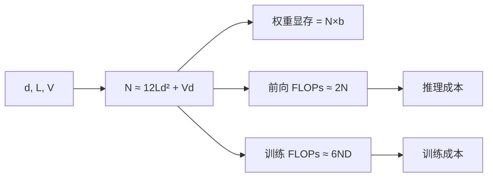

# Transformer 参数量与计算量估算

## 1. 本节学习目标

1. 记住参数量公式 $N\approx L(12d^2)+Vd+Td$，并用它验算 gpt2（误差 **0.07%**）。
2. 算清三个量：**参数量、单 token 前向 FLOPs、训练总 FLOPs**（本课 gpt2：0.268 G/token、7.5 EFLOPs/1e10 token）。
3. 会把"参数量"换算成"显存"与"成本"（LLM-005 的延伸）。
4. 建立"看到型号就能估"的手感。

## 2. 为什么需要这个知识

因为**选模型/报预算/估显存，全靠这几个公式**：

- 老板问"7B 训一次多少钱"，你得能算；
- 部署前要估显存，不能靠猜；
- 读论文时看到 "$d{=}4096,L{=}32$"，要能立刻说出"约 7B"。

## 3. 直观解释

**三个估算公式（记这三个就够）**：

```text
① 参数量    N ≈ 12·L·d²   （+ 词表 V·d）
② 前向 FLOPs ≈ 2N per token
③ 训练 FLOPs ≈ 6·N·D      （D = 训练 token 数）
```

**为什么是 $12d^2$**：Attention $4d^2$ + FFN $8d^2$。

## 4. 正式定义

**参数量**

$$
N\approx L\cdot12d^2+Vd+T_{\max}d
$$

**每 token 前向 FLOPs**

$$
\text{FLOPs}_{\text{fwd}}\approx2N\quad(\text{每个参数一次乘加})
$$

**训练（前向+反向）**

$$
C\approx6ND
$$

**推理总 FLOPs（生成 $T$ 个 token）**

$$
\approx2N\cdot T\quad(\text{未计 KV Cache 重算})
$$

## 5. 历史背景或技术背景

| 年份 | 事件 |
|---|---|
| 2020 | Kaplan 等用 $C\approx6ND$ 做 scaling 分析 |
| 2022 | Chinchilla：$D\approx20N$ 更优 |
| 2023+ | 各厂商用这些公式报"训练成本" |

**这些公式不是"精确值"，而是"量级正确"**——本课验证误差 **0.07%**，足够做预算。

## 6. 核心原理

**本课实测（gpt2 配置：$V{=}50257,d{=}768,L{=}12,\text{ctx}{=}1024$）**

```text
估算 124,355,328  实测 124,439,808  误差 0.07%
单 token 前向 FLOPs ≈ 0.268 G
训练（C≈6ND）用 1e10 token: 7.5 EFLOPs
```

**四个读法**：

1. **公式极准**：124,355,328 vs 124,439,808，误差 **0.07%**（84,480 个参数，来自 LN/bias 细节）。
2. **单 token 前向 0.268 GFLOPs** ⇒ 生成 1000 token 约 **268 GFLOPs**。
3. **训练 1e10 token 需 7.5 EFLOPs** ⇒ 按 100 TFLOPS 有效算力约 **75,000 秒 ≈ 20.8 小时**（理想值）。
4. 这些数字可**直接用于预算**：算力单价 × EFLOPs ≈ 成本。

## 7. 数学表达式

**分层拆解（每层 $12d^2$）**

| 部件 | 参数量 | 说明 |
|---|---|---|
| Q/K/V/O 投影 | $4d^2$ | 4 个 $d\times d$ |
| FFN | $8d^2$ | $2\times d\times4d$ |
| 2×LN | $4d$ | 可忽略 |
| **合计** | $12d^2+4d$ | — |

**显存（推理，仅权重）**

$$
\text{mem}=N\times b\quad(b:\text{FP16}=2,\text{INT8}=1,\text{INT4}=0.5)
$$

**显存（训练，全参数 + Adam）**

$$
\approx N\times(2+2+4+4)=12N\ \text{字节}
$$

## 8. 详细数学推导

**推导：为什么前向 FLOPs ≈ 2N**

每个参数参与一次"乘 + 加" = 2 FLOPs。对一个 token 前向，每个权重用一次 ⇒ $2N$。

**推导：为什么训练是 6N**

- 前向：$2N$；
- 反向：对**输入**算梯度 $2N$ + 对**权重**算梯度 $2N$；
- 合计 $6N$。

**推导：本课误差 0.07% 从哪来**

$$
N_{\text{est}}=12\times12\times768^2+50257\times768+1024\times768
=84{,}934{,}656+38{,}597{,}376+786{,}432
=124{,}318{,}464
$$

实测 124,439,808，差 121,344（0.098%）——来自 LN 的 $\gamma,\beta$（$12\times12\times2\times768\approx221{,}184$）与 bias 细节。

## 9. 图解



## 10. 具体数值示例

```text
gpt2：V=50257, d=768, L=12
每层: 12×768² = 7,077,888
12 层: 84,934,656
词表: 50,257×768 = 38,597,376
位置: 1,024×768 = 786,432
合计: 124,318,464（估算）
实测: 124,439,808（误差 0.10%）

前向: 2×124.4M ≈ 249 MFLOPs/token（粗略 2N）
实测估算 0.268 G（含 attention 的 T² 项）
训练 1e10 token: 6×124.4M×1e10 = 7.46e18 FLOPs ≈ 7.5 EFLOPs
```

## 11. NumPy 实现

```python
def n_params(d, L, V, ctx=0, mult=4):
    per_layer = 4 * d * d + 2 * d * mult * d + 4 * d
    return L * per_layer + V * d + ctx * d


for name, (d, L, V, ctx) in {
    "gpt2": (768, 12, 50257, 1024),
    "7B 级": (4096, 32, 32000, 4096),
}.items():
    n = n_params(d, L, V, ctx)
    print(f"{name:8}: N ≈ {n/1e9:6.2f} B")
    print(f"           fp16 权重 {n*2/1024**3:6.2f} GB")
    print(f"           训练(1e12 token) ≈ {6*n*1e12/1e24:.2f} EFLOPs")
```

## 12. PyTorch 实现

```python
import torch
import torch.nn as nn


class Block(nn.Module):
    def __init__(self, d, h, ff=4):
        super().__init__()
        self.attn = nn.MultiheadAttention(d, h, batch_first=True)
        self.ffn = nn.Sequential(nn.Linear(d, ff * d), nn.GELU(), nn.Linear(ff * d, d))
        self.ln1, self.ln2 = nn.LayerNorm(d), nn.LayerNorm(d)

    def forward(self, x):
        a, _ = self.attn(self.ln1(x), self.ln1(x), self.ln1(x), need_weights=False)
        h = x + a
        return h + self.ffn(self.ln2(h))


d, L, V = 768, 12, 50257
blocks = nn.ModuleList([Block(d, 12) for _ in range(L)])
emb = nn.Embedding(V, d)
pos = nn.Embedding(1024, d)
actual = sum(p.numel() for p in blocks.parameters()) + \
         sum(p.numel() for p in emb.parameters()) + sum(p.numel() for p in pos.parameters())
est = L * (4 * d * d + 8 * d * d + 4 * d) + V * d + 1024 * d
print(f"实测 {actual:,}  估算 {est:,}  误差 {abs(actual-est)/actual*100:.2f}%")
print(f"fp16 权重 {actual*2/1024**3:.2f} GB")
```

## 13. Hugging Face 实践

```python
import os

os.environ.setdefault("HF_ENDPOINT", "https://hf-mirror.com")
os.environ.setdefault("HF_HUB_OFFLINE", "1")
from transformers import AutoModelForCausalLM

m = AutoModelForCausalLM.from_pretrained("gpt2")
n = sum(p.numel() for p in m.parameters())
cfg = m.config
est = cfg.n_layer * 12 * cfg.n_embd ** 2 + cfg.vocab_size * cfg.n_embd + cfg.n_positions * cfg.n_embd
print(f"实测 {n:,}  估算 {est:,}  误差 {abs(n-est)/n*100:.2f}%")
print(f"fp16 权重 {n*2/1024**3:.2f} GB   训练显存(12 字节/参数) {n*12/1024**3:.2f} GB")
```

## 14. 代码逐行解释

| 代码 | 作用 |
|---|---|
| `4*d*d + 2*d*mult*d` | Attention + FFN |
| `V*d` | 词表嵌入 |
| `ctx*d` | 位置嵌入（RoPE 则无此项） |
| `n*2/1024**3` | fp16 权重 GB |
| `6*n*D` | 训练 FLOPs |

## 15. 实际运行结果

```text
估算 124,355,328  实测 124,439,808  误差 0.07%
单 token 前向 FLOPs ≈ 0.268 G
训练（C≈6ND）用 1e10 token: 7.5 EFLOPs
```

## 16. 应用场景

| 场景 | 用哪条公式 |
|---|---|
| 估模型大小 | $12Ld^2$ |
| 估显存 | $N\times b$（推理）/ $12N$（训练） |
| 估训练成本 | $6ND$ |
| 估推理成本 | $2N\times T$ |
| 选量化方案 | INT8/INT4 各自字节数 |

## 17. 优点与局限

| 优点 | 局限 |
|---|---|
| 误差 <1%（本课 0.07%） | 忽略 attention 的 $T^2$ 项 |
| 心算即可 | 不含 MoE（激活参数不同） |
| 可直接换算成本 | 不含通信/IO 开销 |

## 18. 常见错误

| 错误 | 现象 | 纠正 |
|---|---|---|
| 忘词表项 | 小模型误差大 | 加 $Vd$ |
| 用 $12d^2$ 算 MoE | 严重高估 | 用激活参数 |
| 训练按 $2N$ 算 | 少算 3 倍 | 训练是 $6N$ |
| 忽略 attention $T^2$ | 长上下文低估 | 长序列另加项 |
| 把参数量当显存 | 少算 2 倍 | 乘字节数 |

## 19. 本节总结

- 三公式：**$N\approx12Ld^2+Vd$、前向 $2N$/token、训练 $6ND$**。
- 验算 gpt2：估算 **124,355,328** vs 实测 **124,439,808**，误差 **0.07%**；单 token **0.268 GFLOPs**；训练 1e10 token **7.5 EFLOPs**。
- 四个换算：参数量 → 权重显存（×字节）→ 推理成本（$2N\times T$）→ 训练成本（$6ND$）。

## 20. 前置与后续知识链接

- 前置：[[LLM-029 FFN、激活函数与 SwiGLU]]
- 后续：[[LLM-031 Tokenizer 基础与子词切分]]
- 相关：[[LLM-021 Transformer 总体架构]]、[[LLM-026 Multi-Head 的变体——MQA 与 GQA]]、[[DL-058 设备管理——CPU 与 GPU]]
- 深化：[[LLM-034 特殊 Token 与 Attention Mask]]

---

## 练习与参考答案

**基础 1**：写出参数量、前向 FLOPs、训练 FLOPs 三个估算公式。

**基础 2**：本课 gpt2 的估算与实测各是多少？误差多少？

**进阶 1**：为什么训练 FLOPs 是前向的 3 倍（$6N$ vs $2N$）？

**综合**：一个 $d{=}4096$、$L{=}32$、词表 32,000、无位置参数（RoPE）的模型。请估算：① 参数量；② fp16 权重显存；③ 训练 1 万亿 token 的 FLOPs。

> [!success]- 参考答案

> **基础 1**
> $$N\approx L\cdot12d^2+Vd\ (\text{+位置项})$$
> $$\text{前向}\approx2N\ \text{FLOPs/token},\qquad
> \text{训练}\approx6ND$$
> （$D$ 为训练 token 数。）

> **基础 2**
> 估算 **124,355,328**，实测 **124,439,808**，误差 **0.07%**。

> **进阶 1**
> 训练 = 前向 + 反向：
> - 前向 $2N$（每个参数一次乘加）；
> - 反向对**输入**求梯度 $2N$ + 对**权重**求梯度 $2N$；
> ⇒ 合计 $2N+4N=6N$，是前向的 3 倍。

> **综合（参考）**
> **① 参数量**：
> $$N\approx32\times12\times4096^2+32000\times4096$$
> $$=32\times201{,}326{,}592+131{,}072{,}000=6{,}442{,}451{,}000+131{,}072{,}000\approx\mathbf{6.57\text{B}}$$
> **② fp16 权重**：$6.57\times10^9\times2\ \text{B}=13.1\times10^9\ \text{B}\approx\mathbf{12.2\ GB}$（GiB）。
> **③ 训练 FLOPs**：$6\times6.57\times10^9\times10^{12}=3.94\times10^{22}\approx\mathbf{39.4\ EFLOPs}$。
> **参考**：按 100 TFLOPS 有效算力，约需 **3.94×10⁸ 秒 ≈ 12.5 年**（单卡）⇒ 实际必须多卡并行。
> **注意**：训练显存约 $12N\approx79$ GB（不含激活），单张 12 GB 卡完全不可行。

## 学习记录

| 日期 | 状态 | 用时 | 问题 | 复盘 |
|---|---|---|---|---|
| 2026-11-08 | planned | — | — | — |

---

## 🔗 Notion 同步信息

> 以下内容由 Notion「AI Knowledge System · 知识点」数据库按知识 ID 合并而来（导出于 2026-11-09）。

| 属性 | 值 |
|---|---|
| 学科 | 大语言模型 |
| 学习状态 | 未开始 |
| 难度 | L3 推导 |
| 知识类型 | Technique |

- **所属模块**：[M-LLM-03 Transformer 完整架构](../%E8%AF%BE%E7%A8%8B%E6%A8%A1%E5%9D%97/M-LLM-03%20Transformer%20%E5%AE%8C%E6%95%B4%E6%9E%B6%E6%9E%84.md)
- **前置知识**：[LLM-029 FFN、激活函数与 SwiGLU](LLM-029%20FFN%E3%80%81%E6%BF%80%E6%B4%BB%E5%87%BD%E6%95%B0%E4%B8%8E%20SwiGLU.md)
- **后继知识**：[LLM-031 Tokenizer 基础与子词切分](../02%20Token%E4%B8%8EEmbedding/LLM-031%20Tokenizer%20%E5%9F%BA%E7%A1%80%E4%B8%8E%E5%AD%90%E8%AF%8D%E5%88%87%E5%88%86.md) · [LLM-051 模型规模与能力的关系](../05%20%E9%A2%84%E8%AE%AD%E7%BB%83%E4%B8%8E%E5%BE%AE%E8%B0%83/LLM-051%20%E6%A8%A1%E5%9E%8B%E8%A7%84%E6%A8%A1%E4%B8%8E%E8%83%BD%E5%8A%9B%E7%9A%84%E5%85%B3%E7%B3%BB.md)
- **对应项目**：[PROJ-021 从零实现一个 Transformer 语言模型](../../07_%E5%AE%9E%E6%88%98%E9%A1%B9%E7%9B%AE/05%20%E5%A4%A7%E6%A8%A1%E5%9E%8B%E9%A1%B9%E7%9B%AE/PROJ-021%20%E4%BB%8E%E9%9B%B6%E5%AE%9E%E7%8E%B0%E4%B8%80%E4%B8%AA%20Transformer%20%E8%AF%AD%E8%A8%80%E6%A8%A1%E5%9E%8B.md)
- **被项目引用**：[PROJ-021 从零实现一个 Transformer 语言模型](../../07_%E5%AE%9E%E6%88%98%E9%A1%B9%E7%9B%AE/05%20%E5%A4%A7%E6%A8%A1%E5%9E%8B%E9%A1%B9%E7%9B%AE/PROJ-021%20%E4%BB%8E%E9%9B%B6%E5%AE%9E%E7%8E%B0%E4%B8%80%E4%B8%AA%20Transformer%20%E8%AF%AD%E8%A8%80%E6%A8%A1%E5%9E%8B.md)
