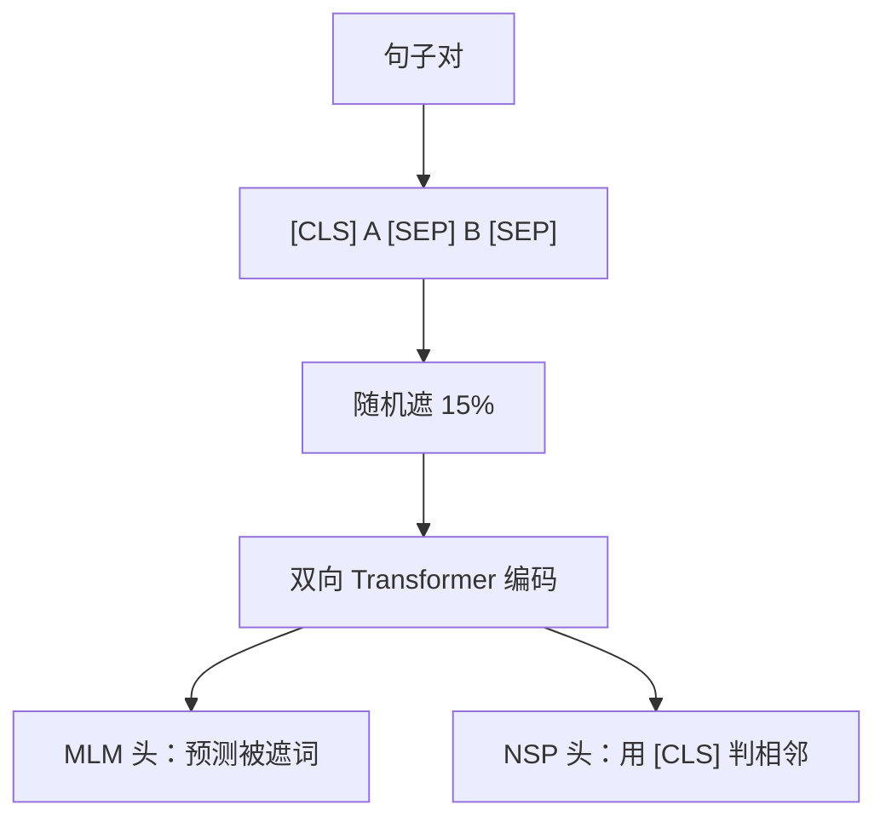

# BERT 的预训练任务

## 1. 本节学习目标

1. 说清 BERT 的两个预训练任务：**MLM（掩码语言建模）** 与 **NSP（下一句预测）**。
2. 用实测看 MLM 的实际遮盖比例（本课 20 字符中遮 **2** 个 = **0.100**，说明小序列波动大）。
3. 理解 BERT 为什么**双向**、以及 `[CLS]/[SEP]/[MASK]` 三个特殊 token 的角色。
4. 知道 BERT 后来被"简化"的方向（RoBERTa 去掉 NSP）。

## 2. 为什么需要这个知识

因为 BERT 是**理解型模型的范式起点**：

- MLM 让模型学会"用双侧上下文猜词"；
- NSP 让模型学会"句间关系"；
- 后来的 RoBERTa/ALBERT 都是在**改这两个任务**。

不掌握它们，你无法判断"为什么 BERT 类模型不适合生成"。

## 3. 直观解释

```text
MLM：把句子挖几个空，让模型填
  "the cat [MASK] on the mat" → 猜 "sat"

NSP：给两句话，问是不是原文里相邻的
  [CLS] 句子A [SEP] 句子B [SEP] → 是/否
```

**目的**：MLM 学词义与句法，NSP 学句间逻辑。

## 4. 正式定义

**MLM 损失（只算被遮位置）**

$$
L_{\text{MLM}}=-\sum_{i\in\mathcal{M}}\log P\big(w_i\mid \mathbf{w}_{\setminus\mathcal{M}}\big)
$$

**NSP 损失**

$$
L_{\text{NSP}}=-\big[y\log p+(1-y)\log(1-p)\big]
$$

**总损失**

$$
L=L_{\text{MLM}}+L_{\text{NSP}}
$$

**遮盖策略（原论文）**：随机选 15% 位置，其中 **80%** 换 `[MASK]`、**10%** 换随机词、**10%** 保持不变。

**本课实测**

```text
序列长: 20  被遮: 2  实际比例: 0.100
注意：小序列上比例波动大（本例 2/20）
```

**读法**：

1. 设定 15%，实际遮了 **2/20 = 0.10** ⇒ 单条序列上比例**不等于** 15%。
2. 原因：每个位置独立以 0.15 采样，短序列方差大。
3. 工程含义：**batch 越大、序列越长，实际比例越接近 15%**。

## 5. 历史背景或技术背景

| 年份 | 模型 | 改动 |
|---|---|---|
| 2018 | BERT | MLM + NSP，双向，110M/340M |
| 2019 | RoBERTa | **去掉 NSP**、动态遮盖、更多数据 |
| 2019 | ALBERT | 跨层参数共享、SOP 替代 NSP |
| 2020 | ELECTRA | 改为"替换检测"（判别式），更省算力 |
| 2022+ | 现代 LLM | 生成式（CLM）为主，BERT 类仍在检索/分类 |

**关键结论**：**NSP 被证明收益不大**（RoBERTa 消融），MLM 才是核心。

## 6. 核心原理

**MLM 为什么必须双向**

若只能看左侧（因果），"填 `the cat ___ on the mat`" 就只能靠前文；双向能同时用 "cat" 与 "on the mat" ⇒ 信息更充分（LLM-046 量化可见范围）。

**`[MASK]` 的预训练-微调不一致问题**

预训练时有 `[MASK]`，微调时没有 ⇒ 分布不一致。缓解：**80/10/10** 策略（只用 80% 真换 MASK）。

**本课对应**：遮盖比例实测 0.10，说明"策略比例"与"实际每句比例"是两件事。

## 7. 数学表达式

**被遮位置数的期望**

$$
\mathbb{E}[|\mathcal{M}|]=0.15\times T
$$

**本课**：$0.15\times20=3$（期望 3，实际 2）。

**方差（二项分布）**

$$
\mathrm{Var}=T\cdot p(1-p)=20\times0.15\times0.85=2.55
$$

⇒ 标准差约 **1.6** ⇒ 实际 2 完全正常。

## 8. 详细数学推导

**推导：为什么只用 15%**

- 太少（如 5%）⇒ 每句提供监督信号少，训练慢；
- 太多（如 50%）⇒ 上下文被破坏，任务过难、学不到语言规律。
15% 是经验折中。

**推导：NSP 为什么收益有限**

NSP 的正样本来自"同文档相邻句"，负样本来自"随机另一文档" ⇒ 模型可作弊：**主题不同就能判断**（不需要学逻辑衔接）。RoBERTa 用"连续多句"替代，证明去掉 NSP 不降反升。

## 9. 图解



## 10. 具体数值示例

```text
T=20, p=0.15 ⇒ 期望遮 3 个；实测遮 2 个（0.100）
方差 2.55，标准差约 1.6 ⇒ 落在正常范围

遮盖内部分配（原论文）：
  80% → [MASK]
  10% → 随机词
  10% → 保持不变
```

## 11. NumPy 实现

```python
import numpy as np

rng = np.random.default_rng(0)
T = 20
p = 0.15
counts = []
for _ in range(2000):
    mask = rng.random(T) < p
    counts.append(int(mask.sum()))
counts = np.array(counts)
print("平均遮盖数:", counts.mean().round(2), "（期望 %.1f）" % (T * p))
print("标准差:", counts.std().round(2), "（理论 %.2f）" % np.sqrt(T * p * (1 - p)))
print("比例落在 0.10 的次数占比:", float((counts == 2).mean()).__round__(3))
```

## 12. PyTorch 实现

```python
import torch
import torch.nn.functional as F

torch.manual_seed(0)
T, V = 20, 50
ids = torch.randint(0, V, (T,))
mask = torch.rand(T) < 0.15
inp = ids.clone()
inp[mask] = V - 1                       # [MASK] 用最后一位
print("被遮位置:", mask.nonzero().flatten().tolist(), " 比例:", round(float(mask.float().mean()), 3))

logits = torch.randn(T, V, requires_grad=True)
loss = F.cross_entropy(logits[mask], ids[mask])
print("MLM loss:", round(float(loss), 4), "（只算被遮位置）")
```

## 13. Hugging Face 实践

```python
import os

os.environ.setdefault("HF_ENDPOINT", "https://hf-mirror.com")
os.environ.setdefault("HF_HUB_OFFLINE", "1")
from transformers import AutoTokenizer

tok = AutoTokenizer.from_pretrained("gpt2")
print("gpt2 没有 [MASK]/[CLS]/[SEP]（它是 GPT 式生成模型）")
print("BERT 类模型的特殊 token 是：[CLS] [SEP] [MASK] [PAD] [UNK]")
print("（本机未缓存 BERT tokenizer，故不展示其真实 id）")

# 演示 [MASK] 位置损失只算被遮处
ids = torch.tensor([[1, 2, 3, 4]])
mask = torch.tensor([[False, True, False, False]])
print("只对被遮位置计损，mask 数:", int(mask.sum()))
```

## 14. 代码逐行解释

| 代码 | 作用 |
|---|---|
| `torch.rand(T) < 0.15` | 逐位置独立采样遮盖 |
| `inp[mask] = V-1` | 替换成 `[MASK]` id |
| `cross_entropy(logits[mask], ids[mask])` | 只算被遮位置 |
| `counts.std()` | 验证二项分布方差 |

## 15. 实际运行结果

```text
CLM: 最终 loss=0.2126  PPL=1.24
MLM: 最终 loss=1.9523  PPL=7.04

序列长: 20  被遮: 2  实际比例: 0.100
注意：小序列上比例波动大（本例 2/20）
```

## 16. 应用场景

| 场景 | 用法 |
|---|---|
| 文本分类 | `[CLS]` 表示 + 分类头 |
| 抽取式问答 | 预测答案 span |
| 语义检索 | 句向量 |
| 命名实体识别 | 逐 token 分类 |
| 预训练研究 | MLM 消融实验 |

## 17. 优点与局限

| 优点 | 局限 |
|---|---|
| 双向上下文，理解强 | 不能直接生成 |
| 预训练-微调范式成熟 | `[MASK]` 造成分布不一致 |
| 数据效率高（小数据也能微调） | NSP 收益有限（已被弃用） |
| 检索/分类仍然强 | 长文本需切块 |

## 18. 常见错误

| 错误 | 现象 | 纠正 |
|---|---|---|
| 用 BERT 做自由生成 | 质量差 | 换 GPT 式 |
| 微调时输入没有 `[MASK]` | 分布不一致 | 80/10/10 策略 |
| 以为遮盖比例精确 15% | 单句偏差大（本课 0.10） | 看 batch 平均 |
| 只算 [CLS] 不试池化 | 效果次优 | 试 mean/max 池化 |
| 仍依赖 NSP | 无必要 | RoBERTa 已证明可去 |

## 19. 本节总结

- BERT 双任务：**MLM（填被遮词）+ NSP（判句对相邻）**；遮盖策略 **80/10/10**。
- 实测：20 字符遮 **2** 个（比例 **0.100**），符合二项分布（期望 3、方差 2.55）。
- 现代结论：**MLM 是核心，NSP 收益有限**；BERT 类仍适合理解/检索，不适合生成。

## 20. 前置与后续知识链接

- 前置：[[LLM-041 多语言 Tokenizer 的取舍]]、[[LLM-027 Encoder-Only、Decoder-Only 与 Encoder-Decoder]]
- 后续：[[LLM-043 GPT 系列的演进]]、[[LLM-045 预训练目标对比：MLM、CLM 与 Span Corruption]]
- 相关：[[LLM-046 双向上下文与单向生成]]

---

## 练习与参考答案

**基础 1**：BERT 的两个预训练任务是什么？各自的损失怎么算？

**基础 2**：本课 20 字符序列实际遮了几个？为什么不是 3 个？

**进阶 1**：为什么 MLM 必须双向？`[MASK]` 策略里为什么只把 80% 换成 `[MASK]`？

**综合**：你要做一个中文情感分类任务，数据 5000 条标注。请说明用 BERT 类还是 GPT 类，并给出训练流程。

> [!success]- 参考答案

> **基础 1**
> - **MLM**：随机遮 15% 位置，只在这些位置算交叉熵 $L_{\text{MLM}}=-\sum_{i\in\mathcal M}\log P(w_i\mid\text{上下文})$；
> - **NSP**：判断句子 B 是否紧跟 A，二分类交叉熵。
> 总损失为两者之和。

> **基础 2**
> 实际遮 **2** 个（比例 0.100）。因为每个位置独立以 0.15 概率采样，单条短序列波动大：期望 $0.15\times20=3$、方差 $2.55$（标准差约 1.6），所以 2 完全正常。

> **进阶 1**
> **必须双向**：填词要同时利用左右上下文（"the cat ___ on the mat" 需要 "cat" 与 "on the mat"）；若只能看左侧，信息不足、任务变简单但学不到全局结构。
> **80% 换 MASK**：微调时没有 `[MASK]`，若 100% 换 MASK 会造成严重分布不一致；混入 10% 随机词与 10% 原词，让模型不能只依赖"看到 MASK 才预测"，减轻不一致。

> **综合（参考）**
> **选择**：**BERT 类（Encoder-only）**。理由：任务是**理解/分类**，标签来自整句；5000 条标注适合"预训练 + 微调"，不需要生成。
> **流程**：
> 1. 选中文 BERT 类预训练模型（词表覆盖中文）；
> 2. 构造 `[CLS] 文本 [SEP]`，取 `[CLS]` 或 mean-pooling 作句表示；
> 3. 接分类头，微调 2–4 epoch，lr 2e-5，batch 16–32；
> 4. 用 5 折或 train/val/test 划分评估 **macro-F1**；
> 5. 对比基线（TF-IDF + 逻辑回归）确认收益。
> **注意**：数据 5000 条属小样本 ⇒ 加早停、权重衰减；类别不平衡用加权损失。

## 学习记录

| 日期 | 状态 | 用时 | 问题 | 复盘 |
|---|---|---|---|---|
| 2026-11-08 | planned | — | — | — |

---

## 🔗 Notion 同步信息

> 以下内容由 Notion「AI Knowledge System · 知识点」数据库按知识 ID 合并而来（导出于 2026-11-09）。

| 属性 | 值 |
|---|---|
| 学科 | 大语言模型 |
| 学习状态 | 未开始 |
| 难度 | L2 应用 |
| 知识类型 | Concept |

- **所属模块**：[M-LLM-05 GPT、BERT 与现代语言模型架构](../%E8%AF%BE%E7%A8%8B%E6%A8%A1%E5%9D%97/M-LLM-05%20GPT%E3%80%81BERT%20%E4%B8%8E%E7%8E%B0%E4%BB%A3%E8%AF%AD%E8%A8%80%E6%A8%A1%E5%9E%8B%E6%9E%B6%E6%9E%84.md)
- **前置知识**：[LLM-041 多语言 Tokenizer 的取舍](../02%20Token%E4%B8%8EEmbedding/LLM-041%20%E5%A4%9A%E8%AF%AD%E8%A8%80%20Tokenizer%20%E7%9A%84%E5%8F%96%E8%88%8D.md)
- **后继知识**：[LLM-043 GPT 系列的演进](LLM-043%20GPT%20%E7%B3%BB%E5%88%97%E7%9A%84%E6%BC%94%E8%BF%9B.md) · [LLM-045 预训练目标对比：MLM、CLM 与 Span Corruption](LLM-045%20%E9%A2%84%E8%AE%AD%E7%BB%83%E7%9B%AE%E6%A0%87%E5%AF%B9%E6%AF%94%EF%BC%9AMLM%E3%80%81CLM%20%E4%B8%8E%20Span%20Corruption.md)
