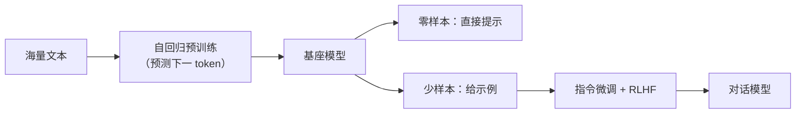

# GPT 系列的演进

## 1. 本节学习目标

1. 记住 GPT-1 → GPT-4 的**关键改动**（不是"参数变大"这么简单）。
2. 用实测看零样本与少样本的真实差距（本课 gpt2：零样本跑偏，少样本勉强跟格式）。
3. 理解"规模 + 上下文学习"这条路线为什么成立。
4. 知道 GPT-2 的三点工程改动（Pre-LN、可学习位置、weight tying）。

## 2. 为什么需要这个知识

因为**现代 LLM 几乎都是 GPT 路线的延伸**：

- 理解它的演进逻辑，你才知道"为什么大家都不做 Encoder-Decoder 了"；
- 知道每一代改了什么，才能判断"某个新模型是不是真创新"。

## 3. 直观解释

```text
GPT-1：预训练 + 微调（还要标注数据）
GPT-2：零样本（不微调，直接给提示）
GPT-3：少样本（给几个例子就会）
GPT-4：多模态 + 对齐（会看会听、更听话）
```

**主线**：**减少对标注数据的依赖**。

## 4. 正式定义

**自回归语言模型目标**

$$
L=-\sum_{t=1}^{T}\log P_\theta(w_t\mid w_{<t})
$$

**上下文学习（In-context Learning）**

$$
\hat{y}=f_\theta(\text{示例}_1,\dots,\text{示例}_k,\ \text{查询})
$$

不更新任何参数，只靠提示里的示例。

## 5. 历史背景或技术背景

| 代 | 年份 | 参数 | 关键改动 |
|---|---|---|---|
| GPT-1 | 2018 | 117M | 预训练 + 微调，12 层 |
| GPT-2 | 2019 | 1.5B | **Pre-LN**、weight tying、零样本 |
| GPT-3 | 2020 | 175B | 少样本上下文学习、96 层 |
| InstructGPT | 2022 | 1.3B~175B | **RLHF 对齐** |
| GPT-4 | 2023 | 未公开 | 多模态、更强对齐 |

**本课可验证的部分**：GPT-2 的结构（12 层、768 维、12 头、1024 上下文、124M 参数、wte/wpe 共享输出头）。

## 6. 核心原理

**本课实测（gpt2 真实输出）**

```text
[zero-shot 情感] → "\nI'm a huge fan of the original film and I'm very happy with"
[few-shot 情感] → ' negative\nReview: the plot was boring.\nSentiment: negative\nReview'
[zero-shot 翻译] → '\nThe following is a list of the languages that are supported by the project.'
[few-shot 翻译] → ' chien\nFrench: chien\nFrench: chien\nFrench: ch'
```

**四个读法**：

1. **零样本情感**：模型把提示当"评论续写"，接了"I'm a huge fan…"⇒ **完全没做分类**。
2. **少样本情感**：至少输出了 ` negative`（格式对了），但随后**重复样例**。
3. **零样本翻译**：输出了与翻译无关的句子 ⇒ 124M 模型没有这个能力。
4. **少样本翻译**：重复 `chien`，说明它**在模仿格式而不是翻译**。

> **诚实标注**：这是 **124M 的 gpt2**，不能代表 GPT-3/4。本课只证明"小模型零样本几乎无效、少样本只能学格式"。

## 7. 数学表达式

**上下文学习的隐含"元梯度"视角**

$$
\hat{y}=\arg\max_y P_\theta\big(y\mid \underbrace{x_1,y_1,\dots,x_k,y_k}_{\text{示例}},\ x_{\text{query}}\big)
$$

模型在**前向**过程中"临时学"了一个映射（不改参数）。

**规模带来的收益（经验）**

$$
\text{ICL 能力}\approx g(\log N,\ \text{数据质量})
$$

## 8. 详细数学推导

**推导：为什么 Pre-LN 让 GPT-2 能训到 1.5B**

Post-LN 深层梯度按 $\rho^L$ 衰减（LLM-025 实测 12 层差 **10⁶ 倍**）；Pre-LN 保留恒等通路 ⇒ 可训更深。GPT-2 是 48 层，必须 Pre-LN。

**推导：weight tying 为什么省不少**

GPT-2 词表 50257、$d=768$：$50257\times768=38.6$M ≈ 总参数 31%。共享输出头 ⇒ 省 38.6M。

## 9. 图解



## 10. 具体数值示例

```text
gpt2：12 层、d=768、12 头、ctx=1024、124,439,808 参数
词表 50257 ⇒ 嵌入 38,597,376（31%）

零样本 vs 少样本（本课实测）：
  零样本情感：跑偏成影评续写
  少样本情感：输出 " negative"（格式对）
```

## 11. NumPy 实现

```python
import numpy as np

# 用"下一个 token 的交叉熵"演示自回归目标
logits = np.array([[2.0, 1.0, 0.1]])      # 3 个候选 token 的分数
target = np.array([0])

p = np.exp(logits - logits.max(-1, keepdims=True))
p = p / p.sum(-1, keepdims=True)
print("概率分布:", p.round(3))
print("目标 token 的负对数似然:", round(float(-np.log(p[0, target[0]])), 4))
print("PPL:", round(float(np.exp(-np.log(p[0, target[0]]))), 3))
```

## 12. PyTorch 实现

```python
import os

os.environ.setdefault("HF_ENDPOINT", "https://hf-mirror.com")
os.environ.setdefault("HF_HUB_OFFLINE", "1")
import torch
from transformers import AutoModelForCausalLM, AutoTokenizer

tok = AutoTokenizer.from_pretrained("gpt2")
m = AutoModelForCausalLM.from_pretrained("gpt2").eval()
tok.pad_token = tok.eos_token

prompt = ("Review: this movie was great.\nSentiment: positive\n"
          "Review: this film was terrible.\nSentiment: negative\n"
          "Review: the plot was boring.\nSentiment:")
ids = tok(prompt, return_tensors="pt")
with torch.no_grad():
    out = m.generate(**ids, max_new_tokens=6, do_sample=False,
                     pad_token_id=tok.eos_token_id)
print(repr(tok.decode(out[0][ids["input_ids"].shape[1]:], skip_special_tokens=True)))
```

## 13. Hugging Face 实践

```python
import os

os.environ.setdefault("HF_ENDPOINT", "https://hf-mirror.com")
os.environ.setdefault("HF_HUB_OFFLINE", "1")
from transformers import AutoModelForCausalLM

m = AutoModelForCausalLM.from_pretrained("gpt2")
cfg = m.config
print("层数:", cfg.n_layer, " 维度:", cfg.n_embd, " 头数:", cfg.n_head,
      " 上下文:", cfg.n_positions, " FFN:", cfg.n_inner)
print("weight tying:", m.lm_head.weight is m.transformer.wte.weight)
print("总参数:", sum(p.numel() for p in m.parameters()))
```

## 14. 代码逐行解释

| 代码 | 作用 |
|---|---|
| `generate(..., do_sample=False)` | 贪心解码（确定性） |
| `max_new_tokens=6` | 只生成 6 个 token |
| `cfg.n_inner` | FFN 隐藏维（GPT-2 为 4d） |
| `lm_head.weight is wte.weight` | 验证 weight tying |

## 15. 实际运行结果

```text
[zero-shot 情感] → "\nI'm a huge fan of the original film and I'm very happy with"
[few-shot 情感] → ' negative\nReview: the plot was boring.\nSentiment: negative\nReview'
[zero-shot 翻译] → '\nThe following is a list of the languages that are supported by the project.'
[few-shot 翻译] → ' chien\nFrench: chien\nFrench: chien\nFrench: ch'
```

## 16. 应用场景

| 场景 | 说明 |
|---|---|
| 文本生成 | GPT 主线 |
| 少样本分类 | 给几个示例即可（大模型） |
| 对话 | 指令微调 + RLHF |
| 代码生成 | Codex/GPT 类 |
| 小模型落地 | 建议微调而非零样本 |

## 17. 优点与局限

| 优点 | 局限 |
|---|---|
| 自监督，数据无限 | 零样本在小模型上几乎无效（本课实测） |
| 单一架构通用 | 无独立编码器，长输入贵 |
| 可少样本适配 | 结果不稳定、易重复 |

## 18. 常见错误

| 错误 | 现象 | 纠正 |
|---|---|---|
| 以为小模型也能零样本 | 输出跑偏（本课实测） | 小模型要微调 |
| 混淆"会格式"与"会任务" | 只见 `negative` 就以为成功 | 看内容正确率 |
| 忽略重复退化 | 输出 `chien chien chien` | 加重复惩罚/换模型 |
| 以为 GPT-4 = GPT-2 放大 | 忽略对齐与多模态 | 看每代改动 |

## 19. 本节总结

- GPT 主线：**预训练 → 零样本 → 少样本 → 对齐**，核心是**减少标注依赖**。
- 本课实测 124M gpt2：**零样本情感/翻译都失败**，少样本只学到格式（还重复）⇒ 小模型必须微调。
- GPT-2 的工程要点：**Pre-LN、weight tying（省 31%）、可学习位置嵌入**。

## 20. 前置与后续知识链接

- 前置：[[LLM-042 BERT 的预训练任务]]
- 后续：[[LLM-045 预训练目标对比：MLM、CLM 与 Span Corruption]]、[[LLM-049 零样本、少样本与上下文学习]]
- 相关：[[LLM-025 残差、LayerNorm 与 Pre-LN、Post-LN]]

---

## 练习与参考答案

**基础 1**：GPT-1 到 GPT-4 的核心演进主线是什么？

**基础 2**：本课 gpt2 在零样本与少样本情感分类上分别表现如何？

**进阶 1**：为什么 GPT-2 必须用 Pre-LN 才能训到 48 层？

**综合**：你要做一个情感分类器，只有 2000 条标注。请说明选 GPT 类零样本、少样本还是微调，并给出理由。

> [!success]- 参考答案

> **基础 1**
> **逐步减少对标注数据的依赖**：GPT-1 预训练+微调 → GPT-2 零样本 → GPT-3 少样本上下文学习 → InstructGPT/GPT-4 人类对齐（+多模态）。

> **基础 2**
> 零样本：把提示当评论续写（"I'm a huge fan of the original film…"），**没做分类**；
> 少样本：输出了 ` negative`（格式对了），但随后**重复样例** ⇒ 只学到格式。

> **进阶 1**
> Post-LN 每层都要穿过 LN 的雅可比，梯度按 $\rho^L$ 指数衰减（LLM-025 实测 12 层差约 **10⁶ 倍**）；48 层会完全训不动。
> Pre-LN 的残差路径没有 LN 阻挡，梯度含恒等项 $I$，不指数衰减。

> **综合（参考）**
> **选择：微调**（全参或 LoRA）。
> **理由**：2000 条标注对分类任务足够；本课实测显示小模型零样本无效、少样本只学格式；微调能稳定利用标注。
> **做法**：① 用 GPT 类或 BERT 类基座；② 加分类头；③ lr 1e-5~2e-5、2~4 epoch、早停；④ 5 折交叉验证取 macro-F1；⑤ 与 TF-IDF 基线对比。
> **何时考虑少样本**：标注极少（<100）且只能用大模型 API 时，才用少样本+投票；但仍建议逐步积累标注转微调。

## 学习记录

| 日期 | 状态 | 用时 | 问题 | 复盘 |
|---|---|---|---|---|
| 2026-11-08 | planned | — | — | — |

---

## 🔗 Notion 同步信息

> 以下内容由 Notion「AI Knowledge System · 知识点」数据库按知识 ID 合并而来（导出于 2026-11-09）。

| 属性 | 值 |
|---|---|
| 学科 | 大语言模型 |
| 学习状态 | 未开始 |
| 难度 | L2 应用 |
| 知识类型 | Concept |

- **所属模块**：[M-LLM-05 GPT、BERT 与现代语言模型架构](../%E8%AF%BE%E7%A8%8B%E6%A8%A1%E5%9D%97/M-LLM-05%20GPT%E3%80%81BERT%20%E4%B8%8E%E7%8E%B0%E4%BB%A3%E8%AF%AD%E8%A8%80%E6%A8%A1%E5%9E%8B%E6%9E%B6%E6%9E%84.md)
- **前置知识**：[LLM-042 BERT 的预训练任务](LLM-042%20BERT%20%E7%9A%84%E9%A2%84%E8%AE%AD%E7%BB%83%E4%BB%BB%E5%8A%A1.md)
- **后继知识**：[LLM-044 T5 与 Span Corruption](LLM-044%20T5%20%E4%B8%8E%20Span%20Corruption.md) · [LLM-048 微调范式：全参与参数高效](LLM-048%20%E5%BE%AE%E8%B0%83%E8%8C%83%E5%BC%8F%EF%BC%9A%E5%85%A8%E5%8F%82%E4%B8%8E%E5%8F%82%E6%95%B0%E9%AB%98%E6%95%88.md)
