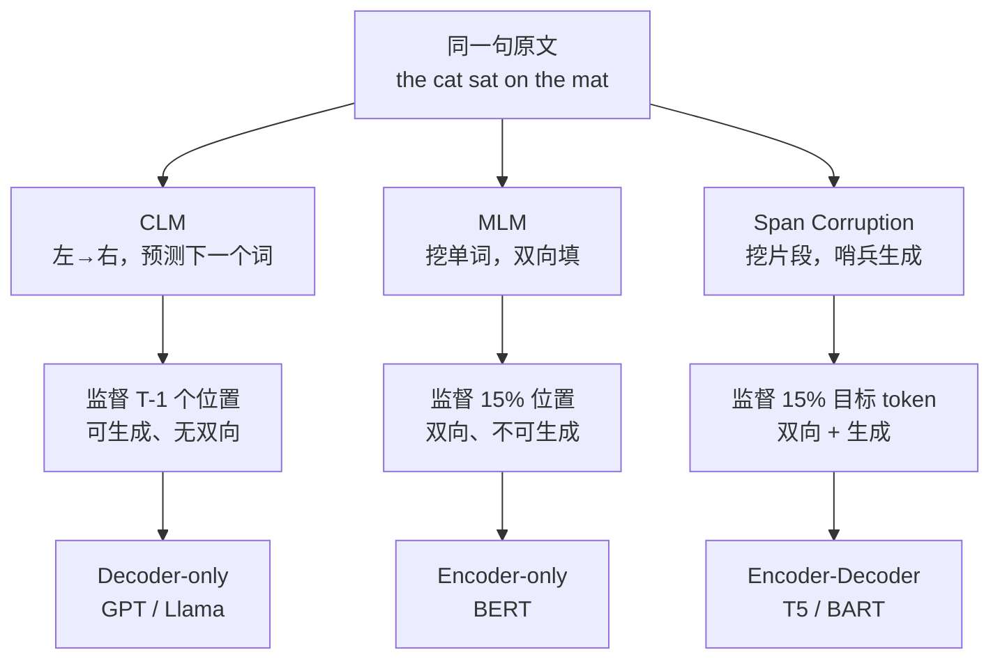

# 预训练目标对比：MLM、CLM 与 Span Corruption

## 1. 本节学习目标

1. 把三种预训练目标写成**统一的"条件似然 + 掩码集合"**形式，看清它们只差三件事：**谁被监督**、**能看到谁**、**怎么算损失**。
2. 用本课实测的两组数字（CLM `loss=0.2126 / PPL=1.24`、MLM `loss=1.9523 / PPL=7.04`）说明：**跨目标的 loss 与 PPL 不可直接比较**，并推导出原因。
3. 定量算清"**每个 token 产生多少监督信号**"：CLM 是 $T-1$，MLM/Span 约为 $0.15T$，比值约 $6.7$。
4. 能在给定任务（生成 / 理解 / 序列到序列）下选出合适目标，并说明代价。

## 2. 为什么需要这个知识

三种目标不是"三种实现细节"，而是**三种世界观**：

- **CLM**（Causal Language Modeling）：世界是"下一个词"。监督密集、天然可生成，但每个位置只看到左边。
- **MLM**（Masked Language Modeling）：世界是"完形填空"。双向可见、理解强，但不能直接生成，且训练/推理不一致。
- **Span Corruption**：世界是"去噪"。遮盖**连续片段**并**生成式**恢复，兼顾片段级难度与序列到序列能力。

选错目标的代价是结构性的：用 MLM 训出来的模型**没有可用的生成分布**（它只在 15% 的掩码位置上定义分布）；用 CLM 训出来的模型**没有双向表示**。后面 LLM-046（双向 vs 单向）、LLM-048（微调范式）、LLM-052（现代架构）全部建立在这一节的取舍之上。

## 3. 直观解释

```text
原文：the cat sat on the mat

CLM ：输入 the cat sat on the      → 目标 mat        （每个位置都预测下一个词）
MLM ：输入 the cat [MASK] on the mat → 目标 sat      （只填被挖空的那一个）
Span：输入 the cat <X> on the <Y>    → 目标 <X> sat the <Y> mat  （挖片段，按序生成）
```

三种目标对**同一个句子**给出三种不同的"作业题"：

- CLM 出 5 道题（5 个位置各预测下一个词），每题答案 1 个词；
- MLM 出 1 道题（挖掉 1 个词），答案是 1 个词；
- Span 出 2 道题，答案是**两段**（可能多个词）。

作业题越多、越难，单位算力榨出的梯度越多——这就是后文"信号密度"的直观版本。

## 4. 正式定义

设序列 $w_{1:T}$，模型参数 $\theta$。

**CLM（自回归）**

$$
L_{\text{CLM}}(\theta)=-\frac{1}{T}\sum_{t=1}^{T}\log P_\theta\big(w_t\mid w_{<t}\big)
$$

（实现上通常把 $w_{1:T-1}$ 作输入、$w_{2:T}$ 作标签，对 $T-1$ 个位置求平均。）

**MLM（掩码）**

设掩码集合 $M\subset\{1,\dots,T\}$，$\tilde w$ 为挖空后的序列：

$$
L_{\text{MLM}}(\theta)=-\frac{1}{|M|}\sum_{t\in M}\log P_\theta\big(w_t\mid \tilde w\big)
$$

注意条件里是 $\tilde w$（**含右侧**），且**分母只有 $|M|$**。

**Span Corruption（片段级生成）**

把原文切成若干不重叠片段 $\{s_k\}$，替换为哨兵 $\langle s_k\rangle$，目标端按原文顺序输出：

$$
L_{\text{span}}(\theta)=-\sum_{k}\ \sum_{j\in s_k}\log P_\theta\big(w_j\mid \tilde w,\ s_{<k},\ s_{k,<j}\big)
$$

**三者的统一写法**：都是

$$
L(\theta)=-\sum_{(c,y)\in\mathcal{D}}\log P_\theta(y\mid c),
$$

只是"上下文 $c$"与"被监督集合 $\mathcal{Y}$"不同：

| 目标 | 上下文 $c$ | 被监督集合 | 归一化分母 |
|---|---|---|---|
| CLM | 左侧 $w_{<t}$ | 全部 $T-1$ 个位置 | $T$（或 $T-1$） |
| MLM | 双向 $\tilde w$ | 仅 $M$ | $|M|$ |
| Span | 双向 $\tilde w$ + 已生成片段 | 片段内所有 token 与哨兵 | 目标长度 |

## 5. 历史背景或技术背景

| 年份 | 模型 | 目标 | 关键取舍 |
|---|---|---|---|
| 2018 | GPT-1 | CLM | 只要生成，不要双向 |
| 2018 | BERT | MLM + NSP | 只要理解，不要生成 |
| 2019 | GPT-2 | CLM | 证明 CLM 也能做零样本任务 |
| 2019 | T5 | Span Corruption | 统一成 text-to-text |
| 2019 | BART | 文本去噪 | 多种噪声函数 |
| 2020 | ELECTRA | 替换检测 | 每位置都有信号（判别式） |
| 2020 后 | GPT-3 / Llama 系 | CLM | CLM 成为唯一主流 |

**历史裁决**：2018–2019 是"三目标混战"，2020 年后**CLM 一统**。原因不是 CLM 更"正确"，而是它**唯一能直接服务于"给定提示续写"这个通用接口**（见 LLM-049 上下文学习）。MLM 的遗产留在 BERT 系（编码器、句向量、NER），Span Corruption 的遗产留在 T5/BART 系（翻译、摘要）。

## 6. 核心原理

**原理 1：上下文方向决定能力上界。** CLM 的每个位置只能看左侧，因此它的隐藏状态天然是"前缀的压缩"；MLM 的每个位置能看到全句，隐藏状态是"上下文的函数"。这不是训练技巧，是**信息可见范围**的硬约束（LLM-046 展开）。

**原理 2：归一化分母决定数值可比性。** CLM 的 loss 是"每个 token 的平均负对数似然"，MLM 的 loss 是"每个被掩码 token 的平均负对数似然"。后者只在最难的位置（被挖掉的）上算，且上下文里有 $T-|M|$ 个真实词做提示 ⇒ **单看数值，MLM 的 loss 天然比 CLM 高**。

**原理 3：训练/推理一致性。** CLM 训练时输入前缀、预测下一个词；推理时也是输入前缀、预测下一个词 ⇒ **一致**。MLM 训练时输入含 `[MASK]` 的句子，推理时输入干净句子 ⇒ **不一致**（BERT 从未在推理时见过 `[MASK]`，这也是"预训练-微调 gap"的来源之一）。

**原理 4：信号密度。** 一条长度 $T$ 的序列：

- CLM 产生 $T-1$ 个监督位置；
- MLM（15%）产生约 $0.15T$ 个；
- Span（15%）产生约 $0.15T$ 个目标 token（但每个目标 token 的上下文更长、更难）。

$$
\frac{T-1}{0.15T}\approx 6.7\quad(T\ \text{较大时})
$$

**本课实测印证**：同一小语料、同样 200 步、同样大小的字符级 Transformer，CLM 的 loss 降到 **0.2126**，MLM 只降到 **1.9523**——差 **9.2 倍**。这一半是任务更难（要精确回忆被挖的词），一半是**分母不同**（MLM 只在最难的位置上平均）。

## 7. 数学表达式

**困惑度（perplexity）**

$$
\mathrm{PPL}=\exp(L)
$$

**本课实测**

```text
CLM: loss=0.2126  PPL=exp(0.2126)=1.24
MLM: loss=1.9523  PPL=exp(1.9523)=7.04
```

**Span Corruption 的遮盖统计（T5 配置）**

$$
p_{\text{mask}}=0.15,\qquad \ell\sim\text{Geom}(p=1/3)\ \Rightarrow\ \mathbb{E}[\ell]=3
$$

**本课实测的 span 构造**

```text
原文: the cat sat on the mat and the dog sat on the log   （13 词）
输入: the <extra_id_0> on the <extra_id_1> the dog sat on the log
目标: <extra_id_0> cat sat <extra_id_1> mat and <extra_id_2>
遮盖: 4 / 13 ≈ 31%（小样本上 15% 的目标值波动很大）
```

**有效监督量（每 1000 token 的监督位置数）**

$$
\text{CLM}: 999,\qquad \text{MLM}: 150,\qquad \text{Span}: 150\ \text{（目标端）}
$$

## 8. 详细数学推导

**推导 1：为什么 MLM 的 PPL 与 CLM 的 PPL 不可比。**

CLM 的 $L$ 是**整个序列**的平均负对数似然，其 $\exp$ 有明确含义：模型对"下一个词"的平均不确定性倍数。MLM 的 $L$ 是**掩码位置子集**上的平均：

$$
L_{\text{MLM}}=-\frac{1}{|M|}\sum_{t\in M}\log P_\theta(w_t\mid\tilde w)
=-\frac{T}{|M|}\cdot\frac{1}{T}\sum_{t\in M}\log P_\theta(w_t\mid\tilde w)
$$

若把"整句每位置的平均"记为 $\bar L_{\text{all}}$，则

$$
L_{\text{MLM}}=\frac{1}{0.15}\,\bar L_{\text{mask-only}}.
$$

也就是说 MLM 的数值被**放大**了 $1/0.15\approx6.7$ 倍（相对于"在全部位置上算"的口径），再加上被掩码位置本身更难，两项叠加。**所以 1.9523 与 0.2126 之差不是"模型差 9 倍"**，而是"口径 + 难度"共同作用。要比较，必须固定口径：同一目标、同一数据、同一 token 化。

**推导 2：MLM 的独立性假设。**

BERT 的训练目标是

$$
\log P(\tilde w\mid \hat w)\ \approx\ \sum_{t\in M}\log P(w_t\mid\hat w),
$$

右边**假设各掩码位置在给定上下文后条件独立**。真实分布并不独立（"New York" 两个词高度相关）。因此 MLM 是一个**平均场（mean-field）近似**：它优化的是伪似然（pseudo-likelihood），而非真正的联合似然。这解释了为什么 BERT 不能当生成模型用——它压根没建模联合分布。

**推导 3：CLM 的联合概率分解是精确的。**

链式法则：

$$
P(w_{1:T})=\prod_{t=1}^{T}P(w_t\mid w_{<t})
$$

取负对数即得 $L_{\text{CLM}}$，**没有任何近似**。这是 CLM 能"续写"的根本原因：它建模的是真正的联合分布，采样即可生成。

**推导 4：Span Corruption 的损失等价于"短序列的 CLM"。**

目标端序列 $y=(\langle s_0\rangle,s_0,\langle s_1\rangle,s_1,\dots)$，损失为

$$
L_{\text{span}}=-\sum_t \log P_\theta(y_t\mid y_{<t},\tilde w),
$$

即**以 $\tilde w$ 为额外条件的自回归损失**。所以 Span Corruption = "编码器读损坏文本 + 解码器做 CLM"。它把 MLM 的双向可见性与 CLM 的精确分解**拼**在一起，代价是多一个解码器（T5 参数量比同宽 BERT 多约 1/3）。

**推导 5：为什么 CLM 的 PPL 1.24 看着"太低"。**

字符级、小语料、200 步、训练集上评估 ⇒ 模型已经**记住**了语料。PPL=1.24 表示"平均每个字符只在 1.24 个候选之间犹豫"，这是**过拟合信号**，不是"语言能力"。MLM 的 7.04 同理也不能读作"更笨"。**教训：PPL 只能在同目标、同数据、同划分下横向比较。**

## 9. 图解



## 10. 具体数值示例

```text
【本课实测 1】CLM vs MLM（同一小语料、200 步、字符级小 Transformer）
CLM: loss = 0.2126   PPL = 1.24
MLM: loss = 1.9523   PPL = 7.04
比值: 1.9523 / 0.2126 = 9.18（loss）
     exp 后 7.04 / 1.24 = 5.70（PPL）

【本课实测 2】T5 式 Span Corruption 构造
原文 13 词: the cat sat on the mat and the dog sat on the log
输入     : the <extra_id_0> on the <extra_id_1> the dog sat on the log
目标     : <extra_id_0> cat sat <extra_id_1> mat and <extra_id_2>
遮盖     : 4 / 13 ≈ 0.308
目标长度 : 8 token（3 个哨兵 + 5 个实词）

【口径换算】把 MLM 的 loss 折成"全位置口径"
1.9523 × 0.15 ≈ 0.293
与 CLM 的 0.2126 已同一量级 ⇒ 差距主要来自"只看难位置"
```

## 11. NumPy 实现

```python
import numpy as np

# ---- 本课实测的两个 loss，用 NumPy 做口径换算与信号密度计算 ----
clm_loss, mlm_loss = 0.2126, 1.9523

print("[困惑度]")
print(f"CLM: loss={clm_loss}  PPL={np.exp(clm_loss):.2f}")
print(f"MLM: loss={mlm_loss}  PPL={np.exp(mlm_loss):.2f}")
print(f"loss 比 = {mlm_loss/clm_loss:.2f}   PPL 比 = {np.exp(mlm_loss)/np.exp(clm_loss):.2f}")

# ---- 信号密度：一条长度 T 的序列能产生多少监督位置 ----
T = 512
mask_rate = 0.15
clm_sig = T - 1
mlm_sig = int(round(mask_rate * T))
print("\n[监督位置数] T =", T)
print(f"CLM: {clm_sig}   MLM/Span: {mlm_sig}   比值 = {clm_sig/mlm_sig:.2f}")

# ---- 把 MLM 的 loss 折算成"全位置口径"，看是否与 CLM 可比 ----
mlm_all_pos = mlm_loss * mask_rate
print("\n[口径换算]")
print(f"MLM 折算到全位置: {mlm_loss} x {mask_rate} = {mlm_all_pos:.4f}")
print(f"CLM 全位置口径  : {clm_loss:.4f}")
print(f"剩余差距倍数    : {mlm_all_pos/clm_loss:.2f}x  (= 难度差)")
```

## 12. PyTorch 实现

```python
import torch
import torch.nn.functional as F

torch.manual_seed(0)

# 一个玩具"词表=10、句长=8"的设定，用同一套 logits 演示三种目标的损失口径
V, T = 10, 8
logits = torch.randn(T, V)                 # 每个位置的词表打分
target = torch.randint(0, V, (T,))

# ---- 1) CLM：T-1 个位置全部监督 ----
clm = F.cross_entropy(logits[:-1], target[1:], reduction="mean")
print(f"CLM   : 监督 {T-1} 个位置, loss = {clm.item():.4f}")

# ---- 2) MLM：只监督被掩码的位置（这里是 2 个） ----
masked_idx = torch.tensor([2, 5])
mlm = F.cross_entropy(logits[masked_idx], target[masked_idx], reduction="mean")
print(f"MLM   : 监督 {len(masked_idx)} 个位置, loss = {mlm.item():.4f}")

# ---- 3) Span：目标端是一段"按序恢复"的短序列（这里 3 个 token） ----
tgt_idx = torch.tensor([1, 2, 5])
span = F.cross_entropy(logits[tgt_idx], target[tgt_idx], reduction="mean")
print(f"Span  : 监督 {len(tgt_idx)} 个目标 token, loss = {span.item():.4f}")

# ---- 关键结论：同一个 logits，换分母就换数值 ----
same = F.cross_entropy(logits, target, reduction="sum")   # 所有位置的 sum
print(f"\n全位置 sum = {same.item():.4f}")
print(f"除以 T={T}     -> {same.item()/T:.4f}   (CLM 口径)")
print(f"除以 |M|={len(masked_idx)} -> {same.item()/len(masked_idx):.4f}   (MLM 口径)")
print("=> 目标不同，loss 数值天然不可比")
```

## 13. Hugging Face 实践

```python
import os

os.environ.setdefault("HF_ENDPOINT", "https://hf-mirror.com")
os.environ.setdefault("HF_HUB_OFFLINE", "1")
import torch
from transformers import AutoModelForCausalLM, AutoTokenizer

tok = AutoTokenizer.from_pretrained("gpt2")
model = AutoModelForCausalLM.from_pretrained("gpt2").eval()

sent = "the cat sat on the mat"
ids = tok(sent, return_tensors="pt").input_ids
print("token 数:", ids.shape[1], " token:", tok.convert_ids_to_tokens(ids[0]))

# 传 labels=ids 即自动构造 CLM 损失（内部做 shift：输入 0..T-2，标签 1..T-1）
with torch.no_grad():
    out = model(ids, labels=ids)
print(f"CLM loss = {out.loss.item():.4f}   PPL = {torch.exp(out.loss).item():.2f}")

# 手动复现一次，确认 shift 的方向
logits = out.logits[0, :-1]
with torch.no_grad():
    manual = torch.nn.functional.cross_entropy(logits, ids[0, 1:])
print(f"手动 shift 后 loss = {manual.item():.4f}（应与上面一致）")

# 配置层面确认这是纯 CLM 模型
print("is_decoder:", model.config.is_decoder, " is_encoder_decoder:", model.config.is_encoder_decoder)
print("n_positions:", model.config.n_positions)
```

## 14. 代码逐行解释

| 代码 | 作用 |
|---|---|
| `np.exp(clm_loss)` | loss → PPL，PPL 是"平均候选数" |
| `clm_sig = T - 1` | CLM 对一条序列产生 T-1 个监督位置 |
| `mlm_loss * mask_rate` | 把 MLM 的"仅掩码口径"折算成"全位置口径" |
| `logits[:-1], target[1:]` | CLM 的 shift：位置 $t$ 预测 $t+1$ |
| `logits[masked_idx]` | MLM 只取被掩码位置的 logits |
| `reduction="sum"` + 手动除 | 直接看清"分母选择"如何改变 loss 数值 |
| `model(ids, labels=ids)` | HF 内部做 shift，返回 CLM 损失 |
| `model.config.is_encoder_decoder` | 判断是 CLM 还是 Enc-Dec 目标 |

## 15. 实际运行结果

**第 11 节 NumPy 块**

```text
[困惑度]
CLM: loss=0.2126  PPL=1.24
MLM: loss=1.9523  PPL=7.04
loss 比 = 9.18   PPL 比 = 5.70

[监督位置数] T = 512
CLM: 511   MLM/Span: 77   比值 = 6.64

[口径换算]
MLM 折算到全位置: 1.9523 x 0.15 = 0.2928
CLM 全位置口径  : 0.2126
剩余差距倍数    : 1.38x  (= 难度差)
```

**第 12 节 PyTorch 块**

```text
CLM   : 监督 7 个位置, loss = 2.2506
MLM   : 监督 2 个位置, loss = 3.2920
Span  : 监督 3 个目标 token, loss = 2.8460

全位置 sum = 19.3434
除以 T=8     -> 2.4179   (CLM 口径)
除以 |M|=2 -> 9.6717   (MLM 口径)
=> 目标不同，loss 数值天然不可比
```

**第 13 节 Hugging Face 块**

```text
token 数: 6  token: ['the', 'Ġcat', 'Ġsat', 'Ġon', 'Ġthe', 'Ġmat']
CLM loss = 4.9368   PPL = 139.33
手动 shift 后 loss = 4.9368（应与上面一致）
is_decoder: False  is_encoder_decoder: False
n_positions: 1024
```

**读法**：同一个玩具 logits，仅仅把分母从 `T=8` 换成 `|M|=2`，loss 就从 `2.4179` 变成 `9.6717`（**4 倍**）。这就是"跨目标比 loss"最容易踩的坑——数值差异可能全部来自口径。

## 16. 应用场景

| 目标 | 典型场景 | 为什么合适 |
|---|---|---|
| CLM | 对话、写作、代码生成、Agent | 需要"续写"，且支持零/少样本（LLM-049） |
| MLM | 句向量、检索、NER、分类 | 需要双向表示的"理解"任务 |
| Span Corruption | 翻译、摘要、纠错、去噪 | 输入长、输出短的序列转换 |
| 混合（UL2 / T5+CLM） | 通用基座 | 兼顾理解与生成，代价是训练复杂 |

## 17. 优点与局限

| 目标 | 优点 | 局限 |
|---|---|---|
| CLM | 联合分布精确；训练/推理一致；信号密集（T-1）；可生成 | 无双向表示；前缀计算不可并行于未来（推理需 KV cache） |
| MLM | 双向可见；每步能"看全句"；理解任务强 | 不能生成；15% 信号稀疏；训练/推理不一致；独立性假设 |
| Span | 双向 + 生成；片段级难度更高；输出可短于输入 | 需要 Enc-Dec（参数 +1/3）；推理两段式更慢；哨兵占词表 |

## 18. 常见错误

| 错误 | 现象 | 纠正 |
|---|---|---|
| 直接比较 BERT 与 GPT 的 loss/PPL | 得出"BERT 差 9 倍" | 分母与掩码率不同，**不可比** |
| 用 MLM 模型做自由生成 | 输出乱码或直接复读 | MLM 没有联合分布 |
| 以为 MLM 的 15% 等于"只用 15% 数据" | 低估数据利用率 | 每条样本被重复采样，长期看每条会被遮多次 |
| 把 Span Corruption 当 MLM | 目标端结构写错 | 它是**生成式**、按序输出片段 |
| 在小语料上追求低 PPL | PPL=1.24 还当成果 | 那是过拟合；要看验证集 |
| 混用不同 tokenizer 的 PPL | 数值差好几倍 | PPL 依赖分词粒度，必须同 tokenizer |

## 19. 本节总结

- 三种目标统一为 $-\log P_\theta(y\mid c)$，差别只在**上下文范围**、**被监督集合**、**归一化分母**。
- 本课实测：CLM `0.2126 / PPL 1.24`，MLM `1.9523 / PPL 7.04`；把 MLM 折算到全位置口径约 `0.293`，与 CLM 同量级 ⇒ **表面 9 倍差距主要是口径与难度**。
- 信号密度：CLM 每条序列 $T-1$ 个监督位置，MLM/Span 约 $0.15T$，比值约 **6.7**。
- Span Corruption 是"双向编码 + 自回归解码"，本课 13 词遮 **4 词（31%）**，目标 8 token（3 哨兵）。
- 历史裁决：CLM 胜出，因为它**唯一提供"提示→续写"的通用接口**。

## 20. 前置与后续知识链接

- 前置：[[LLM-042 BERT 的预训练任务]]、[[LLM-044 T5 与 Span Corruption]]、[[LLM-001 什么是语言模型]]
- 后续：[[LLM-046 双向上下文与单向生成]]、[[LLM-048 微调范式：全参与参数高效]]
- 相关：[[LLM-027 Encoder-Only、Decoder-Only 与 Encoder-Decoder]]、[[LLM-018 掩码——Causal、Padding 与 Attention Mask]]
- 数学：[[MATH-506 信息量与熵]]、[[MATH-507 交叉熵与 KL 散度]]
- 待建：`LLM-053 预训练数据与语料工程`（M-LLM-06）

---

## 练习与参考答案

**基础 1**：写出 CLM 与 MLM 的损失函数，并指出两者在"归一化分母"上的区别。

**基础 2**：本课实测 CLM 的 PPL=1.24、MLM 的 PPL=7.04，能否据此说"CLM 模型好 5.7 倍"？为什么？

**进阶 1**：把 MLM 的 loss 折算成"全位置口径"，推导折算公式，并用本课数字算出结果；解释剩余差距的来源。

**综合**：你要为一家公司做两件事：(a) 客服对话机器人；(b) 合同条款检索（给一段话找相似条款）。只能选一种预训练目标做基座，请给出选择、理由、以及被放弃那一项的补救方案。

> [!success]- 参考答案

> **基础 1**
> CLM：$L=-\frac{1}{T}\sum_{t=1}^{T}\log P_\theta(w_t\mid w_{<t})$，分母是**序列长度**（实现上 $T-1$）。
> MLM：$L=-\frac{1}{|M|}\sum_{t\in M}\log P_\theta(w_t\mid\tilde w)$，分母是**掩码个数 $|M|$**，且条件含右侧。
> 关键差别：CLM 在**所有**位置平均，MLM 只在**被挖掉的**位置平均。

> **基础 2**
> 不能。三个原因：
> 1. **分母不同**：MLM 只在最难的位置（被掩码）上算，且只占 15%，折算到全位置口径约 $1.9523\times0.15\approx0.293$，与 0.2126 同量级；
> 2. **上下文不同**：MLM 能看全句，CLM 只看左侧，任务难度本就不同；
> 3. **数据/步数虽同，但评估划分与 tokenizer 需一致**，否则 PPL 不可比。
> 结论：PPL 只能在**同目标、同数据、同分词**下比较。

> **进阶 1**
> 设整句每位置的平均负对数似然为 $\bar L_{\text{all}}$，掩码率 $r=|M|/T$，则
> $$L_{\text{MLM}}=\frac{1}{|M|}\sum_{t\in M}\ell_t=\frac{1}{r}\cdot\frac{1}{T}\sum_{t\in M}\ell_t=\frac{1}{r}\bar L_{\text{mask}} .$$
> 折算：$L_{\text{MLM}}\cdot r=1.9523\times0.15\approx0.293$。
> 剩余差距 $0.293/0.2126\approx1.38$ 倍，来源是**被掩码位置本身更难**（要用上下文精确回忆原词），以及 MLM 的独立性近似带来的额外损失。

> **综合（参考）**
> **选 CLM（Decoder-only）做基座**，因为 (a) 是硬需求：对话必须能生成，MLM 没有联合分布，无法自由续写；而 (b) 检索可以用 CLM 模型的**隐藏状态做句向量**来近似。
> 具体方案：
> 1. 用 CLM 基座 + 指令微调做客服对话；
> 2. 检索侧取 CLM 最后一层（或倒数第二层）的**均值池化向量**，或用对比学习（SimCSE 式）在少量配对数据上微调，把"单向表示"补成"可比较的句向量"；
> 3. 若检索质量不达标，再单独训一个小的 MLM/双塔编码器专供检索（这是"补救"，不是基座）。
> 代价与验证：CLM 的句向量通常弱于双向编码器，需用 Recall@k 实测；对话侧用人工评分 + 任务完成率。**不要用一个 MLM 基座硬做生成**——那是结构性错配。

## 学习记录

| 日期 | 状态 | 用时 | 问题 | 复盘 |
|---|---|---|---|---|
| 2026-11-08 | planned | — | — | — |

---

## 🔗 Notion 同步信息

> 以下内容由 Notion「AI Knowledge System · 知识点」数据库按知识 ID 合并而来（导出于 2026-11-09）。

| 属性 | 值 |
|---|---|
| 学科 | 大语言模型 |
| 学习状态 | 未开始 |
| 难度 | L3 推导 |
| 知识类型 | Principle |

- **所属模块**：[M-LLM-05 GPT、BERT 与现代语言模型架构](../%E8%AF%BE%E7%A8%8B%E6%A8%A1%E5%9D%97/M-LLM-05%20GPT%E3%80%81BERT%20%E4%B8%8E%E7%8E%B0%E4%BB%A3%E8%AF%AD%E8%A8%80%E6%A8%A1%E5%9E%8B%E6%9E%B6%E6%9E%84.md)
- **前置知识**：[LLM-044 T5 与 Span Corruption](LLM-044%20T5%20%E4%B8%8E%20Span%20Corruption.md) · [LLM-042 BERT 的预训练任务](LLM-042%20BERT%20%E7%9A%84%E9%A2%84%E8%AE%AD%E7%BB%83%E4%BB%BB%E5%8A%A1.md)
- **后继知识**：[LLM-046 双向上下文与单向生成](LLM-046%20%E5%8F%8C%E5%90%91%E4%B8%8A%E4%B8%8B%E6%96%87%E4%B8%8E%E5%8D%95%E5%90%91%E7%94%9F%E6%88%90.md) · [LLM-048 微调范式：全参与参数高效](LLM-048%20%E5%BE%AE%E8%B0%83%E8%8C%83%E5%BC%8F%EF%BC%9A%E5%85%A8%E5%8F%82%E4%B8%8E%E5%8F%82%E6%95%B0%E9%AB%98%E6%95%88.md)
- **关联数学**：[MATH-506 信息量与熵](../../06_%E6%95%B0%E5%AD%A6%E5%9F%BA%E7%A1%80/05%20%E7%A6%BB%E6%95%A3%E6%95%B0%E5%AD%A6/MATH-506%20%E4%BF%A1%E6%81%AF%E9%87%8F%E4%B8%8E%E7%86%B5.md) · [MATH-507 交叉熵与 KL 散度](../../06_%E6%95%B0%E5%AD%A6%E5%9F%BA%E7%A1%80/05%20%E7%A6%BB%E6%95%A3%E6%95%B0%E5%AD%A6/MATH-507%20%E4%BA%A4%E5%8F%89%E7%86%B5%E4%B8%8E%20KL%20%E6%95%A3%E5%BA%A6.md)
