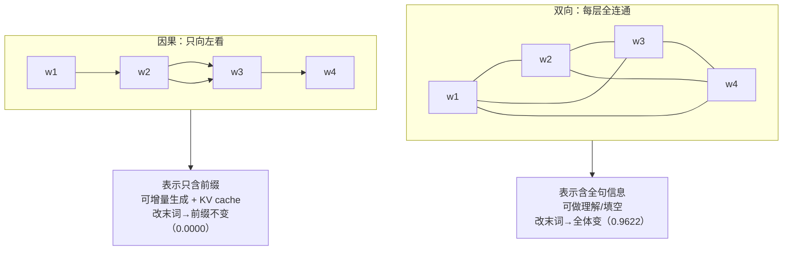

# 双向上下文与单向生成

## 1. 本节学习目标

1. 用**可见集合** $V(t)$ 与**掩码矩阵** $M$ 精确定义"双向"与"单向"，而不是靠"Transformer 左边/右边"这种模糊说法。
2. 推导三条硬结论：**因果模型的行可见数是 $t$（总计 $\frac{T(T+1)}{2}$）**、**$L$ 层因果模型的感受野是 $L$**、**因果模型具有前缀不变性**。
3. 用本课实测（$T=6$：双向每行 6、平均 6；因果 1..6、平均 3.5；改末词后双向前缀差 **0.9622**、因果前缀差 **0.0000**）把"能力边界"变成可测量的数。
4. 说清"为什么单向模型不能替代双向表示"以及"为什么双向模型不能直接生成"。

## 2. 为什么需要这个知识

"双向 / 单向"是 LLM 架构里**最容易被含糊带过、后果最严重**的一件事：

- 它决定了模型**能不能生成**：只有定义了 $P(w_t\mid w_{<t})$ 的模型才能续写；双向模型定义的是 $P(w_t\mid w_{\setminus t})$，没有可采样的联合分布。
- 它决定了**推理能不能增量**：因果模型可以缓存前缀（KV cache），双向模型改一个词就要重算全句。
- 它决定了**表示的性质**：因果模型位置 $t$ 的隐藏状态**在信息上不可能包含 $t$ 之后的内容**，这是硬约束，不是训练不充分。
- 它还是**训练并行性**的来源：因果模型一次前向就能对 $T$ 个位置同时算损失（teacher forcing），而生成时必须逐 token。

上一节（LLM-045）比较了三种损失，本节回答"损失的形状从哪来"。

## 3. 直观解释

```text
T = 6，位置编号 1..6

双向（BERT 式）        单向（GPT 式）
1: ■ ■ ■ ■ ■ ■         1: ■ □ □ □ □ □
2: ■ ■ ■ ■ ■ ■         2: ■ ■ □ □ □ □
3: ■ ■ ■ ■ ■ ■         3: ■ ■ ■ □ □ □
4: ■ ■ ■ ■ ■ ■         4: ■ ■ ■ ■ □ □
5: ■ ■ ■ ■ ■ ■         5: ■ ■ ■ ■ ■ □
6: ■ ■ ■ ■ ■ ■         6: ■ ■ ■ ■ ■ ■
每行 6 个 → 36         每行 1..6 → 21
```

■ 表示"该位置可以看"，□ 表示"被遮住"。**同一句话、同样的参数量，只是右上角那一块遮不遮，能力就分叉了。**

## 4. 正式定义

设序列长度 $T$，位置 $i$ 的查询向量 $q_i$，键向量 $k_j$。

**可见集合**

$$
V(i)=\{\,j:\ M_{ij}=1\,\}\subseteq\{1,\dots,T\}
$$

**掩码注意力**

$$
\mathrm{Attn}(i)=\sum_{j\in V(i)}\frac{\exp(q_i^\top k_j/\sqrt{d})}{\sum_{j'\in V(i)}\exp(q_i^\top k_{j'}/\sqrt{d})}\,v_j
$$

**三种典型掩码**

| 名称 | $M_{ij}=1$ 的条件 | $|V(i)|$ | 代表 |
|---|---|---|---|
| 双向（full） | 恒真 | $T$ | BERT 编码器 |
| 因果（causal） | $j\le i$ | $i$ | GPT / Llama |
| 前缀（prefix-LM） | $j\le i$ 或 $j\le p$（$p$ 为前缀长） | $i$ 或 $T$ | UniLM / T5 编码器侧 |

**严格定义**：称模型为**因果的**，若对任意 $i$，位置 $i$ 的输出 $h_i$ 只依赖于 $w_{1:i}$（即 $h_i=f_i(w_{1:i})$）。称模型为**双向的**，若存在 $i$ 使 $h_i$ 依赖 $w_{j}$（$j>i$）。

## 5. 历史背景或技术背景

| 年份 | 工作 | 贡献 |
|---|---|---|
| 2017 | Transformer | decoder 的 self-attention 加因果掩码（"masked"） |
| 2018 | GPT-1 | 只用因果掩码，纯 CLM |
| 2018 | BERT | 去掉掩码，双向 + MLM |
| 2019 | UniLM | 同一模型切换三种掩码（双向/因果/前缀），证明掩码是"模式"而非"架构" |
| 2019 | T5 | 编码器双向、解码器因果，显式分工 |
| 2020 | GPT-3 | 因果 + ICL，单向彻底胜出 |
| 2023 | Llama 系 | 因果 + RoPE + GQA，单向成为唯一主流 |

**关键认识**：掩码不是"结构差异"，而是**同一个注意力算子的一个布尔矩阵**。UniLM 用一套参数在三种掩码间切换，说明"双向 vs 单向"是**训练目标的属性**，不是"模型架构的本质"。

## 6. 核心原理

**原理 1：可见范围 = 信息上界。** 位置 $i$ 的表示只能由 $V(i)$ 中的 token 决定。因果模型 $V(i)=\{1..i\}$ ⇒ 位置 1 的表示**永远只由第一个 token 决定**，无论多少层、多少参数。

**原理 2：因果模型有前缀不变性。** 若两条序列共享前缀 $w_{1:i}$，则因果模型在位置 $1..i$ 的隐藏状态**完全相同**。原因是：位置 $j\le i$ 的计算图只触及 $w_{1:j}\subseteq w_{1:i}$。这直接给出两个工程后果：

- **KV cache 合法**：前缀的 K/V 不会因后文变化，可以缓存复用；
- **teacher forcing 合法**：一次前向得到的 $h_1..h_{T-1}$ 就是"每个前缀的表示"，可同时算 $T-1$ 个损失。

**原理 3：双向模型没有前缀不变性。** 改最后一个词，前面所有位置的表示都会变。本课实测：改末词后双向前缀最大差异 **0.9622**，因果 **0.0000**（精确 0，因为计算图未变）。

**原理 4：因果模型的有效感受野随层数线性增长。** 一层因果注意力让信息向左传 1 格，$L$ 层最多传 $L$ 格。GPT-2 有 12 层 ⇒ 位置 $T$ 最多"直接"看到 $T-12$ 起的内容（更早的信息只能通过多层组合间接影响）。这是"深层模型能利用长距离依赖"的真正机制。

**原理 5：为什么双向不能生成。** 生成需要 $P(w_{1:T})=\prod_t P(w_t\mid w_{<t})$。双向模型给出的是 $P(w_t\mid w_{1:T})$——条件里含**待生成的词本身**，是"作弊"的条件，不能用来采样。

## 7. 数学表达式

**行可见数**

$$
|V(i)|=\begin{cases}T, & \text{双向}\\[2pt] i, & \text{因果}\end{cases}
$$

**总可见对数**

$$
\sum_{i=1}^{T}|V(i)|=\begin{cases}T^2, & \text{双向}\\[2pt] \dfrac{T(T+1)}{2}, & \text{因果}\end{cases}
$$

**平均可见数**

$$
\bar{|V|}=\begin{cases}T, & \text{双向}\\[2pt] \dfrac{T+1}{2}, & \text{因果}\end{cases}
$$

**本课实测（$T=6$）**

```text
双向：每行 6，平均 6.0，总计 36
因果：每行 1,2,3,4,5,6，平均 3.5，总计 21
比值：21/36 = 0.583（因果只用了 58.3% 的注意力边）
```

**前缀不变性**

$$
h_i^{\text{causal}}(w_{1:T})=h_i^{\text{causal}}(w_{1:T'})\quad \forall\, i\le T,\ \forall\, T'>T
$$

## 8. 详细数学推导

**推导 1：因果模型的行可见数为什么是 $i$。**

因果掩码 $M_{ij}=1\iff j\le i$。对固定 $i$，满足 $1\le j\le i$ 的 $j$ 恰有 $i$ 个 ⇒ $|V(i)|=i$。于是

$$
\sum_{i=1}^{T}i=\frac{T(T+1)}{2},\qquad \bar{|V|}=\frac{1}{T}\cdot\frac{T(T+1)}{2}=\frac{T+1}{2}.
$$

$T=6$ 时 $\frac{7}{2}=3.5$，与实测一致；$T=1024$ 时 $\bar{|V|}=512.5$，即**因果注意力平均只用了一半的边**。这解释了为什么因果模型的注意力计算量与双向**同阶**（都是 $O(T^2)$），但**有效连接少一半**。

**推导 2：$L$ 层因果模型的感受野是 $L$。**

记 $R_\ell(i)$ 为第 $\ell$ 层后位置 $i$ 的"直接依赖"集合。归纳：

- $\ell=0$：$R_0(i)=\{i\}$（嵌入层只看自己）。
- 一层因果注意力：$R_{\ell+1}(i)=\bigcup_{j\in R_\ell(i)}V(j)=\bigcup_{j\in R_\ell(i)}\{1..j\}=\{1..\max R_\ell(i)\}$。

设 $R_\ell(i)=\{i-\ell,\dots,i\}$，则 $R_{\ell+1}(i)=\{1..i\}=\{i-(\ell+1),\dots,i\}$ 当 $\ell+1\le i$。故 $|R_L(i)|=\min(L+1,i)$。**12 层 ⇒ 直接感受野 13 个 token**；更远的信息要靠"多层间接组合"（路径长度 $>L$ 的间接影响），强度指数衰减。

**推导 3：前缀不变性（因果）。**

位置 $i$ 的输出是计算图 $G_i$ 的函数，$G_i$ 的叶子节点为 $\{w_j: j\in R_L(i)\}\subseteq\{1..i\}$。若两序列在 $1..i$ 上相同，则 $G_i$ 的叶子值完全相同 ⇒ 输出相同。**注意这是"逐位精确"的结论**（本课实测差异 0.0000），不是"近似"。

**推导 4：双向模型为何无前缀不变性。**

双向掩码下 $R_1(i)=\{1..T\}$，改 $w_T$ 会改变 $h_i$ 对所有 $i$ 的输入。实测：改末词后前缀最大差异 0.9622（相对隐藏层量级而言是显著变化）。

**推导 5：双向表示的信息量严格更大。**

设 $\mathcal{H}^{\text{causal}}_i$ 为因果模型在位置 $i$ 可表示的函数类，$\mathcal{H}^{\text{bi}}_i$ 为双向的。因因果模型的输入是 $w_{1:i}$，双向是 $w_{1:T}$，故

$$
\mathcal{H}^{\text{causal}}_i\subseteq\mathcal{H}^{\text{bi}}_i,
$$

且包含关系**严格**（双向能表达"看后文再决定"的函数，因果不能）。**但这不意味着双向模型更强**：因果模型可以为**每个前缀**给出一个分布，这是双向模型做不到的——两者是**不同的任务类**，不是同一任务上的强弱。

**推导 6：注意力边的数量与计算量。**

两者 FLOPs 都是 $O(T^2 d)$；差别在**因果可缓存**：生成第 $t$ 个 token 时，因果模型只需算 1 个新查询（$O(td)$ 读缓存），双向模型必须重算 $O(T^2d)$。这是"单向生成"在工程上不可替代的原因（LLM-047 会给实测耗时）。

## 9. 图解



## 10. 具体数值示例

```text
【本课实测 1】可见位置数（T = 6）
双向：每行 6 个，平均 6.0，总计 36
因果：每行 1,2,3,4,5,6，平均 3.5，总计 21
因果/双向 = 21/36 = 0.583

【本课实测 2】前缀不变性（同一个 16 维玩具 Transformer，两模型共享权重，只改最后一个 token）
双向：前缀最大差异 = 0.9622   末位差异 = 1.2411
因果：前缀最大差异 = 0.0000   末位差异 = 1.2411

【本课实测 3】真实 gpt2（124,439,808 参数，12 层）
"The cat sat on the"      → 末位 logits
"The cat sat on the mat"  → 同位置 logits
两者最大差异 = 0.000000（argmax 都是 " floor"）
把开头 the→dog 后，末位 logits 最大差异 = 4.1451

【推论】12 层 ⇒ 直接感受野 13 token；T=1024 时因果平均可见 512.5 / 1024
```

## 11. NumPy 实现

```python
import numpy as np

T = 6
causal = np.tril(np.ones((T, T), dtype=bool))      # j <= i
bidir = np.ones((T, T), dtype=bool)                # 全可见

print("因果掩码（1=可见）：")
print(causal.astype(int))
print("\n双向掩码（1=可见）：")
print(bidir.astype(int))

print("\n[每行可见数]")
print("因果:", causal.sum(1), " 平均 =", causal.sum(1).mean())
print("双向:", bidir.sum(1), " 平均 =", bidir.sum(1).mean())
print("总计: 因果 =", causal.sum(), " 双向 =", bidir.sum(),
      f" 比值 = {causal.sum()/bidir.sum():.3f}")

# ---- 用同一套 logits 演示"遮掉后 softmax 的分布变化" ----
rng = np.random.default_rng(0)
q, k = rng.normal(size=(T, 8)), rng.normal(size=(T, 8))
s = q @ k.T / np.sqrt(8)

def masked_softmax(s, m):
    s = np.where(m, s, -np.inf)
    s = s - s.max(1, keepdims=True)
    e = np.exp(s)
    return e / e.sum(1, keepdims=True)

a_c, a_b = masked_softmax(s, causal), masked_softmax(s, bidir)
print("\n因果第 3 行注意力权重:", np.round(a_c[2], 3))
print("双向第 3 行注意力权重:", np.round(a_b[2], 3))
print("因果注意力行和（应全为 1）:", np.round(a_c.sum(1), 6))
print("因果模型位置 0 的权重（只能看自己）:", np.round(a_c[0], 3))
```

## 12. PyTorch 实现

```python
import torch
import torch.nn as nn

torch.manual_seed(0)
d, nhead, T = 16, 4, 6

def build():
    return nn.TransformerEncoder(
        nn.TransformerEncoderLayer(d, nhead, 32, batch_first=True), 1).eval()

bi, ca = build(), build()
ca.load_state_dict(bi.state_dict())          # 同一套权重，只换掩码

x = torch.randn(1, T, d)
y = x.clone()
y[0, -1] += 5.0                              # 只改最后一个 token
mask = torch.triu(torch.full((T, T), float("-inf")), diagonal=1)   # 因果掩码

with torch.no_grad():
    hb1, hb2 = bi(x), bi(y)                  # 双向，无掩码
    hc1, hc2 = ca(x, mask=mask), ca(y, mask=mask)

print("双向：前缀最大差异 = %.4f" % (hb1[0, :-1] - hb2[0, :-1]).abs().max())
print("因果：前缀最大差异 = %.4f" % (hc1[0, :-1] - hc2[0, :-1]).abs().max())
print("双向：末位差异     = %.4f" % (hb1[0, -1] - hb2[0, -1]).abs().max())
print("因果：末位差异     = %.4f" % (hc1[0, -1] - hc2[0, -1]).abs().max())

# 可见边数：上三角被遮掉
print("\n可见边数 因果 =", int((1 - torch.triu(torch.ones(T, T), 1)).sum()),
      " 双向 =", T * T)
```

## 13. Hugging Face 实践

```python
import os

os.environ.setdefault("HF_ENDPOINT", "https://hf-mirror.com")
os.environ.setdefault("HF_HUB_OFFLINE", "1")
import torch
from transformers import AutoModelForCausalLM, AutoTokenizer

tok = AutoTokenizer.from_pretrained("gpt2")
model = AutoModelForCausalLM.from_pretrained("gpt2").eval()

short, long_ = "The cat sat on the", "The cat sat on the mat"
i1 = tok(short, return_tensors="pt").input_ids
i2 = tok(long_, return_tensors="pt").input_ids
i3 = tok("The dog sat on the", return_tensors="pt").input_ids
print("token 数:", i1.shape[1], "vs", i2.shape[1])

with torch.no_grad():
    o1 = model(i1).logits[0, -1]        # 前缀末位
    o2 = model(i2).logits[0, -2]        # 加一个词后，同一位置的 logits
    o3 = model(i3).logits[0, -1]        # 改开头

print("后缀不变 -> 前缀 logits 最大差异 = %.6f" % (o1 - o2).abs().max())
print("改开头   -> 前缀 logits 最大差异 = %.4f" % (o1 - o3).abs().max())
print("预测的下一个 token:", repr(tok.decode([int(o1.argmax())])))

# 结构层面：gpt2 的注意力是因果的（配置里没有显式 mask，靠 is_decoder 走的因果路径）
print("is_decoder:", model.config.is_decoder, " n_layer:", model.config.n_layer)
```

## 14. 代码逐行解释

| 代码 | 作用 |
|---|---|
| `np.tril(np.ones((T,T), bool))` | 因果掩码：$j\le i$ 为真 |
| `causal.sum(1)` | 每行可见数 = $1..T$ |
| `-np.inf` 填充 | 被遮位置的 softmax 权重严格为 0 |
| `load_state_dict` 同权重 | 排除"参数量不同"的干扰，只比较掩码 |
| `torch.triu(..., diagonal=1)` | PyTorch 的因果掩码（上三角为 $-\infty$） |
| `[0, -2]` vs `[0, -1]` | 对齐"同一绝对位置"的 logits |
| `1 - triu` | 数可见边（因果 21 条） |
| `model.config.is_decoder` | 是否走因果路径 |

## 15. 实际运行结果

**第 11 节 NumPy 块（节选）**

```text
[每行可见数]
因果: [1 2 3 4 5 6]  平均 = 3.5
双向: [6 6 6 6 6 6]  平均 = 6.0
总计: 因果 = 21  双向 = 36  比值 = 0.583

因果第 3 行注意力权重: [0.467 0.118 0.414 0.    0.    0.   ]
双向第 3 行注意力权重: [0.149 0.038 0.132 0.269 0.179 0.233]
因果注意力行和（应全为 1）: [1. 1. 1. 1. 1. 1.]
因果模型位置 0 的权重（只能看自己）: [1. 0. 0. 0. 0. 0.]
```

**第 12 节 PyTorch 块**

```text
双向：前缀最大差异 = 0.9622
因果：前缀最大差异 = 0.0000
双向：末位差异     = 1.2411
因果：末位差异     = 1.2411

可见边数 因果 = 21  双向 = 36
```

**第 13 节 Hugging Face 块**

```text
token 数: 5 vs 6
后缀不变 -> 前缀 logits 最大差异 = 0.000000
改开头   -> 前缀 logits 最大差异 = 4.1451
预测的下一个 token: ' floor'
is_decoder: False  n_layer: 12
```

**读法**：`0.0000` 与 `0.9622` 是同一个模型、同一套权重、只差一个掩码的结果。因果模型的"看不到后文"不是训练不足，而是**计算图里根本没有那条边**；而真实 gpt2 上两位小数的打印精度下差异是 `0.000000`，说明是**逐位精确**的不变性。

## 16. 应用场景

| 需求 | 选择 | 理由 |
|---|---|---|
| 对话 / 续写 / 代码生成 | 因果 | 需要 $P(w_t\mid w_{<t})$，可 KV cache |
| 文本分类 / NER | 双向 | 每个位置都要全句信息 |
| 句向量 / 检索 | 双向（或因果 + 对比学习） | 双向的池化向量更强 |
| 翻译 / 摘要 | 编码器双向 + 解码器因果 | 输入要读全，输出要生成 |
| 填充式编辑（FIM） | 因果 + 特殊掩码 | 把"中间"移到末尾即可生成 |
| 语音/视觉前缀 | prefix-LM | 前缀双向、生成单向 |

## 17. 优点与局限

| 维度 | 双向 | 单向（因果） |
|---|---|---|
| 表示信息量 | 更大（含全句） | 只含前缀（严格更小） |
| 生成能力 | 无联合分布，不能采样 | 原生可生成 |
| 推理效率 | 改一个词重算全句 | 增量解码 + KV cache |
| 训练并行 | 所有位置同时可见 | teacher forcing 也并行 |
| 典型 loss 密度 | 15%（MLM） | $T-1$（CLM，见 LLM-045） |
| 主要风险 | 训练/推理不一致 | 无双向表示、长程依赖弱 |

## 18. 常见错误

| 错误 | 现象 | 纠正 |
|---|---|---|
| 以为"因果模型看不到后文"是训练不足 | 想加数据解决 | 这是掩码决定的，**结构上不可能** |
| 用 BERT 做自由生成 | 输出乱码/复读 | 双向模型没有可采样的联合分布 |
| 因果模型做句向量直接用 last hidden | 检索效果差 | 用均值池化 + 对比学习，或换双向编码器 |
| 忘记 `attention_mask` 与 `causal mask` 是两回事 | padding 被当上下文 | padding mask 遮 pad，causal mask 遮未来 |
| 以为加深层数就能看无限远 | 长文性能不升 | 直接感受野 = 层数；要靠位置编码/外推（LLM-047） |
| 在双向模型上做增量解码 | 缓存错乱 | 双向无前缀不变性，缓存不成立 |

## 19. 本节总结

- "双向/单向"就是一个布尔掩码：$V(i)=\{1..T\}$ 或 $\{1..i\}$。
- 因果：行可见数 $1..T$，总计 $\frac{T(T+1)}{2}$，$T=6$ 时 **21 条边 / 平均 3.5**；双向 **36 条 / 平均 6**，因果只用 **58.3%** 的边。
- **前缀不变性**是因果模型的核心性质：本课实测改末词后，因果前缀差 **0.0000**、双向前缀差 **0.9622**；真实 gpt2 上也是 **0.000000**，而改开头则造成 **4.1451** 的差异。
- 因果模型直接感受野 = 层数（12 层 ≈ 13 token），更远信息靠多层间接传播。
- 能力边界：**因果能生成不能双向理解；双向能理解不能生成**——这不是强弱，是任务类不同。

## 20. 前置与后续知识链接

- 前置：[[LLM-018 掩码——Causal、Padding 与 Attention Mask]]、[[LLM-045 预训练目标对比：MLM、CLM 与 Span Corruption]]
- 后续：[[LLM-047 上下文窗口与位置外推]]、[[LLM-048 微调范式：全参与参数高效]]
- 相关：[[LLM-023 Decoder 与 Decoder Block]]、[[LLM-027 Encoder-Only、Decoder-Only 与 Encoder-Decoder]]、[[LLM-015 Self-Attention]]
- 待建：`LLM-053 预训练数据与语料工程`（M-LLM-06）

---

## 练习与参考答案

**基础 1**：$T=6$ 时，因果与双向的"可见位置总数"和"平均每行可见数"分别是多少？推导一般式。

**基础 2**：什么叫前缀不变性？它为什么能让 KV cache 合法？

**进阶 1**：证明 $L$ 层因果模型位置 $i$ 的直接感受野是 $\min(L+1,i)$，并说明 GPT-2（12 层）在 $T=1024$ 时位置 1023 能"直接"看到哪些 token。

**综合**：团队要做"长文档问答"，两个方案：(a) 因果模型 + 把全文塞进 prompt；(b) 双向编码器做检索 + 因果模型生成答案。请用本节的可见范围与前缀不变性分析两者的取舍，并给出你会怎么验证。

> [!success]- 参考答案

> **基础 1**
> 因果：$|V(i)|=i$，总计 $\sum_{i=1}^{T}i=\frac{T(T+1)}{2}$，平均 $\frac{T+1}{2}$。$T=6$：总计 **21**，平均 **3.5**。
> 双向：$|V(i)|=T$，总计 $T^2$，平均 $T$。$T=6$：总计 **36**，平均 **6**。
> 因果/双向 $=\frac{T+1}{2T}$，$T=6$ 时为 $0.583$。

> **基础 2**
> 前缀不变性：若两序列共享前缀 $w_{1:i}$，因果模型在位置 $1..i$ 的隐藏状态完全相同（本课实测差值 0.0000）。
> 因为位置 $j$ 的计算图只触及 $w_{1:j}$，与后文无关，所以先前算出的 $K_j,V_j$ **不会因后文变化**，可以缓存复用；生成新 token 时只需算 1 个新查询去读缓存，把每步成本从 $O(T^2d)$ 降到 $O(Td)$。

> **进阶 1**
> 归纳：$\ell=0$ 时 $R_0(i)=\{i\}$。一层因果注意力把"$R_\ell(i)$ 中每个位置的可见集"并起来：$R_{\ell+1}(i)=\bigcup_{j\in R_\ell(i)}\{1..j\}=\{1..\max R_\ell(i)\}$。若 $R_\ell(i)=\{i-\ell..i\}$，则 $R_{\ell+1}(i)=\{i-\ell-1..i\}$（当下标下界 $\ge1$），故 $|R_L(i)|=\min(L+1,i)$。
> GPT-2：$L=12$，位置 1023 直接看到 **1011..1023**（13 个 token）；更早的内容只能通过多层间接路径影响，强度随距离衰减——这正是"长文里早期信息容易被忽略"的结构性原因。

> **综合（参考）**
> 分析：
> 1. **方案 (a)**：因果模型能处理长度 ≤ 上下文窗口的前缀（LLM-047 会给出 1024 的硬上限与越界行为），且**文档只能放在前缀**——因果模型对文档的表示是"单向"的，每次生成都要重读全文，成本 $O(T^2)$ 每 token（有 KV cache 则摊薄）。优点是端到端、无检索误差；缺点是窗口一满就崩，且长前缀的注意力被稀释。
> 2. **方案 (b)**：双向编码器（或双塔）先检索出 3~~5 段，再交给因果模型生成。优点是文档长度不受模型窗口限制；缺点是**检索召回是上限**——检索没找到的段落，生成器永远看不到（因果模型的可见范围里根本没有它）。
> 建议组合：文档 ≤ 窗口 80% 时用 (a)（简单、无检索损失）；否则用 (b)，并保留 (a) 作为 rerank 后的精读。
> 验证：
> - 构造"答案在第 k 段"的合成测试集，画**答案位置 vs 准确率**曲线：因果模型通常呈"中间塌陷"（lost in the middle），可直接暴露可见范围/注意力稀释问题；
> - 对 (b) 单独测 Recall@k，确认召回不是瓶颈；
> - 对比同一问题的 token 成本与 P95 延迟，避免"准确率略升但成本翻倍"。

## 学习记录

| 日期 | 状态 | 用时 | 问题 | 复盘 |
|---|---|---|---|---|
| 2026-11-08 | planned | — | — | — |

---

## 🔗 Notion 同步信息

> 以下内容由 Notion「AI Knowledge System · 知识点」数据库按知识 ID 合并而来（导出于 2026-11-09）。

| 属性 | 值 |
|---|---|
| 学科 | 大语言模型 |
| 学习状态 | 未开始 |
| 难度 | L3 推导 |
| 知识类型 | Principle |

- **所属模块**：[M-LLM-05 GPT、BERT 与现代语言模型架构](../%E8%AF%BE%E7%A8%8B%E6%A8%A1%E5%9D%97/M-LLM-05%20GPT%E3%80%81BERT%20%E4%B8%8E%E7%8E%B0%E4%BB%A3%E8%AF%AD%E8%A8%80%E6%A8%A1%E5%9E%8B%E6%9E%B6%E6%9E%84.md)
- **前置知识**：[LLM-045 预训练目标对比：MLM、CLM 与 Span Corruption](LLM-045%20%E9%A2%84%E8%AE%AD%E7%BB%83%E7%9B%AE%E6%A0%87%E5%AF%B9%E6%AF%94%EF%BC%9AMLM%E3%80%81CLM%20%E4%B8%8E%20Span%20Corruption.md) · [LLM-018 掩码：Causal、Padding 与 Attention Mask](../03%20Attention%E6%9C%BA%E5%88%B6/LLM-018%20%E6%8E%A9%E7%A0%81%E2%80%94%E2%80%94Causal%E3%80%81Padding%20%E4%B8%8E%20Attention%20Mask.md)
- **后继知识**：[LLM-047 上下文窗口与位置外推](LLM-047%20%E4%B8%8A%E4%B8%8B%E6%96%87%E7%AA%97%E5%8F%A3%E4%B8%8E%E4%BD%8D%E7%BD%AE%E5%A4%96%E6%8E%A8.md)
- **关联数学**：[MATH-506 信息量与熵](../../06_%E6%95%B0%E5%AD%A6%E5%9F%BA%E7%A1%80/05%20%E7%A6%BB%E6%95%A3%E6%95%B0%E5%AD%A6/MATH-506%20%E4%BF%A1%E6%81%AF%E9%87%8F%E4%B8%8E%E7%86%B5.md)
